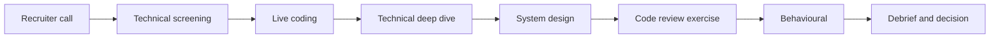

# 00. How to use this book (and how .NET interviews work)

## Why this chapter matters

A .NET interview is not one exam. It is a set of different rounds, and each round looks for
different signals. If you do not know what a round is measuring, you prepare the wrong way: you
memorize API names for a system-design round, or you draw boxes in a deep-dive round that wants
mechanisms. This chapter explains how interviews are structured, what separates the levels, and
how to use this book and its Anki cards so that the knowledge stays in long-term memory.

## What you will be able to do

- Describe the typical rounds of a .NET backend interview and what each one measures.
- Tell the difference between Senior and Staff signals, and aim your answers at your target level.
- Import the Anki decks of this book and use tags to study by chapter, topic or interview side.
- Follow a 4-week or a 2-week study plan mapped to chapters 01–14.
- Use the book from the interviewer side: question banks, probes and rubrics.

---

## How this book is organized

The book has 15 chapters. Chapters 01–13 each cover one topic area. Chapter 14 brings them
together into an interview playbook.

| # | Chapter | Main question it answers |
|---|---|---|
| 00 | How to use this book | How do interviews work, and how do I study? |
| 01 | C# and the .NET runtime | Do I have a correct model of the language and the runtime? |
| 02 | Code style and naming the Smartcat way | Can I write code that fits a large team's conventions? |
| 03 | Async and await in depth | Do I know what really happens at an `await`? |
| 04 | Multithreading, concurrency and distributed locks | Is my code correct on many threads and many pods? |
| 05 | ASP.NET Core | Do I know hosting, the pipeline, DI, configuration, APIs? |
| 06 | Architectural patterns at Smartcat | How do modules, bounded contexts and services fit together? |
| 07 | Domain events, the Outbox pattern and Kafka | How do I publish and consume events without losing or duplicating them? |
| 08 | Background task processing | How do long-running jobs work: state machine, fairness, canary? |
| 09 | MongoDB models, indexes and safe migrations | How do I model data and change it in production safely? |
| 10 | Unit and integration testing | How do I write tests that catch bugs and stay cheap to maintain? |
| 11 | Diff coverage | How do I test exactly what I changed? |
| 12 | Code review from both sides of the MR | How do I give and receive useful reviews? |
| 13 | Secure .NET code | How do I avoid the OWASP classics in real .NET services? |
| 14 | The interview playbook | How do I answer, and how do I run an interview? |

### The structure of every chapter

Every chapter from 01 to 14 has the same parts, so you always know where to look:

1. **Why this chapter matters** — what interviews test and why it matters in real work.
2. **What you will be able to do** — concrete outcomes. Use them as a self-check at the end.
3. **Main sections** — each has: concept, why, a C# example, a common mistake, a tip.
4. **At Smartcat** — how the topic looks in Smartcat code, with file paths from real repositories.
5. **Interview corner** — two parts:
   - *As the interviewee*: likely questions with "A strong answer covers:" bullets.
   - *As the interviewer*: what to ask, depth probes, green and red flags, a scoring rubric.
6. **Exercises** — tasks with short answer notes in a collapsible block.
7. **Summary** — the points to remember.
8. A footer with the name of the Anki deck for the chapter.

### General .NET vs "At Smartcat"

The book mixes two kinds of knowledge, and it keeps them apart on purpose:

- **General .NET truth.** How the GC works, what `ConfigureAwait(false)` does, how DI lifetimes
  behave. This is true in any company.
- **Smartcat convention.** For example: private methods are `camelCase` in the monolith, Mongo models
  use `required` + `init`, index names start with `IDX_` or `UDX_`, events go through an outbox with
  `PushEach`. These are team decisions, marked with "At Smartcat:".

Why this matters: in an interview at another company, a Smartcat convention is an *example of good
judgment*, not a universal rule. Say "In my last team we did X because Y". When the book is not sure
that a convention is general across Smartcat repos, it says "likely".

**Tip:** when a convention differs between repositories (it happens), the rule is "follow the repo
you are in". The book points out such differences where it knows them.

### Two ways to read the book

**As a candidate.** Read chapters in order, do the exercises, and study the cards every day. Before
the interview, read every "As the interviewee" section again and say the answers out loud. Speaking
is a different skill from reading.

**As an interviewer.** Read chapter 14 first (the plan, the question bank, the rubric, bias and
feedback). Then use the "As the interviewer" section of each chapter to choose questions and
probes for the round you run. The cards tagged `interviewer` train this side.

---

## How .NET interviews are structured

Most companies use a similar set of rounds for a backend engineer. The names and the order differ;
the goals are stable.



Not every company has every round. Smaller companies often combine deep dive and system design, or
replace live coding with a take-home task. Ask the recruiter for the list of rounds. It is a normal
question, and the answer tells you what to prepare.

### Round by round

| Round | Typical length | What they measure | What they do not care about much | Main chapters |
|---|---|---|---|---|
| Technical screening | 30–45 min | correct fundamentals, clear communication, basic fit for the level | perfect API recall | 01, 03, 05 |
| Live coding | 45–60 min | can you turn a problem into correct, readable, tested code while you talk | the cleverest algorithm | 01, 03, 10 |
| Technical deep dive | 60 min | depth: mechanisms, edge cases, production experience | breadth of buzzwords | 03, 04, 05, 07, 08, 09 |
| System design | 60 min | decomposition, tradeoffs, reliability, data modeling | a "correct" final diagram | 06, 07, 08, 09, 13 |
| Code review exercise | 30–45 min | judgment: what matters most, severity, security | style comments | 10, 12, 13 |
| Behavioural | 45 min | ownership, collaboration, conflict, learning, influence | heroic stories | 14 |

**Technical screening.** Short questions, often from a list: value vs reference types, `async` vs
threads, DI lifetimes, `IEnumerable` vs `IQueryable`. The interviewer checks that your model is
correct and that you can explain it simply. A screening is lost by confident wrong answers more
often than by "I do not know".

**Live coding.** A small problem in a shared editor, sometimes with a compiler, sometimes not. The
problem is often less important than the process: do you clarify, do you write examples, do you test
your code by walking through it? Chapter 14 has a checklist.

**Technical deep dive.** The interviewer picks a topic (often from your CV) and goes deeper until you
reach the limit of your knowledge. This is normal and expected: the goal is to find the limit. Typical
paths: `await` → state machine → `SynchronizationContext` → thread pool starvation; or Kafka →
consumer groups → at-least-once → idempotency → transactions.

**System design.** An open problem ("design a file translation pipeline"). There is no single right
answer. The interviewer looks at how you collect requirements, split the system, choose data
storage, handle failure, and explain tradeoffs. Chapter 14 has a full walkthrough.

**Code review exercise.** You get a snippet or a small merge request and 10–20 minutes. The signal is
*prioritization*: do you find the security hole and the data-loss bug before the naming issues?
Chapter 12 and chapter 14 have exercises.

**Behavioural.** Questions about your past: an incident, a disagreement, a mistake. Use STAR
(Situation, Task, Action, Result). The interviewer looks at your actions and judgment, not at the
team's achievements.

**Common mistake:** preparing only for coding. For Senior and Staff roles, system design, deep dive
and behavioural rounds usually decide the level.

**Tip:** for each round, ask yourself: "What signal does this interviewer need to write down?" Then
make that signal easy to see. Say your tradeoffs out loud. Say "I" in stories.

---

## Levels: Senior vs Staff signals

Levels are about **scope and independence**, not about years. The same question can show different
levels depending on the answer.

| Area | Mid | Senior | Staff |
|---|---|---|---|
| Scope | features | a component or service, end to end | a system or an area across several teams |
| Ambiguity | needs a clear task | turns a vague task into a plan | finds the problems that nobody has written down yet |
| Technical depth | knows the common traps | explains the mechanisms and edge cases | sets team rules and tooling so the traps do not happen |
| Design | follows the existing design | designs components with clear tradeoffs | decides boundaries (module vs service), plans migrations |
| Production | fixes bugs when assigned | owns incidents of their component | improves how the whole team detects and prevents incidents |
| Quality | writes tests when asked | tests behaviour, edge cases, races | defines test strategy; makes the right thing the easy thing |
| Influence | in the team | mentors, leads reviews | aligns several teams, product and management, often without authority |
| Communication | answers clearly | structures answers, states tradeoffs | adapts to the audience, writes decisions down, resolves disagreements with data |

**What a Staff-level answer sounds like.** A Senior answer solves the problem in front of them. A
Staff answer solves it, then asks "where else does this happen?" and "how do we make it impossible?".

Example question: "A Kafka handler created duplicate tasks. What do you do?"

- *Senior:* "Make the handler idempotent: store processed event ids with a unique index, in the same
  transaction as the task creation. Add a test that delivers the event twice."
- *Staff:* the Senior answer, plus: "Check the other handlers that create entities; move the
  idempotency into the base class so new handlers get it by default; add a review rule; add a metric
  for duplicate events so we see it next time."

**Common mistake:** trying to sound Staff-level by talking about large systems you did not own.
Interviewers probe, and a lack of real detail is visible fast. Talk about what you did; show scope
through *the effects* of your work.

**Tip:** before the interview, write down three examples where your work changed something beyond
your own task: a rule, a tool, a process, another team's design. These are your Staff-level stories.

---

## Studying with spaced repetition

### Why spaced repetition

Reading a chapter once gives you recognition: "I have seen this". An interview needs *recall*: you
must produce the answer without the text in front of you. Spaced repetition trains recall. Each card
asks a question; you answer from memory; the app shows the card again just before you would forget
it. Cards you know well appear rarely; difficult cards appear often. About 15–30 minutes a day is
enough to keep hundreds of cards in memory.

Two rules make it work:

1. **Answer before you look.** Say or think the full answer, then flip the card. If you only
   "recognize" the answer, press *Again*.
2. **Every day, a little.** Missing days creates a large pile of reviews. Twenty minutes every day is
   better than two hours on Sunday.

### The decks of this book

There is one deck file per chapter in the `anki/` folder: `anki/00-introduction.txt`,
`anki/01-csharp-and-runtime.txt`, and so on. Each file starts with header lines that tell Anki how to
read it:

```text
#separator:tab
#html:true
#notetype:Basic
#deck:DotNet Interview Guide::01 CSharp and Runtime
#tags column:3
```

- `separator:tab` — fields are separated by a tab character.
- `html:true` — fields contain HTML (`<br>`, `<code>`, `<pre>`), so code shows correctly.
- `notetype:Basic` — a simple front/back card.
- `deck:...` — the deck to import into. `::` creates a sub-deck, so all chapters appear under one
  parent deck "DotNet Interview Guide".
- `tags column:3` — the third column has the tags.

### How to import

You need Anki desktop version 2.1.55 or newer (any current version works).

1. Open Anki desktop.
2. **File → Import** and choose one `.txt` file from the `anki/` folder.
3. Check the import screen. Because of the headers, the mapping is already filled: separator *Tab*,
   *Allow HTML* on, note type *Basic*, the deck from the file, field 1 → Front, field 2 → Back,
   field 3 → Tags. You do not need to change anything.
4. Click **Import**. Repeat for each chapter file.
5. To study on a phone, sync with AnkiWeb. AnkiDroid can also import the files directly; on iOS,
   import on desktop and sync.

**Updating the cards.** If a new version of a deck file appears, import it again. Anki finds
existing notes by the first field (Front) and the note type. In the import options, set *Existing
notes* to **Update**, so your review history stays and only the content changes. A card whose front
text changed is treated as a new card.

**Common mistake:** importing with the note type "Basic (and reversed card)". Many cards (code on
the front, a list on the back) do not work in reverse. Use *Basic*, as the header says.

### Recommended Anki settings

- Turn on **FSRS** in the deck options (Anki 23.10 and newer). It is a modern scheduling algorithm
  that usually needs fewer reviews for the same memory. Keep *desired retention* at about 0.9.
- **New cards per day:** set it from your study plan (see below), usually 20–40.
- **Maximum reviews per day:** high enough not to hide reviews (for example 300). Hidden reviews come
  back later as a bigger pile.

### Using tags

Every card has tags. They let you study a slice of the material.

| Tag | Meaning | Example search |
|---|---|---|
| `chNN` | chapter number | `tag:ch03` |
| topic tags | for example `async`, `gc`, `outbox`, `idempotency` | `tag:idempotency` |
| `smartcat` | company-specific convention or pattern | `tag:smartcat` |
| `interviewer` | trains the interviewer side | `tag:interviewer` |

Ways to use them:

- **Browse.** Open *Browse* and type a search: `tag:ch07 tag:smartcat` shows Smartcat-specific cards
  of chapter 07. `-tag:interviewer` removes interviewer cards.
- **Focus before an interview.** *Tools → Create Filtered Deck* with a search such as
  `deck:"DotNet Interview Guide" (tag:ch06 OR tag:ch07 OR tag:ch08)`. Study the filtered deck the day
  before a system-design round.
- **Different goals.** Preparing for an interview at another company? Suspend the cards tagged
  `smartcat` (select them in Browse, then *Toggle Suspend*). Preparing to *run* interviews? Make a
  filtered deck with `tag:interviewer`.

**Tip:** when a card is wrong or unclear for you, edit it. A card you understand is better than a
"correct" card you do not. Keep the change small (one fact per card).

### How to answer a card well

- Say the short answer first, then one line of "why". This is also the structure of a good
  interview answer.
- For code cards ("What is wrong with this code?"), name the bug, the consequence and the fix.
- Press *Again* honestly. Pressing *Good* on a card you half-knew makes the schedule wrong.

---

## Study plans

Both plans assume about 1.5–2 hours on study days: reading and exercises (about 1 hour), cards (about
20–30 minutes), and speaking answers out loud (about 15 minutes). Adjust to your time; the order of
chapters is the important part.

The decks have about 40–80 cards per chapter, so the whole set is several hundred cards. Plan the
*new cards per day* so that you see every card at least once before the interview, and have a few
days of reviews after the last new card.

### 4-week plan

| Week | Days | Chapters | Focus | Practice |
|---|---|---|---|---|
| 1 | 1 | 00 | plan, Anki setup, list of rounds for your target company | import all decks; set new cards to ~30/day |
| 1 | 2–3 | 01 | runtime model, equality, LINQ, GC | exercises 1–6; explain "structs on the stack" out loud |
| 1 | 4 | 02 | Smartcat style, naming, models | review one of your own old MRs against the rules |
| 1 | 5–6 | 03 | async in depth | write and explain a sync-over-async bug |
| 1 | 7 | — | review day | cards only; re-read the summaries of 01–03 |
| 2 | 8–9 | 04 | concurrency, locks, multi-pod | explain a race you have seen in production |
| 2 | 10–11 | 05 | ASP.NET Core, DI, config | draw the middleware pipeline from memory |
| 2 | 12–13 | 06 | modular monolith, boundaries, services | explain when to extract a service |
| 2 | 14 | — | review day + first mock | one mock screening (30 min) with a colleague |
| 3 | 15–16 | 07 | events, outbox, Kafka | explain dual writes and idempotency without notes |
| 3 | 17–18 | 08 | background tasks | design a task with fairness and canary |
| 3 | 19–20 | 09 | MongoDB, indexes, migrations | plan a safe unique-index migration |
| 3 | 21 | — | review day + mock system design | the file pipeline from chapter 14, timed (45 min) |
| 4 | 22–23 | 10, 11 | testing, diff coverage | write tests for an exercise from chapter 01 |
| 4 | 24 | 12 | code review | the code-review exercise from chapter 14, timed |
| 4 | 25 | 13 | security | list the tenant-isolation checks for one of your APIs |
| 4 | 26 | 14 | playbook, STAR stories | write 6–8 STAR stories; say them with a timer |
| 4 | 27 | — | full mock loop | coding + design + behavioural with a colleague |
| 4 | 28 | — | rest | reviews only; no new material |

New cards: about 30 per day in weeks 1–3, then stop adding new cards around day 25 so the last days
are reviews only.

### 2-week plan

Use this when the interview date is close. It keeps all chapters but goes faster, and it is honest
about what to skip.

| Day | Chapters | Focus |
|---|---|---|
| 1 | 00, 01 (first half) | setup; value/reference types, equality, records, NRT |
| 2 | 01 (second half) | closures, LINQ, exceptions, Dispose, GC, collections |
| 3 | 03 | async in depth |
| 4 | 04 | concurrency and distributed locks |
| 5 | 05 | ASP.NET Core |
| 6 | 06, 02 (summary only) | architecture; read the chapter 02 summary and Smartcat rules |
| 7 | — | review + mock screening |
| 8 | 07 | events, outbox, Kafka |
| 9 | 08 | background tasks |
| 10 | 09 | MongoDB and migrations |
| 11 | 10, 11 | testing and diff coverage |
| 12 | 12, 13 | code review and security |
| 13 | 14 | playbook: STAR stories, design walkthrough, code-review exercise |
| 14 | — | mock loop in the morning, reviews only after |

New cards: this plan needs about 50–60 new cards per day, which is heavy. Reduce the load:

- Interview at another company? Suspend `smartcat` cards.
- Not running interviews soon? Suspend `interviewer` cards (except in chapter 14).
- Strong area already? Skim the chapter, do only its exercises, and suspend its easiest cards after
  the first review.

**Common mistake:** reading every chapter and doing no practice. Mock interviews and speaking
answers out loud give more value per hour in the last week than more reading.

---

## Mock interviews

A mock interview is a practice round with a colleague who plays the interviewer. It is the only way
to practise the pressure of a real round: the time limit, a person watching, and questions you did
not choose.

**How to run one (45–60 minutes):**

1. The "interviewer" picks the round type and 2–3 questions from the question bank in chapter 14.
   The candidate does not see them in advance.
2. Use a real timer and a shared editor or a whiteboard, the same tools as the real interview.
3. The interviewer uses the depth probes and does not help more than a real interviewer would.
4. At the end, 10 minutes of feedback with the rubric from chapter 14: one thing that went well, two
   things to change, and the level the answer showed.
5. Swap roles next time. Playing the interviewer teaches you what a good answer looks like from the
   other side.

**What to watch in your own recording** (with permission, record the mock):

- How long until your first useful sentence? More than 30 seconds of setup is too long.
- How many times did you say "we" when you meant "I"?
- Did you state at least one tradeoff for every design decision?
- Did you go silent for more than 20 seconds?

**Tip:** do at least two mocks of the round type you are weakest in. Most people avoid exactly that
round, and it is the one where practice helps most.

---

## Take-home tasks

Some companies replace live coding with a take-home task: a small service or feature, 2–6 hours of
work, reviewed later and often discussed in a follow-up call.

What reviewers look at, roughly in this order:

| Area | What a reviewer checks |
|---|---|
| Correctness | does it work for the stated cases and the obvious edge cases? |
| Structure | clear layers or modules; no business logic in controllers |
| Tests | tests for behaviour, including at least one failure path |
| Async and resources | `async` all the way, `CancellationToken` passed, no `.Result`, `using` for disposables |
| Configuration | typed options, no hard-coded secrets or URLs |
| README | how to run it, what you assumed, what you would do with more time |

**Common mistake:** building far more than asked (a full CQRS framework for a three-endpoint task).
It takes your time and it shows weak judgment of scope. Build the simple version well, and write the
"what I would add for production" list in the README.

**Tip:** treat the follow-up call as a code-review round. Expect "why did you choose this?" and "what
happens if two requests do this at the same time?". Prepare answers for your own code (chapters 03,
04 and 12 help).

---

## Before the interview day

A short checklist:

- [ ] You know the list of rounds and who the interviewers are (role, team).
- [ ] Your development environment works: the IDE, the .NET SDK version they use, the shared-editor
      tool if it is remote. Test the camera and microphone.
- [ ] You have your 6–8 STAR stories written down, each fitting in two minutes.
- [ ] You can give a two-minute overview of the system you know best.
- [ ] You have 3–5 questions for the interviewers.
- [ ] You did your Anki reviews, and you stopped new material a day before.

On the day: if you do not understand a question, ask for it again in other words. This is normal,
and in a team that works in a second language it is expected. A misunderstood question costs more
than a clarifying one.

---

## At Smartcat

- **The examples come from real repositories.** The book uses the Smartcat monolith
  (`smartcat/`, a .NET 10 modular monolith with `Features/*` as bounded contexts) and extracted
  services such as `project-tasks-service/`, `work-orders-service/`, `filedisassembling/` and
  `smartcat-ai-agents/`. Paths in the book point to these repositories so you can read the real code.
- **The conventions come from the team's review canon.** The AI Toolkit skills
  (`backend-smartcat-codestyle`, `backend-modulehosting-events`, `backend-modulehosting-tasks`,
  `review-architecture`, `review-security`, `review-dotnet-style`, `review-tests-backend` and others)
  are the source for "At Smartcat" sections. Rule ids such as A1 (DI lifetime mixing), S20 (missing
  `[Authorize]`) or D8 (exception as success indicator) are the same ids that review tools print in
  merge requests.
- **The team works in English as a second language.** Many engineers are Russian-native. The book uses
  short sentences and no idioms for this reason, and chapter 14 asks interviewers to do the same.
- **The interview loop uses the same patterns.** A system design round at Smartcat is likely to touch
  the outbox, idempotent consumers, background tasks with fairness, MongoDB indexes, and the
  modular-monolith vs service decision. Chapters 06–09 and 14 prepare for that.

---

## Interview corner

### As the interviewee

**1. "Walk me through your current system."**
A strong answer covers:
- A one-minute overview first: purpose, users, main components, your part in it.
- One hard technical problem and how it was solved.
- What you would change, and why.

**2. "What is the difference between Senior and Staff, in your view?"**
A strong answer covers:
- Scope: a component vs a system across teams.
- Preventing problems through rules, tools and design, not only fixing them.
- Influence without authority, with a real example.

**3. "How do you keep your knowledge up to date?"**
A strong answer covers:
- Concrete sources (release notes for .NET versions, design docs of your own company, incident
  reviews).
- A habit, not a one-time effort (for example spaced repetition, reading MRs of other teams).
- One recent thing you learned and used.

**4. "Why do you want this role?"**
A strong answer covers:
- Something specific about the product or the technical problems.
- How your experience fits, with an example.
- What you want to learn.

**5. "What questions do you have for us?"**
A strong answer covers:
- How the team works: reviews, on-call, how decisions are made.
- The main technical challenges of the role.
- How success is measured in the first months.

### As the interviewer

**What to ask.** Use this chapter to design the loop, not to ask questions from it. Decide which
round measures which dimension, so rounds do not repeat the same questions and every dimension of the
rubric (chapter 14) gets evidence from at least one round.

**Depth probes** for the opening "walk me through your system":
- "Which part did you build yourself?"
- "What broke in production, and how did you find out?"
- "If the load grew ten times, what would fail first?"

**Green flags:**
- Clear structure; separates own work from the team's.
- Talks about failure and learning without being asked.
- Knows the numbers of their own system (traffic, data size, latency).

**Red flags:**
- Only buzzwords, no concrete details on probing.
- Cannot say which part was theirs.
- No interest in how the team works.

**Scoring rubric (for the opening question):**

| Level | Signal |
|---|---|
| Junior | describes the features of the product |
| Mid | describes the components and their own feature work |
| Senior | explains design decisions, tradeoffs and incidents of their component |
| Staff | explains why the system is shaped this way, what they changed across teams, and what they would change next |

---

## Exercises

1. **Map your target loop.** Ask the recruiter (or a colleague who interviewed there) for the list of
   rounds. Write down, for each round, what it measures and which chapters prepare for it.
2. **Import and configure.** Import all deck files, turn on FSRS, set new cards per day from your
   plan, and create one filtered deck with `tag:interviewer`.
3. **Level self-check.** Use the levels table. For each row, write one example from your own work.
   Where you have no example for your target level, note a story to look for or a gap to close.
4. **Opening answer.** Prepare a two-minute "walk me through your system" answer. Record it, listen,
   and cut everything that is not your own decision or result.
5. **Plan your weeks.** Choose the 4-week or 2-week plan, put the days in your calendar, and book two
   mock interviews now.

<details>
<summary>Answer notes</summary>

1. A typical result: screening (01, 03, 05), coding (01, 03, 10), deep dive (03–05, 07–09), system
   design (06–09, 13), behavioural (14). If the company has a code-review round, add 12 and 13.
2. Check that the decks appear under one parent deck "DotNet Interview Guide", that code shows
   formatted (HTML on), and that the filtered deck contains only interviewer cards.
3. Most candidates find gaps in "Influence" and "Production" rows. Those are the stories that
   decide Senior vs Staff, so they are worth the most preparation time.
4. A good answer has a structure: purpose (15 s), components (30 s), your part and one hard problem
   (60 s), what you would change (15 s).
5. Booking mocks early matters: they are the step people skip when time is short, and they give
   the most value.

</details>

---

## Summary

- An interview is a set of rounds; each round measures a different signal. Ask for the list.
- System design, deep dive and behavioural rounds usually decide Senior vs Staff.
- Levels are about scope and independence. Staff answers fix the problem and prevent the class of
  problem.
- The book separates general .NET truth from "At Smartcat" conventions. Follow the repo you are in.
- Import each `anki/NN-*.txt` file with File → Import; the headers do the mapping.
- Use tags (`chNN`, topics, `smartcat`, `interviewer`) to study a slice of the material.
- Answer the card before you flip it; press *Again* honestly; study every day.
- Use the 4-week plan if you can; the 2-week plan works with suspended tags and fewer new cards.
- Speak answers out loud and do mock interviews. Reading alone gives recognition, not recall.

Anki deck: anki/00-introduction.txt
