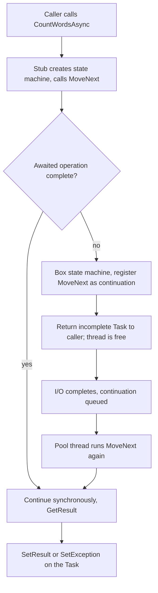
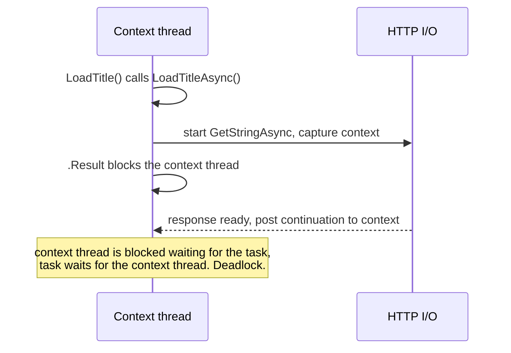

# 03. Async and await in depth

## Why this chapter matters

Almost every .NET interview has async questions. Some are simple ("what does `await` do?"). Many are
not: "why does this code deadlock?", "why did the service stop answering when CPU was at 10%?", "why
did this exception disappear?". The answers show if a candidate understands the runtime or only the
syntax. In real work the stakes are high: one `.Result` on a hot path, or one `async void` handler,
can make a whole pod fail under load. Every Smartcat service is an ASP.NET Core host that talks to
MongoDB, Kafka and other services over the network, so almost all of our code is async.

## What you will be able to do

- Explain what the compiler generates for an `async` method and what the awaiter pattern is.
- Choose between `Task` and `ValueTask`, and list the rules that make `ValueTask` safe.
- Explain `SynchronizationContext`, `ConfigureAwait(false)` and why sync-over-async is dangerous even
  in ASP.NET Core, where it does not deadlock.
- Write correct cancellation, timeout, throttling and streaming code, and test it with a fake clock.
- Diagnose thread-pool starvation with `dotnet-counters`, `dotnet-stack` and `dotnet-dump`.
- Review async code against the Smartcat rules (D6, D15, A7, A9, A20, T8).

## 1. The mental model: async is about threads you do not block

**Concept.** Most server code is I/O-bound: it waits for MongoDB, Kafka, HTTP or disk. A synchronous
call holds a thread while the network card and the remote server do the work. An asynchronous call
gives the thread back to the thread pool while the I/O is pending. When the I/O completes, the
runtime takes any free pool thread and continues the method from where it stopped.

**Why it matters.** Threads are expensive (each reserves a stack of 1 MB or more, plus scheduling cost),
and the thread pool adds new threads slowly. A service with 200 requests waiting on Mongo needs 200
threads in the sync model, and only a handful in the async model. Async does not make one request
faster. It makes the service handle more requests with the same resources.

| | Synchronous I/O | Asynchronous I/O |
|---|---|---|
| Thread during the wait | Blocked, cannot do other work | Returned to the pool |
| Threads for 1000 concurrent waits | ~1000 | A few |
| Latency of one call | Same | Same (small overhead) |
| Failure mode under load | Thread-pool starvation | Downstream overload, if not throttled |

**Tip.** "There is no thread" while a true async I/O operation is pending. The OS completes the I/O
and the runtime queues the continuation. If somebody tells you "`await` runs the code on a background
thread", that is the first misunderstanding to fix.

**Common mistake.** Thinking that `async` makes CPU-bound work parallel. An `async` method that only
computes runs fully synchronously on the caller thread. For CPU work, see chapter 04
(Multithreading, concurrency and distributed locks).

## 2. What the compiler generates

### 2.1 The state machine

**Concept.** The C# compiler rewrites every `async` method into a state machine type. The original
method body moves into a `MoveNext()` method. Local variables that live across an `await` become
fields of the state machine ("hoisted" locals). A `state` field remembers which `await` the method is
waiting on.

This method:

```csharp
public async Task<int> CountWordsAsync(string path, CancellationToken cancellationToken)
{
    var text = await File.ReadAllTextAsync(path, cancellationToken);
    return text.Split(' ').Length;
}
```

becomes, in simplified form:

```csharp
// Simplified. The real type is a struct in Release builds and a class in Debug builds.
private struct CountWordsStateMachine : IAsyncStateMachine
{
    public int State;                              // -1 = running, 0 = waiting at await #1, -2 = done
    public AsyncTaskMethodBuilder<int> Builder;    // creates and completes the returned Task<int>
    public string Path;                            // parameters become fields
    public CancellationToken CancellationToken;
    private TaskAwaiter<string> _awaiter;          // the awaiter of the pending operation

    public void MoveNext()
    {
        int result;
        try
        {
            if (State != 0)
            {
                _awaiter = File.ReadAllTextAsync(Path, CancellationToken).GetAwaiter();
                if (!_awaiter.IsCompleted)
                {
                    State = 0;
                    // Registers MoveNext as the continuation and returns the thread to the caller.
                    Builder.AwaitUnsafeOnCompleted(ref _awaiter, ref this);
                    return;
                }
            }

            State = -1;
            var text = _awaiter.GetResult();       // returns the value or throws the stored exception
            result = text.Split(' ').Length;
        }
        catch (Exception exception)
        {
            State = -2;
            Builder.SetException(exception);       // the exception goes INTO the task
            return;
        }

        State = -2;
        Builder.SetResult(result);
    }

    public void SetStateMachine(IAsyncStateMachine stateMachine) => Builder.SetStateMachine(stateMachine);
}
```

The public method becomes a small stub: it creates the state machine, copies the arguments, calls
`Builder.Start(ref stateMachine)` (which calls `MoveNext()` the first time, on the caller's thread)
and returns `Builder.Task`.

**Why it matters.** Three facts follow directly from this code, and interviews test all three:

1. **The method runs synchronously until the first `await` of an incomplete operation.** If every
   awaited operation is already complete, the whole method runs synchronously and nothing is queued.
2. **Exceptions do not escape the call.** They are caught and stored in the returned task. The caller
   sees them only when it awaits the task (or reads `.Result`).
3. **The state machine stays on the stack until it must wait.** In Release builds it is a struct. It
   is boxed onto the heap only at the first real suspension. So the "fast path" (already completed)
   is cheap.



### 2.2 The awaiter pattern

**Concept.** `await` does not require `Task`. It works on any expression whose type has an accessible
`GetAwaiter()` method (instance or extension). The awaiter type must have:

- `bool IsCompleted { get; }`
- `void OnCompleted(Action continuation)` (from `INotifyCompletion`), and optionally
  `UnsafeOnCompleted` (from `ICriticalNotifyCompletion`, which does not flow `ExecutionContext`
  because the builder flows it itself);
- `GetResult()`, which returns the value (or `void`) and throws if the operation failed.

This is pattern-based ("duck typing"), like `foreach` and `GetEnumerator()`. That is why
`Task.Yield()`, `ValueTask`, `ConfiguredTaskAwaitable` and even custom types can be awaited.

**Interviewer view.** "Can you `await` something that is not a `Task`?" separates people who know the
pattern from people who know only the syntax.

### 2.3 Argument validation and "eager" exceptions

Because exceptions go into the task, argument checks inside an `async` method do not fail at the call
site. They fail at the `await`, which can be far away.

```csharp
// BAD: the ArgumentException surfaces only when somebody awaits the task.
public async Task<Report> BuildReportAsync(Guid projectId, CancellationToken cancellationToken)
{
    if (projectId == Guid.Empty)
        throw new ArgumentException("Project id is empty.", nameof(projectId));

    var project = await _projects.GetAsync(projectId, cancellationToken);
    return Report.From(project);
}

// GOOD when eager validation matters (public library API): validate, then call a local async function.
public Task<Report> BuildReportAsync(Guid projectId, CancellationToken cancellationToken)
{
    ArgumentOutOfRangeException.ThrowIfEqual(projectId, Guid.Empty);
    return BuildCoreAsync();

    async Task<Report> BuildCoreAsync()
    {
        var project = await _projects.GetAsync(projectId, cancellationToken);
        return Report.From(project);
    }
}
```

**Tip.** In application code the first version is usually fine, because the caller awaits at once.
The split matters for libraries and for iterators.

### 2.4 Eliding `async` and `await`

You can return a task directly instead of awaiting it:

```csharp
public Task<Project?> GetAsync(Guid id, CancellationToken cancellationToken) =>
    _repository.FindAsync(id, cancellationToken);   // no state machine
```

This saves a state machine, but it changes behavior:

| | `return task;` (elided) | `return await task;` |
|---|---|---|
| Allocation | No state machine | State machine on first suspension |
| `using` / `try` around the call | **Disposed before the task completes** | Works as expected |
| Exceptions thrown synchronously by the callee | Thrown at the call site | Stored in the task |
| Stack trace | Method is missing from the trace | Method is present |
| `AsyncLocal` changes inside the method | Visible to the caller | Not visible to the caller |

```csharp
// BAD: the client is disposed while the request is still running.
public Task<string> DownloadAsync(Uri uri)
{
    using var client = new HttpClient();
    return client.GetStringAsync(uri);
}
```

**Recommendation.** Elide only in one-line pass-through methods with no `using`, `try` or extra logic.
When in doubt, write `async`/`await`. The cost is small; the bugs are not.

## 3. `Task`, `Task<T>`, `ValueTask` and `ValueTask<T>`

### 3.1 Task

**Concept.** A `Task` is a reference type that represents a future result: a promise. Many callers
can await it, at the same time, many times. You can store it, pass it to `Task.WhenAll`, and read its
result after completion. The runtime caches some completed tasks (`Task.CompletedTask`).

### 3.2 ValueTask

**Concept.** `ValueTask<T>` is a struct that holds either a result (synchronous completion, no
allocation), or a `Task<T>`, or an `IValueTaskSource<T>` (a pooled, reusable object). It exists for
hot paths where the result is usually available synchronously, for example a cache hit, or a buffered
stream read. `IAsyncEnumerator<T>.MoveNextAsync()` returns `ValueTask<bool>` for this reason.

**Why the rules exist.** When a `ValueTask` wraps a pooled `IValueTaskSource`, the source is reused
after you call `GetResult()`. A second await may read the result of a **different** operation.

**The ValueTask rules** (memorize them, they are a classic interview question):

1. Await it **once**. Never await the same `ValueTask` twice.
2. Never await it **concurrently** from two places.
3. Never call `.Result` or `.GetAwaiter().GetResult()` before it has completed.
4. If you need any of the above, call `.AsTask()` once and use the `Task`.

```csharp
// BAD: stored, awaited twice, and passed to WhenAll.
ValueTask<int> pending = _cache.GetCountAsync(key);
var first = await pending;
var second = await pending;                    // undefined behavior with pooled sources

// GOOD: consume it directly, or convert once.
var count = await _cache.GetCountAsync(key);

Task<int> asTask = _cache.GetCountAsync(key).AsTask();
await Task.WhenAll(asTask, otherTask);
```

| | `Task<T>` | `ValueTask<T>` |
|---|---|---|
| Kind | Class | Struct |
| Allocation on sync completion | Yes (unless cached) | No |
| Await many times / concurrently | Yes | No |
| Store in a field, `WhenAll` | Yes | Only after `.AsTask()` |
| Default choice | **Yes** | Only for measured hot paths |

**Common mistake.** Changing every `Task` to `ValueTask` "for performance". If the method almost
always completes asynchronously, `ValueTask` adds size and rules with no gain. Measure first.

## 4. SynchronizationContext and ConfigureAwait

### 4.1 What "capturing the context" means

**Concept.** When you `await` an incomplete task, the awaiter checks `SynchronizationContext.Current`.
If there is one, the continuation is **posted** to it. If not, it checks `TaskScheduler.Current`; if
that is not the default scheduler, the continuation is scheduled there. Otherwise the continuation
runs on the thread pool.

A `SynchronizationContext` is a "where must code run" abstraction:

| Host | SynchronizationContext | Meaning |
|---|---|---|
| WPF / WinForms / MAUI | Yes, single UI thread | Continuations return to the UI thread |
| Legacy ASP.NET (System.Web) | Yes, one request at a time | Continuations re-enter the request context |
| **ASP.NET Core** | **None** | Continuations run on any pool thread |
| Console app, worker service | None | Thread pool |
| Test frameworks | Depends on the framework (xUnit v2 installs its own) | Check before you rely on it |

### 4.2 ConfigureAwait(false)

**Concept.** `await task.ConfigureAwait(false)` tells the awaiter: do not capture the context, continue
on the thread pool.

**Why.** Two reasons: (1) it avoids the classic deadlock when somebody blocks on your code from a
context thread (section 5); (2) it avoids an extra hop back to the context, which is a small
performance gain.

**In ASP.NET Core application code** there is no context, so `ConfigureAwait(false)` changes nothing
in practice. **In library code** (NuGet packages, API clients, shared infrastructure), keep using it,
because you do not control the host. A WPF tool or a legacy service may call your library.

```csharp
// Library code: every await uses ConfigureAwait(false).
public async Task<ProjectDto> GetProjectAsync(Guid id, CancellationToken cancellationToken)
{
    using var response = await _http.GetAsync($"api/projects/{id}", cancellationToken).ConfigureAwait(false);
    response.EnsureSuccessStatusCode();
    return (await response.Content.ReadFromJsonAsync<ProjectDto>(cancellationToken).ConfigureAwait(false))!;
}
```

**Common mistake.** Putting `ConfigureAwait(false)` only on the first `await` and assuming the rest of
the method is "off the context". If the first awaited task is already complete, there is no
suspension, and the method is still on the original context at the second `await`.

**Common mistake 2.** Believing `ConfigureAwait(false)` makes `HttpContext` unsafe in ASP.NET Core.
`HttpContext` is not bound to a thread, so you can use it after `ConfigureAwait(false)`. But it is
**not thread-safe**: never use it from two parallel tasks at once.

### 4.3 ConfigureAwaitOptions (.NET 8)

.NET 8 added `ConfigureAwait(ConfigureAwaitOptions)` for `Task`. `SuppressThrowing` waits without
throwing (useful for best-effort cleanup; it is not allowed on `Task<T>`), and `ForceYielding` always
continues asynchronously, even when the task is already complete.

### 4.4 At Smartcat

At Smartcat: `smartcat-ai-agents/src/Smartcat.Maf.Workflow/` is a Smartcat-owned copy of a Microsoft
agent-framework library, and it uses `ConfigureAwait(false)` on almost every await, as library code
should. The application modules (`src/Module`, `src/API`) use it in some files and not in others.
Recommendation: in application code, follow the convention of the file you edit; in a package other
teams consume (for example an `*.ApiClient` project), use `ConfigureAwait(false)` everywhere.

## 5. Sync over async: deadlocks and starvation

### 5.1 The classic deadlock

**Concept.** "Sync over async" means blocking a thread until an async operation completes:
`task.Result`, `task.Wait()`, `task.GetAwaiter().GetResult()`.

With a single-threaded context (UI, legacy ASP.NET), this deadlocks:

```csharp
// Runs on the UI thread (or in a legacy ASP.NET request).
public string LoadTitle()
{
    return LoadTitleAsync().Result;            // 1. blocks the context thread
}

private async Task<string> LoadTitleAsync()
{
    var json = await _http.GetStringAsync(_url); // 2. continuation is posted to the context...
    return Parse(json);                          // 3. ...which is blocked by step 1. Deadlock.
}
```



`ConfigureAwait(false)` inside `LoadTitleAsync` breaks the cycle, but **every** await in the call
chain, including inside third-party code, must use it. The real fix is "async all the way": make
`LoadTitle` async too.

### 5.2 ASP.NET Core: no deadlock, but starvation

ASP.NET Core has no `SynchronizationContext`, so the code above does not deadlock there. It is still
harmful. Each blocked request holds a pool thread **and** needs a second pool thread to run the
continuation. Under load:

1. All pool threads are blocked in `.Result`.
2. The continuations that would unblock them wait in the pool queue.
3. The pool adds threads slowly (it injects new threads gradually after the minimum is used up,
   not all at once), so the queue grows.
4. Latency grows sharply, health checks time out, the pod is restarted, and the next pod repeats it.

This is **thread-pool starvation**. See section 16 for diagnosis.

### 5.3 The three ways to block, compared

| Call | Blocks? | Exception type you get |
|---|---|---|
| `task.Wait()` | Yes | `AggregateException` wrapping the real one |
| `task.Result` | Yes | `AggregateException` wrapping the real one |
| `task.GetAwaiter().GetResult()` | Yes | The original exception |

`GetAwaiter().GetResult()` is not "safer" against deadlocks. It only gives a nicer exception.

**When blocking is hard to avoid.** A synchronous interface you cannot change (some legacy framework
callbacks, `IDisposable.Dispose`, a few configuration hooks). Options, in order:

1. Make the caller async (`async Task Main`, `IAsyncDisposable`, `IHostedService.StartAsync`).
2. Use a sync API of the dependency if it has a real one (for example the sync Mongo driver methods).
3. Block with `GetAwaiter().GetResult()`, in one place, with a comment that says why, on a path that
   is not hot.

**Common mistake: async over sync.** The opposite anti-pattern: a library method
`Task<T> ReadAsync() => Task.Run(() => Read())`. It looks async but uses a pool thread to block on
sync I/O. Expose the sync method and let the caller decide.

## 6. `async void`, fire-and-forget and lost exceptions

### 6.1 async void

**Concept.** An `async void` method returns nothing awaitable. The caller cannot wait for it, cannot
catch its exceptions, and cannot know when it finishes. An exception in it is re-thrown on the
`SynchronizationContext` that was current at the start; with no context (ASP.NET Core, workers), it is
thrown on the thread pool and **crashes the process**.

`async void` exists only for event handlers (`button.Click += async (s, e) => ...`).

**The hidden async void.** An async lambda passed to a parameter of type `Action` or `Action<T>` is
`async void`:

```csharp
// BAD: each lambda is async void. ForEach returns before the work is done; an exception kills the process.
projects.ForEach(async project => await _indexer.IndexAsync(project, cancellationToken));

// BAD for the same reason: Parallel.ForEach takes Action<T>, not Func<T, Task>.
Parallel.ForEach(projects, async project => await _indexer.IndexAsync(project, cancellationToken));

// GOOD
foreach (var project in projects)
    await _indexer.IndexAsync(project, cancellationToken);

// GOOD (bounded parallel)
await Parallel.ForEachAsync(projects, cancellationToken,
    async (project, ct) => await _indexer.IndexAsync(project, ct));
```

Other common places: `System.Threading.Timer` callbacks, `List<T>.ForEach`, custom event APIs that
take `Action`.

### 6.2 Fire-and-forget

**Concept.** "Fire-and-forget" means starting a task and not awaiting it:

```csharp
// BAD in a controller
[HttpPost("{id}/reindex")]
public IActionResult Reindex(Guid id)
{
    _ = _indexer.ReindexAsync(id);   // the request returns at once
    return Accepted();
}
```

What goes wrong:

1. **Exceptions are lost.** Nobody awaits the task. Its exception is "unobserved". Since .NET 4.5 an
   unobserved exception does not crash the process; it raises `TaskScheduler.UnobservedTaskException`
   when the task is garbage-collected, which is late and usually not logged.
2. **The DI scope is gone.** The request scope is disposed when the response is sent. If
   `ReindexAsync` uses a scoped service (a repository, a `DbContext`-like unit of work), it fails with
   `ObjectDisposedException` at a random point.
3. **The work is lost on restart.** A deploy or a pod eviction kills the in-memory task. No retry.
4. **No cancellation, no backpressure.** A thousand requests start a thousand background tasks.

**Correct options**, from lightest to strongest:

| Need | Use |
|---|---|
| The caller can wait | Just `await` it |
| In-process background work, loss on restart is OK | `Channel<T>` + `BackgroundService` (chapter 04), create a new DI scope per item |
| Work must survive restarts and be retried | A persisted task (at Smartcat: the task processing framework, chapter 08) |
| Work is a reaction to a state change | A domain event through the Outbox (chapter 07) |

If you truly must fire-and-forget (for example a best-effort metric), attach a continuation that
logs the failure (`task.ContinueWith(..., TaskContinuationOptions.OnlyOnFaulted)`), so the exception
is at least visible.

**At Smartcat.** Background work that matters is a persisted task (Ordinary, Singleton or Sticky task
in `Smartcat.TaskProcessing`), not a `Task.Run` from a controller. The task is captured by one pod at a
time, retried with a recapture limit, and survives deploys. See chapter 08 (Background task processing).

## 7. Exceptions in async code

### 7.1 What `await` throws

**Concept.** A faulted `Task` stores an `AggregateException` in `task.Exception`, because a task can
have several failures (for example after `Task.WhenAll`). `await` unwraps it and throws **the first**
inner exception, with its original stack trace preserved (via `ExceptionDispatchInfo`).

So `catch` after `await Task.WhenAll(a, b)` sees only the first failure, even if both failed.

### 7.2 Getting all exceptions from Task.WhenAll

```csharp
var all = Task.WhenAll(LoadUsersAsync(), LoadProjectsAsync());
try
{
    await all;
}
catch
{
    // all.Exception is an AggregateException with every failure.
    foreach (var inner in all.Exception!.InnerExceptions)
        _logger.LogError(inner, "Load step failed.");
    throw;
}
```

**Important.** When one task in `WhenAll` fails, the others **keep running**. `WhenAll` completes only
when all tasks complete. If you want the others to stop, give them a shared `CancellationTokenSource`
and cancel it on the first failure.

### 7.3 Canceled is not failed

A task that ends with `OperationCanceledException` is in the `Canceled` state, not `Faulted`.
`await` throws `OperationCanceledException` (often its subtype `TaskCanceledException`). Always catch
the base type `OperationCanceledException`, and do not log it as an error when the caller asked for
it (section 8).

### 7.4 Exception filters

`catch ... when (...)` does not unwind the stack when the filter is false, and it keeps the code
readable:

```csharp
catch (MongoWriteException exception) when (exception.WriteError.Category == ServerErrorCategory.DuplicateKey)
{
    throw new GlossaryNameTakenException(name);
}
```

**Common mistake.** `catch (Exception) { return false; }` around an awaited call. It hides
cancellation (the request continues after the client left) and turns bugs into silent wrong
results. At Smartcat, review rule D8 flags exceptions used as a success indicator.

## 8. Cancellation

### 8.1 The cooperative model

**Concept.** Cancellation in .NET is cooperative. A `CancellationTokenSource` (CTS) owns the right to
cancel. A `CancellationToken` is the read-only view that you pass down. Code that receives a token
must check it (or pass it to APIs that check it). Nobody can force a running method to stop.

```csharp
public async Task<int> ExportAsync(IReadOnlyList<Segment> segments, Stream output, CancellationToken cancellationToken)
{
    var written = 0;
    foreach (var segment in segments)
    {
        cancellationToken.ThrowIfCancellationRequested();     // CPU loop: check explicitly
        await WriteSegmentAsync(segment, output, cancellationToken); // I/O: pass it down
        written++;
    }
    return written;
}
```

**Rules of thumb**

- Every async method that does I/O takes `CancellationToken cancellationToken` as the **last**
  parameter. Public APIs often give it `= default`.
- Pass the token to **every** call that accepts one. A token that is accepted and not passed is a bug.
- In ASP.NET Core, add a `CancellationToken` parameter to the action. The framework binds it to
  `HttpContext.RequestAborted`, which fires when the client disconnects.

### 8.2 Linked tokens and timeouts

```csharp
public async Task<Page> FetchPageAsync(Uri uri, CancellationToken cancellationToken)
{
    // Cancels when EITHER the caller cancels OR 10 seconds pass.
    using var timeout = CancellationTokenSource.CreateLinkedTokenSource(cancellationToken);
    timeout.CancelAfter(_fetchTimeout);

    try
    {
        return await _client.GetPageAsync(uri, timeout.Token);
    }
    catch (OperationCanceledException) when (!cancellationToken.IsCancellationRequested)
    {
        // The caller did not cancel, so it was our timeout.
        throw new TimeoutException($"Fetching {uri} took longer than {_fetchTimeout}.");
    }
}
```

**Why `using`.** A linked CTS registers a callback on the parent token. If you do not dispose it, the
registration lives as long as the parent, which for a long-lived token is a memory leak. A CTS with
`CancelAfter` also holds a timer.

### 8.3 Telling "who cancelled" apart

The filter `when (!cancellationToken.IsCancellationRequested)` is the standard way to tell a timeout
from a caller cancellation. A real example from Project Tasks Service
(`project-tasks-service/src/ProjectTasks.Module/Services/VolumeScopeManager.cs`):

```csharp
// a lock timeout must not fail the merge: Smartcat has already saved the merged document and cannot replay this call
private async Task<IAsyncDisposable> tryAcquireForProjectTask(ProjectTask projectTask, CancellationToken ct)
{
    try
    {
        return await _lockService.AcquireForProjectTask(projectTask, ct);
    }
    catch (OperationCanceledException) when (!ct.IsCancellationRequested)
    {
        return null;   // the lock wait timed out; the caller was not cancelled
    }
}
```

If the caller cancelled, the exception propagates. If only the lock wait ran out, the method returns
`null` and the caller takes another path.

At Smartcat, review rule A7 asks the same question one level higher: compensation logic in background
runs must distinguish **user cancel** from **infrastructure failure** (a lost worker, a pod shutdown),
for example with distinct exception types or a `CancellationReason` on the run record. A single
`OnCancellation` handler for both is a MAJOR finding.

### 8.4 Which token to pass: not always the caller's

Sometimes one caller's cancellation must not cancel shared work. A real example from
`smartcat-ai-agents/src/Module.UsageLimits/Packages/SubscriptionPackageResolver.cs` (shortened):

```csharp
private readonly ConcurrentDictionary<string, Lazy<Task<SubscriptionLookup>>> _pendingLookups = new();

private async Task<SubscriptionLookup> getSubscriptionAsync(string cacheKey, Guid workspaceId, CancellationToken cancellationToken)
{
    if (cache.TryGetValue(cacheKey, out SubscriptionLookup? cached) && cached is not null)
        return cached;

    var pending = _pendingLookups.GetOrAdd(
        cacheKey,
        _ => new Lazy<Task<SubscriptionLookup>>(
            () => readAndCacheSubscriptionAsync(cacheKey, workspaceId),   // uses CancellationToken.None inside
            LazyThreadSafetyMode.ExecutionAndPublication));

    return await pending.Value.WaitAsync(cancellationToken);           // each waiter can stop waiting alone
}
```

Several concurrent requests share one read ("single-flight"). The shared read runs with
`CancellationToken.None`, so a request that is aborted does not fail the read for the others. Each
caller uses `WaitAsync(cancellationToken)` to stop **waiting** when it is cancelled.

### 8.5 Common mistakes

- Accepting a token and not passing it to the Mongo or HTTP call.
- `catch (Exception)` that also catches `OperationCanceledException` and logs it as an error, or
  retries it.
- Returning HTTP 500 when the client disconnected. The client is gone; log at Debug/Information.
- Passing the request token into work that must finish after the response (writing the outbox after
  the commit, releasing a lock). Use `CancellationToken.None` there, on purpose, with a comment.
- `CancellationTokenSource.Cancel()` runs registered callbacks **synchronously** on the calling thread.
  A slow or throwing callback affects the code that calls `Cancel()`.

## 9. Timeouts and testable time

### 9.1 WaitAsync

**Concept.** `Task.WaitAsync(TimeSpan timeout)` / `WaitAsync(CancellationToken)` (.NET 6+) returns a
task that completes when the original completes **or** the timeout/cancellation fires, whichever is
first.

**Important.** `WaitAsync` **does not cancel the original operation**. It only stops waiting for it.
The original keeps running and may still write to the database. If the operation supports a token,
cancel it through the token instead, and use `WaitAsync` only for operations that cannot be cancelled.

### 9.2 TimeProvider

.NET 8 added `TimeProvider`, an abstraction over the clock and timers. Several APIs accept it:

```csharp
await task.WaitAsync(timeout, _timeProvider, cancellationToken);
await Task.Delay(retryDelay, _timeProvider, cancellationToken);
using var cts = new CancellationTokenSource(timeout, _timeProvider);
var now = _timeProvider.GetUtcNow();
```

In production you register `TimeProvider.System`. In tests you use `FakeTimeProvider` from the
`Microsoft.Extensions.TimeProvider.Testing` package and move time forward by hand:

```csharp
[Test]
public async Task Should_throw_timeout_when_probe_is_slower_than_limit()
{
    // Arrange
    var time = new FakeTimeProvider();
    var neverCompletes = new TaskCompletionSource<Verdict>(TaskCreationOptions.RunContinuationsAsynchronously);
    var probe = A.Fake<IProbe>();
    A.CallTo(() => probe.RunAsync(A<CancellationToken>._)).Returns(neverCompletes.Task);
    var sut = new ProbeRunner(probe, time, timeout: TimeSpan.FromSeconds(30));

    // Act
    Func<Task> act = async () =>
    {
        var run = sut.RunAsync(CancellationToken.None);
        time.Advance(TimeSpan.FromSeconds(31));
        await run;
    };

    // Assert
    Assert.ThrowsAsync<TimeoutException>(() => act());
}
```

The test takes milliseconds and never flakes, because no real time passes.

**At Smartcat.** Review rule T8 flags `DateTime.UtcNow` or `Guid.NewGuid()` inside a non-test class
without an injected clock, and time-related assertions without a frozen clock. `TimeProvider` is
injected widely in the newer services. Monolith tests commonly use the
`WaitAsync(timeout, TimeProvider, ct)` overload with a fake clock. The real-world example
`smartcat-ai-agents/src/ToolDiscoveryEvals/Datasets/LangfuseDatasetClient.cs` waits between retries
with `Task.Delay(_retryDelays[attempt], _timeProvider, cancellationToken)`.

**Common mistake.** A test that uses `Task.Delay(100)` to "let the background work finish". It is slow
and flaky on a busy CI agent. Use a fake clock, or a `TaskCompletionSource` that the fake signals.

## 10. Combining tasks: WhenAll, WhenAny, WhenEach

### 10.1 Task.WhenAll

Start independent operations first, then await them together. Total time is the slowest one, not the
sum.

```csharp
// BAD: sequential, total = users + projects + quotas
var users = await _users.GetAsync(workspaceId, ct);
var projects = await _projects.GetAsync(workspaceId, ct);
var quotas = await _quotas.GetAsync(workspaceId, ct);

// GOOD: concurrent, total = max(...)
var usersTask = _users.GetAsync(workspaceId, ct);
var projectsTask = _projects.GetAsync(workspaceId, ct);
var quotasTask = _quotas.GetAsync(workspaceId, ct);
await Task.WhenAll(usersTask, projectsTask, quotasTask);
var (users, projects, quotas) = (usersTask.Result, projectsTask.Result, quotasTask.Result); // safe: completed
```

**Careful.** Concurrent calls on one object that is not thread-safe (one `HttpContext`, one Mongo
session `IClientSessionHandle`, one non-thread-safe repository) are a bug. Each concurrent branch needs
its own instance or a thread-safe one.

**At Smartcat.** Review rule A20 (N+1 reads on a hot path) flags `foreach (var x in xs) await
repo.GetAsync(x.Id)` and also `xs.Select(async x => await GetAsync(x.Id))`. The fix is usually not
`WhenAll` but **one** query: collect ids, call `FindByIdsAsync(ids)`, and join the results in memory.
`WhenAll` over 500 single reads is still 500 round trips.

### 10.2 Task.WhenAny

Returns the **first** task that completes (successfully, faulted or canceled). It never throws by
itself.

```csharp
using var cts = CancellationTokenSource.CreateLinkedTokenSource(ct);
var primary = _primary.GetAsync(key, cts.Token);
var mirror = _mirror.GetAsync(key, cts.Token);

var winner = await Task.WhenAny(primary, mirror);
cts.Cancel();                    // stop the loser
return await winner;             // await the winner to get its result or exception
```

**Common mistakes:** not awaiting the returned task (exceptions are lost); not cancelling the losers
(they keep running and use resources); `WhenAny(work, Task.Delay(timeout))` without cancelling the
delay timer. For simple timeouts prefer `WaitAsync` or a timeout CTS.

### 10.3 Task.WhenEach (.NET 9)

Processes tasks **in completion order** as an `IAsyncEnumerable<Task<T>>`. It replaces the old
"loop with `WhenAny` and `Remove`" pattern, which was O(n²).

```csharp
var downloads = files.Select(file => _storage.DownloadAsync(file, ct)).ToList();

await foreach (var finished in Task.WhenEach(downloads))
{
    var content = await finished;     // completed; await to get result or throw
    await _indexer.IndexAsync(content, ct);
}
```

| API | Completes when | Throws on await | Use for |
|---|---|---|---|
| `WhenAll` | All complete | First exception (all in `.Exception`) | Independent work, need all results |
| `WhenAny` | First completes | Never (returns the task) | First wins, hedging, manual timeout |
| `WhenEach` (.NET 9) | Yields each in completion order | Per item, when you await it | Process results as they arrive |

## 11. Throttling: SemaphoreSlim and Parallel.ForEachAsync

**Concept.** Async makes it easy to start 10 000 operations at once. Your database, the downstream
service and the socket pool are not ready for that. Throttling limits how many run at the same time.

### 11.1 SemaphoreSlim as a throttle

```csharp
private readonly SemaphoreSlim _throttle = new(initialCount: 8, maxCount: 8);

public async Task TranslateAllAsync(IEnumerable<Document> documents, CancellationToken ct)
{
    var tasks = documents.Select(async document =>
    {
        await _throttle.WaitAsync(ct);
        try
        {
            await _translator.TranslateAsync(document, ct);
        }
        finally
        {
            _throttle.Release();      // always in finally, or a failure leaks a slot forever
        }
    });

    await Task.WhenAll(tasks);
}
```

This still creates one task object per document. For large inputs prefer `Parallel.ForEachAsync`.

### 11.2 Parallel.ForEachAsync (.NET 6)

```csharp
var options = new ParallelOptions { MaxDegreeOfParallelism = 8, CancellationToken = ct };
await Parallel.ForEachAsync(documents, options, async (document, token) =>
{
    await _translator.TranslateAsync(document, token);
});
```

It takes items from the source lazily, runs at most N bodies at once, stops taking new items after the
first exception, and passes a token that is cancelled on failure. Default `MaxDegreeOfParallelism` is
`Environment.ProcessorCount`, which is a CPU number; for I/O work, set it explicitly based on what the
downstream system can take.

**At Smartcat.** A real example in Project Tasks Service
(`project-tasks-service/src/ProjectTasks.Module/TaskProcessing/VendorAssignments/VendorAssignmentFixTaskProcessor.cs`):

```csharp
var logEntries = new ConcurrentBag<VendorAssignmentFixLogEntry>();

var parallelOptions = new ParallelOptions { MaxDegreeOfParallelism = _maxParallelRequestsToSmartcat };
await Parallel.ForEachAsync(taskScopes, parallelOptions, applyAssignment);
```

Two details are worth copying: the limit is a named, configurable value (not a magic number, rules D1
and A38), and results from the parallel bodies go into a `ConcurrentBag`, not a `List<T>`. A plain
`List<T>.Add` from parallel bodies corrupts the list (chapter 04).

**Common mistake.** `Parallel.ForEach` (the sync one) with an async lambda. It compiles, because the
lambda becomes `async void`, and it returns before any work finishes (section 6.1).

## 12. Async streams: IAsyncEnumerable and `await foreach`

### 12.1 Producing and consuming

**Concept.** `IAsyncEnumerable<T>` is a sequence whose items arrive asynchronously. An `async`
iterator combines `await` and `yield return`. The consumer uses `await foreach`.

```csharp
public async IAsyncEnumerable<Segment> ReadSegmentsAsync(
    Guid documentId,
    [EnumeratorCancellation] CancellationToken cancellationToken = default)
{
    using var cursor = await _segments.FindAsync(s => s.DocumentId == documentId, cancellationToken: cancellationToken);
    while (await cursor.MoveNextAsync(cancellationToken))
    {
        foreach (var segment in cursor.Current)
            yield return segment;
    }
}

await foreach (var segment in ReadSegmentsAsync(documentId, ct))
    await _writer.WriteAsync(segment, ct);
```

Memory use stays flat: items are processed while they arrive, not collected first.

### 12.2 `[EnumeratorCancellation]`

A consumer can pass a token in two ways: as an argument, or with `.WithCancellation(token)` on an
enumerable it received from someone else. `WithCancellation` passes the token to
`GetAsyncEnumerator(token)`. The compiler routes that token into the iterator **only** into the
parameter marked `[EnumeratorCancellation]`. Without the attribute, the token from `WithCancellation`
is silently ignored (the compiler gives a warning, CS8425).

```csharp
IAsyncEnumerable<Segment> segments = _source.ReadSegmentsAsync(documentId);
await foreach (var segment in segments.WithCancellation(ct).ConfigureAwait(false))
{
    // ...
}
```

**At Smartcat.** Agents in `smartcat-ai-agents` stream their answers as `IAsyncEnumerable<AgentResponseUpdate>`,
and `[EnumeratorCancellation]` appears in dozens of files. For example
`smartcat-ai-agents/src/Module/Narration/NarrationAgent.cs` merges the inner agent stream with
narration updates through a bounded channel inside an async iterator. Channels are covered in
chapter 04.

### 12.3 Streaming and common mistakes

A controller action can return `IAsyncEnumerable<T>`; `System.Text.Json` writes the JSON array while
items arrive. Common mistakes: calling `ToListAsync()` on a large stream (the streaming benefit is
lost), and forgetting that the iterator body starts only at the first `MoveNextAsync`, so validation
inside it runs late. Leaving `await foreach` early is safe: the compiler calls `DisposeAsync`, which
runs the iterator's `finally` blocks and disposes the cursor.

## 13. TaskCompletionSource

**Concept.** `TaskCompletionSource<T>` (TCS) creates a task that **you** complete by hand. It bridges
callback-based or event-based APIs to `await`.

```csharp
public Task<Message> WaitForReplyAsync(string correlationId, CancellationToken cancellationToken)
{
    var tcs = new TaskCompletionSource<Message>(TaskCreationOptions.RunContinuationsAsynchronously);
    _pending[correlationId] = tcs;

    var registration = cancellationToken.Register(() => tcs.TrySetCanceled(cancellationToken));
    tcs.Task.ContinueWith(_ => registration.Dispose(), TaskScheduler.Default);

    return tcs.Task;
}

private void OnReply(Message message)
{
    if (_pending.TryRemove(message.CorrelationId, out var tcs))
        tcs.TrySetResult(message);
}
```

### Why `RunContinuationsAsynchronously`

By default, `SetResult` runs the awaiting continuations **inline**, on the thread that calls
`SetResult`. In the example, that is the message-consumer thread. The continuation may do a lot of
work, take a lock the consumer already holds (deadlock), or call back into the consumer
(re-entrancy). `RunContinuationsAsynchronously` queues continuations to the thread pool, so
`SetResult` returns at once.

**Recommendation.** Always create a TCS with `TaskCreationOptions.RunContinuationsAsynchronously`,
unless you have measured a reason not to.

**Other rules:**

- Use `TrySetResult` / `TrySetException` / `TrySetCanceled` when more than one path can complete the
  TCS (reply, timeout, cancel). `SetResult` throws if the task is already complete.
- Make sure every TCS is completed on every path. A TCS that is never completed is an `await` that
  never returns, and a memory leak.
- The non-generic `TaskCompletionSource` (.NET 5+) exists for tasks without a result.

## 14. Async and object lifetime: constructors, Dispose, IAsyncDisposable

### 14.1 No async constructors

A constructor cannot be `async`. Do not call `.Result` in it either. Options:

```csharp
// Option 1: static factory
public sealed class TermIndex
{
    private readonly FrozenDictionary<string, Term> _terms;
    private TermIndex(FrozenDictionary<string, Term> terms) => _terms = terms;

    public static async Task<TermIndex> LoadAsync(ITermSource source, CancellationToken ct)
    {
        var terms = await source.ReadAllAsync(ct);
        return new TermIndex(terms.ToFrozenDictionary(t => t.Text, StringComparer.OrdinalIgnoreCase));
    }
}
```

- **Option 2: lazy initialization** on first use, guarded by `SemaphoreSlim` or `Lazy<Task<T>>`
  (chapter 04 shows both, with a real Smartcat example).
- **Option 3: initialize at startup** in `IHostedService.StartAsync` (or a module's warmup step), and
  keep the constructor cheap. DI constructors must be fast and must not do I/O.

### 14.2 IAsyncDisposable

```csharp
public sealed class ExportSession : IAsyncDisposable
{
    private readonly Stream _output;
    public ExportSession(Stream output) => _output = output;

    public async ValueTask DisposeAsync()
    {
        await _output.FlushAsync();
        await _output.DisposeAsync();
    }
}

await using var session = new ExportSession(stream);
```

**DI and async disposal.** The DI container calls `DisposeAsync` on scoped and singleton services when
the scope or the host is disposed with `DisposeAsync` (ASP.NET Core request scopes are). If a service
implements **only** `IAsyncDisposable` and its scope is disposed **synchronously**
(`using var scope = factory.CreateScope();`), the container throws `InvalidOperationException`. In
background code, use `await using var scope = scopeFactory.CreateAsyncScope();`.

**At Smartcat.** Distributed locks are released through `IAsyncDisposable`. A real example from
`VendorAssignmentFixTaskProcessor.cs`:

```csharp
await using var _ = await _lockService.AcquireForProjectTask(projectTask, Token);
```

The lock is released on every exit path, including exceptions. Chapter 04 explains the lock itself.

**Common mistake.** `public void Dispose() => FlushAsync().GetAwaiter().GetResult();` — sync over
async inside `Dispose`. Implement `IAsyncDisposable` instead, and keep `Dispose` for the sync path.

## 15. Task.Run in ASP.NET Core

**Concept.** `Task.Run` queues a delegate to the thread pool. In a request handler, the request
thread is already a pool thread. Moving work to another pool thread and awaiting it gives no benefit
and adds a context switch.

| Situation | Use Task.Run? |
|---|---|
| "Make this sync I/O call async" | **No.** Use the real async API |
| Start background work from a controller | **No.** See section 6.2 |
| CPU-heavy work inside a request | Rarely. It still uses a pool thread; consider a background queue |
| UI app: keep the UI thread free during CPU work | Yes, this is the classic use |
| Run several CPU-bound computations in parallel in a worker | Yes, or `Parallel.For` (chapter 04) |
| Long blocking loop that runs for the life of the process | `new Thread` or `TaskCreationOptions.LongRunning` |

**Trap: LongRunning with async delegates.** `Task.Factory.StartNew(async () => ..., LongRunning)`
creates a dedicated thread, but the thread exits at the first `await`. The rest runs on the pool.
`StartNew` with an async lambda also returns `Task<Task>`; you must call `.Unwrap()`. Prefer
`Task.Run`, which unwraps automatically, or a `BackgroundService`.

## 16. Thread-pool starvation: symptoms and diagnosis

### 16.1 Symptoms

- Latency grows sharply, while CPU use stays **low**.
- Health and readiness probes time out; Kubernetes restarts pods; the problem moves to the next pod.
- Kafka consumer lag grows; timers fire late.
- Thread count of the process grows slowly and steadily (the pool injects threads gradually).
- The thread-pool queue length stays above zero.

### 16.2 Tools

```bash
# Live counters: look at thread count, queue length, completed work items per second.
dotnet-counters monitor --process-id <pid> --counters System.Runtime
# .NET 9+ also publishes the System.Runtime meter with names such as dotnet.thread_pool.queue.length.

# Stack of every managed thread right now: many threads in Task.Wait / .Result = sync over async.
dotnet-stack report --process-id <pid>

# A dump for offline analysis.
dotnet-dump collect --process-id <pid>
dotnet-dump analyze <dump-file>
> clrstack -all        # all thread stacks
> dumpasync            # pending async state machines and what they wait for
> threadpool           # pool state: workers, queue

# A trace for a time window (CPU samples, contention, waits).
dotnet-trace collect --process-id <pid>
```

In Kubernetes you run these tools inside the pod (or a debug sidecar) and copy the files out.

### 16.3 What you look for

In `dotnet-stack` or `clrstack -all`, starvation looks like dozens of threads with the same top
frames: `Monitor.Wait` / `ManualResetEventSlim.Wait` / `Task.InternalWaitCore`, called from
`.Result` or `GetAwaiter().GetResult()` in your code. Find the frame from your code, and you have the
cause.

### 16.4 Fix

1. Remove the blocking call (async all the way).
2. If a synchronous dependency cannot be removed, move it out of the hot path or limit how many
   requests can call it at once.
3. `ThreadPool.SetMinThreads` makes the pool start more threads without delay. It is a **temporary**
   mitigation that hides the cause, not a fix.

**Interviewer view.** "CPU is 10%, latency is 30 seconds, what do you check?" is a strong open
question. A Senior answer mentions starvation and `dotnet-counters`. A Staff answer also explains why
the pool grows slowly, how to prove the cause from a dump, and why raising min threads is not the fix.

## 17. Async across boundaries: state and context

### 17.1 Mutable objects across `await` (Smartcat rule D6)

**Concept.** After an `await`, your method may run on a different thread, and other code may have run
in between. If an object you hold is shared and mutable, someone may have changed it.

```csharp
// BAD: a shared, mutable request object is modified after an await while other branches read it.
public async Task EnrichAsync(RunRequest request, CancellationToken ct)
{
    var glossaryTask = AttachGlossaryAsync(request, ct);   // reads request.Options
    request.Options.Language = await DetectLanguageAsync(request.Text, ct);   // writes it at the same time
    await glossaryTask;
}

// GOOD: immutable record, new value per step.
public sealed record RunRequest(string Text, RunOptions Options)
{
    public RunRequest WithLanguage(string language) => this with { Options = Options with { Language = language } };
}
```

At Smartcat, review rule D6 is MAJOR: classes with public setters reused after `await`, and lists or
dictionaries mutated in async methods on shared state. The fix is a `sealed record` with `With*`
methods, or passing values (not shared references) across each `await`.

### 17.2 HttpContext does not travel to the background (Smartcat rule A9)

`HttpContext` lives only while the request lives. `IHttpContextAccessor.HttpContext` is `null` in
background work. A tempting "fix" is to copy request state into the background job record:

```csharp
// BAD: snapshot of per-request state into a persisted background run.
var run = new AgentRun
{
    RunId = Guid.NewGuid(),
    IsAiPdfProcessingEnabled = (bool)HttpContext.Items["IsAiPdfProcessingEnabled"]!,
    UserCulture = CultureInfo.CurrentUICulture.Name,
};

// GOOD: store identity only; re-resolve flags where they are used.
var run = new AgentRun { RunId = Guid.NewGuid(), AccountId = user.AccountId, WorkspaceId = user.WorkspaceId };

// Later, in the worker:
var enabled = await _features.IsEnabledAsync(run.AccountId, FeatureKeys.AiPdfProcessing, ct);
```

Why: a snapshot freezes the flag at request time. If the flag is turned off for an incident, runs that
are already queued still see it on. It also spreads the decision across many places. Review rule A9
(MAJOR) and its security twin S4 (feature flag snapshotted into BSON) flag this.

### 17.3 ExecutionContext and AsyncLocal

`await` flows the `ExecutionContext`, so `AsyncLocal<T>`, tracing `Activity` and culture follow the
logical flow across threads. Why a mutable `AsyncLocal` is dangerous (rule S5) is in chapter 04.

## 18. Naming and signatures

- **`Async` suffix** for methods that return `Task`, `Task<T>`, `ValueTask`, `ValueTask<T>`. Do not add
  it to methods that do not return an awaitable. Methods that return `IAsyncEnumerable<T>` usually
  also get the suffix (`ReadSegmentsAsync`).
- **`CancellationToken cancellationToken` last.** Optional (`= default`) on public APIs is common.
- **Return `Task`, not `void`,** from every async method that is not an event handler.
- **Do not offer both sync and async versions** of the same method unless both are truly needed.

At Smartcat, rule D15 (NIT) flags `Task`-returning methods without the `Async` suffix and `Async`
methods that do not return a task; it exempts interface methods from external libraries. Some older
internal framework APIs predate the rule, for example `ToSleep`, `ToComplete` and `Capture` in the task
processing framework, or `AcquireForProjectTask` in Project Tasks Service. Follow D15 in new code; do
not rename old APIs inside an unrelated MR.

## At Smartcat

| Rule | Severity | What it catches | Section |
|---|---|---|---|
| D6 | MAJOR | Mutable objects shared across `await` | 17.1 |
| D8 | MAJOR | Exception as success indicator (often hides cancellation) | 7.4 |
| D15 | NIT | Missing or wrong `Async` suffix | 18 |
| A7 | MAJOR | One handler for user cancel and infra failure | 8.3 |
| A9 | MAJOR | HttpContext state snapshotted into background runs | 17.2 |
| A20 | MAJOR | N+1 awaited reads in a loop | 10.1 |
| A38 | MINOR | Timeouts and lease durations as magic numbers | 11.2 |
| T3 | MAJOR | `SemaphoreSlim` / `lock` without a concurrency test | chapter 04 |
| T8 | MINOR | Real clock in logic or tests; use `TimeProvider` | 9.2 |
| S5 | MAJOR | Mutable `AsyncLocal` for per-request state | chapter 04 |

Real code worth reading (read-only), in addition to the files quoted above:

- `smartcat-ai-agents/src/Module.UsageLimits/Pricing/Sources/CachedModelPriceProvider.cs` — an async
  refresh guarded by `SemaphoreSlim(1, 1)` with a double check (chapter 04).
- `project-tasks-service/src/ProjectTasks.Module/TaskProcessing/VendorAssignments/VendorAssignmentFixTaskProcessor.cs`
  — `Parallel.ForEachAsync` with a configured limit and `await using` for a distributed lock.
- `filedisassembling/src/Module/DistributedLock/DistributedSemaphore.cs` — a lease token that combines
  a lifetime timer with the caller token, and a renew loop that never throws out (chapter 04).

**At Smartcat: tests.** Backend tests use NUnit and FakeItEasy with Arrange/Act/Assert markers and
`Should_..._when_...` names (chapter 10). For async code this means: `Func<Task> act = () => sut.RunAsync(...)`
in the Act step, a `FakeTimeProvider` for anything with time, and `TaskCompletionSource` to control
when a fake dependency completes.

## Interview corner

### As the interviewee

**1. What does `await` actually do?**
A strong answer covers:
- Calls `GetAwaiter()`, checks `IsCompleted`; if complete, continues synchronously.
- If not, registers the rest of the method as a continuation and returns to the caller.
- The continuation runs on the captured context, or on the pool if there is none.
- No new thread is created by `await` itself.

**2. What does the compiler generate for an async method?**
A strong answer covers:
- A state machine (struct in Release) with `MoveNext`, a state field and hoisted locals.
- A method builder that creates and completes the returned task.
- Boxing only at the first real suspension; the synchronous fast path is cheap.
- Exceptions are stored in the task, not thrown to the caller.

**3. Task vs ValueTask: when and what are the rules?**
A strong answer covers:
- `ValueTask` avoids allocation when results are often synchronous; can wrap a pooled source.
- Await once, never concurrently, no `.Result` before completion, `.AsTask()` otherwise.
- `Task` is the default; switch only for measured hot paths.

**4. Why can `.Result` deadlock, and does it deadlock in ASP.NET Core?**
A strong answer covers:
- Single-threaded context + blocked thread + continuation posted to that context = deadlock.
- ASP.NET Core has no context, so no deadlock, but thread-pool starvation under load.
- Fix: async all the way; `ConfigureAwait(false)` in libraries.

**5. What is wrong with `async void`?**
A strong answer covers:
- Cannot be awaited; exceptions go to the context or crash the process.
- Only for event handlers.
- Hidden `async void` in lambdas passed as `Action` (`List.ForEach`, `Parallel.ForEach`, timers).

**6. A controller does `_ = DoWorkAsync();` and returns 202. What can go wrong?**
A strong answer covers:
- Lost exceptions (unobserved), disposed DI scope, work lost on restart, no backpressure.
- Alternatives: await, `Channel` + `BackgroundService` with a new scope, persisted task, outbox.

**7. How do exceptions work with `Task.WhenAll`?**
A strong answer covers:
- `await` throws the first one; `task.Exception.InnerExceptions` holds all.
- Other tasks keep running after a failure; cancel them with a shared CTS if needed.

**8. How do you implement a timeout correctly?**
A strong answer covers:
- Linked CTS + `CancelAfter`, disposed with `using`.
- `catch (OperationCanceledException) when (!callerToken.IsCancellationRequested)` to tell timeout from cancel.
- `WaitAsync` does not stop the original operation.
- Use `TimeProvider` so tests can control time.

**9. How should cancellation be handled in a Web API?**
A strong answer covers:
- Action parameter bound to `RequestAborted`; pass it everywhere.
- Do not log client aborts as errors or return 500.
- Use `CancellationToken.None` on purpose for work that must finish (cleanup, after-commit steps).

**10. You need to call an API for 5000 items. How?**
A strong answer covers:
- Not sequential, not unbounded `WhenAll`.
- `Parallel.ForEachAsync` with an explicit limit, or `SemaphoreSlim`.
- Better still: a batch endpoint, if the API has one.
- Thread-safe result collection.

**11. Why `RunContinuationsAsynchronously` on a TaskCompletionSource?**
A strong answer covers:
- Otherwise continuations run inline on the thread that calls `SetResult`.
- Risk of deadlock, re-entrancy, and slow producers.

**12. CPU is low, latency is high, pods restart. What is your plan?**
A strong answer covers:
- Suspect thread-pool starvation; check queue length and thread count with `dotnet-counters`.
- `dotnet-stack` / dump with `clrstack -all` to find blocking frames.
- Remove the sync-over-async; `SetMinThreads` only as a temporary mitigation.

**13. How do you test code that waits 30 seconds?**
A strong answer covers:
- Inject `TimeProvider`; use `FakeTimeProvider.Advance` in the test.
- Control dependency completion with `TaskCompletionSource`.
- No `Task.Delay` in tests.

### As the interviewer

**What to ask.** Start with code, not definitions. Show a 15-line method with one of these bugs and
ask "what does this do under load?":

- `.Result` inside a service method called from a controller.
- `list.ForEach(async x => ...)`.
- `_ = SendEmailAsync(...)` in a controller that uses a scoped repository.
- `using var client = ...; return client.GetAsync(...);` (elided await with using).
- A timeout with `CancellationTokenSource` that is never disposed and catches `Exception`.

**Depth probes.**

- "Where exactly does the code after `await` run in ASP.NET Core? In WPF?"
- "Why does the thread pool not just create 500 threads immediately?"
- "What does `WaitAsync` do to the original operation?"
- "Your shared lookup is cancelled by one request. How do you protect the other waiters?"
- "How would you make this background work survive a pod restart?"
- "What does the state machine look like when the awaited task is already complete?"

**Green flags.**

- Talks about threads being released, not "running in the background".
- Distinguishes deadlock (context) from starvation (pool).
- Passes tokens everywhere without being asked; separates timeout from cancel.
- Mentions throttling without being asked when there is a loop over many items.
- Knows how to prove a theory with a tool (`dotnet-counters`, a dump), not only guess.

**Red flags.**

- "Async makes code faster" or "await starts a new thread".
- Uses `Task.Run` to "make it async".
- Fixes a deadlock by adding `ConfigureAwait(false)` at one place and calling it done.
- Catches `Exception` around everything, including cancellation.
- Thinks `GetAwaiter().GetResult()` is a non-blocking alternative to `.Result`.

**Scoring rubric.**

| Level | Signals |
|---|---|
| Junior | Writes `async`/`await` correctly in simple cases; knows not to use `.Result`, but not why |
| Senior | Explains context capture, deadlock vs starvation, `ValueTask` rules, cancellation and throttling; avoids `async void` and fire-and-forget |
| Staff | Explains the state machine and awaiter pattern; diagnoses starvation with tools; designs single-flight, timeouts and background work for multi-pod systems; reviews code against concrete rules and explains the production impact |

## Exercises

1. **Find the bugs.** List every problem in this code and rewrite it:

   ```csharp
   public class ReportController : ControllerBase
   {
       private readonly IReportService _reports;
       public ReportController(IReportService reports) => _reports = reports;

       [HttpPost("reports")]
       public IActionResult Create(ReportRequest request)
       {
           var data = _reports.LoadDataAsync(request.ProjectId).Result;
           request.Rows.ForEach(async row => await _reports.ValidateAsync(row));
           _ = _reports.SendByEmailAsync(data);
           return Ok();
       }
   }
   ```

2. **Timeout with a fake clock.** Write `Task<T> WithTimeoutAsync<T>(Func<CancellationToken, Task<T>> operation, TimeSpan timeout, TimeProvider time, CancellationToken ct)`
   that cancels the operation after `timeout` and throws `TimeoutException` (but rethrows
   `OperationCanceledException` if `ct` was cancelled). Write two NUnit tests with `FakeTimeProvider`.

3. **Throttled fan-out.** You must call `ITranslationClient.TranslateAsync(segment, ct)` for 20 000
   segments. The downstream service accepts at most 16 concurrent calls. Write the code, collect all
   failures (do not stop at the first), and return a summary `(int Succeeded, IReadOnlyList<Exception> Failures)`.

4. **Single-flight cache.** Write `GetOrLoadAsync(string key, Func<CancellationToken, Task<T>> load, CancellationToken ct)`
   so that concurrent callers for the same key share one `load` call, a cancelled caller does not
   cancel the others, and a failed load is not cached.

5. **Explain the incident.** A service's p99 latency grew from 80 ms to 25 s during a traffic spike.
   CPU stayed under 20%. Pods were restarted by liveness probes. Describe the most likely cause, the
   exact commands you would run to confirm it, and the fix.

<details>
<summary>Answer notes</summary>

1. Problems: `.Result` blocks a pool thread (starvation under load); no `CancellationToken`;
   `ForEach` with an async lambda is `async void` (returns before validation finishes, an exception
   crashes the process); `_ = SendByEmailAsync` is fire-and-forget (lost exceptions, disposed scope,
   lost on restart); `request.Rows` is mutated/used across async work (D6 risk). Rewrite: `async Task<IActionResult> Create(ReportRequest request, CancellationToken ct)`,
   `await LoadDataAsync(..., ct)`, a `foreach` with `await` (or `Parallel.ForEachAsync` with a limit),
   and enqueue the email as a persisted task or outbox event, then `return Accepted()`.

2. Use `using var cts = CancellationTokenSource.CreateLinkedTokenSource(ct); cts.CancelAfter(timeout)`
   — but `CancelAfter` uses the system clock. With a `TimeProvider`, create
   `using var timeoutCts = new CancellationTokenSource(timeout, time);` and link it with `ct` through
   `CreateLinkedTokenSource(ct, timeoutCts.Token)`. Catch `OperationCanceledException when (!ct.IsCancellationRequested)`
   and throw `TimeoutException`. Tests: (a) operation is a TCS that never completes and observes the
   token; `time.Advance(timeout + 1s)`; assert `TimeoutException`. (b) cancel `ct` first; assert
   `OperationCanceledException`, not `TimeoutException`.

3. `Parallel.ForEachAsync` with `MaxDegreeOfParallelism = 16`; inside the body, `try/catch` each call
   and add failures to a `ConcurrentQueue<Exception>`; count successes with `Interlocked.Increment`.
   Do not let one failure stop the loop (catch inside the body), but do let cancellation stop it
   (rethrow `OperationCanceledException` when `ct` is cancelled).

4. `ConcurrentDictionary<string, Lazy<Task<T>>>` with `LazyThreadSafetyMode.ExecutionAndPublication`;
   run `load(CancellationToken.None)` inside the lazy; each caller awaits `lazy.Value.WaitAsync(ct)`.
   Remove the entry in a `finally`/continuation of the load (always, or only on failure if you also
   cache results there). Compare with `SubscriptionPackageResolver.cs` in `smartcat-ai-agents`.

5. Thread-pool starvation from sync-over-async (or other blocking) on a hot path. Confirm:
   `dotnet-counters monitor -p <pid> --counters System.Runtime` (queue length > 0, thread count
   climbing), `dotnet-stack report -p <pid>` or a dump with `clrstack -all` showing many threads
   blocked in `Task.Wait`/`.Result` under the same frame of your code. Fix the blocking call (async all
   the way). `SetMinThreads` only as a short-term mitigation while the fix ships.

</details>

## Summary

- `async` methods run synchronously until the first incomplete `await`; `await` releases the thread,
  it does not create one.
- The compiler generates a state machine; exceptions go into the returned task; any type with a
  proper `GetAwaiter()` can be awaited.
- `Task` is the default. `ValueTask`: await once, never concurrently, no early `.Result`, else `.AsTask()`.
- ASP.NET Core has no `SynchronizationContext`: sync-over-async does not deadlock there, it starves the
  thread pool. Libraries still use `ConfigureAwait(false)` on every await.
- `async void` only for event handlers; watch for async lambdas passed as `Action`.
- Fire-and-forget loses exceptions, scopes and work. Use a channel worker, a persisted task or the outbox.
- Pass `CancellationToken` everywhere; dispose linked CTS; use `when (!ct.IsCancellationRequested)`
  to tell a timeout from a cancel; `WaitAsync` does not stop the original work.
- Inject `TimeProvider` and test with `FakeTimeProvider`; never `Task.Delay` in tests.
- Throttle fan-out with `Parallel.ForEachAsync` or `SemaphoreSlim`; prefer one batch query to N reads.
- Never carry mutable objects or `HttpContext` state across async and background boundaries (D6, A9).

Anki deck: anki/03-async-await.txt
