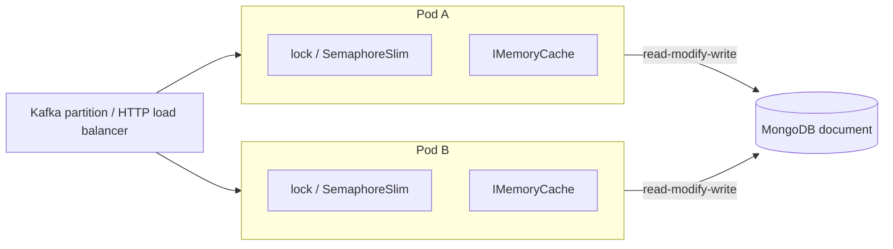

# 04. Multithreading, concurrency and distributed locks

## Why this chapter matters

Concurrency bugs are the most expensive bugs to find: they do not reproduce on a laptop, they pass
CI, and they appear in production as "sometimes the counter is wrong" or "twice a week a task runs
twice". Interviews test this area to see if a candidate can reason about shared state, not only use
`lock`. At Smartcat the question is wider than threads: every service runs as several pods, so two
copies of the same code run at the same time on different machines. A `lock` statement protects
nothing there. You need atomic database updates, version checks, unique indexes, leases and
idempotency.

## What you will be able to do

- Explain threads, the thread pool and tasks, and the basics of the .NET memory model (reordering,
  visibility, `volatile`, why double-checked locking is tricky).
- Choose the right primitive: `lock` / `System.Threading.Lock`, `SemaphoreSlim`, `Interlocked`,
  `ReaderWriterLockSlim`, concurrent collections, `Channel<T>`, immutable snapshots.
- Spot race conditions, deadlocks and the `ConcurrentDictionary.GetOrAdd` "factory runs twice" trap.
- Explain `ThreadStatic` vs `AsyncLocal` and why a mutable `AsyncLocal` is a security risk.
- Design for many pods: atomic Mongo updates, optimistic concurrency, unique indexes, leases with
  renewal, idempotency keys, and the limits of per-pod caches.
- Write deterministic tests for concurrent code.

## Part 1. Concurrency inside one process

## 1. Threads, the thread pool and tasks

**Concept.**

| | `Thread` | Thread pool | `Task` |
|---|---|---|---|
| What it is | An OS thread you create and own | A shared set of reusable worker threads | A unit of work (or a promise), usually run on the pool |
| Cost to start | High (stack, OS object) | Low (reuse) | Low |
| Good for | A loop that runs for the whole process life, special priority or apartment state | Short work items | Almost everything: composition, results, exceptions, cancellation |
| Result and exceptions | You build it yourself | You build it yourself | Built in |

A `Task` is not a thread. `Task.Run` queues a delegate to the pool. An I/O task (`ReadAsync`) uses
no thread while it waits (chapter 03, Async and await in depth).

**Why it matters.** The pool is shared by everything in the process: ASP.NET Core requests, Kafka
consumers, timers, `Task.Run`. If your code blocks pool threads, everything else slows down. That is
why long blocking loops get their own `Thread` (or a `BackgroundService` that is async all the way),
not a pool thread.

## 2. The memory model in practice

### 2.1 Three problems: atomicity, visibility, ordering

1. **Atomicity.** Reads and writes of references and of primitive types up to the native word size
   (`int`, `bool`, `double` on 64-bit, references) are atomic: you never see half a value. A `struct`
   bigger than that (a `Guid`, a `decimal`, your own struct) can be **torn**: another thread sees half
   old, half new. `count++` is **not** atomic: it is read, add, write.
2. **Visibility.** A write on one core may not be seen by another core at once. The JIT can also
   keep a field in a register and never read memory again inside a loop.
3. **Ordering.** The compiler, the JIT and the CPU may reorder reads and writes, as long as the
   result is the same **for a single thread**. Another thread may see the writes in a different order.

```csharp
// BAD: on a weak memory model (ARM64), the reader can see _ready == true and still read old _data.
private int _data;
private bool _ready;

public void Publish() { _data = 42; _ready = true; }
public int? TryRead() => _ready ? _data : null;
```

**Why it matters now.** x86 has a strong memory model that hides many of these bugs. ARM64 (Apple
Silicon laptops, AWS Graviton nodes) has a weaker one. Code that "always worked" on x86 can fail on ARM.

### 2.2 volatile and Volatile.Read/Write

`volatile` on a field (or `Volatile.Read` / `Volatile.Write` on a normal field) gives:

- a **volatile read** has *acquire* semantics: later reads and writes cannot move before it;
- a **volatile write** has *release* semantics: earlier reads and writes cannot move after it;
- the JIT must really read memory each time (no caching in a register).

```csharp
private int _data;
private volatile bool _ready;

public void Publish() { _data = 42; _ready = true; }      // release: _data is written before _ready
public int? TryRead() => _ready ? _data : null;            // acquire: if _ready is seen, _data is seen
```

`volatile` does **not** make `count++` atomic, and it does not prevent a write followed by a read
from being reordered. For anything beyond "one writer publishes a flag or a reference", use a lock or
`Interlocked`.

### 2.3 Double-checked locking and Lazy&lt;T&gt;

```csharp
// Tricky: correct today on CoreCLR, but easy to break.
private static Settings? _instance;
private static readonly object _gate = new();

public static Settings Instance
{
    get
    {
        if (_instance is null)                 // check 1, no lock
        {
            lock (_gate)
            {
                if (_instance is null)         // check 2, inside lock
                    _instance = Settings.Load();
            }
        }
        return _instance;
    }
}
```

Why it is tricky:

- Without the second check, two threads both create the instance.
- On the ECMA memory model, another thread could see the reference **before** the constructor's
  writes. CoreCLR gives stronger guarantees (a reference store is a release), so it works there, but
  this depends on runtime details most reviewers do not know.
- A common variant is truly broken: `_instance = new Settings(); _instance.Init();` publishes an
  object that is not ready.

**Recommendation.** Use `Lazy<T>`:

```csharp
private static readonly Lazy<Settings> _instance = new(Settings.Load, LazyThreadSafetyMode.ExecutionAndPublication);
public static Settings Instance => _instance.Value;
```

| `LazyThreadSafetyMode` | Factory runs | Use when |
|---|---|---|
| `ExecutionAndPublication` (default) | Exactly once | Factory is expensive or has side effects |
| `PublicationOnly` | Maybe many times, first result wins | Factory is cheap and pure; avoids locking |
| `None` | Once, not thread-safe | Single-threaded use only |

**Trap.** With `ExecutionAndPublication`, if the factory throws, `Lazy<T>` **caches the exception**:
every later `.Value` throws the same exception. For a transient failure (database down at start)
that is wrong. `PublicationOnly` does not cache exceptions. For async init, use `Lazy<Task<T>>` and
remove the entry on failure (see section 7.2).

### 2.4 At Smartcat: snapshot swap with Volatile

A real example from `smartcat-ai-agents/src/Module.UsageLimits/Pricing/Sources/CachedModelPriceProvider.cs`
(shortened):

```csharp
private readonly SemaphoreSlim _gate = new(1, 1);
private Dictionary<string, ModelPrice> _prices = new(StringComparer.OrdinalIgnoreCase);

public async Task<ModelPrice?> PriceForAsync(string model, CancellationToken cancellationToken)
{
    await loadIfNeededAsync(cancellationToken);
    return Volatile.Read(ref _prices).GetValueOrDefault(model);
}

private async Task loadIfNeededAsync(CancellationToken cancellationToken)
{
    if (!needsSnapshot)
        return;

    await _gate.WaitAsync(cancellationToken);
    try
    {
        if (!needsSnapshot)                         // double check inside the gate
            return;

        var snapshot = await readSnapshotAsync(cancellationToken);
        Volatile.Write(ref _prices, snapshot);      // publish a complete new dictionary
        _loadedAtUtc = DateTime.UtcNow;             // mark fresh only AFTER the snapshot is in place
    }
    finally
    {
        _gate.Release();
    }
}
```

Three good ideas in one place: readers never lock (they read an immutable-in-practice snapshot), the
writer builds a **new** dictionary and swaps the reference, and the "loaded" timestamp is written
**after** the swap. The comment in the real file explains why: marking the cache fresh before the read
would let concurrent callers skip the gate, find an empty dictionary, and charge the fallback price.

## 3. lock, Monitor and System.Threading.Lock

### 3.1 What `lock` compiles to

```csharp
lock (_sync)
{
    _balance += amount;
}

// is compiled to (for an object):
bool lockTaken = false;
try
{
    Monitor.Enter(_sync, ref lockTaken);
    _balance += amount;
}
finally
{
    if (lockTaken) Monitor.Exit(_sync);
}
```

`Monitor` gives mutual exclusion **and** a full memory barrier on enter and exit, so all writes made
inside the lock are visible to the next thread that takes it. It is **re-entrant**: the same thread
can enter twice. It is **thread-affine**: only the thread that entered can exit.

**Rules.**

- Lock on a `private readonly` object that only this class can see. Never on `this`, a `Type`
  (`typeof(X)`), or a `string` (interned strings are shared across the process).
- Keep the critical section small. No I/O, no calls to unknown code (callbacks, events, virtual
  methods) inside a lock: they may take other locks and cause a deadlock.
- Every access to the shared state, reads included, must take the same lock.

### 3.2 System.Threading.Lock (.NET 9, C# 13)

.NET 9 added a dedicated lock type:

```csharp
private readonly Lock _sync = new();

public void Deposit(decimal amount)
{
    lock (_sync)               // compiler uses _sync.EnterScope(), a ref struct disposed at the end
    {
        _balance += amount;
    }
}
```

It is faster than `Monitor` on an object, and it makes intent explicit. The compiler warns if you
convert a `Lock` to `object` (because `lock` on that object would silently fall back to `Monitor`).

**Recommendation.** In new code on .NET 9+, use `Lock` for synchronous critical sections. In code
that must also run on .NET 8, keep `private readonly object _sync = new();`.

## 4. Why you cannot await inside a lock, and SemaphoreSlim as the async lock

**Concept.** `await` inside a `lock` body is a compiler error (CS1996).

**Why.**

1. `Monitor` is thread-affine. After `await`, the continuation may run on another thread, which
   would then call `Monitor.Exit` on a lock it does not own (`SynchronizationLockException`).
2. Even if it were allowed, holding a lock across I/O blocks every other thread that needs it for
   the whole network round trip.

Tricks that hide the `await` from the compiler (calling `.Result` inside the lock, or
`Monitor.Enter` / `Monitor.Exit` by hand around an await) are worse: they compile and fail at runtime.

**The async lock: `SemaphoreSlim(1, 1)`.**

```csharp
private readonly SemaphoreSlim _mutex = new(1, 1);

public async Task RefreshAsync(CancellationToken cancellationToken)
{
    await _mutex.WaitAsync(cancellationToken);
    try
    {
        await ReloadFromStoreAsync(cancellationToken);
    }
    finally
    {
        _mutex.Release();
    }
}
```

| | `lock` / `Lock` | `SemaphoreSlim(1, 1)` |
|---|---|---|
| `await` inside | No | Yes |
| Re-entrant | Yes | **No**: a second `WaitAsync` from the same flow waits forever |
| Thread affinity | Yes | No (any thread may release) |
| Cancellation / timeout while waiting | `Monitor.TryEnter(timeout)` only | `WaitAsync(timeout, ct)` |
| Speed for short sync sections | Faster | Slower |

**Common mistakes.**

- `Release()` not in `finally`: one exception leaves the semaphore at zero, and every later caller
  waits forever.
- `WaitAsync` inside the `try`: if it is cancelled, the `finally` releases a slot you never took, and
  the count goes above 1. Wait **before** `try`.
- Re-entrancy: method A takes the semaphore and calls method B, which also takes it. Deadlock.
- Disposing the `SemaphoreSlim` while waiters exist. In a singleton you usually never dispose it.

**At Smartcat.** `SemaphoreSlim(1, 1)` is the standard async gate in `smartcat-ai-agents`, for
example in `CachedModelPriceProvider` (above), `Module.Mcp/Services/CachedContextProvider/CachingMcpToolsProvider.cs`
and `Module.Mcp/Services/DatabricksMcpToolProvider.cs`. Review rule T3 (MAJOR) asks for a test with
deliberate contention for every new `lock`, `SemaphoreSlim` or `Monitor` (section 25).

## 5. Interlocked

**Concept.** `Interlocked` gives atomic operations on a single variable, with a full memory barrier,
without a lock.

```csharp
private long _processed;
public void OnProcessed() => Interlocked.Increment(ref _processed);
public long Processed => Interlocked.Read(ref _processed);   // atomic 64-bit read, also on 32-bit
```

`CompareExchange` (CAS: compare-and-swap) is the base of lock-free code: "write the new value only if
the current value is still what I read".

```csharp
// Lock-free "keep the maximum".
public static void UpdateMax(ref int target, int candidate)
{
    int current;
    do
    {
        current = Volatile.Read(ref target);
        if (candidate <= current)
            return;
    }
    while (Interlocked.CompareExchange(ref target, candidate, current) != current);
}
```

| Method | Does |
|---|---|
| `Increment` / `Decrement` / `Add` | Atomic arithmetic, returns the new value |
| `Exchange` | Set and return the old value (swap a snapshot reference) |
| `CompareExchange` | Set only if equal to the comparand; returns the original value |
| `Read` | Atomic 64-bit read |

**Tip.** `Interlocked` protects **one** variable. If an invariant links two fields ("count equals the
number of items in the list"), you need a lock, or one immutable object that holds both, swapped with
`Interlocked.Exchange`.

## 6. ReaderWriterLockSlim

**Concept.** Many readers at the same time, or one writer alone. Useful when reads are far more
frequent than writes **and** the read section is not tiny.

Limits: it is thread-affine (no `await` inside), it has more overhead than `lock` for short sections,
and upgradeable locks are easy to misuse. In practice, two simpler options usually win:

- **Immutable snapshot + reference swap** (section 2.4): readers never wait.
- **`ConcurrentDictionary`** when the data is a key-value map with independent entries.

## 7. Concurrent collections

### 7.1 Overview

| Type | Use for | Notes |
|---|---|---|
| `ConcurrentDictionary<K,V>` | Shared map, caches, in-flight work by key | Fine-grained locks; delegates run **outside** the lock |
| `ConcurrentQueue<T>` | FIFO, many producers and consumers | Lock-free; no waiting when empty |
| `ConcurrentStack<T>` | LIFO | Lock-free |
| `ConcurrentBag<T>` | Unordered collection of results | Per-thread lists; best when the same threads add and take |
| `BlockingCollection<T>` | Sync producer/consumer with blocking `Take` and a bound | Blocks threads; in async code use `Channel<T>` |
| `ImmutableArray<T>`, `ImmutableDictionary<K,V>` | Shared data that changes rarely | Every change makes a new instance |
| `FrozenDictionary<K,V>` (.NET 8) | Data built once, read very often | Fastest reads; expensive to build |

### 7.2 The GetOrAdd trap: the factory can run twice

**Concept.** `GetOrAdd(key, valueFactory)` does **not** run the factory under a lock. Two threads that
miss the same key at the same time can both run the factory. Only one result is stored and returned
to both; the other is discarded. `AddOrUpdate` has the same property for its update delegate, which
can run more than once.

This is harmless for a pure, cheap factory. It is a bug when the factory has side effects: starting
an HTTP call, opening a connection, starting a background probe, incrementing a counter.

```csharp
// BAD: two concurrent callers can start two expensive loads (one result is thrown away, but the work ran).
private readonly ConcurrentDictionary<string, Task<Report>> _inFlight = new();
public Task<Report> GetAsync(string key) => _inFlight.GetOrAdd(key, k => LoadReportAsync(k));

// GOOD: the factory only creates a Lazy (cheap, no side effects). Only the stored Lazy is ever started.
private readonly ConcurrentDictionary<string, Lazy<Task<Report>>> _inFlight = new();

public Task<Report> GetAsync(string key) =>
    _inFlight.GetOrAdd(key, k => new Lazy<Task<Report>>(
        () => LoadReportAsync(k),
        LazyThreadSafetyMode.ExecutionAndPublication)).Value;
```

**At Smartcat.** The same repository shows both sides. `smartcat-ai-agents/src/Module.UsageLimits/Packages/SubscriptionPackageResolver.cs`
uses `ConcurrentDictionary<string, Lazy<Task<SubscriptionLookup>>>` and removes the entry in a
`finally`, which is the correct shape. `smartcat-ai-agents/src/Module/Agents/PackageIntake/Detection/PackageIntakeInFlight.cs`
calls `GetOrAdd(fileDriveId, id => { started = true; return run(id, start); })`, where the factory
itself starts the probe. Under a race this likely starts two probes for one file and reports
"started" to both callers. Treat this as an inference to verify, not a confirmed bug (see the
exercises).

### 7.3 Other traps

- **Check-then-act on a concurrent collection is still a race.**
  `if (!dict.ContainsKey(k)) dict[k] = v;` is two operations. Use `TryAdd`, `GetOrAdd`,
  `AddOrUpdate`, or `TryUpdate(key, newValue, comparisonValue)`.
- **Mutable values.** `ConcurrentDictionary<string, List<int>>` makes the dictionary safe, not the
  lists inside it. Two threads calling `dict[k].Add(...)` corrupt the list.
- **`Count`, `Keys`, `Values`, `ToArray()`** take all internal locks. Do not call them on a hot path.
- **Enumeration** is safe while others write, but it is not a moment-in-time snapshot.

## 8. System.Threading.Channels

**Concept.** A `Channel<T>` is an async producer/consumer queue: writers call `WriteAsync`, readers
call `ReadAsync` or `ReadAllAsync`. It is the async replacement for `BlockingCollection<T>`.

**Bounded vs unbounded.** An unbounded channel accepts everything: if the consumer is slower than the
producer, memory grows until the pod is killed. A **bounded** channel gives **backpressure**: when it
is full, the producer waits (or items are dropped, by your choice).

| `BoundedChannelFullMode` | When the channel is full |
|---|---|
| `Wait` (default) | `WriteAsync` waits for space: backpressure |
| `DropNewest` | Removes the newest item in the channel to make room |
| `DropOldest` | Removes the oldest item to make room |
| `DropWrite` | Drops the item being written |

**Producer/consumer in a service.**

```csharp
public sealed class IndexingQueue
{
    private readonly Channel<Guid> _channel = Channel.CreateBounded<Guid>(new BoundedChannelOptions(1_000)
    {
        FullMode = BoundedChannelFullMode.Wait,
        SingleReader = true,
    });

    public ValueTask EnqueueAsync(Guid documentId, CancellationToken ct) => _channel.Writer.WriteAsync(documentId, ct);
    public IAsyncEnumerable<Guid> ReadAllAsync(CancellationToken ct) => _channel.Reader.ReadAllAsync(ct);
}

public sealed class IndexingWorker(IndexingQueue queue, IServiceScopeFactory scopes, ILogger<IndexingWorker> logger)
    : BackgroundService
{
    protected override async Task ExecuteAsync(CancellationToken stoppingToken)
    {
        await foreach (var documentId in queue.ReadAllAsync(stoppingToken))
        {
            try
            {
                await using var scope = scopes.CreateAsyncScope();          // a fresh scope per item
                var indexer = scope.ServiceProvider.GetRequiredService<IDocumentIndexer>();
                await indexer.IndexAsync(documentId, stoppingToken);
            }
            catch (Exception exception) when (exception is not OperationCanceledException)
            {
                logger.LogError(exception, "Indexing of document {DocumentId} failed.", documentId);
            }
        }
    }
}
```

Why each detail matters:

- **Bounded + Wait**: a traffic spike slows producers instead of filling memory.
- **`SingleReader = true`**: lets the channel use a faster implementation; it is a promise you must keep.
- **A new DI scope per item**: the worker is a singleton; scoped services must not be captured
  (rule A1, chapter 05).
- **Catch per item**: one bad item must not stop the loop. An exception that escapes
  `ExecuteAsync` stops the hosted service (and, by default since .NET 6, stops the whole host).
- **The queue is in memory**: items are lost on restart. If that is not acceptable, use a persisted
  task (chapter 08) or Kafka.

**`AllowSynchronousContinuations`.** Default `false`. If `true`, a write can run the reader's
continuation inline on the writer's thread. Faster, but it has the same risks as
`TaskCompletionSource` without `RunContinuationsAsynchronously` (chapter 03).

**At Smartcat.** `smartcat-ai-agents/src/Module/Narration/NarrationAgent.cs` merges the inner agent's
stream with narration updates through a bounded channel:

```csharp
var channel = Channel.CreateBounded<AgentResponseUpdate>(
    new BoundedChannelOptions(config.Value.ChannelCapacity)
    {
        SingleWriter = false,
        SingleReader = true,
        AllowSynchronousContinuations = false,
        FullMode = BoundedChannelFullMode.Wait
    });
```

The capacity comes from configuration (no magic number), there are several writers (the inner stream
and the narration emitter), and one reader (the async iterator that yields to the client). Other
streaming agents in the same repository use unbounded channels; that is acceptable only when the
producer cannot outrun the consumer by much, for example when both sides are one user's request.

## 9. Parallel and PLINQ: for CPU-bound work only

**Concept.** `Parallel.For`, `Parallel.ForEach` and PLINQ (`AsParallel()`) split CPU work across
cores. They **block** the calling thread until done and use pool threads.

```csharp
// CPU-bound: hashing many in-memory segments.
var hashes = new string[segments.Length];
Parallel.For(0, segments.Length, new ParallelOptions { MaxDegreeOfParallelism = 4 }, i =>
{
    hashes[i] = ComputeHash(segments[i]);        // each index written by one iteration only: safe
});

var totalWords = segments.AsParallel().WithDegreeOfParallelism(4).Sum(s => CountWords(s.Text));
```

**When not to use them.**

- **I/O work.** They block threads while waiting. Use `Parallel.ForEachAsync` or `Task.WhenAll`
  with throttling (chapter 03).
- **Inside an ASP.NET Core request**, usually. One request that takes all cores slows every other
  request on the pod. Limit the degree, or move heavy CPU work to a background worker.
- **Small work items.** Scheduling overhead is bigger than the gain. Measure.

**Common mistake.** Writing to a shared `List<T>` or a shared counter from the loop body. Write to
an index you own (as above), use thread-local state (`Parallel.For` overload with `localInit` /
`localFinally`), or aggregate with PLINQ.

## 10. Race conditions

**Concept.** A race condition is a bug whose result depends on the timing of threads. Three shapes
cover most real cases:

| Shape | Example | Fix |
|---|---|---|
| Read-modify-write | `_count++`, `balance = balance - amount` | `Interlocked`, a lock, or an atomic DB update |
| Check-then-act | `if (!exists) create();` | Atomic operation (`TryAdd`, unique index, `FindOneAndUpdate` with a filter) |
| Unsafe publication / lazy init | Publishing an object before it is ready | `Lazy<T>`, immutability, `Volatile.Write` after full init |

```csharp
// BAD: lost updates. Two threads read 10, both write 11.
public void Increment() => _count++;

// GOOD
public void Increment() => Interlocked.Increment(ref _count);
```

**Tip.** When you review, look for **shared mutable state** first: static fields, singleton fields,
captured variables in lambdas that run in parallel, objects passed to `Task.Run` and then changed. If
there is no shared mutable state, there is no race.

## 11. Deadlocks, livelocks and starvation

### 11.1 Deadlock

**Concept.** Two (or more) threads each hold a lock and wait for a lock the other holds. Four
conditions are needed at once: mutual exclusion, hold-and-wait, no preemption, circular wait. Break
any one and there is no deadlock. In practice you break **circular wait** with a fixed lock order.

```csharp
// BAD: Transfer(a, b) and Transfer(b, a) at the same time can deadlock.
public static void Transfer(Account from, Account to, decimal amount)
{
    lock (from.Sync)
    lock (to.Sync)
    {
        from.Balance -= amount;
        to.Balance += amount;
    }
}

// GOOD: always lock in the same global order (here, by id).
public static void Transfer(Account from, Account to, decimal amount)
{
    var (first, second) = from.Id.CompareTo(to.Id) < 0 ? (from, to) : (to, from);
    lock (first.Sync)
    lock (second.Sync)
    {
        from.Balance -= amount;
        to.Balance += amount;
    }
}
```

Other defences: hold one lock at a time; never call unknown code while holding a lock; use timeouts
(`Monitor.TryEnter(obj, timeout)`, `SemaphoreSlim.WaitAsync(timeout)`) so a deadlock becomes a
visible error instead of a silent hang.

**The same rule applies to distributed locks.** If an operation takes the lock for a project and then
the lock for a task, every code path must take them in that order.

### 11.2 Livelock and starvation

- **Livelock**: threads are not blocked, but they keep reacting to each other and make no progress.
  Example: two workers that both detect a conflict, both wait for exactly 100 ms, and both retry
  at the same time again. Fix: **random jitter** in retries.
- **Starvation**: a thread never gets the resource because others always win (for example readers
  that never stop on a reader-preferring lock). Thread-pool starvation is covered in chapter 03.

## 12. Thread safety of DI singletons

**Concept.** A singleton is one instance for the whole process. Every request, every consumer and
every background worker uses it **at the same time**. Any mutable field in a singleton is shared
mutable state.

```csharp
// BAD: singleton with per-request state in a field.
public sealed class QuoteCalculator(IRateSource rates)
{
    private decimal _currentRate;                    // shared by all concurrent requests

    public async Task<decimal> CalculateAsync(Quote quote, CancellationToken ct)
    {
        _currentRate = await rates.GetRateAsync(quote.Currency, ct);
        return quote.Words * _currentRate;           // may use another request's rate
    }
}

// GOOD: keep per-call state in locals; singletons hold only immutable config and thread-safe dependencies.
public sealed class QuoteCalculator(IRateSource rates)
{
    public async Task<decimal> CalculateAsync(Quote quote, CancellationToken ct)
    {
        var rate = await rates.GetRateAsync(quote.Currency, ct);
        return quote.Words * rate;
    }
}
```

**Checklist for a singleton:**

- Fields are `readonly` and hold immutable data or thread-safe objects.
- Caches inside are concurrent collections or snapshot swaps.
- No scoped dependency in the constructor (a "captive dependency"; rule A1 is a BLOCKER at Smartcat).
- No per-request state through `IHttpContextAccessor` stored in fields (rule A1, A23).

**At Smartcat.** Rule A23 (MAJOR) flags a singleton that reads or writes an `AsyncLocal<T>` field, or
keeps state from `IHttpContextAccessor.HttpContext` in a field. The required correction is an
explicit `AsyncLocal` contract with a comment, plus an integration test showing that two concurrent
requests do not see each other's state.

## 13. ThreadStatic vs AsyncLocal

### 13.1 ThreadStatic

`[ThreadStatic] static T _value;` gives each **thread** its own copy. Two traps:

- The field initializer runs only once, on the first thread. On other threads the field starts at
  `default`.
- It does not follow async code. After `await`, the continuation may run on another thread and see
  another value. Pool threads are reused, so a value left by one request is seen by the next.

`ThreadLocal<T>` is the class form, with a factory per thread. Both are useful only for strictly
synchronous, per-thread caches (for example a reusable buffer).

### 13.2 AsyncLocal

`AsyncLocal<T>` stores a value in the `ExecutionContext`, which flows across `await`, `Task.Run`, and
thread-pool work items. It follows the **logical** flow, not the thread.

Key semantics:

- A child flow sees the parent's value at the moment the child started.
- When an async method sets the value, the change is **not** visible to its caller after the method
  returns. The runtime restores the caller's context.
- The `ExecutionContext` is copy-on-write for the **reference** only. If the value is a mutable
  object, every flow that captured it shares **the same object**.

### 13.3 Mutable AsyncLocal: Smartcat rule S5

```csharp
// BAD: a static, publicly settable AsyncLocal holding a mutable object.
public static class RequestState
{
    public static readonly AsyncLocal<Dictionary<string, string>> Current = new();
}

// In a request:
RequestState.Current.Value ??= new Dictionary<string, string>();
RequestState.Current.Value["workspaceId"] = workspaceId;   // mutates a dictionary that background work started
                                                           // from this request also holds
```

What goes wrong: a background task started from the request captured the same dictionary. A later
write in the request (or in the task) changes what the other side sees. If the value is set without a
clear scope owner, it can also stay attached to flows it was never meant for. With tenant data such as
`workspaceId`, this is a cross-tenant leak, which is why review-security treats it as a security rule.

At Smartcat, rule S5 (MAJOR) flags `static readonly AsyncLocal<T>` with a public setter, and
ambient-context classes that do not have a scope owner. The correct choices are scoped DI
(`AddScoped<T>`) or `HttpContext.Items["key"]` set once per request.

When an ambient value is really needed (for example on a background path with no `HttpContext`), it
must have a **scope owner** that sets it and restores the previous value. A real example,
`smartcat-ai-agents/src/Module/Agents/ClientToolsAmbientContext.cs`:

```csharp
internal static class ClientToolsAmbientContext
{
    private static readonly AsyncLocal<ClientToolsProvider?> _current = new();

    public static ClientToolsProvider? Current => _current.Value;   // no public setter

    public static IDisposable Bind(ClientToolsProvider provider)
    {
        var previous = _current.Value;
        _current.Value = provider;
        return new Restore(previous);                                 // the owner restores on Dispose
    }

    private sealed class Restore : IDisposable
    {
        private readonly ClientToolsProvider? _previous;
        public Restore(ClientToolsProvider? previous) => _previous = previous;
        public void Dispose() => _current.Value = _previous;
    }
}
```

The class is `internal`, the setter is private, the value is set by one owner at the start of a run
with `using (ClientToolsAmbientContext.Bind(provider))`, and the previous value comes back on
dispose. The calibration notes of review-security also say that `HttpContext.Items["ag_ui_thread_id"]`
used as a thread-id fallback is not an `AsyncLocal` anti-pattern.

| | `[ThreadStatic]` / `ThreadLocal<T>` | `AsyncLocal<T>` | Scoped DI |
|---|---|---|---|
| Follows `await` | No | Yes | Yes (you pass the object) |
| Visible to the caller after return | Yes | No | Yes |
| Explicit in signatures | No | No | **Yes** |
| Default choice for per-request state | Never | Only with a scope owner | **Yes** |

## 14. Immutability as a concurrency tool

**Concept.** An object that never changes after construction is thread-safe without locks. Share it
freely; to "change" it, build a new one and swap the reference.

```csharp
public sealed record PricingSnapshot(FrozenDictionary<string, ModelPrice> Prices, DateTimeOffset LoadedAt);

private PricingSnapshot _snapshot = PricingSnapshot.Empty;

public ModelPrice? Find(string model) => Volatile.Read(ref _snapshot).Prices.GetValueOrDefault(model);

public void Replace(PricingSnapshot next) => Interlocked.Exchange(ref _snapshot, next);
```

Tools: `record` / `record struct` with `init` properties and `with`, `ImmutableArray<T>`,
`ImmutableDictionary<K,V>`, `FrozenDictionary<K,V>`, `IReadOnlyList<T>` for API surfaces (note:
read-only interfaces do not make the underlying object immutable).

At Smartcat, review rule D6 (chapter 03) prefers `sealed record X(...)` with `With*` methods for data
that crosses `await` boundaries, and rule D16 prefers `required` + `init` on Mongo entity properties.

## Part 2. Concurrency across pods

## 15. Why in-process primitives are not enough

**Concept.** A Smartcat service runs as several pods (and during a canary or a rolling deploy, as two
versions at once). Each pod has its own memory. A `lock`, a `SemaphoreSlim`, a `ConcurrentDictionary`
or an `IMemoryCache` exists **per pod**.



The shared resource is the database document. The tools that work across pods all live in, or are
coordinated by, the shared store:

| Problem | Tool | Section |
|---|---|---|
| Lost update on one document | Atomic update (`$inc`, `$set` with filter, `FindOneAndUpdate`) | 16 |
| Lost update on a complex edit | Optimistic concurrency with a version field | 17 |
| Duplicate creation | Unique index (+ tenant in the key) | 18 |
| Several documents for one intent | `UpdateMany` / transaction | 19 |
| Only one worker at a time on a resource | Distributed lock / lease, or task capture | 20, 21 |
| Stale or inconsistent cached state | Read authoritative store or `IDistributedCache` | 22 |
| Same message processed twice | Idempotency key | 23 |

## 16. Atomic Mongo updates vs read-modify-write

**Concept.** "Read the document, change it in C#, write it back" is a race between pods: the second
writer overwrites the first one's change (a **lost update**). A single-document update in MongoDB is
atomic. Express the change as an update operator, so the database applies it.

```csharp
// BAD: lost update when two pods do this at the same time.
var scope = await _scopes.Find(s => s.Id == scopeId).SingleAsync(ct);
scope.Progress += increment;
await _scopes.ReplaceOneAsync(s => s.Id == scopeId, scope, cancellationToken: ct);

// GOOD: one atomic operation on the server.
var updated = await _scopes.FindOneAndUpdateAsync(
    Builders<Scope>.Filter.Eq(s => s.Id, scopeId),
    Builders<Scope>.Update.Inc(s => s.Progress, increment),
    new FindOneAndUpdateOptions<Scope> { ReturnDocument = ReturnDocument.After },
    ct);
```

**At Smartcat.** `project-tasks-service/src/ProjectTasks.Module/DAL/ScopeRepository.cs` increments
scope progress with `Update.Inc(s => s.Progress, progressIncrement)` in a `FindOneAndUpdateAsync`, and
also `.Inc(s => s.ProgressVersion, 1)` so readers can tell that progress moved. The conditional form
("update only if the state is still X") goes into the **filter**:

```csharp
var result = await _tasks.UpdateOneAsync(
    Builders<ExportTask>.Filter.Eq(t => t.Id, id) & Builders<ExportTask>.Filter.Eq(t => t.Status, ExportStatus.Pending),
    Builders<ExportTask>.Update.Set(t => t.Status, ExportStatus.Running),
    cancellationToken: ct);

var weWon = result.ModifiedCount == 1;   // the other pod sees 0 and stops
```

The `&` operator instead of `Filter.And(a, b)` follows Smartcat style rule D23 (operator overloads
for two-argument filters).

## 17. Optimistic concurrency with a version field

**Concept.** When the change cannot be expressed as one update operator (a user edits a complex
document), keep a `Version` number. Read it, build the new document, and write **only if the version
is still the one you read**. If the write matches nothing, somebody else won: reload and retry, or
report a conflict to the user.

**At Smartcat.** A real example from `smartcat-ai-agents/src/Module/Infrastructure/Dispatch/MongoBriefTemplates.cs`
(shortened):

```csharp
var written = next with { Version = expectedVersion + 1, UpdatedAt = DateTimeOffset.UtcNow };

// The version lives in the filter, not only in the read above: two editors that read the same
// version both pass the check, and only the one whose replace matches wins.
var guarded = Builders<OverrideDoc>.Filter.And(
    Builders<OverrideDoc>.Filter.Eq(d => d.Id, DocId(current.Scope, current.ScopeId)),
    Builders<OverrideDoc>.Filter.Eq(d => d.Version, expectedVersion));

var result = await _overrides.ReplaceOneAsync(guarded, ToDoc(written), (ReplaceOptions?)null, ct);

if (result.MatchedCount == 0)
    throw new BriefTemplateConflictException("... moved past version ... re-read them and rebuild the delta.");
```

The comment states the key idea: an `if (current.Version != expected)` check in C# is not enough,
because two writers can pass it at the same time. Only the **filter** makes the check and the write
one atomic step.

**Optimistic vs pessimistic.**

| | Optimistic (version) | Pessimistic (lock / lease) |
|---|---|---|
| Cost when there is no conflict | One conditional write | Acquire + release round trips |
| On conflict | Retry or report to the user | Others wait |
| Good for | User edits, low contention | Long operations, high contention, external side effects |

**Rule A10 (MINOR).** When you add a version field to an existing collection, old documents do not
have it. `Filter.Eq(d => d.Version, 0)` does not match a missing field. Either backfill in a migration
or filter with `Or(Eq(Version, current), Exists(Version, false))`. Rule T4 asks for a test of null vs
missing vs zero (chapter 09, MongoDB models, indexes and safe migrations).

## 18. TOCTOU and the unique index

**Concept.** TOCTOU means "time of check to time of use": you check a condition, and it changes
before you act. The classic case is "check that the name is free, then insert".

```csharp
// BAD (rule A28): two pods both see "not exists" and both insert.
if (await _glossaries.ExistsAsync(workspaceId, name, ct))
    throw new GlossaryNameTakenException(name);
await _glossaries.InsertAsync(new Glossary(workspaceId, name), ct);

// GOOD: let the unique index decide; map the duplicate-key error to a domain error.
try
{
    await _glossaries.InsertAsync(new Glossary(workspaceId, name), ct);
}
catch (MongoWriteException exception) when (exception.WriteError.Category == ServerErrorCategory.DuplicateKey)
{
    throw new GlossaryNameTakenException(name);
}
```

**At Smartcat.**

- Rule A28 (MINOR): drop the pre-check on a path protected by a unique index; rely on the
  `DuplicateKey` error. (Keeping a pre-check for a nicer message is fine only if the index still
  decides.)
- Rule A27 (MINOR): a unique index on `Name` or `Key` alone is global. It must include the tenant:
  `(workspaceId, name)` or `(accountId, key)`.
- Rule A26 (MINOR): a new unique index on a nullable field that is backfilled later needs a partial
  filter excluding `null` until the backfill completes.

## 19. Several documents, one intent

**Concept.** MongoDB is atomic per document. A loop of `UpdateOneAsync` calls for one domain operation
can stop in the middle (pod killed, exception), and other readers can see the half-done state.

At Smartcat, rule A22 (MAJOR) flags `foreach (...) await collection.UpdateOneAsync(...)` for one
domain operation. The corrections:

- `UpdateManyAsync` with a filter, or with `ArrayFilters` for elements inside arrays;
- a Mongo transaction (`IClientSessionHandle`) when several collections must change together;
- or redesign so the intent is one document (sometimes the best answer), while watching the 16 MB
  document limit (rule A29).

Note the `IClientSessionHandle session` parameter in `ScopeRepository.IncrementProgress`: PTS passes
a session so the progress update can be part of a larger transaction.

## 20. Distributed locks and leases

### 20.1 What a distributed lock must do

A distributed lock is a record in a shared store (at Smartcat, usually MongoDB) that says "holder H
owns resource R until time T". It must:

1. **Acquire atomically**: one conditional update, never read-then-write.
2. **Expire**: if the holder dies, the lock must free itself (a TTL or an `expiresAt` deadline). A
   lock without expiry is a permanent outage after the first crash.
3. **Use one clock**: the database server time, not each pod's clock, to avoid clock skew.
4. **Renew** for long operations: a heartbeat extends the deadline while work continues.
5. **Tell the holder when the lease is lost**, so it stops working instead of running unprotected.
6. **Release** on every exit path (`await using`).

### 20.2 At Smartcat: the FDA distributed semaphore

`filedisassembling/src/Module/DistributedLock/` contains a complete, well-commented implementation.
Worth reading in full. The main ideas:

**Atomic acquire with server time** (`DefaultMongoDbDistributedSemaphoreRepository.TryAcquire`): one
`FindOneAndUpdateAsync` with an update pipeline that (1) removes expired holders and any stale copy of
this holder id, using `$$NOW` (server time), and (2) appends the new holder only if there is room.
Success is "my holder id is in the returned document". A fresh holder id per acquisition makes a
retried acquire idempotent.

**A lease token** (`DistributedSemaphore.createLease`):

```csharp
// The slot-lifetime deadline with the caller's cancellation folded in.
var tokenSource = new CancellationTokenSource(_lockLifetime);
var callerRegistration = cancellationToken.Register(
    static state => ((CancellationTokenSource)state).Cancel(),
    tokenSource);
```

The guarded operation receives `lease.Token`. It is cancelled when the lifetime runs out, when the
caller cancels, or when renewal discovers that the slot is lost.

**A renew loop that classifies errors** (`runKeepAlive`, shortened):

```csharp
while (true)
{
    try
    {
        await Task.Delay(renewInterval, stop);

        var stillHeld = await _repository.Renew(Id, holderId, _lockLifetime, stop);
        if (!stillHeld)
        {
            tokenSource.Cancel();        // logical loss: stop the guarded work
            return;
        }

        tokenSource.CancelAfter(_lockLifetime);   // push the local deadline forward
    }
    catch (OperationCanceledException) when (stop.IsCancellationRequested)
    {
        return;                          // normal stop on release
    }
    catch (Exception exception)
    {
        // Transient failure (for example a Mongo blip): the server-side TTL is the safety net,
        // so log and try again on the next tick instead of giving up the slot.
        _logger.Warn(exception, "Failed to renew the distributed semaphore {semaphoreId} holder {holderId}", Id, holderId);
    }
}
```

This is exactly what rule A11 (MAJOR) asks for: **"lock lost" (logical) and "infrastructure glitch"
(transient) are different outcomes.** A renewer that catches `Exception` and treats it as "lock lost"
aborts healthy work on every network blip. A renewer that treats a real loss as a glitch keeps working
without protection. The constructor also validates that `renewInterval < lockLifetime`, so each
renewal happens before the previous deadline.

### 20.3 At Smartcat: PTS locks and timeouts

Project Tasks Service acquires locks through `IDistributedLockService` (from
`Smartcat.MongoDBPersistence.DistributedLock`) with small helpers in
`project-tasks-service/src/ProjectTasks.Module/Extensions/DistributedLockServiceExtensions.cs`:

```csharp
var lockId = new DistributedLockId($"ProjectTask_{projectTask.Id}");
return lockService.Acquire(lockId, cancellationToken: ct);      // Task<IAsyncDisposable>
```

Callers use `await using`, and `VolumeScopeManager` turns a lock wait timeout into a "take another
path" result instead of a failure (chapter 03, section 8.3).

### 20.4 The lock key must be stable across pods

A lock works only if every pod computes **the same key** for the same resource. `string.GetHashCode()`
and `System.HashCode.Combine` are **randomized per process** in .NET Core: the same input gives a
different number in each pod and after each restart.

The same helper file has a second method:

```csharp
var lockId = new DistributedLockId($"Project_{projectId}_{stage.GetHashCode()}");
```

`StageInfo.GetHashCode()` returns `HashCode.Combine(TargetLanguageId, StageId, StageType, StageNumber)`,
so this key likely differs between pods, and two pods would not exclude each other. At the time of
writing the method appears to have no callers, so this is a latent trap, not a live bug; verify before
you act on it. The fix is a key built from stable values: `$"Project_{projectId}_{stage.StageId}_{stage.TargetLanguageId}_{stage.StageNumber}"`.

Rule A3 (MAJOR) covers the same family: object identity, closures and hash codes used as cross-pod
identifiers. Rule T18 asks for a cross-process test for new hashing code that touches shared state.

### 20.5 The limit of every lease: pauses

A lease cannot protect against a holder that **pauses** longer than the lease (a long GC, a frozen
container, a slow network) and then continues writing after another pod took the lease. The lease
token helps only if the code checks it before each write. For writes that must never overlap, combine
the lease with a **fencing** check in the store: each acquisition gets a higher number, and writes
include "only if my number is still the current one" in the filter (the same idea as the version field
in section 17).

## 21. Task capture as a lock: the task processing framework

**Concept.** Smartcat's `Smartcat.TaskProcessing` framework (chapter 08) is itself a distributed
concurrency mechanism. A pod **captures** a task with an atomic update that moves it from `Sleep` to
`InProgress` and writes a new `CaptureKey` and a future `UpTime`. Other pods do not capture it while
it is in progress. If the pod dies, the capture expires and another pod recaptures it, up to a
recapture limit.

The skill's first "common mistake" is a concurrency rule:

```csharp
// WRONG: concurrent modification possible
var task = await _manager.GetById(taskId);
task.ProcessedCount++;
await _manager.Update(task);

// CORRECT: only the capturing pod changes the task.
var task = await _manager.Capture(TimeSpan.FromMinutes(5));
if (task != null)
{
    task.ProcessedCount++;
    await ToSleep(task, TimeSpan.FromMinutes(1), "Updated");
}
```

Variants: **Singleton** tasks (one per `Name`, enforced by a unique index `UDX_Name`) for scheduled
jobs, and **Sticky** tasks that prefer the same pod (`StickMarker`, `StickTimeout`) for affinity.
Inside one captured task, work on a shared project task may still need a distributed lock, as
`VendorAssignmentFixTaskProcessor` shows.

## 22. Per-pod IMemoryCache traps

**Concept.** `IMemoryCache` lives in one pod. With N pods you have N independent caches:

- **Inconsistent answers**: pod A has the new value, pod B serves the old one for the TTL.
- **Invalidation does not reach other pods**: `cache.Remove(key)` after a write clears only the local pod.
- **Wrong after restart or failover** for any flow that expects the cached state to continue on
  another pod.

At Smartcat, rule A18 (MAJOR) flags `IMemoryCache` in checkpoint-critical or cross-pod flows
(persistence, agent injections, background runs). The correction is `IDistributedCache` (Redis), or
no cache: read the authoritative source.

**When a per-pod cache is fine:** read-mostly reference data where a short staleness window is
acceptable and documented. `SubscriptionPackageResolver` caches a workspace subscription in
`IMemoryCache` for 10 minutes (`_subscriptionCacheLifetime`, a named constant per rule A38): if a plan
changes, the new limits apply within 10 minutes on every pod. That is a product decision, not an
accident; write it down as one. Rule A39 asks for a documented contract (who writes, who reads,
worst-case staleness, crash behavior) for any TTL-based field.

## 23. Idempotency keys

**Concept.** In a distributed system, "exactly once" delivery does not exist in practice. Kafka
consumers get a message again after a rebalance; HTTP clients retry after a timeout; users click twice.
Design every handler so that processing the same input twice has the same effect as once.

**Techniques.**

- **Natural idempotency**: `$set Status = Done` is idempotent; `$inc Count` is not.
- **Idempotency key + unique index**: store the message id / request id / confirmation id with the
  side effect, under a unique index. A duplicate fails with `DuplicateKey` and is treated as "already
  done".
- **Conditional state transitions**: `UpdateOne(filter: Status == Pending, set: Status = Running)`
  (section 16) lets only the first attempt proceed.
- **Outbox** for "write to the database and publish an event" as one unit (chapter 07, Domain events,
  the Outbox pattern and Kafka).

```csharp
public async Task HandleAsync(InvoicePaid message, CancellationToken ct)
{
    try
    {
        await _processed.InsertOneAsync(new ProcessedMessage(message.MessageId, DateTime.UtcNow), cancellationToken: ct);
    }
    catch (MongoWriteException exception) when (exception.WriteError.Category == ServerErrorCategory.DuplicateKey)
    {
        return;   // already handled
    }

    await _subscriptions.ExtendAsync(message.AccountId, message.Period, ct);
}
```

This simple form has a gap: if the process dies between the insert and `ExtendAsync`, the retry sees
"already handled" and the extension is lost. Close it by putting both writes in one transaction, or
by making the side effect itself conditional on the message id.

**At Smartcat.**

- Rule A34 (BLOCKER): a workflow or side-effecting agent run started from a UI confirmation must pass
  an `idempotencyKey` derived from the confirmation id, and the backend must de-duplicate.
- Rule T14 (MAJOR): fixes to state-update or queueing logic need a **replay test**: process the same
  input twice and assert a single side effect.
- The FDA semaphore makes acquire idempotent with a unique holder id per acquisition (section 20.2).

## 24. Checklist: choosing a primitive

| Need | In one process | Across pods |
|---|---|---|
| Protect a short sync critical section | `lock` / `Lock` | (not applicable) |
| Protect a section with `await` | `SemaphoreSlim(1, 1)` | Distributed lock / lease |
| Count or swap one value | `Interlocked` | `$inc`, `$set` with filter |
| Shared read-mostly data | Immutable snapshot + `Volatile` | Authoritative store, `IDistributedCache` |
| Key-value cache / in-flight work | `ConcurrentDictionary<K, Lazy<Task<V>>>` | Redis, unique index, idempotency key |
| Producer/consumer | `Channel<T>` (bounded) | Kafka, persisted tasks |
| Complex edit by users | Lock (rarely) | Version field (optimistic) |
| "Only once" creation | `Lazy<T>`, `TryAdd` | Unique index |
| CPU-bound parallel work | `Parallel.For`, PLINQ | Split into tasks |

## 25. Testing concurrent code

### 25.1 Rule T3: a test with deliberate contention

At Smartcat, rule T3 (MAJOR) requires at least one test that exercises concurrent calls for every
new `lock`, `SemaphoreSlim` or `Monitor`, using `Task.WhenAll` or `Parallel.ForEachAsync` with
deliberate contention. The test below is a sketch in the style of `CachedModelPriceProvider`; the
real repository interface may differ. (The skill text mentions xUnit because it was written for `smartcat-ai-agents`;
most Smartcat backends use NUnit and FakeItEasy, chapter 10.)

```csharp
[Test]
public async Task Should_load_prices_once_when_many_callers_miss_the_cache_at_the_same_time()
{
    // Arrange
    var release = new TaskCompletionSource<Dictionary<string, ModelPrice>>(TaskCreationOptions.RunContinuationsAsynchronously);
    var repository = A.Fake<IModelPriceRepository>();
    A.CallTo(() => repository.ReadAllAsync(A<CancellationToken>._)).Returns(release.Task);
    var sut = CreateProvider(repository);

    // Act
    var callers = Enumerable.Range(0, 50).Select(_ => sut.PriceForAsync("model-a", CancellationToken.None)).ToList();
    release.SetResult(new() { ["model-a"] = new ModelPrice(1m) });
    var prices = await Task.WhenAll(callers);

    // Assert
    A.CallTo(() => repository.ReadAllAsync(A<CancellationToken>._)).MustHaveHappenedOnceExactly();
    Assert.That(prices, Has.All.Not.Null);
}
```

Why this test is deterministic: all 50 callers start while the load is **held open** by the
`TaskCompletionSource`, so they all hit the gate at the same time on every run. Then the test releases
the load. No sleeps, no timing luck. The call-count assert is the behaviour here ("load once"), and it
is paired with a state assert, as rule T5 asks.

### 25.2 Techniques for deterministic ordering

- **`TaskCompletionSource` gates** in fakes: decide exactly when each dependency completes.
- **`Barrier` or `CountdownEvent`**: release N threads at the same moment for a contention test.
- **`FakeTimeProvider`**: drive leases, renewals, TTLs and timeouts without real time (rule T8).
- **Replay tests** (rule T14): call the handler twice with the same input; assert one side effect.
- **Ephemeral MongoDB** (Testcontainers) for atomic-update, version and unique-index behavior: a fake
  repository cannot prove that a filter is atomic.
- **Stress loops** (run the contention test 1 000 times in a loop locally) to find rare races before
  you commit; do not put a 1 000-iteration loop in CI.

**Common mistake.** `Thread.Sleep(50)` or `Task.Delay(50)` to "let the other thread go first". It
passes locally and flakes in CI. Use a gate or `FakeTimeProvider.Advance` instead.

## At Smartcat

| Rule | Severity | What it catches | Section |
|---|---|---|---|
| A1 | BLOCKER | Singleton with a scoped dependency; `IHttpContextAccessor` in background singletons | 12 |
| A3 | MAJOR | Closures, object identity or hash codes as cross-pod identity | 20.4 |
| A10 | MINOR | Version field: null vs missing not handled | 17 |
| A11 | MAJOR | Lock renewal that does not classify "lost" vs "glitch" | 20.2 |
| A18 | MAJOR | Per-pod `IMemoryCache` in cross-pod or checkpoint-critical flows | 22 |
| A22 | MAJOR | Several single-document updates for one intent | 19 |
| A23 | MAJOR | Singleton with implicit per-request state (`AsyncLocal`, `HttpContext`) | 12 |
| A27 / A28 | MINOR | Unique index without tenant; TOCTOU pre-check before insert | 18 |
| A34 | BLOCKER | Side-effecting run from a UI confirmation without an idempotency key | 23 |
| A38 / A39 | MINOR / MAJOR | Lease and TTL durations as magic numbers; undocumented TTL contracts | 20, 22 |
| S5 | MAJOR | Mutable `AsyncLocal` for per-request state | 13.3 |
| T3 | MAJOR | Concurrency code without a contention test | 25.1 |
| T8 | MINOR | Real clock instead of an injected `TimeProvider` | 25.2 |
| T14 | MAJOR | State-update fix without a replay test | 23, 25.2 |
| Task skill | — | Never modify a task without capturing it | 21 |

## Interview corner

### As the interviewee

**1. What is the difference between a thread, the thread pool and a task?**
A strong answer covers:
- Thread = OS thread you own; pool = shared reusable workers; task = unit of work or promise.
- Tasks compose (results, exceptions, cancellation); I/O tasks hold no thread while waiting.
- Blocking pool threads hurts the whole process.

**2. Why is `count++` not thread-safe, and how do you fix it?**
A strong answer covers:
- Read, add, write: two threads can read the same value (lost update).
- `Interlocked.Increment`, or a lock if other fields are involved.

**3. What does `volatile` guarantee, and what does it not?**
A strong answer covers:
- Acquire on read, release on write, no register caching.
- Not atomic read-modify-write; does not stop store-load reordering.
- ARM64 is weaker than x86, so missing barriers become visible there.

**4. Why is double-checked locking tricky, and what do you use instead?**
A strong answer covers:
- Two checks needed; publication of a half-built object on weak models; easy to break.
- `Lazy<T>` with the right `LazyThreadSafetyMode`; know that it caches exceptions in the default mode.

**5. Why can you not `await` inside `lock`? What do you use?**
A strong answer covers:
- `Monitor` is thread-affine; continuation may resume on another thread; holding a lock over I/O is bad.
- `SemaphoreSlim(1, 1)`: `WaitAsync` before `try`, `Release` in `finally`, not re-entrant.

**6. What is the `ConcurrentDictionary.GetOrAdd` trap?**
A strong answer covers:
- Factory runs outside the lock and may run more than once; only one value is stored.
- Use `Lazy<T>` / `Lazy<Task<T>>` values when the factory has side effects or is expensive.

**7. When do you use `Channel<T>`, and why bounded?**
A strong answer covers:
- Async producer/consumer; bounded gives backpressure; full modes.
- Worker as `BackgroundService`, new DI scope per item, catch per item; in-memory items are lost on restart.

**8. How do you prevent deadlocks?**
A strong answer covers:
- Four conditions; fixed lock order; one lock at a time; no unknown code under a lock; timeouts.
- The same applies to distributed locks.

**9. `ThreadStatic` vs `AsyncLocal`?**
A strong answer covers:
- Per thread vs per logical flow; ThreadStatic breaks across `await` and leaks across pooled threads.
- AsyncLocal changes do not flow back to the caller; mutable values are shared; prefer scoped DI.

**10. Two pods update the same Mongo document. How do you avoid lost updates?**
A strong answer covers:
- Atomic update operators (`$inc`, conditional filter, `FindOneAndUpdate`).
- Version field in the filter for complex edits; check `MatchedCount`; retry or report a conflict.

**11. How do you make "create if not exists" safe across pods?**
A strong answer covers:
- Unique index (with tenant in the key) and catch `DuplicateKey`; no pre-check as the guard.

**12. Design a distributed lock for a 20-minute job.**
A strong answer covers:
- Atomic acquire with server time; expiry; renewal with interval below lifetime.
- A lease token cancelled on loss; classify lost vs transient errors.
- Release with `await using`; stable lock key; fencing for writes that must never overlap.

**13. Why is `IMemoryCache` risky in a multi-pod service?**
A strong answer covers:
- Per-pod copies, inconsistent answers, local-only invalidation.
- Fine for documented, short-TTL reference data; otherwise Redis or the authoritative store.

### As the interviewer

**What to ask.** Give a small singleton class with a cache and ask the candidate to make it correct
for (a) many threads, then (b) many pods. The second step shows who thinks beyond `lock`.

**Depth probes.**

- "Your `GetOrAdd` factory calls an HTTP API. What happens under contention?"
- "Your lock renewer gets a `MongoConnectionException`. Is the lock lost?"
- "The GC pauses your process for 40 seconds while it holds a 30-second lease. What happens?"
- "Why does this lock key use `GetHashCode()`? What happens on another pod?"
- "A Kafka message is delivered twice. Which line in your handler makes that safe?"
- "How do you prove in a test that two concurrent requests do not see each other's `AsyncLocal` state?"

**Green flags.**

- Starts by asking "what is shared and mutable?".
- Knows the difference between atomicity, visibility and ordering.
- Moves from in-process to cross-pod tools without being pushed.
- Puts conditions in the database filter, not in an `if` before the write.
- Mentions idempotency and replay tests for consumers.
- Writes tests with gates and fake time, not sleeps.

**Red flags.**

- "Add `lock` everywhere" or "make it `volatile`" as the answer to every race.
- `await` inside `lock` workarounds (`.Result`, manual `Monitor`).
- A distributed lock without expiry, or with a pod-local clock.
- Read-check-write in C# as the guard for uniqueness.
- `IMemoryCache` invalidation after a write, assuming it reaches all pods.
- Concurrency tests based on `Thread.Sleep`.

**Scoring rubric.**

| Level | Signals |
|---|---|
| Junior | Knows `lock` and that shared state needs protection; uses concurrent collections |
| Senior | Explains `Interlocked`, `SemaphoreSlim` async locking, `GetOrAdd` trap, channels with backpressure, deadlock ordering, `AsyncLocal` semantics; uses atomic DB updates and unique indexes |
| Staff | Reasons about the memory model and ARM; designs leases with renewal, error classification, stable keys and fencing; designs idempotent consumers; knows the per-pod cache limits; turns all of this into deterministic tests and review rules |

## Exercises

1. **Make it thread-safe.** This singleton is used by all requests. Find every problem and fix it
   without a global lock on every read:

   ```csharp
   public sealed class GlossaryCache(IGlossaryStore store)
   {
       private Dictionary<Guid, Glossary> _items = new();
       private DateTime _loadedAt;

       public async Task<Glossary?> GetAsync(Guid id, CancellationToken ct)
       {
           if (DateTime.UtcNow - _loadedAt > TimeSpan.FromMinutes(5))
           {
               _loadedAt = DateTime.UtcNow;
               _items = new Dictionary<Guid, Glossary>();
               foreach (var glossary in await store.ReadAllAsync(ct))
                   _items[glossary.Id] = glossary;
           }
           return _items.GetValueOrDefault(id);
       }
   }
   ```

2. **Review `PackageIntakeInFlight`.** Read `smartcat-ai-agents/src/Module/Agents/PackageIntake/Detection/PackageIntakeInFlight.cs`.
   Under which interleavings can (a) two probes run for one file, (b) a finished probe stay in the
   dictionary forever, (c) one probe's cleanup remove another probe's entry? Propose a fix and a
   deterministic test.

3. **Optimistic update with retry.** Write `RenameProjectAsync(Guid id, string newName, CancellationToken ct)`
   for a document with a `Version` field. Retry at most 3 times on conflict, then throw a domain
   conflict exception. Handle old documents that have no `Version` field.

4. **Design a lease.** A Singleton job rebuilds a search index for 20–40 minutes. Design the lock:
   collection shape, acquire and renew updates, lifetime and renew interval, what the job does when
   renewal returns "not held", what it does on a `MongoConnectionException`, and how you would test it
   with `FakeTimeProvider`.

5. **Idempotent consumer.** A Kafka handler for `WordsPurchased { MessageId, AccountId, Words }`
   currently does `$inc Balance`. Messages are delivered at least once. Make it idempotent and explain
   how you close the gap between "mark processed" and "apply increment". Write the replay test (T14).

<details>
<summary>Answer notes</summary>

1. Problems: the freshness check and the reload are a race (many callers reload at once); `_loadedAt`
   is set before the data is ready, so others skip the reload and read an empty or half-filled
   dictionary; the dictionary is mutated while other threads read it (`Dictionary` is not safe for
   concurrent read + write); no memory barrier on publication; `DateTime.UtcNow` instead of
   `TimeProvider` (T8); magic `5` minutes (A38). Fix: `SemaphoreSlim(1, 1)` gate with a double check;
   build a new `FrozenDictionary` locally; publish it with `Volatile.Write` (or a snapshot record via
   `Interlocked.Exchange`); set the timestamp **after** publishing; readers use `Volatile.Read` and
   never lock. Compare with `CachedModelPriceProvider`. Add a T3 contention test.

2. (a) Two callers miss at once; both factories run `run(id, start)`; both probes start; both see
   `started = true`. (b) If `start()` completes synchronously, `run`'s `finally` calls `TryRemove`
   before `GetOrAdd` stores the task, and the completed task is then stored and never removed.
   (c) The losing probe's `finally` removes the key, which now maps to the winner's task. Fix: store
   `Lazy<Task<...>>`, start only `lazy.Value` of the stored entry, and remove with
   `TryRemove(KeyValuePair.Create(key, lazy))` so you remove only your own entry. Test: a fake `start`
   that blocks on a `TaskCompletionSource`, call `TryStart` from two tasks released by a `Barrier`,
   assert one start and one `true`. Also note `Task.WhenAny(task, Task.Delay(...))` leaves the delay
   timer running; `task.WaitAsync(timeout, ct)` is simpler. Label all of this "to verify".

3. Loop up to 3 times: read the document (treat missing `Version` as 0); build the new state;
   `ReplaceOne` (or `UpdateOne` with `$set Name` and `$inc Version`) with filter
   `Id == id & (Version == read | (read == 0 & Version does not exist))`; if `MatchedCount == 1` return;
   otherwise reload. After 3 conflicts, throw `ProjectConflictException`. Tests with ephemeral Mongo:
   concurrent renames (one wins per round), and a document inserted as raw BSON without `Version` (T4,
   T13).

4. Document `{ _id: resourceKey, holderId, expiresAt }`. Acquire: `FindOneAndUpdate` with filter
   `_id == key & (expiresAt < $$NOW | holderId == me)` and upsert, set `holderId = me`,
   `expiresAt = $$NOW + lifetime` (catch `DuplicateKey` from the upsert race as "not acquired").
   Lifetime 5 min, renew every 1 min (interval well below lifetime; named options, A38). Renew:
   update with filter `_id == key & holderId == me & expiresAt > $$NOW`; `MatchedCount == 0` means
   lost: cancel the lease token and stop the job (it will be recaptured). `MongoConnectionException`
   or timeout: log, retry on the next tick, keep working while the local deadline has not passed
   (A11). Writes of the job check the lease token, and ideally a fencing number. Test: fake repository
   + `FakeTimeProvider`; advance past each renew; return "not held" once and assert the token is
   cancelled; throw a transient exception once and assert it is not cancelled.

5. Store `MessageId` with a unique index in a `processedMessages` collection, and apply the increment
   **in the same Mongo transaction**; or put the processed ids on the account document and update with
   filter `AccountId == x & ProcessedMessageIds does not contain MessageId`, `$inc Balance`,
   `$push ProcessedMessageIds` (bounded, rule A29: keep only recent ids or use a separate collection).
   Replay test: call the handler twice with the same message; assert the balance increased once.

</details>

## Summary

- First find what is **shared and mutable**. No shared mutable state, no race.
- Atomicity, visibility and ordering are separate problems; `volatile` solves only visibility and
  ordering for simple publication; ARM64 exposes missing barriers.
- Prefer `Lazy<T>` to hand-written double-checked locking; remember it caches exceptions by default.
- `lock` / `System.Threading.Lock` for short sync sections; `SemaphoreSlim(1, 1)` when you need `await`
  (wait before `try`, release in `finally`, not re-entrant).
- `GetOrAdd` factories can run twice; store `Lazy<Task<T>>` when the factory has side effects.
- Bounded channels give backpressure; workers create a DI scope per item and catch per item.
- `AsyncLocal` follows the logical flow but shares mutable values; at Smartcat use scoped DI, or an
  ambient value with a scope owner (rule S5).
- Across pods, put the condition in the database: atomic updates, version filters, unique indexes.
- Leases need expiry, server time, renewal with error classification (A11), stable keys and, for
  critical writes, fencing.
- Per-pod caches are inconsistent by design (A18); make every consumer idempotent (A34, T14); test
  with gates and fake time, never with sleeps (T3, T8).

Anki deck: anki/04-multithreading.txt
