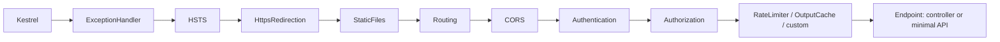
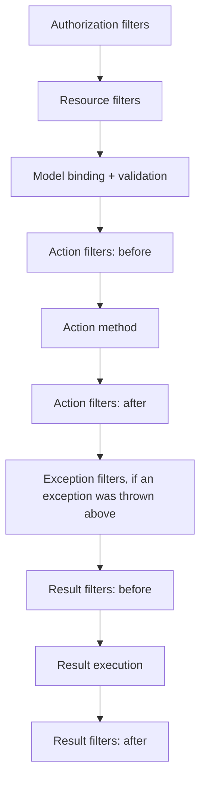
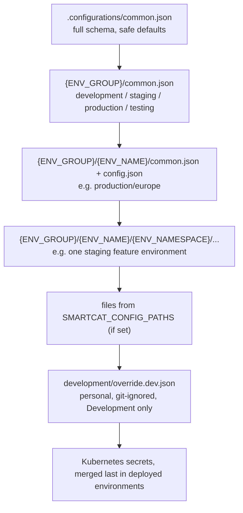

# 05. ASP.NET Core: hosting, pipeline, DI, config, APIs

## Why this chapter matters

Almost every .NET backend interview has an ASP.NET Core block. Interviewers use it to check if you
know what happens between "a TCP packet arrives" and "your controller method runs". The usual topics
are middleware order, DI lifetimes, options, logging, `HttpClient` and authentication. These are
also the places where real production bugs live: a singleton that holds a scoped service, a
middleware in the wrong order, a missing `[Authorize]`, a client created with `new HttpClient()`.
This chapter covers the framework in depth and shows how Smartcat builds on top of it.

## What you will be able to do

- Explain the generic host, `WebApplication`, Kestrel, and the full request pipeline, and say why
  middleware order matters for each built-in middleware.
- Choose between middleware, filters and endpoint filters, and between controllers and minimal APIs.
- Register services with the correct lifetime, find a captive dependency in a review, and explain
  why `IServiceProvider` in business code is a smell.
- Bind and validate configuration with the options pattern, and pick `IOptions`,
  `IOptionsSnapshot` or `IOptionsMonitor` for a given case.
- Write safe outbound HTTP code with `IHttpClientFactory`, timeouts and resilience handlers.
- Read a Smartcat service startup (`Program.cs`, `Server.cs`, `Modules.cs`) and add a module,
  a controller, a setting or an API client in the right place.

---

## 1. Hosting: generic host, WebApplication and Kestrel

### Concept

An ASP.NET Core app is a **generic host** (`IHost`) that runs a set of hosted services. One of these
hosted services is the web server. The host owns four things:

| Host part | What it gives you |
|---|---|
| Configuration (`IConfiguration`) | Layered key/value settings from JSON, env vars, command line |
| DI container (`IServiceProvider`) | All registered services |
| Logging (`ILoggerFactory`) | Providers such as console, NLog, OpenTelemetry |
| Lifetime (`IHostApplicationLifetime`) | Start and stop events, graceful shutdown |

Since .NET 6 the usual entry point is `WebApplication.CreateBuilder`. It is a thin, opinionated
wrapper over the generic host:

```csharp
var builder = WebApplication.CreateBuilder(args);   // config + logging + DI are ready

builder.Services.AddControllers();
builder.Services.AddProblemDetails();

var app = builder.Build();                          // DI container is built here, it is now read-only

app.UseExceptionHandler();
app.MapControllers();

app.Run();                                          // starts Kestrel and blocks until shutdown
```

`builder.Build()` is a hard line. Before it, you register services. After it, you configure the
pipeline. You cannot add services after `Build()`.

**Kestrel** is the cross-platform web server inside the process. It parses HTTP/1.1, HTTP/2 and
HTTP/3, owns connection limits and body size limits, and turns each request into an `HttpContext`.
In Kubernetes, Kestrel usually sits behind an ingress or a proxy that terminates TLS. That is why
`UseForwardedHeaders()` matters: without it, `Request.Scheme` and the client IP are the proxy's
values, not the real ones.

### Why

You need this model to answer "where does X happen?" questions. Config is read before services are
built. Services are built before the pipeline runs. Hosted services start before Kestrel accepts
traffic (by default). Shutdown signals go through `IHostApplicationLifetime`.

### Common mistake

Calling `builder.Services.BuildServiceProvider()` inside `Program.cs` to "get a service early". It
builds a **second container**. Singletons from it are different instances from the real app, and
the analyzer warns about it (ASP0000).

### Tip

If you need a configured value during registration, read it from `builder.Configuration`, not from
a service. If you need a service at startup, use a hosted service or `app.Services` after `Build()`.

---

## 2. The request pipeline and middleware order

### Concept

The pipeline is a chain of delegates. Each middleware gets `HttpContext` and a `next` delegate.
It can do work before `next`, call `next`, do work after `next`, or not call `next` at all
(short-circuit). Order of registration is order of execution on the way in, and reverse order on
the way out.



The recommended order for an API:

```csharp
var app = builder.Build();

if (!app.Environment.IsDevelopment())
{
    app.UseExceptionHandler();   // 1. outermost: catches everything below it
    app.UseHsts();               // 2. adds Strict-Transport-Security header
}

app.UseHttpsRedirection();       // 3. redirect http -> https
app.UseRouting();                // 4. selects the endpoint, stores it on HttpContext
app.UseCors();                   // 5. needs the endpoint (for per-endpoint policies), before auth
app.UseAuthentication();         // 6. builds HttpContext.User from the token or cookie
app.UseAuthorization();          // 7. reads the endpoint's [Authorize] metadata + User
app.UseRateLimiter();            // 8. may use the endpoint and the user for partitioning
app.MapControllers();            // 9. terminal: executes the endpoint
```

### Why each position matters

| Middleware | Why it sits there | What breaks if moved |
|---|---|---|
| `UseExceptionHandler` | Must wrap everything to catch exceptions from all later middleware | Exceptions above it return a raw 500 or a dropped connection |
| `UseHsts` | Only header logic; early is fine; not in Development | HSTS cached by browsers on localhost, painful to undo |
| `UseRouting` | Chooses the endpoint; later middleware can read `GetEndpoint()` | CORS and authorization cannot see endpoint metadata |
| `UseCors` | Must answer preflight `OPTIONS` before auth rejects it | Preflight gets 401, browser blocks the real call |
| `UseAuthentication` | Must run before anything that reads `User` | `User` is anonymous, so `[Authorize]` always fails |
| `UseAuthorization` | After routing (needs metadata) and authentication (needs user) | Before routing it sees no endpoint and allows the call |
| Endpoints | Terminal | Middleware registered after a terminal one never runs for matched routes |

Note: `WebApplication` adds `UseRouting` at the start and endpoint execution at the end
automatically if you do not call them. Since .NET 7 it also adds authentication and authorization
middleware when those services are registered. If you call them explicitly, your order wins. In an
interview, say this, and then say that you still write the order explicitly so the reader sees it.

### Common mistake

```csharp
// BAD: authorization runs before authentication; User is empty, every [Authorize] fails
app.UseAuthorization();
app.UseAuthentication();
```

```csharp
// BAD: exception handler registered late; exceptions thrown by auth middleware escape it
app.UseAuthentication();
app.UseExceptionHandler();
```

### Tip

When you debug "why does this request get 401/404/CORS error", draw the pipeline first. Most of
these bugs are order bugs, not logic bugs.

---

## 3. Writing custom middleware: convention vs IMiddleware

### Concept

There are three ways to write middleware.

**Inline** with `app.Use`:

```csharp
app.Use(async (context, next) =>
{
    var started = Stopwatch.GetTimestamp();
    await next(context);
    var elapsed = Stopwatch.GetElapsedTime(started);
    context.RequestServices.GetRequiredService<ILogger<Program>>()
        .LogInformation("Request {Path} took {ElapsedMs} ms", context.Request.Path, elapsed.TotalMilliseconds);
});
```

**Convention-based** class: a public constructor with `RequestDelegate`, and an
`Invoke`/`InvokeAsync` method.

```csharp
public sealed class CorrelationIdMiddleware
{
    private const string HeaderName = "X-Correlation-Id";
    private readonly RequestDelegate _next;

    public CorrelationIdMiddleware(RequestDelegate next) => _next = next;   // created ONCE

    // Scoped services go here, not in the constructor
    public async Task InvokeAsync(HttpContext context, ICorrelationContext correlation)
    {
        var id = context.Request.Headers[HeaderName].FirstOrDefault() ?? Guid.NewGuid().ToString("N");
        correlation.Set(id);
        context.Response.Headers[HeaderName] = id;
        await _next(context);
    }
}

app.UseMiddleware<CorrelationIdMiddleware>();
```

**Factory-based** with `IMiddleware`:

```csharp
public sealed class TenantMiddleware : IMiddleware
{
    private readonly ITenantResolver _resolver;   // can be scoped

    public TenantMiddleware(ITenantResolver resolver) => _resolver = resolver;

    public async Task InvokeAsync(HttpContext context, RequestDelegate next)
    {
        await _resolver.ResolveAsync(context);
        await next(context);
    }
}

builder.Services.AddScoped<TenantMiddleware>();   // REQUIRED, or UseMiddleware throws at runtime
app.UseMiddleware<TenantMiddleware>();
```

| | Convention-based | `IMiddleware` |
|---|---|---|
| Instance lifetime | One instance for the app (effectively singleton) | Resolved from DI per request, with the lifetime you register |
| Scoped dependencies | Only as `InvokeAsync` parameters | Constructor is fine |
| Registration in DI | Not needed | Required |
| Compile-time contract | None (reflection on method name) | Interface |

### Why

The convention-based constructor runs once. If you put a scoped service there, you have a captive
dependency (section 7). This is the most common middleware bug in reviews.

### Common mistake

```csharp
// BAD: DbContext/unit-of-work is scoped, but this constructor runs once for the whole app
public AuditMiddleware(RequestDelegate next, IUnitOfWork unitOfWork) { ... }
```

In Development, scope validation throws at startup. In Production it may silently work with a
root-scope instance shared by all requests.

### Tip

Short-circuit early and cheap. A middleware that rejects a request (for example 413 for a large
body) should do it before it reads anything.

---

## 4. Endpoint routing, controllers and minimal APIs

### Concept

Endpoint routing splits **matching** (`UseRouting`) from **execution** (the endpoint at the end).
An endpoint is a `RequestDelegate` plus metadata (`[Authorize]`, CORS policy, rate limit policy,
OpenAPI info). Controllers and minimal APIs both produce endpoints.

Route templates support constraints:

```csharp
[HttpGet("projects/{projectId:guid}/tasks/{taskId:guid}")]
```

A constraint is for **matching**, not validation. A failed constraint gives 404, not 400.

**Controllers**:

```csharp
[ApiController]
[Route("api/projects")]
[Authorize]
public sealed class ProjectsController : ControllerBase
{
    private readonly IProjectService _projects;

    public ProjectsController(IProjectService projects) => _projects = projects;

    [HttpGet("{id:guid}")]
    public async Task<ActionResult<ProjectDto>> Get(Guid id, CancellationToken ct)
    {
        var project = await _projects.FindAsync(id, ct);
        return project is null ? NotFound() : project;
    }
}
```

**Minimal APIs**:

```csharp
var projects = app.MapGroup("/api/projects").RequireAuthorization();

projects.MapGet("/{id:guid}", async Task<Results<Ok<ProjectDto>, NotFound>> (
        Guid id, IProjectService service, CancellationToken ct) =>
    await service.FindAsync(id, ct) is { } project
        ? TypedResults.Ok(project)
        : TypedResults.NotFound());
```

| | Controllers | Minimal APIs |
|---|---|---|
| Structure | Classes, attributes, conventions | Lambdas or static methods, route groups |
| Filters | Full MVC filter pipeline | Endpoint filters (`IEndpointFilter`, .NET 7+) |
| Validation | `[ApiController]` automatic 400 | .NET 10 built-in `AddValidation()`; before that manual or filter |
| Performance | Good | Slightly less overhead; supports Native AOT better |
| Big teams, many endpoints | Familiar, discoverable | Needs discipline (extension methods per feature) |
| Code generation (NSwag clients) | Mature | Works, with `TypedResults` for accurate schemas |

### Why

Interviewers do not want "minimal APIs are better". They want the tradeoff: minimal APIs give less
ceremony and less overhead; controllers give a richer filter model and a structure many teams know.
Both run on the same routing and the same middleware.

### Common mistake

Return `IResult` from minimal APIs without types. OpenAPI then cannot describe the response.
Use `TypedResults` and `Results<T1, T2>` so the schema is known at compile time.

### Tip

At Smartcat, most service APIs are controllers (they feed NSwag client generation), while
smartcat-ai-agents also maps minimal-style endpoints (`MapAGUI`, `MapMcp`) for streaming protocols.
Both live in one app without conflict.

---

## 5. Filters vs middleware

### Concept

Filters run **inside** the MVC action pipeline, after an endpoint is selected and a controller is
chosen. They see MVC concepts: `ActionArguments`, `ModelState`, `IActionResult`.



| Filter type | Typical use |
|---|---|
| Authorization (`IAuthorizationFilter`) | Rare today; prefer policies |
| Resource (`IResourceFilter`) | Short-circuit before model binding (caching, feature gate) |
| Action (`IAsyncActionFilter`) | Wrap the action: transactions, argument checks, timing |
| Exception (`IExceptionFilter`) | Map exceptions from the action to a result (MVC only) |
| Result (`IResultFilter`) | Change the result: headers, envelope |

Exception filters catch exceptions from model binding, action filters and the action. They do
**not** catch exceptions thrown during result execution or in middleware. Global exception
handling belongs in middleware (section 17).

```csharp
internal sealed class TransactionFilter : IAsyncActionFilter
{
    private readonly IDatabaseHelper _database;

    public TransactionFilter(IDatabaseHelper database) => _database = database;

    public Task OnActionExecutionAsync(ActionExecutingContext context, ActionExecutionDelegate next) =>
        _database.WithTransaction(async (_, _) =>
        {
            var executed = await next();
            if (executed.Exception is not null)
                ExceptionDispatchInfo.Throw(executed.Exception);   // rethrow so the transaction aborts
        });
}
```

This is a simplified version of a real filter in `project-tasks-service/src/WebModule/ActionFilters/TransactionFilter.cs`.

### Choosing

| Need | Use |
|---|---|
| Applies to every request, including static files, health checks, 404s | Middleware |
| Needs `ActionArguments`, `ModelState`, the controller instance | Action filter |
| Needs to apply only to some actions, declared with an attribute | Filter (or endpoint metadata read by middleware) |
| Minimal API endpoint | Endpoint filter |

### Common mistake

Filters with dependencies applied as `[MyFilter]` attributes. Attributes cannot take constructor
injection. Use `[ServiceFilter(typeof(MyFilter))]` (filter must be registered), `[TypeFilter]`, or
an `IFilterFactory`. Also note `IsReusable`: if `true`, the framework may cache the instance, so it
must not hold per-request state.

### Tip

A transaction filter returns the action's exception through `ExceptionDispatchInfo.Throw` instead
of `throw executed.Exception`. That keeps the original stack trace.

---

## 6. Model binding and validation

### Concept

Model binding maps the HTTP request to action parameters. Sources: route, query, header, body,
form, services. With `[ApiController]`, sources are inferred: complex types come from the body,
simple types from route or query, registered services from DI.

`[ApiController]` also gives:

1. **Automatic 400**: if `ModelState` is invalid, the action does not run. The response is a
   `ValidationProblemDetails` (RFC 9457 problem details, formerly RFC 7807):

   ```json
   {
     "type": "https://tools.ietf.org/html/rfc9110#section-15.5.1",
     "title": "One or more validation errors occurred.",
     "status": 400,
     "errors": { "Name": ["The Name field is required."] }
   }
   ```

2. Attribute routing is required.
3. Error status codes (`NotFound()`, etc.) become problem details when `AddProblemDetails` is used.

Validation with data annotations:

```csharp
public sealed class CreateProjectRequest
{
    [Required, MaxLength(255)]
    public string Name { get; init; } = string.Empty;

    [Range(1, 100)]
    public int MaxAssignees { get; init; }
}
```

**FluentValidation** is common for rules that do not fit attributes (cross-field rules, async
lookups). The old auto-validation integration package is deprecated. The recommended way is to
call the validator explicitly, or from a filter:

```csharp
public sealed class CreateProjectValidator : AbstractValidator<CreateProjectRequest>
{
    public CreateProjectValidator()
    {
        RuleFor(x => x.Name).NotEmpty().MaximumLength(255);
        RuleFor(x => x.MaxAssignees).InclusiveBetween(1, 100);
    }
}

[HttpPost]
public async Task<IActionResult> Create(
    CreateProjectRequest request, IValidator<CreateProjectRequest> validator, CancellationToken ct)
{
    var result = await validator.ValidateAsync(request, ct);
    if (!result.IsValid)
        return ValidationProblem(new ValidationProblemDetails(result.ToDictionary()));

    ...
}
```

### Why

Validation at the edge keeps invalid data out of the domain. But it is not a security boundary for
**ownership**. A well-formed `projectId` can still belong to another workspace. Ownership checks
belong in the service, after loading the resource (see chapter 13 (Secure .NET code)).

### Common mistake

Taking actor identity from the body:

```csharp
// BAD: the caller decides who "updated" the record
public sealed class UpdateTaskRequest { public Guid UpdatedByUserId { get; init; } ... }
```

Take it from `User` (the authenticated principal). This is review rule S20.

### Tip

Strongly typed IDs (`ProjectId` wrapping a `Guid`) need a `TypeConverter` to bind from the route,
and a JSON converter for the body. Smartcat API contracts follow this rule
(`backend-smartcat-api-contracts-client`).

---

## 7. Dependency injection in depth

### 7.1 Lifetimes

| Lifetime | One instance per | Typical use |
|---|---|---|
| Singleton | Application | Stateless services, caches, clients, options monitors |
| Scoped | Scope (one HTTP request by default) | Unit of work, request context, per-request user info |
| Transient | Every resolution | Lightweight stateless helpers |

The core rule: **a service must not depend on a service with a shorter lifetime.**

### 7.2 Captive dependency (review rule A1)

```csharp
builder.Services.AddScoped<IRequestContext, RequestContext>();
builder.Services.AddSingleton<IPriceCalculator, PriceCalculator>();

public sealed class PriceCalculator : IPriceCalculator
{
    private readonly IRequestContext _context;   // BAD: captured from the first request, forever

    public PriceCalculator(IRequestContext context) => _context = context;
}
```

The singleton is created once. It gets the scoped instance that exists at that moment and keeps it.
Every later request sees the first request's user, workspace or culture. This compiles, passes unit
tests, and fails only under real traffic. It is also a security bug if the captured state is a
tenant id.

Detection:

- `ValidateScopes` and `ValidateOnBuild` are on by default in the Development environment. The
  error is "Cannot consume scoped service 'X' from singleton 'Y'".
- Turn them on in tests too:

```csharp
builder.Host.UseDefaultServiceProvider(o =>
{
    o.ValidateScopes = true;
    o.ValidateOnBuild = true;
});
```

Other forms of the same bug that review rule A1 lists:

- The same interface registered with two lifetimes in two places.
- `IHttpContextAccessor` used in a singleton that background workers also call: there is no
  `HttpContext` in a background thread.
- A transient `IDisposable` resolved from the root provider: the root keeps it until the app stops.
  That is a memory leak.

Fixes, in order of preference: make the consumer scoped; pass the value as a method parameter;
inject `IServiceScopeFactory` and create a scope per unit of work (7.4).

### 7.3 Service locator (review rule A16)

```csharp
// BAD: hides dependencies, fails at runtime instead of at startup
public sealed class InvoiceService
{
    private readonly IServiceProvider _provider;
    public InvoiceService(IServiceProvider provider) => _provider = provider;

    public Task Send(Guid id) => _provider.GetRequiredService<IMailer>().Send(id);
}
```

Why it is bad:

- The constructor no longer tells you what the class needs.
- Missing registrations fail at the call, not at `ValidateOnBuild`.
- Tests must build a real container or fake `IServiceProvider`.
- Lifetime errors are harder to see.

`IServiceProvider` is fine in composition-root code, in factories (classes named `*Factory`), and in
hosted service startup. Everywhere else, inject the dependency, or inject `IServiceScopeFactory`
with a short doc comment that says why.

### 7.4 IServiceScopeFactory in background services

A `BackgroundService` is a singleton. To use scoped services, create a scope per unit of work:

```csharp
public sealed class OutboxPublisher : BackgroundService
{
    private readonly IServiceScopeFactory _scopeFactory;
    private readonly ILogger<OutboxPublisher> _logger;

    public OutboxPublisher(IServiceScopeFactory scopeFactory, ILogger<OutboxPublisher> logger)
    {
        _scopeFactory = scopeFactory;
        _logger = logger;
    }

    protected override async Task ExecuteAsync(CancellationToken stoppingToken)
    {
        using var timer = new PeriodicTimer(TimeSpan.FromSeconds(1));
        while (await timer.WaitForNextTickAsync(stoppingToken))
        {
            await using var scope = _scopeFactory.CreateAsyncScope();
            var outbox = scope.ServiceProvider.GetRequiredService<IOutboxRepository>();
            await outbox.PublishPendingAsync(stoppingToken);
        }
    }
}
```

One scope per iteration means a fresh unit of work each time, and disposal of scoped resources.

### 7.5 Keyed services (.NET 8)

```csharp
builder.Services.AddKeyedSingleton<IStorage, S3Storage>("s3");
builder.Services.AddKeyedSingleton<IStorage, LocalStorage>("local");

public sealed class ExportService([FromKeyedServices("s3")] IStorage storage) { ... }

var agent = app.Services.GetRequiredKeyedService<AIAgent>(RuntimeAgentKeys.Smartcat);
```

Use keys when you have several implementations of one interface and the consumer must choose one.
smartcat-ai-agents uses keyed `AIAgent` registrations and maps each one to a route
(`src/Service/AgentEndpoints.cs`).

### 7.6 Registration order, TryAdd and multiple registrations

- `GetService<T>()` returns the **last** registration of `T`.
- `IEnumerable<T>` returns **all** registrations in registration order.
- `TryAddSingleton<T, TImpl>()` adds only if `T` has no registration yet. Libraries use it so an app
  can override a default by registering first.
- `TryAddEnumerable(ServiceDescriptor.Singleton<IValidator, A>())` adds only if this exact
  implementation type is not already in the list. Use it for plugin lists, so calling a
  registration extension twice does not add duplicates.
- `Replace(...)` swaps a registration; `RemoveAll<T>()` removes all. Tests use these.

```csharp
public static IServiceCollection AddBilling(this IServiceCollection services)
{
    services.TryAddSingleton<IClock, SystemClock>();                        // app may override
    services.TryAddEnumerable(ServiceDescriptor.Singleton<IInvoiceRule, VatRule>());
    return services;
}
```

Review rule A2 says: if order changes behavior and nothing documents or enforces the order, flag
it and ask "what guarantees this order?".

### Common mistake

A typed `HttpClient` injected into a singleton. Typed clients are transient. The singleton keeps one
instance and its handler forever, so DNS changes are never seen (section 10).

### Tip

When you review DI, list every `Add*` call and draw arrows from consumer to dependency. Any arrow
from a longer lifetime to a shorter one is a finding.

---

## 8. Configuration and options

### 8.1 Layering

Configuration is a stack of providers. A later provider overrides keys from an earlier one. The
default stack for `WebApplication.CreateBuilder`:

1. `appsettings.json`
2. `appsettings.{Environment}.json`
3. User secrets (Development only)
4. Environment variables (`Storage__Default__Port` maps to `Storage:Default:Port`)
5. Command-line arguments

Keys are case-insensitive. Arrays are indexed keys (`Servers:0`, `Servers:1`). That last fact
explains a classic surprise: an override file with a shorter array does **not** remove the extra
elements of the base array, because index `2` from the base file is still there.

At Smartcat, services replace `appsettings.json` with a `.configurations/` folder (see "At
Smartcat" below).

### 8.2 Options pattern

```csharp
public sealed class ExportOptions
{
    public const string SectionName = "export";

    [Required, Url]
    public string StorageUrl { get; init; } = string.Empty;

    [Range(1, 64)]
    public int MaxParallelism { get; init; } = 4;

    public TimeSpan Timeout { get; init; } = TimeSpan.FromSeconds(30);
}

builder.Services
    .AddOptions<ExportOptions>()
    .BindConfiguration(ExportOptions.SectionName)
    .ValidateDataAnnotations()
    .ValidateOnStart();   // fail at startup, not at the first request
```

| Interface | Lifetime | Reloads on change | Use when |
|---|---|---|---|
| `IOptions<T>` | Singleton | No, value is fixed after first read | Most settings |
| `IOptionsSnapshot<T>` | Scoped | Yes, once per request/scope | Per-request consistency; named options |
| `IOptionsMonitor<T>` | Singleton | Yes, `CurrentValue` + `OnChange` | Singletons and background services that must see changes |

`IOptionsSnapshot<T>` cannot be injected into a singleton: it is scoped, so that is a captive
dependency again.

For rules that data annotations cannot express, implement `IValidateOptions<T>`:

```csharp
internal sealed class ExportOptionsValidator : IValidateOptions<ExportOptions>
{
    public ValidateOptionsResult Validate(string? name, ExportOptions options) =>
        options.Timeout <= TimeSpan.Zero
            ? ValidateOptionsResult.Fail("export:timeout must be positive")
            : ValidateOptionsResult.Success;
}

builder.Services.AddSingleton<IValidateOptions<ExportOptions>, ExportOptionsValidator>();
```

.NET 8 also has a source-generated validator (`[OptionsValidator]` on a partial class) that avoids
reflection and works with Native AOT.

### 8.3 Review rules S10 and S17

- **S10**: business classes take `IOptions<TConfig>`, not raw `IConfiguration`. Raw configuration
  hides which keys a class needs, has no types, and cannot be validated at startup.
- **S17**: secrets and crypto config must be validated at startup (`ValidateOnStart`). A missing
  encryption key should stop the pod at deploy time, not fail the first customer request at 3 a.m.

```csharp
// BAD (S10): stringly-typed, unvalidated, hidden dependency
public sealed class Exporter(IConfiguration configuration)
{
    private readonly int _parallelism = int.Parse(configuration["export:maxParallelism"]!);
}

// GOOD
public sealed class Exporter(IOptions<ExportOptions> options)
{
    private readonly ExportOptions _options = options.Value;
}
```

### Common mistake

Reading `options.Value` in the constructor of a singleton and expecting hot reload. `IOptions<T>`
never reloads. If an operator should change a value without a redeploy, use `IOptionsMonitor<T>`
and read `CurrentValue` at the point of use.

### Tip

Give every setting a safe in-code default **and** define it in the base config file. The default
protects you from a missing section; the base file documents the schema.

---

## 9. Logging

### Concept

`ILogger<T>` is the abstraction. Providers (console, NLog, Serilog, OpenTelemetry) write the
output. The category is the type name, so you can filter per namespace in config.

**Structured logging with message templates**:

```csharp
// GOOD: template + arguments; "ProjectId" becomes a searchable field
_logger.LogInformation("Project {ProjectId} exported in {ElapsedMs} ms", projectId, elapsed);

// BAD: string interpolation; one unique string per call, no fields, allocates even if disabled
_logger.LogInformation($"Project {projectId} exported in {elapsed} ms");
```

The template is a constant. Log stores group by it. The placeholders become properties you can
query in Kibana. The analyzer CA2254 warns about non-constant templates.

**Scopes** add properties to every log line inside them:

```csharp
using (_logger.BeginScope(new Dictionary<string, object> { ["WorkspaceId"] = workspaceId }))
{
    _logger.LogInformation("Starting import");
    await _importer.RunAsync(ct);   // logs inside also carry WorkspaceId (if the provider supports scopes)
}
```

**LoggerMessage source generator** for hot paths:

```csharp
internal static partial class ExportLog
{
    [LoggerMessage(EventId = 1001, Level = LogLevel.Information,
        Message = "Project {ProjectId} exported in {ElapsedMs} ms")]
    public static partial void ProjectExported(this ILogger logger, Guid projectId, double elapsedMs);
}

_logger.ProjectExported(projectId, elapsed.TotalMilliseconds);
```

It generates code that checks `IsEnabled` first and does not box value types or allocate an
argument array. Use it for logs on hot paths.

### Review rule S11: no PII and no bodies in logs

Log status codes, durations, ids. Do not log response bodies, document text, emails, tokens or
translation segments at Information or higher. Smartcat content is customer content; logs are
kept longer and read by more people than the database.

```csharp
// BAD
_logger.LogWarning("Sidecar failed: {Body}", await response.Content.ReadAsStringAsync(ct));

// GOOD
_logger.LogWarning("Sidecar failed with {StatusCode} for request {RequestId}",
    (int)response.StatusCode, requestId);
```

### Common mistake

Using `LogError(ex.Message)` and losing the stack trace. Pass the exception as the first argument:
`_logger.LogError(ex, "Export of {ProjectId} failed", projectId)`.

### Tip

At Smartcat the services use NLog (`NLog.config` in `src/Service`, `NLogCustomItemsInitializer` in
`Program.cs`). Your code still writes to `ILogger<T>`; NLog is the provider behind it (likely
through the platform's integration).

---

## 10. HttpClient and IHttpClientFactory

### Concept

Two classic bugs:

1. **Socket exhaustion**: `new HttpClient()` per call, then `Dispose()`. Each disposal closes the
   connection, which stays in `TIME_WAIT`. Under load, the machine runs out of ephemeral ports.
2. **Stale DNS**: one static `HttpClient` forever. Connections are reused forever, so a service that
   moved to a new IP is never reached.

`IHttpClientFactory` solves both. It pools `HttpMessageHandler` instances and rotates them (default
handler lifetime is 2 minutes). `HttpClient` objects are cheap wrappers; the handlers are the
expensive part.

```csharp
// Named client
builder.Services.AddHttpClient("pdf-sidecar", c =>
{
    c.BaseAddress = new Uri(builder.Configuration["pdfSidecar:url"]!);
    c.Timeout = TimeSpan.FromSeconds(30);
});

// Typed client
builder.Services.AddHttpClient<IRatesClient, RatesClient>(c => c.Timeout = TimeSpan.FromSeconds(10))
    .AddStandardResilienceHandler();   // Microsoft.Extensions.Http.Resilience (Polly v8)

public sealed class RatesClient(HttpClient http) : IRatesClient
{
    public Task<RatesDto?> GetAsync(string currency, CancellationToken ct) =>
        http.GetFromJsonAsync<RatesDto>($"rates/{Uri.EscapeDataString(currency)}", ct);
}
```

A non-factory alternative for singletons: one `HttpClient` with
`new SocketsHttpHandler { PooledConnectionLifetime = TimeSpan.FromMinutes(2) }`. That also fixes DNS.

### Resilience and timeouts

`AddStandardResilienceHandler()` adds, in order: a rate limiter, a total timeout, retries with
exponential backoff and jitter, a circuit breaker, and a per-attempt timeout. Points to explain:

- **Retry only idempotent calls**, or calls with an idempotency key. A retried `POST /payments` can
  charge twice.
- **Two timeouts**: per-attempt and total. `HttpClient.Timeout` (default 100 s) wraps everything,
  including all retries, so set it larger than the resilience total timeout or leave the
  resilience pipeline in charge.
- **Pass the `CancellationToken`** from the request, so a client that disconnects stops the
  outbound call too.
- Circuit breakers should count infrastructure failures (5xx, timeouts), not user errors (4xx).
  Review rule A30 flags a breaker that counts every exception.

### Common mistake

A typed client captured in a singleton (captive dependency). Inject `IHttpClientFactory` into the
singleton and create the client per call, or make the consumer transient or scoped.

### Tip

At Smartcat, calls to **other Smartcat services** do not use raw `HttpClient` at all. You reference
the service's published `*.ApiClient` NuGet package and register it through
`HttpClientSettingsBuilder` (see "At Smartcat"). Raw `IHttpClientFactory` named clients are for
third-party or sidecar endpoints, for example the PDF sidecar proxy in
`smartcat-ai-agents/src/Module/Agents/PdfTranslation/SidecarHttpProxy.cs`.

---

## 11. Authentication and authorization

### Concept

- **Authentication** answers "who are you?". It builds `HttpContext.User` from a token, cookie or
  header. Failure gives **401**.
- **Authorization** answers "may you do this?". It evaluates policies against `User` and the
  resource. Failure for an authenticated user gives **403**.

JWT bearer setup:

```csharp
builder.Services
    .AddAuthentication(JwtBearerDefaults.AuthenticationScheme)
    .AddJwtBearer(options =>
    {
        options.Authority = builder.Configuration["auth:authority"];
        options.Audience = "projects-api";
        options.MapInboundClaims = false;   // keep "sub", do not rename to long URIs
        options.TokenValidationParameters.ClockSkew = TimeSpan.FromSeconds(30);
        options.EventsType = typeof(PlatformJwtBearerEvents);   // S21: named class, not inline lambdas
    });

builder.Services.AddScoped<PlatformJwtBearerEvents>();

builder.Services.AddAuthorizationBuilder()
    .SetFallbackPolicy(new AuthorizationPolicyBuilder().RequireAuthenticatedUser().Build())
    .AddPolicy("WorkspaceAdmin", p => p.RequireClaim("role", "workspace-admin"));
```

```csharp
public sealed class PlatformJwtBearerEvents : JwtBearerEvents
{
    public override Task MessageReceived(MessageReceivedContext context)
    {
        // Example: token from a custom header used by an internal gateway
        if (context.Request.Headers.TryGetValue("X-Token", out var token))
            context.Token = token;
        return Task.CompletedTask;
    }
}
```

- **Fallback policy** applies to endpoints that have no authorization metadata at all. It turns
  "secure by attribute" into "secure by default". `[AllowAnonymous]` opts out.
- **Resource-based authorization** (`IAuthorizationService.AuthorizeAsync(User, resource, policy)`)
  is for checks that need the loaded entity, such as "this project belongs to the caller's
  workspace".

### Review rules S20 and S21

- **S20 (BLOCKER)**: every `[HttpPost]`, `[HttpPut]`, `[HttpPatch]`, `[HttpDelete]` needs
  `[Authorize]` on the action or the controller (or a fallback policy). Actor identity comes from
  `User`, never from the DTO.
- **S21 (MAJOR)**: JWT event handlers longer than a few lines do not belong inline in
  `Program.cs`/`Server.cs`. Extract them into a named class with methods you can unit test.

### Common mistake

Confusing 401 and 403. A missing or invalid token is 401 with a `WWW-Authenticate` header. A valid
token without permission is 403. Returning 403 for a missing token makes client retry logic wrong.

### Tip

Internal service-to-service endpoints often rely on network boundaries and Basic auth. That is a
real design choice, but in a review you still ask: "what stops a caller inside the cluster from
calling this write endpoint?"

---

## 12. Hosted services and BackgroundService

### Concept

`IHostedService` has `StartAsync` and `StopAsync`. `BackgroundService` is a base class that runs
your `ExecuteAsync` loop and connects `stoppingToken` to shutdown.

Shutdown sequence (simplified): SIGTERM → `IHostApplicationLifetime.ApplicationStopping` fires →
Kestrel stops accepting new connections and drains in-flight requests → hosted services get
`StopAsync` (in reverse registration order) → `stoppingToken` is cancelled → host waits up to
`HostOptions.ShutdownTimeout` (30 s by default since .NET 6) → process exits.

```csharp
public sealed class DeadlineNotifier : BackgroundService
{
    private readonly IServiceScopeFactory _scopes;
    private readonly ILogger<DeadlineNotifier> _logger;

    public DeadlineNotifier(IServiceScopeFactory scopes, ILogger<DeadlineNotifier> logger)
    {
        _scopes = scopes;
        _logger = logger;
    }

    protected override async Task ExecuteAsync(CancellationToken stoppingToken)
    {
        while (!stoppingToken.IsCancellationRequested)
        {
            try
            {
                await using var scope = _scopes.CreateAsyncScope();
                await scope.ServiceProvider.GetRequiredService<IDeadlineService>()
                    .NotifyDueAsync(stoppingToken);
            }
            catch (OperationCanceledException) when (stoppingToken.IsCancellationRequested)
            {
                break;   // normal shutdown
            }
            catch (Exception ex)
            {
                _logger.LogError(ex, "Deadline notification cycle failed");
            }

            await Task.Delay(TimeSpan.FromSeconds(30), stoppingToken);
        }
    }
}
```

Facts interviewers check:

- `ExecuteAsync` should not block synchronously before its first `await`. Host startup waits for
  `StartAsync`, and `BackgroundService.StartAsync` runs `ExecuteAsync` until its first real `await`.
- Since .NET 6, an unhandled exception in `ExecuteAsync` **stops the host** by default
  (`BackgroundServiceExceptionBehavior.StopHost`). Before that, the service died silently.
- Pass `stoppingToken` to every call, so shutdown is fast.
- Kubernetes sends SIGKILL after `terminationGracePeriodSeconds`. If that is shorter than your
  shutdown work, the work is cut.

### Common mistake

Using `BackgroundService` for business jobs that must survive a restart. An in-memory loop has no
retry state, no distribution across pods and no idempotency. At Smartcat, durable jobs use the task
processing framework (see chapter 08 (Background task processing)).

### Tip

Review rule A2: several hosted services with side effects in `StartAsync`, where correctness depends
on their order, is a finding. Make the order explicit or use one composite initializer.

---

## 13. Health checks

```csharp
builder.Services.AddHealthChecks()
    .AddCheck("self", () => HealthCheckResult.Healthy(), tags: ["live"])
    .AddMongoDb(/* ... */, tags: ["ready"]);

app.MapHealthChecks("/health/live", new HealthCheckOptions { Predicate = c => c.Tags.Contains("live") });
app.MapHealthChecks("/health/ready", new HealthCheckOptions { Predicate = c => c.Tags.Contains("ready") });
```

- **Liveness**: "is the process alive?". If it fails, Kubernetes restarts the pod. Keep it cheap and
  free of dependencies. If liveness checks the database, a database outage restarts every pod,
  which makes the outage worse.
- **Readiness**: "can this pod take traffic now?". Failing removes the pod from the load balancer,
  without a restart. Dependencies belong here.
- Health endpoints should be excluded from authentication and from noisy request logging.

At Smartcat, smartcat-ai-agents registers Mongo and Redis checks through the platform's
`ConfigureHealthChecks(...)` in `src/Service/Server.cs`.

---

## 14. Request size limits and streaming bodies (review rules S7, S22)

### Concept

Default limits:

| Limit | Default | Where |
|---|---|---|
| Kestrel `MaxRequestBodySize` | 30,000,000 bytes (about 28.6 MB) | `KestrelServerOptions.Limits` |
| Multipart body (`FormOptions.MultipartBodyLengthLimit`) | 128 MB | Form/file upload binding |
| `EnableBuffering` in-memory threshold | 30 KB, then a temp file | `HttpRequest.EnableBuffering(bufferThreshold, bufferLimit)` |

Per endpoint: `[RequestSizeLimit(10_000_000)]`, `[DisableRequestSizeLimit]`, or
`IHttpMaxRequestBodySizeFeature` in middleware (before the body is read).

**S7**: a middleware that calls `Request.EnableBuffering()` and reads the body into memory must
check `ContentLength` first and reject large bodies with 413.

**S22**: file serving and proxying must stream. Do not copy an arbitrary upload into a
`MemoryStream`.

```csharp
// BAD (S22): whole upload in memory; 10 parallel 500 MB uploads = OOM
var buffer = new MemoryStream();
await Request.Body.CopyToAsync(buffer, ct);
await _storage.SaveAsync(buffer.ToArray(), ct);

// GOOD: stream through with a per-route cap
[HttpPost("files")]
[RequestSizeLimit(200_000_000)]
public async Task<IActionResult> Upload(CancellationToken ct)
{
    await _storage.SaveAsync(Request.Body, ct);   // storage reads the stream in chunks
    return NoContent();
}

// GOOD: early reject in middleware
if (context.Request.ContentLength is > MaxAguiBodyBytes)
{
    context.Response.StatusCode = StatusCodes.Status413PayloadTooLarge;
    return;
}
```

For a proxy, `HttpCompletionOption.ResponseHeadersRead` plus `CopyToAsync(Response.Body)` streams
the upstream response without buffering it.

### Common mistake

`[DisableRequestSizeLimit]` "because uploads failed". That removes the only cap. Set a real limit
for the real maximum file size.

### Tip

A real example to discuss: `smartcat-ai-agents/src/WebModule/Middleware/AguiRequestBodyMiddleware.cs`
calls `EnableBuffering()` and `ReadToEndAsync()` to repair a JSON body. Kestrel's default 30 MB
limit still caps it (unless a deployment raises the limit), and the body is a chat request, not a
file. A reviewer applying S7 would still ask for an explicit, smaller `ContentLength` check on that
route.

---

## 15. Output caching and response caching

| | Response caching (`UseResponseCaching`) | Output caching (`UseOutputCache`, .NET 7+) |
|---|---|---|
| Driven by | HTTP `Cache-Control` headers, client can bypass | Server-side policies |
| Invalidation | None (wait for expiry) | Tags: `EvictByTagAsync("projects")` |
| Store | In memory | In memory, or Redis (.NET 8+) |
| Stampede protection | No | Yes, request coalescing (resource locking) |

```csharp
builder.Services.AddOutputCache(o =>
    o.AddPolicy("rates", p => p.Expire(TimeSpan.FromMinutes(5)).Tag("rates")));

app.UseOutputCache();   // after UseRouting/UseCors; before endpoints

app.MapGet("/rates", GetRates).CacheOutput("rates");
```

By default output caching only caches `GET`/`HEAD` with status 200, and does not cache
authenticated requests or responses that set cookies. That default protects you from serving one
user's data to another.

### Common mistake

Caching a response that depends on the tenant without varying by the tenant
(`p.SetVaryByHeader(...)` or a custom key). That is a data leak between workspaces.

### Tip

Memory stores are per pod. With N pods you have N caches and N different eviction moments. Review
rule A18 says the same about `IMemoryCache` in flows that run across pods.

---

## 16. Rate limiting middleware (.NET 7+)

```csharp
builder.Services.AddRateLimiter(o =>
{
    o.RejectionStatusCode = StatusCodes.Status429TooManyRequests;   // default is 503
    o.AddPolicy("per-workspace", context =>
        RateLimitPartition.GetTokenBucketLimiter(
            partitionKey: context.User.FindFirst("workspace_id")?.Value ?? "anonymous",
            factory: _ => new TokenBucketRateLimiterOptions
            {
                TokenLimit = 100,
                TokensPerPeriod = 50,
                ReplenishmentPeriod = TimeSpan.FromSeconds(10),
                QueueLimit = 0,
            }));
});

app.UseRateLimiter();   // after UseAuthentication if the partition uses User
app.MapPost("/exports", StartExport).RequireRateLimiting("per-workspace");
```

| Algorithm | Behavior |
|---|---|
| Fixed window | N requests per window; bursts at window edges |
| Sliding window | Window split into segments; smoother |
| Token bucket | Steady refill with allowed bursts |
| Concurrency | Limits parallel in-flight requests, not rate |

Two points for a strong answer: the default rejection code is 503, so set 429; and the limiter is
per process, so with 4 pods the real limit is 4 times larger. Cluster-wide limits need a shared
store or limits at the gateway.

---

## 17. Problem details and global exception handling

### Concept

.NET 8 added `IExceptionHandler`. It plugs into `UseExceptionHandler()` and lets you map exception
types to responses in DI-friendly classes:

```csharp
internal sealed class DomainExceptionHandler : IExceptionHandler
{
    private readonly IProblemDetailsService _problemDetails;
    private readonly ILogger<DomainExceptionHandler> _logger;

    public DomainExceptionHandler(IProblemDetailsService problemDetails, ILogger<DomainExceptionHandler> logger)
    {
        _problemDetails = problemDetails;
        _logger = logger;
    }

    public async ValueTask<bool> TryHandleAsync(HttpContext context, Exception exception, CancellationToken ct)
    {
        var status = exception switch
        {
            ResourceNotFoundException => StatusCodes.Status404NotFound,
            ForbiddenException => StatusCodes.Status403Forbidden,
            DomainValidationException => StatusCodes.Status400BadRequest,
            _ => 0,
        };
        if (status == 0)
            return false;   // let the next handler (or the default 500) handle it

        _logger.LogInformation(exception, "Handled domain exception with {StatusCode}", status);
        context.Response.StatusCode = status;
        return await _problemDetails.TryWriteAsync(new ProblemDetailsContext
        {
            HttpContext = context,
            Exception = exception,
            ProblemDetails = { Status = status, Title = exception.Message },
        });
    }
}

builder.Services.AddProblemDetails(o =>
    o.CustomizeProblemDetails = c => c.ProblemDetails.Extensions["traceId"] = Activity.Current?.TraceId.ToString());
builder.Services.AddExceptionHandler<DomainExceptionHandler>();   // handlers run in registration order

app.UseExceptionHandler();
app.UseStatusCodePages();   // problem details for empty 404/405 responses too
```

### Why

One place for exception mapping gives one response shape for all clients and one place to log.
Problem details (RFC 9457) is a standard shape that generated clients and frontends can parse.

### Common mistake

Returning `exception.ToString()` or the stack trace to the client in Production. That leaks
internal paths, library versions and sometimes data. Return a trace id and log the details.

### Tip

Do not use exceptions for expected outcomes on hot paths (for example "not found" in a loop).
Exceptions are expensive. Map them at the edge for truly exceptional or cross-layer cases.

At Smartcat, services written before .NET 8 use a custom middleware for this
(`UnexpectedExceptionHandlingMiddleware` in project-tasks-service and smartcat-ai-agents). It maps
`ResourceNotFoundException` to 404, `ForbiddenException` to 403, `ArgumentException` to 400, and
adds a correlation id and the trace id. Same idea, older API.

---

## 18. API versioning and OpenAPI

### API versioning basics

Use the `Asp.Versioning.Mvc` (controllers) or `Asp.Versioning.Http` (minimal APIs) packages.

```csharp
builder.Services.AddApiVersioning(o =>
{
    o.DefaultApiVersion = new ApiVersion(1, 0);
    o.AssumeDefaultVersionWhenUnspecified = true;
    o.ReportApiVersions = true;   // api-supported-versions response header
    o.ApiVersionReader = new UrlSegmentApiVersionReader();
});

[ApiVersion("1.0")]
[ApiVersion("2.0")]
[Route("api/v{version:apiVersion}/projects")]
public sealed class ProjectsController : ControllerBase { ... }
```

| Strategy | Example | Note |
|---|---|---|
| URL segment | `/api/v2/projects` | Visible, cache-friendly, most common |
| Query string | `?api-version=2.0` | Easy to add later |
| Header | `api-version: 2.0` | Clean URLs, harder to test by hand |

The real skill is not the package. It is **compatibility**: adding optional fields is safe;
renaming, removing or changing the meaning of a field is a breaking change. Internal services with
generated clients still break consumers who have not updated their NuGet package.

### OpenAPI

- .NET 9+: `builder.Services.AddOpenApi()` + `app.MapOpenApi()` (`Microsoft.AspNetCore.OpenApi`).
  Templates no longer include Swashbuckle.
- NSwag and Swashbuckle are still common. At Smartcat, services use NSwag: the spec feeds
  `nswag.json`, which generates the `*.ApiClient` package (`generateDtoTypes: false`, because DTOs
  come from `Api.Contracts`). See `backend-smartcat-api-contracts-client`.
- XML doc comments on contract types become schema descriptions. At Smartcat they are required on
  every `Api.Contracts` type and public property.

---

## 19. Testing with WebApplicationFactory

`WebApplicationFactory<TEntryPoint>` (package `Microsoft.AspNetCore.Mvc.Testing`) boots the real
app in memory with `TestServer`. You test the whole pipeline: routing, model binding, filters,
middleware, serialization, auth.

```csharp
// Program.cs uses top-level statements; make the type visible to the test project
public partial class Program;

public sealed class ProjectsApiTests
{
    private WebApplicationFactory<Program> _factory = null!;

    [SetUp]
    public void SetUp()
    {
        _factory = new WebApplicationFactory<Program>().WithWebHostBuilder(builder =>
        {
            builder.UseEnvironment("Testing");
            builder.ConfigureTestServices(services =>
            {
                services.RemoveAll<IProjectRepository>();
                services.AddSingleton<IProjectRepository, InMemoryProjectRepository>();
                services.AddAuthentication(TestAuthHandler.Scheme)
                    .AddScheme<AuthenticationSchemeOptions, TestAuthHandler>(TestAuthHandler.Scheme, _ => { });
            });
        });
    }

    [TearDown]
    public void TearDown() => _factory.Dispose();

    [Test]
    public async Task Should_return_400_when_name_is_empty()
    {
        // Arrange
        var client = _factory.CreateClient();

        // Act
        var response = await client.PostAsJsonAsync("/api/projects", new { name = "" });

        // Assert
        Assert.That(response.StatusCode, Is.EqualTo(HttpStatusCode.BadRequest));
    }
}
```

- `ConfigureTestServices` runs after the app's own registrations, so your replacements win.
- A test auth handler is better than disabling auth: you still test `[Authorize]` and policies.
- Keep the factory per fixture when the app is expensive to boot, and reset state between tests.

At Smartcat, the custom host (`StandardHostBuilder`, modules, roles) makes a plain
`WebApplicationFactory<Program>` harder to use directly, and the main test style is unit tests with
NUnit and FakeItEasy (see chapter 10 (Unit and integration testing)). Check each repo's test
projects for an existing integration test harness before you write a new one.

---

## 20. Performance tips

| Tip | Why |
|---|---|
| Async all the way; never `.Result` / `.Wait()` on request paths | Blocks a thread-pool thread; under load causes thread-pool starvation and timeouts (chapter 03 (Async and await in depth)) |
| No synchronous I/O | Kestrel sets `AllowSynchronousIO = false`; sync reads of `Request.Body` throw. Do not turn it on to "fix" that |
| Stream large bodies | Avoid LOH allocations and OOM (section 14) |
| Pool buffers and objects | `ArrayPool<byte>.Shared`, `ObjectPool<T>`, `RecyclableMemoryStream` reduce GC pressure |
| Use `IHttpClientFactory` | Connection reuse, no socket exhaustion |
| Use `CancellationToken` from the request (`HttpContext.RequestAborted`) | Stops work for clients that left |
| `LoggerMessage` source generator on hot paths | No boxing, no allocations when disabled |
| Paginate list endpoints | Unbounded lists are a latency and memory problem (review rule A21) |
| Avoid N+1 calls in a loop | Batch reads (review rule A20) |
| Response compression only where the proxy does not already compress | CPU cost; also a BREACH risk with secrets in compressed HTTPS responses |
| Measure first | `dotnet-counters` (thread pool queue length, GC), `dotnet-trace`, traces in Jaeger |

---

## At Smartcat

Smartcat services run ASP.NET Core under an in-house hosting framework: **Smartcat.AppPlatform /
ModuleHosting**. You still write controllers, middleware and `IServiceCollection` registrations.
The framework owns the host setup, config loading, request logging, observability and service
clients. The examples below come from `project-tasks-service` (PTS), `smartcat-ai-agents` and the
monolith `smartcat`.

### Program.cs: verbs, not just "run"

`project-tasks-service/src/Service/Program.cs` parses command-line verbs. The same binary can run
the server or run database migrations:

```csharp
return await parserResult.MapResult(
    (RunOptions options) =>
        StandardWebApplicationBuilderConfigurator.Create().RunServer(logger, options),
    (MigrateOptions options) =>
        StandardWebApplicationBuilderConfigurator.Create().RunMigrator(logger, options.MigratorArgs?.ToArray()),
    _ => { Console.WriteLine(HelpText.AutoBuild(parserResult)); return Task.FromResult(1); });
```

### Server.cs: the StandardHostBuilder chain

`src/Service/Server.cs` is the equivalent of `WebApplication.CreateBuilder` + pipeline setup.
Simplified from PTS:

```csharp
var host = webApplicationBuilderConfigurator
    .UseCommonConfigs()                     // .configurations layering (below)
    .ConfigureModules(logger, options)      // Modules.cs, per app role
    .BuildHost(logger, options)             // StandardHostBuilder: logger, forwarded headers, request logging...
    .ConfigureApiClients()                  // generated clients for other Smartcat services
    .Build();

await host.RunAsync();
```

Inside `BuildHost`:

```csharp
return StandardHostBuilder.Create(webApplicationBuilderConfigurator)
    .UseLogger(logger)
    .UseForwardedHeaders()
    .ConfigureGlobalRequestLogger<RequestLoggerAttribute>()
    .ConfigureServices((services, _) => services.AddSwaggerGen())
    .ConfigureApplication(app =>
    {
        if (appRoles.Contains(AppRole.Web))
        {
            app.UseMiddleware<UnexpectedExceptionHandlingMiddleware>();
            app.UseSwagger();
            app.UseSwaggerUI();
        }
    })
    .ConfigureObservability(["project_tasks_service", MongoDBPersistenceTelemetry.ActivitySourceName]);
```

`ConfigureServices` is where you would call `builder.Services.Add...`. `ConfigureApplication` is
where you would call `app.Use...`. Routing, endpoint mapping and request logging are likely added
by the platform around your middleware, so read the platform's order before you assume yours.

### App roles: one binary, several deployments

A service has roles such as `Web` (HTTP API) and `Processing` (Kafka consumers, outbox, task
processors). The monolith also has `SignalR`, `Admin` and `ClientPortal`. If no role is passed,
PTS runs all roles. In Kubernetes, the Helm `instanceGroups` deploy the same image several times
with different roles (for example `web` with `roles: [Web]` and `processing` with
`roles: [Processing]`), so HTTP latency and background load scale separately.

Role checks appear in three places: module selection (`Modules.cs`), service registration
(`ConfigureServices`) and pipeline setup (`ConfigureApplication`). A middleware registered only
under `AppRole.Web` does not exist in processing pods. Keep that in mind when a bug "only happens
in processing".

### Modules.cs: the composition root

`project-tasks-service/src/Service/Modules.cs`:

```csharp
builder = configureCommonModules(builder);          // persistence, Kafka, settings, observability

if (appRoles.Contains(AppRole.Web))
    builder = builder.Module<WebModule.Module>();   // controllers

if (appRoles.Contains(AppRole.Processing))
    builder = builder
        .Module<Kafka.Consumer.Module>()
        .Module<DomainEvents.OutboxProcessing.TaskModule>()
        .Module<ConsumerModule.Module>()
        .Module<TaskProcessing.TaskProcessingRunnerModule>();
```

The monolith's `smartcat/WebApplication/WebService/Modules.cs` follows the same pattern at a
larger scale: common modules, then `configureWebModules`, `configureProcessingModules`,
`configureSignalRModules`, `configureAdminAppModules` per role. Each feature under
`smartcat/Features/` contributes `*.Module`, `*.WebModule`, `*.TaskModule` and `*.ConsumerModule`
projects, and the monolith picks which of them load.

### A module registers controllers and services

A module is a class that derives from `ServiceProviderModule` and overrides `Load`.
`project-tasks-service/src/WebModule/Module.cs` (shortened):

```csharp
public class Module : ServiceProviderModule
{
    public override void Load(IServiceCollection services, IConfiguration configuration)
    {
        AddController<ProjectTasksController>();
        AddController<ScopesController>();
        AddController<AssignmentTemplatesController>();

        services.AddSingleton<IAssignmentTemplateRequestValidator, AssignmentTemplateRequestValidator>();
        services.AddSingleton<Profile, AssignmentTemplatesProfile>();   // AutoMapper profile
    }
}
```

Controllers are registered **explicitly** with `AddController<T>()`. This likely means a
controller class that is not added in a loaded module is not exposed, even if it exists in the
assembly. When "my new endpoint returns 404", check this first.

Settings are registered in a settings module with `AddConfigOptions<T>()`:

```csharp
public class SettingsModule : ServiceProviderModule
{
    public override void Load(IServiceCollection services, IConfiguration configuration)
    {
        services.AddConfigOptions<SmartcatUrlsSettings>();
        services.AddConfigOptions<ScopeRepositorySettings>();
    }
}

public class ScopeRepositorySettings : IConfig
{
    public static string SectionName => "scopeRepositorySettings";

    /// <summary>Upper bound on the aggregation time; operators can lower it without a redeploy.</summary>
    public TimeSpan ShortDocumentInfoMaxTime { get; init; } = TimeSpan.FromSeconds(30);
}
```

The settings class names its own section through `IConfig.SectionName`, and `AddConfigOptions<T>`
likely binds that section to the options pattern, so consumers inject `IOptions<T>` or a monitor.
Note the in-code default: the service still works if the section is missing.

### Configuration layering: .configurations instead of appsettings.json

`Server.cs` loads config like this:

```csharp
var variables = new DefaultTemplateVariables();
var basePath = ConfigurationDirectoryFinder.Get(AppContext.BaseDirectory, ".configurations");

configurationBuilder
    .AddDefaultTemplatedJsonFiles(basePath, variables, customConfigNames: ["config"])
    .AddTemplatedJsonFilesFromEnvironmentVariable(variables);
```

Load order (later wins), controlled by `ENV_GROUP`, `ENV_NAME` and `ENV_NAMESPACE`:



Rules from `backend-smartcat-microservice-config`:

- `common.json` is the **schema**: every key the service uses, with environment-independent
  defaults. Environment files override only what differs.
- No real credentials in `common.json`. Production secrets come from the secret store, not git.
- Values support templates: `"database": "${ENV_NAMESPACE}_my-service"` isolates each staging
  environment's database, Kafka topics and S3 bucket prefix.
- `override.dev.template.json` is checked in. You copy it to `override.dev.json` (git-ignored) for
  your local database name and Kafka namespace.
- A new key used in production must exist in every production region (`europe`, `america`, `asia`),
  or in `production/common.json`.

The interview link: this is the same layering idea as `appsettings.{Environment}.json`, with more
levels and template variables. Arrays still merge by index.

### Calling other Smartcat services

Never raw `HttpClient` for Smartcat services. The rule from `backend-smartcat-service-communication`:

```csharp
public static IStandardHostBuilder ConfigureApiClients(this IStandardHostBuilder standardHostBuilder)
{
    var builder = HttpClientSettingsBuilder.Create()
        .ConfigureScolApiClient()
        .ConfigureFeatureFlagServiceClient()
        .ConfigureSkillInventoryServiceApiClients();

    return standardHostBuilder.ConfigureApiClients(builder);
}
```

```json
{
  "FeatureFlagServiceApi": { "url": "", "timeout": "00:00:30", "maxRetryCount": 10 }
}
```

The section name must match the constant inside the ApiClient package. The URL is empty in
`common.json` and set per environment. Errors arrive as `{Service}ApiException` with a
`StatusCode`. Review rules A6 and A17 back this up: client config belongs with the client library,
and a new hand-written `*Client` for an internal API is a finding.

### Middleware in smartcat-ai-agents

`smartcat-ai-agents/src/Service/Server.cs`, `ConfigureApplication` for the `Web` role (order as in
the code):

```csharp
appBuilder.UseCors();
appBuilder.UseMiddleware<UnexpectedExceptionHandlingMiddleware>();
appBuilder.UseMiddleware<AuthMiddleware>();
appBuilder.UseMiddleware<AguiRequestBodyMiddleware>();
appBuilder.UseMiddleware<SseKeepaliveMiddleware>();
appBuilder.UseOpenApi();
appBuilder.UseSwaggerUi();
webApp.MapAgentEndpoints();   // keyed AIAgent services mapped with MapAGUI

mcpApp.UseWhen(
    ctx => ctx.Request.Path.StartsWithSegments("/mcp"),
    branch => branch.UseMiddleware<ForwardedJwtContextMiddleware>());
mcpApp.MapMcp("/mcp");
```

Things worth discussing in an interview or a review:

- **`UseWhen`** creates a branch for `/mcp` only. That path gets its identity from a forwarded JWT,
  while other routes use the `X-Token` header through `AuthMiddleware`.
- The MCP server is registered with `WithHttpTransport(o => o.Stateless = true)`. The comment in the
  code explains why: with more than one replica, a stateful session pinned to one pod breaks
  round-robin load balancing. That is a good example of the "per pod state" problem.
- CORS uses `AllowAnyOrigin()`. This is only acceptable because auth uses an explicit header token,
  not cookies (likely the reason). With cookie auth, it would be a serious finding.
- Authentication for some internal endpoints uses a custom `BasicAuthenticationHandler` scheme and
  a named authorization policy.
- Health checks: `ConfigureHealthChecks(...)` with Mongo storages and Redis.

### Real code that shows the review rules

| Rule | Where you can see it |
|---|---|
| A16 (service locator) | `UnexpectedExceptionHandlingMiddleware` in PTS takes `IServiceProvider` in the constructor to resolve a singleton `ISentryWeb`. A convention middleware constructor can take singletons directly, so injecting `ISentryWeb` would be clearer |
| S7 (buffering without a cap) | `AguiRequestBodyMiddleware` in smartcat-ai-agents (section 14) |
| Filters with DI | PTS `SingletonTypeFilterAttribute` implements `IFilterFactory` with `IsReusable => true` and creates the filter once with `ActivatorUtilities` |
| Keyed services | `GetRequiredKeyedService<AIAgent>(RuntimeAgentKeys.Smartcat)` in `AgentEndpoints.cs` |
| Options with defaults | PTS `ScopeRepositorySettings` |

Do not treat these as "bad code". Real code has history and context. Use them to practice the
review question: "what risk does this create, and is the risk accepted on purpose?"

---

## Interview corner

### As the interviewee

**1. Walk me through what happens when an HTTP request reaches an ASP.NET Core app.**
A strong answer covers:
- Kestrel accepts the connection, parses HTTP, creates `HttpContext`, creates a DI scope.
- The request goes through middleware in registration order; routing selects an endpoint.
- Auth middleware builds `User` and evaluates endpoint policies.
- The endpoint runs (for MVC: filters, model binding, action, result); the response flows back
  through middleware in reverse order; the scope is disposed.

**2. Why does middleware order matter? Give two concrete examples.**
A strong answer covers:
- Authentication before authorization, or `User` is empty.
- Exception handler first, so it wraps everything.
- CORS before authorization, so preflight requests are not rejected.
- Routing before anything that reads endpoint metadata.

**3. Convention-based middleware vs `IMiddleware`?**
A strong answer covers:
- Convention: one instance, scoped services only through `InvokeAsync` parameters.
- `IMiddleware`: resolved per request from DI, must be registered, constructor injection of scoped
  services is safe.

**4. Middleware vs filter — how do you choose?**
A strong answer covers:
- Middleware: every request, no MVC context.
- Filters: MVC-only, see action arguments, model state, results; exception filters do not catch
  result execution or middleware exceptions.
- Endpoint filters for minimal APIs.

**5. Explain the three DI lifetimes and the captive dependency problem.**
A strong answer covers:
- Definitions, and the rule "never depend on a shorter lifetime".
- What actually happens (first request's instance kept forever), why it is a security issue with
  tenant state.
- `ValidateScopes`/`ValidateOnBuild`, and fixes (`IServiceScopeFactory`, method parameters).

**6. Why is injecting `IServiceProvider` a smell? When is it fine?**
A strong answer covers:
- Hidden dependencies, late failures, harder tests.
- Fine in composition root, factories, hosted service startup.
- Alternative: `IServiceScopeFactory` with a documented reason.

**7. `IOptions` vs `IOptionsSnapshot` vs `IOptionsMonitor`?**
A strong answer covers:
- Lifetimes (singleton, scoped, singleton), reload behavior.
- `IOptionsSnapshot` cannot go into a singleton.
- `ValidateOnStart` and `IValidateOptions<T>` for fail-fast config.

**8. What is wrong with `new HttpClient()` per request? And with one static client?**
A strong answer covers:
- Socket exhaustion (`TIME_WAIT`) vs stale DNS.
- `IHttpClientFactory` handler pooling and rotation, or `PooledConnectionLifetime`.
- Typed clients are transient: do not capture them in singletons.

**9. How do you make outbound calls resilient?**
A strong answer covers:
- Timeouts (per attempt and total), retries with backoff and jitter, circuit breaker.
- Retry only idempotent operations; idempotency keys.
- Propagate `CancellationToken`; do not count 4xx as breaker failures.

**10. 401 vs 403, and how do you protect write endpoints?**
A strong answer covers:
- 401 = not authenticated, 403 = authenticated but not allowed.
- `[Authorize]` on writes, or a fallback policy; identity from `User`, not the body.
- Resource-based checks for ownership.

**11. How does graceful shutdown work for a `BackgroundService`?**
A strong answer covers:
- SIGTERM, `ApplicationStopping`, `StopAsync`, `stoppingToken`, `ShutdownTimeout`.
- Unhandled exceptions stop the host since .NET 6.
- Scope per iteration; durable work needs a durable queue, not an in-memory loop.

**12. How do you handle large uploads safely?**
A strong answer covers:
- Default limits (30 MB Kestrel), per-route `[RequestSizeLimit]`, 413.
- Streaming instead of `MemoryStream`; `ResponseHeadersRead` for proxies.

**13. How do you implement global error handling in .NET 8?**
A strong answer covers:
- `IExceptionHandler` + `AddProblemDetails` + `UseExceptionHandler`.
- Mapping domain exceptions to status codes; trace id; no stack traces to clients.

**14. Liveness vs readiness checks?**
A strong answer covers:
- Liveness restarts, readiness removes from load balancing.
- No dependencies in liveness.

**15. Controllers or minimal APIs for a new service?**
A strong answer covers:
- Real tradeoffs (filters, structure, AOT, typed results, client generation), not fashion.
- Team convention and tooling (for example NSwag client generation) are valid reasons.

### As the interviewer

**What to ask.** Start with an open question ("what happens between Kestrel and your controller?")
and listen for structure. Then go to DI lifetimes with a code sample that has a captive
dependency, and ask the candidate to find the bug. Finish with one production scenario: "a
partner service became slow; our API pods stop answering. What do you check?"

**Depth probes:**
- "Your singleton needs the current user. What are your options?" (scope factory, method
  parameter, `IHttpContextAccessor` and its limits in background code).
- "Why does `UseAuthorization` need `UseRouting` before it?" (endpoint metadata).
- "The rate limiter is set to 100 rpm and we have 6 pods. What is the real limit?"
- "Where would you put the retry: in the client, the gateway, or both?" (retry storms, budgets).
- "What happens to in-flight requests during a deploy?" (drain, `terminationGracePeriodSeconds`,
  readiness).
- "An options class has a key only in `production/europe`. What fails in other regions?"

**Green flags:**
- Explains the **why** of order and lifetimes, not only the rules.
- Mentions failure modes that only appear under load or across pods.
- Separates validation (shape) from authorization (ownership).
- Talks about timeouts and cancellation without being asked.
- Knows what the framework adds by default and still writes code that is explicit.

**Red flags:**
- "Just make everything singleton for performance."
- `new HttpClient()` in a `using` block as the normal pattern.
- Catches all exceptions in controllers and returns 200 with an error flag.
- Reads `UserId` from the request body for writes.
- Cannot say what `ValidateOnStart` or `stoppingToken` is for.

**Scoring rubric:**

| Level | Signals |
|---|---|
| Junior | Knows the three lifetimes and that middleware order exists; writes working controllers |
| Senior | Finds captive dependencies, explains pipeline order with reasons, uses options validation, `IHttpClientFactory`, resilience, `IExceptionHandler`; knows 401/403 and liveness/readiness |
| Staff | Reasons about multi-pod behavior (caches, rate limits, sessions), shutdown and deploy safety, config across environments and regions, review rules as risk tradeoffs; designs defaults that are secure by default (fallback policy, size limits, fail-fast config) |

---

## Exercises

1. **Fix the pipeline.** This API returns 401 for every call, and CORS preflight fails. Fix the order
   and explain each move.

   ```csharp
   app.UseAuthorization();
   app.MapControllers();
   app.UseCors();
   app.UseAuthentication();
   app.UseRouting();
   app.UseExceptionHandler();
   ```

2. **Find the bug.** Under load, users sometimes see another user's workspace name in emails.

   ```csharp
   builder.Services.AddScoped<IUserContext, HttpUserContext>();
   builder.Services.AddSingleton<IEmailComposer, EmailComposer>();

   public sealed class EmailComposer(IUserContext user) : IEmailComposer
   {
       public string Compose(string body) => $"[{user.WorkspaceName}] {body}";
   }
   ```

3. **Write middleware.** Write a middleware that rejects requests to `/api/import` with a body
   larger than 5 MB with status 413, before reading the body. Say whether you chose convention or
   `IMiddleware`, and why.

4. **Options.** Create `PdfSidecarOptions` (`Url`, `Timeout`, `MaxRetries`) bound from section
   `pdfSidecar`, validated at startup (URL required, timeout between 1 and 120 seconds). Register a
   named `HttpClient` that uses it. Which options interface does a singleton consumer use if
   operators must change `Timeout` without a redeploy?

5. **Smartcat task.** You add a new controller `ReportsController` in PTS and a new setting section
   `reportsSettings`. List every file you touch (code and `.configurations`) and what you add in
   each. Your endpoint returns 404 locally. What do you check first?

6. **Design.** A `BackgroundService` publishes outbox events every second. Describe how it should
   behave on SIGTERM, on a Mongo outage, and on an unexpected exception. What does .NET do by
   default with an unhandled exception in `ExecuteAsync`?

<details>
<summary>Answer notes</summary>

1. Correct order: `UseExceptionHandler` → `UseRouting` → `UseCors` → `UseAuthentication` →
   `UseAuthorization` → `MapControllers`. Exception handler first to wrap all. Routing before CORS
   and authorization so they see endpoint metadata. CORS before auth so preflight is answered.
   Authentication before authorization so `User` is set. Endpoints last, because middleware after
   a terminal endpoint does not run for matched routes.

2. Captive dependency (A1): the singleton `EmailComposer` keeps the first `HttpUserContext`
   forever. Fix: register `EmailComposer` as scoped, or pass the workspace name as a parameter.
   Also enable `ValidateScopes`/`ValidateOnBuild` in tests so this fails at startup.

3. Example (convention-based, no scoped dependencies needed):

   ```csharp
   public sealed class ImportSizeLimitMiddleware(RequestDelegate next)
   {
       private const long MaxBytes = 5 * 1024 * 1024;

       public Task InvokeAsync(HttpContext context)
       {
           if (context.Request.Path.StartsWithSegments("/api/import"))
           {
               if (context.Request.ContentLength is > MaxBytes)
               {
                   context.Response.StatusCode = StatusCodes.Status413PayloadTooLarge;
                   return Task.CompletedTask;
               }

               var feature = context.Features.Get<IHttpMaxRequestBodySizeFeature>();
               if (feature is { IsReadOnly: false })
                   feature.MaxRequestBodySize = MaxBytes;   // also covers chunked bodies without Content-Length
           }

           return next(context);
       }
   }
   ```

   Convention-based is fine because the middleware has no scoped dependencies. A per-endpoint
   `[RequestSizeLimit(5_242_880)]` is a simpler alternative if only one action needs it.

4. `AddOptions<PdfSidecarOptions>().BindConfiguration("pdfSidecar").ValidateDataAnnotations()
   .ValidateOnStart()` with `[Required, Url]` and a `[Range]` on a seconds value, or an
   `IValidateOptions<T>` for the `TimeSpan`. Named client: `AddHttpClient("pdf-sidecar", (sp, c) =>
   { var o = sp.GetRequiredService<IOptions<PdfSidecarOptions>>().Value; c.BaseAddress = new(o.Url);
   c.Timeout = o.Timeout; })`. For hot changes in a singleton: `IOptionsMonitor<T>.CurrentValue`, read
   per call. Note that the named client's `Timeout` is set when the client is created, so a monitor
   read at call time (or a per-call `CancellationTokenSource`) is needed for a real hot change.

5. Files: the controller in `src/WebModule/Controllers/`; `AddController<ReportsController>()` in
   `src/WebModule/Module.cs`; a settings class implementing `IConfig` with `SectionName` and
   defaults; `AddConfigOptions<ReportsSettings>()` in the settings module; the section in
   `.configurations/common.json` (full schema); overrides in environment files only if values
   differ (all production regions if needed); `override.dev.json` locally if you need a personal
   value. For 404, check first that the controller is registered in a module that loads for the
   `Web` role, then the route template and constraints.

6. SIGTERM: `stoppingToken` is cancelled; the loop exits at the next await; the current batch
   finishes or is cancelled cleanly within `ShutdownTimeout`; unpublished events stay in the
   outbox for the next pod. Mongo outage: catch, log once per cycle with backoff, keep the loop
   alive; readiness may report unhealthy. Unexpected exception: catch inside the loop and log;
   since .NET 6 an exception that escapes `ExecuteAsync` stops the host
   (`BackgroundServiceExceptionBehavior.StopHost`). Create one DI scope per iteration.

</details>

---

## Summary

- `builder.Build()` separates registration from pipeline setup. Do not build a second container.
- Middleware order is behavior: exception handler first, routing before CORS/auth, authentication
  before authorization, endpoints last.
- Convention middleware is created once; scoped dependencies go into `InvokeAsync` or use
  `IMiddleware`.
- Filters are MVC-only and see action context; global concerns and exception handling belong in
  middleware (`IExceptionHandler` in .NET 8).
- Never depend on a shorter lifetime (A1). Use `IServiceScopeFactory` in background services, and
  keep `IServiceProvider` out of business code (A16).
- Use typed options with `ValidateOnStart`; `IOptionsMonitor` for live changes; no raw
  `IConfiguration` in business classes (S10, S17).
- Log with message templates and ids, never bodies or PII (S11).
- Outbound HTTP: `IHttpClientFactory`, timeouts, retries only for idempotent calls. At Smartcat,
  generated `*.ApiClient` packages for service-to-service calls.
- `[Authorize]` on every write endpoint and identity from `User` (S20); JWT events in a named class
  (S21); cap and stream request bodies (S7, S22).
- At Smartcat: `StandardHostBuilder` + modules + app roles; controllers registered with
  `AddController<T>()`; config from `.configurations/common.json` → environment → region/namespace
  → `override.dev.json`.

Anki deck: anki/05-aspnet-core.txt
