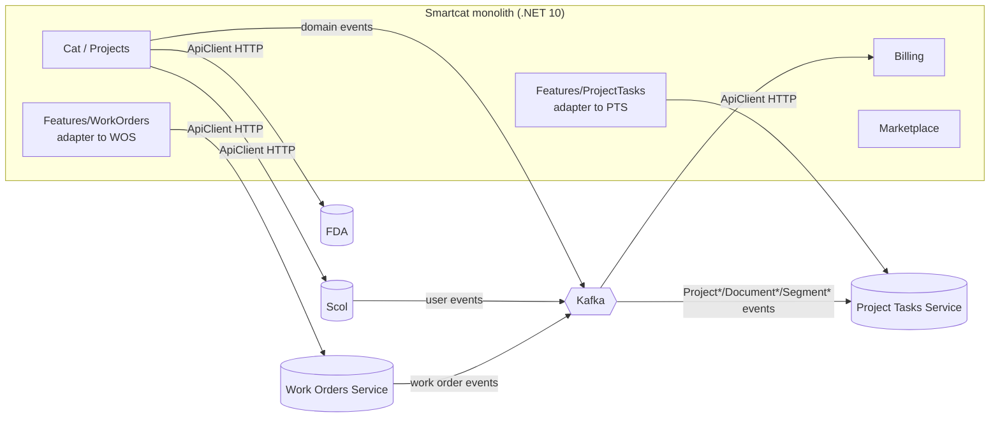
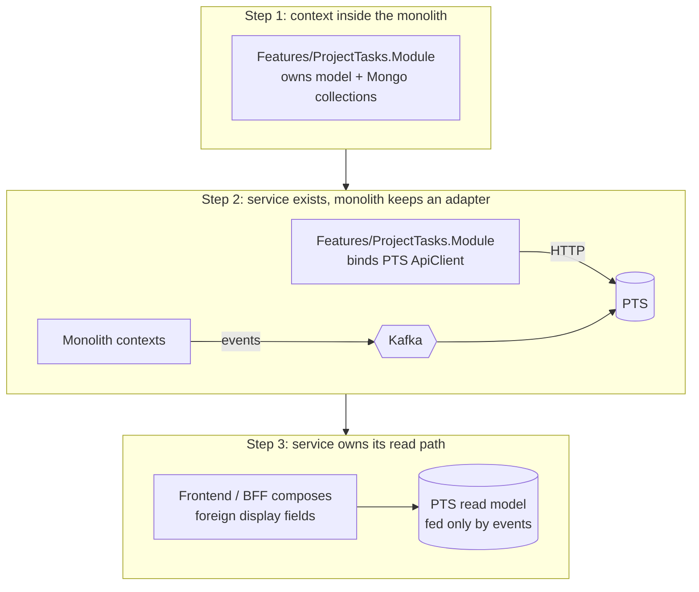
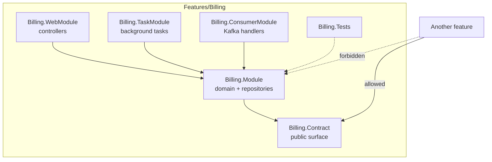
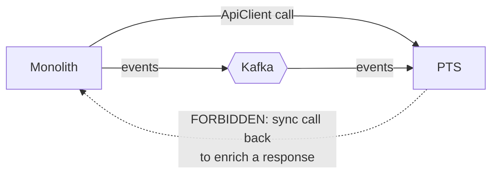
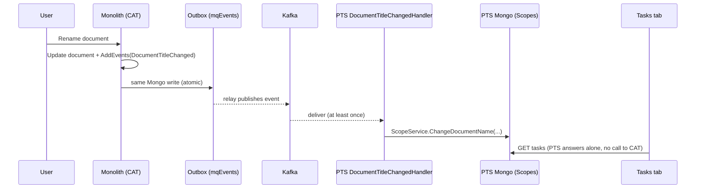
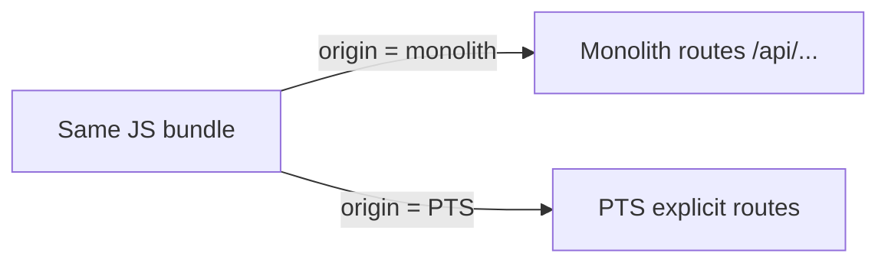

# 06. Architectural patterns at Smartcat: modular monolith, bounded contexts, services

## Why this chapter matters

Senior and staff interviews almost always contain a design round. The interviewer does not want a
diagram with twenty boxes. They want to see that you can draw a boundary, defend it, and say what it
costs. Smartcat is a good teaching case because it has both styles at once: a large modular monolith
and a growing set of services that were cut out of it. If you understand why each boundary exists,
you can answer "monolith or microservices?" with real tradeoffs instead of slogans. In daily work the
same rules decide whether your merge request (MR) is a small, safe change or a change that breaks
another team.

## What you will be able to do

- Explain the difference between a modular monolith and microservices, and why Smartcat runs both.
- Describe the module layout (`Contract` / `Module` / `WebModule` / `TaskModule` / `ConsumerModule` /
  `Tests`) and how role-based loading in `Modules.cs` decides what runs in each pod.
- State the seven boundary rules and spot a violation in a code review.
- Design an event-fed read model for a downstream service, and explain why it beats a synchronous call.
- Wire a service-to-service call through a published `ApiClient`, with config layering and auth.
- Talk about consistency, latency, team autonomy and operational cost in a system-design interview.

---

## 1. The big picture: one monolith and many services

**Concept.** Smartcat is a translation and localization platform. A project flows like this: upload
files, translate in the CAT editor (CAT = computer-assisted translation), run workflow stages and
assignments, then billing and the marketplace. The core of this flow lives in one large .NET 10
application, the **monolith** (`smartcat/`). Around it there are services that own one business
area each.

At Smartcat (from the workspace and repo docs):

| Deployable | Repo | What it owns |
|---|---|---|
| Smartcat monolith | `smartcat/` | Projects, CAT, editor, billing, marketplace, about 40 `Features/*` contexts |
| Project Tasks Service (PTS) | `project-tasks-service/` | Project tasks, assignments, invitations, assignment templates |
| Work Orders Service (WOS) | `work-orders-service/` | Work orders (orders to vendors) |
| Scol | `Scol/` | Users, suppliers, authentication-related data |
| File Disassembling (FDA) | `filedisassembling/` | Parsing source files into segments and back |
| Feature Flags Service | `feature-flags-service/` | Storage of feature values |
| File Management (Drive) | `file-management-service/` | Files |
| AI services | `smartcat-ai-agents/`, `skill-hub/`, ... | AI agents and skills |

The monolith alone is worked on by about 11 teams. It registers about 190 modules by hand.



**Why it looks like this.** The monolith came first. As teams and load grew, some contexts were
extracted into their own services. The monolith now talks to them in two ways: it **calls** them
through typed HTTP clients, and it **reacts** to their Kafka events. They react to its events too.
Notice the direction of the arrows: PTS gets monolith data by event, not by calling back. That
direction is a rule, not an accident (section 9, rule 4).

**Tip.** When you join a team, draw this picture for your own context first: who sends me events,
who do I call, who calls me. It takes ten minutes and saves weeks.

---

## 2. Modular monolith vs microservices

**Concept.** A *modular monolith* is one deployable binary with strong internal boundaries. A
*microservice architecture* is many deployables, each with its own data store, talking over the
network. Both can be well or badly designed. A monolith without boundaries is a "big ball of mud".
Microservices without boundaries are a "distributed monolith": all the network pain, none of the
independence.

| Aspect | Modular monolith | Microservices |
|---|---|---|
| Deployment | One binary, one pipeline | Many pipelines, independent releases |
| Consistency | One database, transactions across modules are possible (but discouraged) | Eventual consistency across services; outbox and events |
| Latency | In-process calls (nanoseconds) | Network calls (milliseconds), retries, timeouts |
| Team autonomy | Shared release train, shared build, shared `Directory.Packages.props` | A team owns its repo, release, and on-call |
| Refactoring across boundaries | Cheap: one IDE, one compile | Expensive: versioned contracts, lockstep MRs |
| Operational cost | One thing to monitor | N services, N dashboards, N configs, distributed tracing |
| Scaling | Scale the whole binary (Smartcat scales by role, see section 6) | Scale each service by its own load |
| Failure isolation | A memory leak in one module can kill the pod | A failing service degrades one feature |

**Why Smartcat has both.** A modular monolith is the right start: you can move fast and change your
mind about boundaries cheaply. You extract a service when one context has a clear reason to leave:

- a different scaling profile (PTS is the platform's busiest Kafka event hub);
- a team that needs its own release cadence;
- a different technology or runtime need (FDA parses files with heavy libraries);
- a clear, stable boundary that already exists inside the monolith.

The last point is the key. You cannot extract a context cheaply if it is tangled with others. The
monolith's boundary rules exist partly to keep every context *extraction-ready*, even if it never
leaves.

**Common mistake.** Saying "microservices are more scalable" as a general truth. A monolith split by
role (Web pods, Processing pods) also scales horizontally. What microservices really buy is
*independent change and ownership*, and you pay for it with consistency and operational cost.

**Tip.** In an interview, start with "it depends on team structure and the cost of coordination",
then give one concrete reason to extract and one concrete reason to stay. Conway's law (a system's
structure copies the communication structure of the organization that builds it) is a good,
neutral name to drop here.

---

## 3. The strangler path: how contexts leave the monolith

**Concept.** The *strangler fig pattern* replaces a part of a legacy system step by step. New code
grows next to the old code, traffic moves over in small steps, and the old part is removed when
nothing uses it. Smartcat follows this path. The monolith's own rules say it plainly: several
contexts "already extracted into their own services (project-tasks-service, scol, organization,
work-orders, ...)".



**At Smartcat: what step 2 looks like in code.** The monolith still has
`Features/ProjectTasks/ProjectTasks.Module`, but its module now binds the PTS client instead of
owning the data:

```csharp
// smartcat/Features/ProjectTasks/ProjectTasks.Module/Module.cs (abbreviated)
public sealed class Module : ServiceProviderModule
{
    public override void Load(IServiceCollection serviceCollection, IConfiguration configuration)
    {
        bindPtsApi(serviceCollection);

        serviceCollection.AddSingleton<IProjectTaskService, ProjectTaskService>();
        serviceCollection.AddSingleton<IMyTasksService, MyTasksService>();
        // ... about 40 more registrations
    }

    private void bindPtsApi(IServiceCollection serviceCollection)
    {
        serviceCollection.AddSingleton(sp => sp.GetRequiredService<IProjectTaskServiceConnection>().ProjectTasksApi);
        serviceCollection.AddSingleton(sp => sp.GetRequiredService<IProjectTaskServiceConnection>().AssignmentTemplatesApi);
    }
}
```

The same is true for `Features/WorkOrders`: its services and tests reference
`Smartcat.WorkOrdersService.ApiClient`. The feature folder stays as an *anti-corruption layer* (a
thin translation layer that keeps the other side's model out of yours) between monolith callers and
the service.

**Why in small steps.** PTS docs describe the order: "own the query, then split foreign columns,
then drop the monolith from the read path", each step pinned by a *characterization test* (a test
that records what the code does today, so you notice when behaviour changes). A big-bang rewrite
moves all risk to one release. Small steps keep every release reversible.

**Common mistake.** Extracting a service but keeping a synchronous call back into the monolith "for
now". This creates a cycle (`monolith -> PTS -> monolith`). Now neither side can deploy or fail
alone. PTS forbids it outright.

**Tip.** If an interviewer asks "how would you split this monolith?", describe the strangler path,
not the target picture. The path is where the real engineering is.

---

## 4. Bounded contexts and team ownership

**Concept.** A *bounded context* (from Domain-Driven Design, DDD) is the area inside which one model
and one vocabulary are consistent. "Task" in PTS means a unit of translation work with a deadline.
"Task" in `Smartcat.TaskProcessing` means a background job. Same word, two models, two contexts.

At Smartcat, each `Features/*` folder is a bounded context, owned by a team, **roughly 1:1 with
`CODEOWNERS`**. The `CODEOWNERS` file maps paths to teams:

```text
/Features/Preview                                   @file-format-support-team
/Features/Cat/Core.Cat.Module/Organizations/        @enterprise-readiness-team
/Features/Cat/DocumentProcessing.TaskModule/ImportExport/        @file-format-support-team
/Features/Cat/DocumentProcessing.TaskModule/ImportExport/WebSync/ @team_connectors
```

Note the word "roughly". `Features/Cat` is old and large, so several teams own sub-folders inside it.
That is a sign of a context that is too big. The PTS repo has the same pattern on a smaller scale:
`@workflow-experience-team` owns the core `ProjectTasks.Module`, and `@assignments-experience-team`
owns `AssignmentTemplates.Module` and the assignment handlers.

**Why ownership matters for architecture.** A boundary that no team owns decays. When one team owns
one context, it can change the inside freely and must only keep the published surface stable. An MR
that touches three `CODEOWNERS` areas needs three teams to review. That cost is a useful signal: it
tells you the change is crossing boundaries.

**Tip.** Before editing, run `git log` and read `CODEOWNERS` for the folder. Rule 1 below starts
with "know which context you are in and who owns it".

---

## 5. Module layout inside the monolith

**Concept.** Each feature is split into several projects by *responsibility and role*:

| Project | Role | Loaded in |
|---|---|---|
| `{Feature}.Contract` | Published surface: interfaces, DTOs, event handler contracts. Other contexts may reference **only** this. | All roles |
| `{Feature}.Module` | Domain and application logic, repositories, Mongo models | All roles |
| `{Feature}.WebModule` | ASP.NET Core controllers, request models, web mappers | Web |
| `{Feature}.TaskModule` | Background task processors (`Smartcat.TaskProcessing`) | Processing |
| `{Feature}.ConsumerModule` | Kafka event handlers | Processing |
| `{Feature}.Tests` | NUnit + FakeItEasy tests | (tests) |

At Smartcat, the real Billing feature (abbreviated):

```text
smartcat/Features/Billing/
├── Billing.Contract/          # published interfaces + models
│   └── PaidServices/
├── Billing.Module/            # domain logic, repositories
├── Billing.WebModule/
│   ├── Controllers/           # AccrualsController, InvoicesController, ...
│   ├── Models/  Services/  Helpers/
│   └── WebModule.cs           # AddController<T>() list
├── Billing.TaskModule/
│   ├── Invoices/  Payout/  PaymentReminders/  Smartwords/  ...
├── Billing.ConsumerModule/
│   ├── Projects/  WorkOrders/  ProjectTasks/  Invoices/  ...
├── Billing.Tests/
└── Stripe/
```

Look at `Billing.ConsumerModule`: it has folders named `Projects`, `WorkOrders`, `ProjectTasks`.
Billing learns about other contexts by **consuming their events**, grouped by source. That is rule 3
in practice.



A web module registers its controllers explicitly. A controller also carries `[TSModule]`, which
drives the TypeScript client generator (TSClientGen) for the frontend:

```csharp
// smartcat/Features/Billing/Billing.WebModule/WebModule.cs (abbreviated)
public class WebModule : ServiceProviderModule
{
    public override void Load(IServiceCollection serviceCollection, IConfiguration configuration)
    {
        AddController<AccrualsController>();
        AddController<InvoicesController>();
        AddController<PaymentConstantsController>();
        // ...
        serviceCollection.AddScoped<JobModelMapper>();
    }
}

// smartcat/Features/Billing/Billing.WebModule/Controllers/PaymentConstantsController.cs
[TSModule("payment-constants")]
[Route("api/payment-constants")]
[ResponsibleTeamsControllerFilter(ResponsibleTeams = ResponsibleTeams.FinanceExperience)]
public class PaymentConstantsController : BaseUIController
{
    [HttpGet("job-cost-limits")]
    public IReadOnlyDictionary<Currency, decimal> GetJobCostLimit()
        => PaymentConstantsCache.JobCostLimitsByCurrency.Value;
}
```

**Why split by role.** A Web pod does not need Kafka consumers. A Processing pod does not need
controllers. Splitting the projects lets the host load only what a role needs, and keeps
dependencies honest: a `TaskModule` cannot accidentally depend on `HttpContext`.

`ResponsibleTeamsControllerFilter` is worth noticing. Errors and metrics from this controller are
tagged with the owning team. Ownership is not only in `CODEOWNERS`; it reaches production telemetry.

**Common mistake.** Putting a shared helper into `Core/` "because two features need it". `Core/` is
the shared kernel: every change there affects every team. Add to it only with care.

---

## 6. The composition root: `Modules.cs` and role-based loading

**Concept.** The *composition root* is the one place where the application is wired together. In the
monolith it is `WebApplication/WebService/Modules.cs`. There is **no auto-discovery**: every module is
a hand-written `.Module<T>()` call, grouped by role.

```csharp
// smartcat/WebApplication/WebService/Modules.cs (abbreviated)
public static IWebApplicationBuilderConfigurator ConfigureModules(
    this IWebApplicationBuilderConfigurator builder,
    IReadOnlyCollection<AppRole> appRoles)
{
    if (appRoles.Count == 0)
        throw new InvalidOperationException("App roles are empty");

    builder = ConfigureCommonModules(builder);

    if (appRoles.Contains(AppRole.Web) || appRoles.Contains(AppRole.SignalR))
        builder = configureCommonWebModules(builder);
    if (appRoles.Contains(AppRole.Processing))
        builder = configureProcessingModules(builder);   // TaskModules + ConsumerModules
    if (appRoles.Contains(AppRole.SignalR))
        builder = configureSignalRModules(builder);
    if (appRoles.Contains(AppRole.Web))
        builder = configureWebModules(builder);          // WebModules
    if (appRoles.Contains(AppRole.Admin))
        builder = configureAdminAppModules(builder);
    if (appRoles.Contains(AppRole.ClientPortal))
        configureClientPortalModules(builder);

    return builder;
}

private static IWebApplicationBuilderConfigurator configureProcessingModules(
    IWebApplicationBuilderConfigurator builder) => builder
        .Module<Smartcat.TaskProcessing.TaskProcessingRunnerModule>()
        .Module<Smartcat.Billing.TaskModule>()
        .Module<Smartcat.Billing.ConsumerModule>()
        .Module<Smartcat.Marketplace.ConsumerModule>()
        .Module<Smartcat.Marketplace.TaskModule>();
        // ...
```

Roles come from a **run profile** (`WebApplication/WebService/Settings/RunProfile.cs`):

| `--profile` | Roles | Typical pod set |
|---|---|---|
| `Web` | Web | HTTP API and UI |
| `Processing` | Processing | Task processors, Kafka consumers, outbox relay |
| `SignalR` | SignalR | Real-time UI push, fed from a Kafka topic |
| `Admin` | Admin | Admin application |
| `ClientPortal` | ClientPortal | Client portal |
| `FullWeb` (default) | Web + SignalR + Processing | Local development |

In Kubernetes each profile is its own pod set, so the single binary runs as six role-sets. This is
how a monolith scales by *workload type*: you can add Processing pods during a heavy import without
adding Web pods.

**Why explicit registration.** Auto-discovery (scan assemblies, register everything) is convenient,
but it hides what runs where. With an explicit list you can read, in one file, exactly which modules
a Processing pod loads. A reviewer sees a new module in the diff.

**Common mistake (a real trap).** You add a new `*.Module.cs` or a new controller and forget to
register it. The code compiles, the app runs, and the module is **silently never loaded**. No error.
Also: putting a consumer or task module in the wrong role group. In production Web and Processing
are separate pods, and the processing infrastructure (for example `TaskProcessingRunnerModule`) is
registered only in the Processing group. A module in the wrong group likely does not run at all, or
runs in pods that were never sized for it. It works locally only because `FullWeb` loads everything.

**Tip.** After adding a module, test with `--profile Processing` or `--profile Web` locally, not only
with the default `FullWeb`.

**Interviewer view.** "Why does a monolith need run profiles?" A strong answer: different workloads
have different scaling and failure needs. A slow Kafka consumer should not starve HTTP request
threads; a deploy of a hot fix to Web should not restart long-running tasks.

---

## 7. The microservice layout

**Concept.** Smartcat services built on the platform share one layout. PTS, at Smartcat:

```text
project-tasks-service/src/
├── Service/                 # host: Program.cs, Server.cs (role -> profile), config, NLog/Sentry
├── WebModule/               # controllers
├── ProjectTasks.Module/     # core domain: Managers, Services, DAL, Validators, TaskProcessing
├── AssignmentTemplates.Module/   # second domain module, owned by another team
├── ConsumerModule/          # Kafka inbound
│   ├── Dispatchers/         # SmartcatEventDispatcher, ScolEventDispatcher, WorkOrderEventsDispatcher, ...
│   └── Handlers/            # grouped by source: Documents/, Projects/, Segments/, Users/, WorkOrders/
├── Contracts.Events/        # Kafka outbound event payloads (the published catalog)
├── Contracts/  ApiClient/   # HTTP DTOs + generated typed client (published NuGet)
├── Common/                  # concurrency helpers, Mongo utils, settings
├── Migrations/              # Migration-YYYY-N packs (Before/After) + Migration-Cleanup
└── Tests/  Testing.WebModule/
```

Services created from the newer .NET microservice template put the API layer under `src/API/`
(WOS has `src/API/ApiClient` and `src/API/Contract`; FDA has `src/API/ApiClient` and
`src/API/Contracts`):

```text
src/API/
├── Api.Contracts/          # DTOs, enums, strongly-typed identifiers
├── Api.Contracts.Events/   # domain events published to Kafka
├── Api.Client/             # NSwag-generated client (DO NOT EDIT) + config + DI extension
└── GatewayModule/          # thin proxy controllers loaded by the public API gateway
```

**Two roles, one binary.** A service has `Web` (HTTP, Swagger) and `Processing` (Kafka consumers,
tasks, outbox relay). Default is both; Kubernetes splits them. PTS's own description is useful in an
interview: "It is an event hub before it is an API. Almost every state change is driven by Kafka
events handled in the Processing role. Business logic lives in consumer handlers and domain
managers, not in controllers."

A PTS dispatcher lists which upstream events it handles:

```csharp
// project-tasks-service/src/ConsumerModule/Dispatchers/SmartcatEventDispatcher.cs
public class SmartcatEventDispatcher : DomainEventDispatcherBase
{
    public SmartcatEventDispatcher(IServiceProvider serviceProvider) : base(serviceProvider, "smartcat")
    {
    }

    protected override IEnumerable<Type> GetHandledEventTypes() =>
    [
        typeof(ProjectCreated),
        typeof(ProjectStatusChanged),
        typeof(DocumentTitleChanged),
        typeof(DocumentDeleted),
        typeof(DocumentWorkflowStageStatusChanged),
        typeof(SegmentProgressChangedEventV2),
        // ...
    ];
}
```

**Why the same layout everywhere.** A developer who knows one service can open any other and find
the controllers, the handlers and the migrations in seconds. Shared layout also lets the platform
(AppPlatform, next section) give every service the same hosting, config, outbox and task features.

**Common mistake.** Putting business logic in a controller or a Kafka handler. Handlers should be
thin: translate the event, call a domain service. The PTS handlers are 5–10 lines each for that
reason (see section 10).

---

## 8. ModuleHosting and AppPlatform: the shared framework

**Concept.** `Smartcat.AppPlatform` (with `Smartcat.ModuleHosting`) is the internal framework that all
these services and the monolith run on. You do not write `Program.cs` from scratch. You get:

| Capability | Package / type | Chapter |
|---|---|---|
| Module system: `ServiceProviderModule.Load(services, config)`, `AddController<T>()` | ModuleHosting | this one |
| Host builder and roles: `IWebApplicationBuilderConfigurator`, `AppRole`, `--roles` | AppPlatform | this one |
| Layered, templated JSON config | `AddDefaultTemplatedJsonFiles` | section 14 |
| Typed HTTP clients: `HttpClientSettingsBuilder`, `IHttpConfigurable`, `BaseApiConfig` | HttpClientConfigurable | section 12 |
| Domain events, outbox, Kafka consumers, DLQ | `Smartcat.DomainEvents`, `MessageQueuing` | 07 |
| Background tasks: Ordinary / Singleton / Sticky, fairness, canary | `Smartcat.TaskProcessing` | 08 |
| Mongo persistence helpers: `SafeCreateIndex`, `EnsureIndexAsync`, `[DefaultStorage]` | `Smartcat.MongoDBPersistence` | 09 |
| Migrations: packs, Before/After release | `Smartcat.DatabaseMigrations` | 09 |

A module is a class with a `Load` method. It is close to an ASP.NET Core `AddXxx()` extension method,
but it is a type that the host loads when you list it with `.Module<T>()`:

```csharp
public sealed class Module : ServiceProviderModule
{
    public override void Load(IServiceCollection services, IConfiguration configuration)
    {
        services.AddSingleton<IInvoiceService, InvoiceService>();
        services.AddSingleton<IInvoiceRepository, InvoiceRepository>();
    }
}
```

The PTS host shows how the pieces are composed:

```csharp
// project-tasks-service/src/Service/Server.cs (abbreviated)
var host = webApplicationBuilderConfigurator
    .UseCommonConfigs()                  // layered JSON config
    .ConfigureModules(logger, options)   // .Module<T>() list, by role
    .BuildHost(logger, options)
    .ConfigureApiClients()               // HttpClientSettingsBuilder chain
    .Build();
await host.RunAsync();
```

**Why an internal platform.** Outbox, retries, DLQ (dead-letter queue), migrations and task capture
are hard to get right. When each team writes its own, you get twenty subtly different bugs. A shared
platform turns hard problems into conventions. The cost is a learning curve and version upgrades
across all repos (there is even a dedicated upgrade agent for ModuleHosting versions).

**Tip.** When something looks "magic" (a handler that runs without registration in `Startup`, a task
that retries by itself), the answer is almost always in AppPlatform. Search the package source
before you add your own mechanism.

---

## 9. The seven boundary rules

These rules are in `smartcat/.claude/rules/bounded-contexts.md` and apply to every change. They are
the most important part of this chapter. Learn them by number.

### Rule 1. One module per change

Know which `Features/*` context you are in and who owns it before editing. A change that spreads
across modules is a design smell: stop and reconsider.

*Why:* small blast radius, one owning team reviews, one place to roll back.

*Common mistake:* "while I am here" edits in a neighbour's module. Split them into a separate MR, or
ask the owning team.

### Rule 2. A module owns its model

Never read or write another module's internal types, entities, or Mongo collections. Cross a
boundary only through its published contract (`*.Contract` / `*.ApiClient`). Concretely: from
another assembly, consume a context's data through its **`*Service`**, never its **`*Repository`**.

```csharp
// BAD: a WebModule service in another context reads the repository directly
internal sealed class TeamPageService
{
    private readonly IAccountUserRepository _accountUserRepository;   // another module's internals

    public TeamPageService(IAccountUserRepository accountUserRepository)
        => _accountUserRepository = accountUserRepository;
}

// GOOD: depend on the published application service
internal sealed class TeamPageService
{
    private readonly IAccountUserService _accountUserService;

    public TeamPageService(IAccountUserService accountUserService)
        => _accountUserService = accountUserService;
}
```

This exact case came up in a real monolith review (MR 27065). *Why:* the repository exposes storage
shape. The service exposes intent and enforces the owner's invariants. If you read the repository,
the owner can no longer change its schema without breaking you, and you skip its rules (soft delete,
permissions, caching).

### Rule 3. Cross-module communication = contracts or events, never shared state

Need another context's data on your read path? **Consume its event and materialize your own read
model.** Do not run a synchronous join into its tables. Section 10 shows the full pattern.

### Rule 4. No dependency cycles

A depends on B *or* B on A, never both. **Never call synchronously back into a context that already
lives as its own service.**



*Why:* a cycle means neither side can deploy, scale, or fail alone. A slow monolith makes PTS slow,
which makes the monolith slower: a classic cascading failure. In code, cycles also block extraction.

### Rule 5. Invariants inside the aggregate, enforced once

An *aggregate* is a cluster of objects changed together as one unit, with one root that guards its
rules. Put the rule inside the aggregate, not in every caller. And keep commands and queries apart:
**commands change state and emit domain events (outbox); queries never mutate.**

```csharp
// BAD: every caller re-checks the rule (review-architecture A31)
if (task.Status == ProjectTaskStatus.Completed)
    throw new InvalidOperationException("Task is completed");
task.Deadline = newDeadline;

// GOOD: the aggregate guards itself and records what happened
public sealed class ProjectTask : DomainEntity
{
    public void ChangeDeadline(DateTime newDeadline)
    {
        if (Status == ProjectTaskStatus.Completed)
            throw new InvariantViolationException("Cannot change the deadline of a completed task");

        var oldDeadline = Deadline;
        Deadline = newDeadline;
        AddEvents(new ProjectTaskDeadlineChanged { TaskId = Id, OldDeadline = oldDeadline, NewDeadline = newDeadline });
    }
}
```

*Why:* the fifth caller will forget the check. One place = one test = one truth.

### Rule 6. Independently testable

Constructor injection, I/O behind seams, fakes at the boundary. "If you cannot unit-test a change
without standing up half the monolith, the boundary is wrong: fix the boundary." See chapter 10
(Unit and integration testing).

### Rule 7. Thin seams, no speculative coupling

Do not add a cross-module reference "for convenience". Do not introduce an abstraction before its
second use. "Structure ratifies boundaries; it never anticipates them." In plain words: draw the
boundary when you have proof it is real, not because it might be useful one day.

### The STOP litmus

Stop and rethink if a change:

1. imports another module's *internal* type;
2. adds a synchronous call that forms a cycle;
3. lets a query mutate, or a command return another context's rich data;
4. shares a collection or entity across contexts;
5. makes a module untestable in isolation.

**Interviewer view.** Give the candidate a small diff that reads another module's repository and ask
"what would you say in review?". A senior names the rule and suggests the service. A staff-level
answer also asks *why* the service lacks the method they needed and proposes adding it to the
contract, or consuming an event.

---

## 10. Downstream read models fed by events

**Concept.** A *read model* is a copy of data shaped for one query. A *downstream* context consumes
events from *upstream* contexts and updates its own read model. It never asks upstream at request
time. This is how PTS gets document names, project statuses and segment progress.



At Smartcat, the handler is thin, as it should be:

```csharp
// project-tasks-service/src/ConsumerModule/Handlers/Documents/DocumentTitleChangedHandler.cs
internal class DocumentTitleChangedHandler : SentryEventHandler<DocumentTitleChanged>
{
    public DocumentTitleChangedHandler(IScopeService scopeService, ISentryProvider sentryProvider)
        : base(sentryProvider, SentryTeam.WorkflowExperience)
    {
        _scopeService = scopeService;
    }

    public override async Task Handle(DocumentTitleChanged evt, CancellationToken ct = default)
    {
        await _scopeService.ChangeDocumentName(evt.ProjectId, evt.Id, evt.Title, evt.Extension, ct);
    }

    private readonly IScopeService _scopeService;
}
```

The service updates every `Scope` of that document with optimistic concurrency (chapter 09
explains `UpdateWithOcc`) and, if needed, emits its own events in the same transaction.

**The rules PTS adds** (`project-tasks-service/.claude/rules/bounded-context.md`):

- **No synchronous back-edge.** PTS never calls the monolith at request time to enrich a response.
- **Cross-context data arrives by event, into PTS's own read model.**
- **Foreign, display-only fields stay foreign.** Fields owned by other contexts (for example cost
  and jobs, owned by billing and CAT) are composed *above* PTS, in the frontend or a BFF (backend
  for frontend, a thin API layer for one UI), *after* the query. They are never joined in.
- **One model per context.** PTS sorts, filters and paginates only on fields it owns. A field PTS
  does not own must not become a sort or filter key on the hot path.

**Why.** The read path is now local: one Mongo query, no network hop, no dependency on the monolith
being healthy. The price is **eventual consistency**: for a short time after a rename, the Tasks tab
can show the old name. For a document title that is fine. For a balance or a permission it may not
be, and then the data should be read from its owner or the check should live with the owner.

**What you must handle with events:**

| Problem | Answer at Smartcat |
|---|---|
| Duplicates (Kafka is at-least-once) | Idempotent handlers, dedupe by `EventId` (`EventWithIdempotencyKeyBase`) |
| Ordering | `[MqEvent("name", nameof(OrderGroupProp))]` partitions by a key, so events of one entity stay in order |
| Lost publish after DB write | Outbox: events are stored in the same document (`mqEvents`) and relayed later |
| Handler keeps failing | DLQ per handler; later messages for that key wait |
| Backfill when a new read model starts | A migration or a one-shot task copies existing data; then events keep it fresh |

Chapter 07 (Domain events, the Outbox pattern and Kafka) goes deep on each line.

**Common mistake.** Sorting by a foreign field. Product asks "sort tasks by cost". Cost is billing's
field. If PTS stores a copy and sorts by it, PTS now owns a second truth for cost that must stay in
sync forever. The right answer is often to push back, or to compose and sort a small page in the
BFF, or to make billing publish a dedicated event that PTS is willing to own as *its* field.

**Tip.** Before adding a field to a read model, ask "will we filter or sort by it?" If yes, PTS must
own it. If it is display-only, compose it above.

---

## 11. CQRS-lite: commands vs queries

**Concept.** CQRS (command query responsibility segregation) splits writes and reads into separate
models. Smartcat uses a light version: not separate databases, but a strict rule that **commands
change state and emit events, queries never mutate, and commands do not return another context's
rich data**.

```csharp
// Command: changes state, returns little (an id or nothing)
[HttpPost("{taskId}/deadline")]
public async Task<IActionResult> ChangeDeadline(Guid taskId, ChangeDeadlineRequest request, CancellationToken ct)
{
    await _projectTaskService.ChangeDeadline(taskId, request.Deadline, ct);
    return NoContent();
}

// Query: reads a projection, changes nothing
[HttpGet("{taskId}")]
public Task<ProjectTaskDto> Get(Guid taskId, CancellationToken ct)
    => _projectTaskQueries.Get(taskId, ct);
```

**Why.** Queries that mutate are dangerous: caches, retries, prefetching, and server-side rendering
all call GETs freely. A command that returns rich data from another context creates hidden coupling:
now the command must know that context's model.

**At Smartcat: a real trap.** The monolith docs warn that some project GETs carry side effects: they
clear the caller's "unseen assignments" badge. The server render of the project page does too. When
someone replaced one GET with a narrower one, the badge stopped clearing, and field-parity tests did
not notice because they only compared the *response*. The lesson: "When swapping one read for
another, trace what the old GET *mutated*, not only what it returned." The fix direction was a
side-effect-only `POST Projects/{id}/opened`: an explicit command.

**Common mistake.** Adding "just one small update" (last-seen timestamp, counter) to a GET. Make it a
separate command, or an event.

---

## 12. Synchronous calls: the published `ApiClient`

Events are the default for data *flow*. Sometimes you need a synchronous answer: "create this work
order now", "parse this file". Then you call the other service through its **NSwag-generated
`ApiClient` NuGet package**. Never with a raw `HttpClient`.

**Step 1. Reference the package** (central package management: the version lives in
`Directory.Packages.props`, never in the `.csproj`):

```xml
<PackageReference Include="Smartcat.ProjectsService.ApiClient" />
```

**Step 2. Register in the `HttpClientSettingsBuilder` chain.** The monolith's chain has about 60
clients:

```csharp
// smartcat/WebApplication/WebService/Modules.cs (abbreviated)
public static IStandardHostBuilder ConfigureApiClients(this IStandardHostBuilder standardHostBuilder)
{
    var builder = HttpClientSettingsBuilder.Create()
        .ConfigureScolApiClient()
        .ConfigureProjectTaskClient()
        .ConfigureFileManagementServiceApiClient()
        .ConfigureFeatureFlagServiceClient()
        .ConfigureFdaServiceClient()
        .ConfigureProjectsServiceClient();
        // ...
    return standardHostBuilder.ConfigureApiClients(builder);
}
```

**Step 3. Add URL config.** The section name must match the constant inside the package:

```json
{ "ProjectsServiceApi": { "url": "", "timeout": "00:00:30", "maxRetryCount": 10 } }
```

Then override `url` per environment. In staging and production all services share one Kubernetes
namespace, so a plain service name works: `http://{service}-web/`. In development you use the full
cluster name or `localhost`.

**Step 4. Inject the interface and handle errors:**

```csharp
internal sealed class ProjectLookup : IProjectLookup
{
    private readonly IProjectsClient _projectsClient;

    public ProjectLookup(IProjectsClient projectsClient) => _projectsClient = projectsClient;

    public async Task<ProjectDto?> TryGet(ProjectId id, Guid workspaceId, CancellationToken ct)
    {
        try
        {
            return await _projectsClient.GetAsync(id, workspaceId, userId: Guid.Empty, ct);
        }
        catch (ProjectsServiceApiException ex) when (ex.StatusCode == 404)
        {
            return null;
        }
    }
}
```

**How the package is built.** The service has `Api.Contracts` (DTOs with XML docs, enums,
strongly-typed IDs), `Api.Contracts.Events`, and `Api.Client`. NSwag generates one client class and
one `I{Controller}Client` interface per controller, with `generateDtoTypes: false`, so the DTOs come
from `Api.Contracts`, not from generation. `Api.Client` embeds the contracts with
`PrivateAssets="all"`, so a consumer adds one package. The generated `{Service}Client.cs` is never
edited by hand.

Strongly-typed identifiers prevent a classic bug, passing a workspace id where a project id was
expected:

```csharp
[JsonConverter(typeof(ProjectIdJsonConverter))]
public readonly struct ProjectId : IEquatable<ProjectId>
{
    private readonly Guid _value;
    public ProjectId(Guid value) => _value = value;
    public Guid ToGuid() => _value;
    public bool Equals(ProjectId other) => _value == other._value;
    // + TypeConverter for route binding, registered in CustomTypeConverterRegistrar
}
```

**Contracts are additive only.** The monolith both consumes and *publishes* `*.Contracts`,
`*.ApiClient` and `*.MQEvents` packages. Change them additively: new optional fields, new endpoints.
Never rename or remove in one step. A real effect: the monolith builds with
`TreatWarningsAsErrors`, so if a consumed `ApiClient` marks a method `[Obsolete]`, bumping it breaks
the monolith build.

**GatewayModule.** Public API traffic goes through the platform API gateway. A service publishes a
`GatewayModule` package with thin proxy controllers that read `workspaceId` and `userId` from claims
and forward to the internal client. No business logic there.

**Why not raw `HttpClient`.** The package gives you typed contracts, retries and timeouts from
config, auth headers, and one place to change when the API evolves. A raw call duplicates all of it
and drifts. review-architecture rule A17 flags any new `*Client` class or raw `PostAsJsonAsync` to a
Smartcat-owned URL when a generated SDK exists; rule A6 flags client config registered in the
consumer instead of shipped as an `AddXClient()` extension with the library.

**Common mistake.** Calling a service synchronously inside a loop (N+1 over HTTP, rule A20), or
inside a Kafka handler without thinking about retries: if the call fails, the handler fails, the
event is retried, and the call is repeated. Make the remote operation idempotent.

---

## 13. Service-to-service authentication

**Concept.** Internal calls are authenticated. Auth is configured *inside* the `ApiClient`
registration extension; the consumer only provides config values. Some clients use Basic auth with
an `appId` and `secretKey`:

```csharp
public class FileManagementApiConfig : BaseApiConfig
{
    public string AppId { get; set; } = string.Empty;
    public string SecretKey { get; set; } = string.Empty;
}
```

```json
{ "fileManagementApi": { "url": "http://file-management-service-web/", "appId": "my-service", "secretKey": "" } }
```

Calls from services back into the monolith's internal API use a dedicated integration identity. For
example, PTS calls to the monolith are authorized by an `internalIntegration` record in the
monolith's `Integration.ClientAuth` collection; locally you create it through the monolith's init
migrations.

**Rules.**
- Credentials live in the service's API config section, never in code.
- Real secrets never go into base `common.json`. Production values are stored in Kubernetes secrets,
  merged into config at deploy time (`STORED_IN_PRODUCTION_SECRET` is the placeholder you see in
  files).
- The receiving side decides *what* the caller may do. A service identity is not a user: pass
  `workspaceId` and `userId` explicitly when the operation is on behalf of a user, and check access
  on the owner side.

**Common mistake.** Treating a valid service credential as "the caller may do anything". Chapter 13
(Secure .NET code) covers broken access control in detail.

---

## 14. Configuration layering

**Concept.** All services use layered JSON. Later files override earlier ones. Three environment
variables decide which files load: `ENV_GROUP` (`development`, `staging`, `production`, `testing`),
`ENV_NAME` (`local`, `static`, `dynamic`, `europe`, `america`, `asia`, ...) and `ENV_NAMESPACE` (the
instance name).

```text
1. .configurations/common.json                         <- BASE: the full schema
2. .configurations/{ENV_GROUP}/common.json
3. .configurations/{ENV_GROUP}/{ENV_NAME}/common.json  (and config.json)
4. .configurations/{ENV_GROUP}/{ENV_NAME}/{ENV_NAMESPACE}/config.json
5. development only: .configurations/development/override.dev.json  (git-ignored, from a template)
```

Files support `${VARIABLE}` templating, which isolates staging environments that share one cluster:

```json
{
  "storages": { "default": { "database": "${ENV_NAMESPACE}_my-service" } },
  "kafka":    { "namespace": "${ENV_NAMESPACE}." },
  "S3":       { "bucketNamespace": "${ENV_NAMESPACE}." }
}
```

Config is read through `IConfiguration` and bound to typed classes, as in any ASP.NET Core app (see
chapter 05, ASP.NET Core):

```csharp
internal sealed class MyTaskProcessorConfig
{
    public required TimeSpan Delay { get; init; }
    public required int MaxTaskCount { get; init; }
    public int MaxRetryCount { get; init; } = 3;
}
```

**Rules (at Smartcat).**
- `common.json` is the **schema**: define every key there, even with an empty value.
- Environment files override only what differs. A feature-stage file often sets only the S3 bucket
  prefix.
- `override.dev.template.json` is committed; `override.dev.json` is git-ignored.
- Kafka `replicationFactor` is 1 in dev/staging and 3 in production. Jaeger tracing is on in
  pre-production and production.
- A new key must exist in **all three production regions** (Europe, America, Asia). Each region has
  its own Mongo cluster, Kafka brokers and S3 prefix.
- Helm values (`.helmchart/`) mirror the same folder tree and define the pod groups (`web`,
  `processing`) with their roles and replicas.

**A real local trap.** PTS and the monolith talk over Kafka. Locally, PTS's
`kafka.namespace` must equal the monolith's (`develop.<your-name>.`), or the two services use
different topics and silently never see each other's events.

**Common mistake.** Adding a key only to `development/common.json` and the production file you
remembered. The service starts in another region with a default value, and nobody notices until a
customer does.

---

## 15. Feature flags

**Concept.** Feature flags let you deploy code switched off, then turn it on per workspace,
organization, or user. At Smartcat, a flag is described by a **`FeatureDefinition`**, identified by a
**`FeatureKey`** enum value, and stored in the Feature Flags Service.

```csharp
// Core/Core.Contract/FeaturesService/FeatureKeys.cs
public enum FeatureKey
{
    [FeatureName("Undefined")]
    Undefined = 1000,
    // ...
    [FeatureName("IsMyFeatureEnabled")]
    IsMyFeatureEnabled = 1234,   // next free id; must be unique
}

// Core/Core.Contract/FeaturesService/Definitions/MyFeatureDefinition.cs
public sealed class MyFeatureDefinition(IFeatureValueSerializer<bool> serializer)
    : FeatureDefinition<bool>(
        key: FeatureKey.IsMyFeatureEnabled,
        displayName: "My Feature",
        description: "What this feature does",
        type: FeatureType.Provisioned,
        defaultValue: false,
        serializer: serializer,
        featureGroup: "My Group");

// Core/Core.Module/Module.cs
serviceCollection.AddSingleton<FeatureDefinition, MyFeatureDefinition>();
```

For the frontend, add a property with the same name and type to `FeatureValuesV2`; it reaches the
SPA through `AccountContext.featureValuesV2`.

**Types.** `Provisioned` (manual or subscription on/off), `Rollout` (gradual rollout to everyone,
permanent), `FeatureParameter` (an enum or config value that extends another feature).

**Scoping.** A definition is scope-agnostic. The *service method* chooses the scope:
`GetFeaturesForWorkspace`, `GetFeaturesForOrganization`, `GetFeaturesForUser`, or
`GetFeaturesForChainedEntities(orgId, wsId, userId)`, which resolves organization -> workspace ->
user, most specific wins. `isVisibleInAdminPanel: false` hides org- or user-level flags from the
workspace admin page.

**Reading: use the definition overload.**

```csharp
// BAD when the default may change: returns false for an absent value, ignoring the definition default
var on = features.IsFeatureOn(Features.MyFeature);

// GOOD: falls back to FeatureDefinition.GetDefaultValue()
var on = features.GetFeature<bool>(featureDefinitions[FeatureKey.IsMyFeatureEnabled]);
```

This matters when a flag starts as `false` and flips to `true` at release: with `IsFeatureOn`,
workspaces with no stored value stay "off" forever.

**Architecture notes.**
- Flags are **cross-cutting state owned by one context** (the Feature Flags Service). Other services
  learn about changes by events: PTS has a `FeaturesEventsDispatcher`.
- Do not snapshot flags from `HttpContext` into a background job record (review-architecture A9).
  Store the identity (`accountId`, `workspaceId`) and re-resolve flags in the background context.
- A flag is also a **migration tool**: two-phase rollouts (write new field, then read it) often use a
  flag for the second step. See chapter 09.
- Flags have a cost: each one doubles the paths to test. Remove a `Rollout` flag once it is 100% on.

---

## 16. The shared frontend bundle

**Concept.** The monolith builds several Vue SPA apps (`web`, `app`, `editor`, `admin`, `portal`) and
serves them. PTS serves **the same frontend bundle**. Frontend API calls are **relative to the
browser origin**, so the same bundle opened on the monolith's host calls the monolith, and opened on
PTS's host calls PTS.



**Why it matters.** PTS has no reverse proxy: it is a standalone service with explicit routes. If a
page calls an endpoint that only the monolith has, it fails when served from PTS. Locally this
explains "works on port X, fails on port Y" bugs. It is also why "compose foreign display fields
above PTS" often means "in the frontend": the UI calls PTS for the task list and the owner context
for costs, then joins them on screen.

The frontend's TypeScript API clients are generated from the backend controllers by TSClientGen
(the `[TSModule]` attribute). A backend contract change shows up as a TypeScript type error after a
full backend build: a useful compile-time boundary.

---

## 17. Infrastructure

| Component | Role at Smartcat | Notes for design talk |
|---|---|---|
| **MongoDB** (replica set) | Primary database for all services; each service has its own database | Transactions need a replica set (PTS fails at startup on standalone `mongod`); reads that tolerate lag go to secondaries |
| **Kafka** | Inter-service domain events, real-time UI push (SignalR pods consume a topic) | At-least-once delivery, ordering per partition key, topics namespaced per environment |
| **Elasticsearch** | Full-text search, monolith only | A derived index: rebuildable from Mongo, fed by events or tasks |
| **S3** | File storage | Bucket namespace per environment and region; versioning in production |

**Real-time push is Kafka-driven.** To push something to the UI, you **emit an event**; the SignalR
pod (`Core/Core.ConsumerModule.SignalR`) consumes the topic and broadcasts. You do not call SignalR
from a Web request. This keeps Web pods stateless and lets SignalR scale on its own.

**Database per service.** Each service owns its Mongo database. "Shared database" integration is the
fastest way to rebuild a distributed monolith, and rule 2 forbids it inside the monolith too: a
module's collections are private.

---

## 18. Review rules that protect the architecture

Boundaries survive only if reviews defend them. The relevant rules from `review-architecture` and
the boundary rules, with what they protect:

| Rule | Severity | Flags | Protects |
|---|---|---|---|
| Boundary rule 2 | STOP | Another module's `*Repository`, entity, or collection used | Model ownership |
| Boundary rule 4 | STOP | Sync call forming a cycle; call back into an extracted service | Independent deploy and failure |
| A1 | BLOCKER | Same interface with two lifetimes; singleton consuming scoped | Correct DI composition |
| A2 | MAJOR | Behaviour depends on implicit registration or hosted-service order | Predictable startup |
| A6 | MAJOR | Client config registered in the consumer assembly | Client owned by the library |
| A9 | MAJOR | `HttpContext` state snapshotted into a background job | Flags and identity re-resolved in the right context |
| A16 | MAJOR | `IServiceProvider` injected into business logic (service locator) | Explicit dependencies, testability |
| A17 | MAJOR | New hand-written client where a generated SDK exists | One contract per service |
| A20 | MAJOR | N+1 calls on a hot path | Latency |
| A21 | MAJOR | Unbounded scan / unbounded list endpoint | Stability under growth |
| A22 | MAJOR | Multi-document mutation without atomicity | Consistency |
| A31 | MAJOR | Invariant enforced only at the caller | Rule 5 |

A1 deserves a code example, because it compiles and fails only under load:

```csharp
// BAD: singleton captures a scoped dependency (review-architecture A1)
services.AddScoped<IRequestContext, RequestContext>();
services.AddSingleton<IInvoiceService, InvoiceService>(); // InvoiceService(IRequestContext ctx)

// GOOD: match lifetimes, or pass the needed values as method arguments
services.AddScoped<IInvoiceService, InvoiceService>();
```

A16, the service locator:

```csharp
// BAD: hidden dependencies, impossible to see in the constructor
public InvoiceService(IServiceProvider sp) => _repository = sp.GetRequiredService<IInvoiceRepository>();

// GOOD
public InvoiceService(IInvoiceRepository repository) => _repository = repository;
```

**Tip.** When you review, check the *imports* of a diff first. A new `using` of another feature's
internal namespace is the fastest boundary-violation signal you will find.

---

## 19. How to talk about this architecture in a system-design interview

You can use Smartcat as your story when asked "describe a system you worked on" or "how would you
design X". Structure the answer around four tradeoffs.

### Consistency

- Inside one aggregate: strong consistency (one Mongo document or one transaction).
- Across contexts: **eventual consistency** through the outbox and Kafka. Say what the user sees in
  the gap (an old document name for a second) and why it is acceptable *for that data*.
- Name the guarantees you rely on: at-least-once delivery, idempotent handlers, per-key ordering,
  DLQ for poison messages. Name the failure you designed for: "the database write succeeded but the
  publish failed" is solved by the outbox.
- Mention reconciliation: event-fed models drift (a lost edge case, a bug). PTS has a sweep that
  finds scopes whose progress moved but whose event was not sent. Good systems plan for drift.

### Latency

- A synchronous chain multiplies latency and failure: if A calls B calls C, A's p99 (99th
  percentile latency) is worse than each.
- Event-fed read models make the read path local. You move work from read time to write time.
- Where a sync call is needed, use typed clients with timeouts and bounded retries, and never call
  in a loop.

### Team autonomy

- Boundaries follow teams (`CODEOWNERS`). A team owns its context, its release, its alerts
  (`ResponsibleTeams` tags in controllers and handlers).
- Contracts are versioned and additive. Lockstep changes across repos are the exception, and are
  explicit (cross-linked MRs).
- The modular monolith gives autonomy *of code*, not *of release*. That is the main reason a context
  leaves.

### Operational cost

- Every service adds a pipeline, configs for three production regions, dashboards, on-call, a
  database, and upgrades of the shared platform.
- A shared platform (AppPlatform) lowers this cost but does not remove it.
- So: extract only with a clear reason. Keep the rest as honest modules.

### A short sample answer

> "The core is a modular monolith on an internal platform. Each feature is a bounded context owned by
> one team, with a published contract project and private internals. One binary runs as several pod
> sets by role: Web, Processing, SignalR. When a context has a different scaling need or release
> cadence, we extract it along the boundary that already exists, strangler-style: first the service
> owns its writes, then its reads become a local read model fed by the monolith's events, and the
> monolith keeps a thin adapter that calls the service's generated client. We never let the new
> service call back into the monolith synchronously; that would create a cycle. The price is eventual
> consistency on display data and the operational cost of another service, which is why we do not
> extract by default."

**Interviewer view: probes that separate levels.**

- "What happens if the Kafka consumer in PTS is down for an hour?" (Lag grows; read model is stale;
  no data loss because offsets are not committed; recovery is replay. Strong candidates mention
  monitoring consumer lag and what the UI shows.)
- "The product team wants to sort tasks by cost. What do you do?" (Ownership question: section 10.)
- "Why not just share the Mongo database between the monolith and PTS?" (Coupling of schema and
  release, no clear owner, no extraction.)
- "When would you merge two services back?" (When they always change together and talk
  synchronously all the time: the boundary is wrong.)

---

## At Smartcat: quick path map

| What | Where |
|---|---|
| Composition root, role groups | `smartcat/WebApplication/WebService/Modules.cs` |
| Run profiles | `smartcat/WebApplication/WebService/Settings/RunProfile.cs` |
| Bounded contexts | `smartcat/Features/*` |
| Shared kernel | `smartcat/Core/` |
| Boundary rules | `smartcat/.claude/rules/bounded-contexts.md` |
| PTS boundary rules | `project-tasks-service/.claude/rules/bounded-context.md` |
| PTS inbound events | `project-tasks-service/src/ConsumerModule/Dispatchers/` |
| PTS outbound events | `project-tasks-service/src/Contracts.Events/` |
| Feature flag keys and definitions | `smartcat/Core/Core.Contract/FeaturesService/` |
| Config layering | `.configurations/` in every repo |
| Ownership | `CODEOWNERS` in every repo |

---

## Interview corner

### As the interviewee

**1. What is a modular monolith, and how is it different from a "big ball of mud"?**
A strong answer covers:
- One deployable, but internal modules with explicit, enforced boundaries (published contract,
  private internals, private data).
- Dependencies point one way; no cycles.
- How it is enforced: project references, review rules, ownership.

**2. Why would a company keep a monolith and also have microservices?**
A strong answer covers:
- Extraction has a cost; do it per context, with a reason (scaling, release cadence, technology).
- Strangler path; the monolith keeps adapters.
- Honest boundaries keep the remaining modules extraction-ready.

**3. What is a bounded context? Give an example of the same word meaning different things.**
A strong answer covers:
- A model and a vocabulary that are consistent within a boundary.
- Example: "task" as translation work (PTS) vs background job (TaskProcessing).
- Mapping to teams.

**4. Another team's data is needed on your read path. What are your options?**
A strong answer covers:
- Consume their events into your own read model (preferred for frequent reads).
- Call their published API (for rare reads, or when freshness is critical).
- Compose above (frontend/BFF) for display-only data.
- Never read their collections directly.

**5. Why must a downstream service never call the upstream synchronously to enrich a response?**
A strong answer covers:
- Cycle: neither side can deploy or fail alone; cascading latency.
- The read path should not depend on upstream health.
- Events plus a local read model instead.

**6. How do you make an event-fed read model correct?**
A strong answer covers:
- Outbox on the producer; idempotent handlers; per-key ordering.
- Backfill for existing data; reconciliation for drift.
- DLQ and monitoring of consumer lag.

**7. Explain CQRS-lite and a bug it prevents.**
A strong answer covers:
- Commands change state and emit events; queries do not mutate.
- GETs are called by caches, prefetch, SSR; a mutating GET causes surprise side effects.
- The reverse: replacing a mutating GET silently drops the side effect.

**8. Where do invariants belong, and why?**
A strong answer covers:
- Inside the aggregate method that changes the state.
- One place to test; callers cannot forget.
- Throw a domain error or return a typed result.

**9. How do services call each other at Smartcat?**
A strong answer covers:
- NSwag-generated `ApiClient` NuGet, shared `Api.Contracts`, `HttpClientSettingsBuilder` registration.
- Config section name must match; URL per environment.
- Typed exceptions, strongly-typed IDs, additive contract changes.

**10. How does configuration differ between environments?**
A strong answer covers:
- Layered JSON, later wins, `common.json` is the schema.
- `${ENV_NAMESPACE}` templating for isolation.
- Secrets from Kubernetes secrets; all production regions configured.

**11. How would you add a feature flag safely?**
A strong answer covers:
- Key, definition, DI registration, frontend property.
- Scope (workspace / org / user / chained) and visibility.
- Read with the definition overload so the default can change; remove when fully rolled out.

**12. What does role-based module loading give you, and what is its trap?**
A strong answer covers:
- One binary, several pod sets, independent scaling per workload.
- Unregistered or wrongly grouped modules are silently not loaded.
- Test with the real profile.

**13. A reviewer says "this MR touches four `Features/*` folders". How do you respond?**
A strong answer covers:
- Treat it as a design smell (rule 1); check if it can be split.
- If the change really spans contexts, use contracts or events between them and get each owner to
  review.

**14. When would you extract a module into a service? When would you not?**
A strong answer covers:
- Yes: different load, release cadence, team, technology; a boundary that already exists.
- No: the module changes together with others; you would need synchronous calls both ways; the team
  cannot afford the operational cost.

### As the interviewer

**What to ask.** Start broad: "Describe the architecture of a system you know well. Where are the
boundaries and why there?" Then narrow down to one boundary and push on it.

**Depth probes.**
- "What happens to your read model if an event is delivered twice? Out of order? Never?"
- "Your service needs a field another team owns, and product wants to filter by it. What do you do?"
- "How do you change a published contract that five services consume?"
- "Your monolith's Processing pods are slow. How does that affect Web requests?"
- "Show me a cycle in this diagram and tell me how you would break it."

**Green flags.**
- Talks about ownership and teams, not only technology.
- Names the price of each choice (eventual consistency, operational cost).
- Distinguishes "the data flows" (events) from "I need an answer now" (sync call).
- Mentions backfill and reconciliation without being asked.
- Pushes back on product requirements that break ownership, with an alternative.

**Red flags.**
- "Microservices are always better" or "monoliths do not scale".
- Shared database between services as the integration method.
- Synchronous calls in both directions "with retries".
- No answer to "what happens when the consumer is down?".
- Every service calls every other service.

**Scoring rubric.**

| Level | Signals |
|---|---|
| Junior | Knows the words (microservice, Kafka, REST). Describes boxes, not boundaries. |
| Senior | Draws clear boundaries with owners; uses events vs sync calls correctly; knows the outbox and idempotency; spots a repository read across a boundary in review. |
| Staff | Reasons from team structure and change frequency; plans the migration path (strangler, characterization tests, backfill, reconciliation); quantifies costs; pushes back on requirements with an ownership-preserving alternative; designs for drift and failure. |

---

## Exercises

1. **Find the violation.** A new class in `Features/Marketplace/Marketplace.WebModule` takes
   `IInvoiceRepository` from `Billing.Module` in its constructor to show unpaid invoices on a page.
   Write the review comment (1–2 lines) and the fix.

2. **Design a read model.** PTS must show the *project name* next to each task, and users want to
   filter tasks by project name. Design the flow: which events, which fields, which index, what
   happens for existing tasks.

3. **Break the cycle.** PTS computes "is this task overdue" and needs the project's time zone, which
   the monolith owns. A developer added `ISmartcatApiClient.GetProject()` inside the PTS query
   handler. Propose two better designs and pick one.

4. **Role bug.** You added `Smartcat.Quotes.ConsumerModule` to `configureWebModules`. Locally
   everything works. In staging, quotes never update after a project event. Explain why.

5. **Flag default.** A flag `IsNewEditorEnabled` was created with default `false`. At release the
   team changes the definition default to `true`. Some workspaces still see the old editor. Find the
   bug.

6. **Interview answer.** In 3 minutes, explain to an interviewer why the monolith's
   `Features/ProjectTasks` folder still exists even though PTS owns project tasks.

<details>
<summary>Answer notes</summary>

1. Comment: "Billing's repository is its internals (boundary rule 2). Please depend on a Billing
   service from `Billing.Contract`." Fix: use or add a method on an `IInvoiceService` exposed in
   `Billing.Contract` (for example `GetUnpaidInvoiceSummaries(accountId)`). If Marketplace reads it
   often, consider consuming Billing's invoice events into a Marketplace read model instead.

2. Consume `ProjectCreated` and a project-renamed event from the monolith's dispatcher. Store
   `projectName` on the task (PTS now *owns* this copy because it filters by it). Add an index that
   serves the filter, with tenant scope first (for example `accountId, projectName`), in both the
   repository and a BeforeRelease migration (chapter 09). Backfill existing tasks in an
   AfterRelease migration or a one-shot task. Handle duplicates (idempotent set) and order (the
   event carries the project id as the order key).

3. Option A: consume a project event that carries the time zone and store it on the task; compute
   overdue locally. Option B: store deadlines in UTC and let the frontend render in the user's time
   zone, so PTS does not need the time zone at all. Pick B if "overdue" is a pure UTC comparison;
   pick A if PTS must filter by "overdue in local time". Either way, remove the sync call (rule 4).

4. In staging, Web and Processing are separate pods. Consumer modules belong in the Processing
   group, next to the processing infrastructure. The Processing pod does not load the module at all,
   so the handlers do not run where events are expected to be processed. The Web pod has the module,
   but likely not the consumer hosting it needs; and even if it did, Kafka work would now compete
   with HTTP traffic. Locally `FullWeb` loads all roles, which hides the bug. Fix: move the module
   to `configureProcessingModules` and test with `--profile Processing`.

5. The read path uses `features.IsFeatureOn(...)`, which returns `false` for an absent stored value
   and ignores the definition default. Use `features.GetFeature<bool>(featureDefinitions[key])`.

6. The folder is an adapter (anti-corruption layer). Monolith callers keep their `IProjectTaskService`
   interface, while the implementation binds the PTS `ApiClient`. This is a strangler step: callers
   do not change, ownership moved. The folder also holds consumer handlers and notification logic
   that react to PTS events inside the monolith. It shrinks as more callers move to the service
   contract directly.

</details>

---

## Summary

- Smartcat is a **modular monolith plus extracted services**. Services leave along boundaries that
  already exist, strangler-style, and the monolith keeps thin adapters.
- `Features/*` are **bounded contexts**, owned by teams roughly 1:1 with `CODEOWNERS`.
- Feature layout: `Contract` (public) / `Module` / `WebModule` / `TaskModule` / `ConsumerModule` /
  `Tests`. Others may reference only the `Contract`.
- `Modules.cs` registers every module **by hand, by role**. Unregistered or wrongly grouped modules are
  silently not loaded. One binary runs as several pod sets via `--profile`.
- The **seven rules**: one module per change; a module owns its model (Service, not Repository);
  contracts or events, never shared state; no cycles and no sync back-edge; invariants inside the
  aggregate; independently testable; thin seams.
- Downstream contexts build **event-fed read models** and never call upstream at request time.
  Foreign display-only fields are composed above. Sort and filter only on owned fields.
- **CQRS-lite**: commands change state and emit events; queries never mutate.
- Sync calls go through the generated **`ApiClient`**, registered in `HttpClientSettingsBuilder`, with
  a config section per service. Contracts change **additively**.
- **Config** is layered JSON; `common.json` is the schema; configure all three production regions.
- **Feature flags**: `FeatureKey` + `FeatureDefinition` + DI; scope is chosen by the read method; read
  with the definition overload.

Anki deck: anki/06-smartcat-architecture.txt
