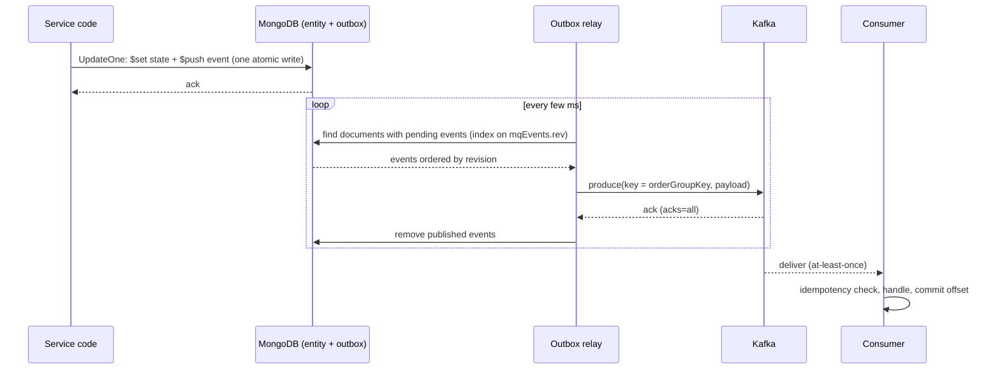
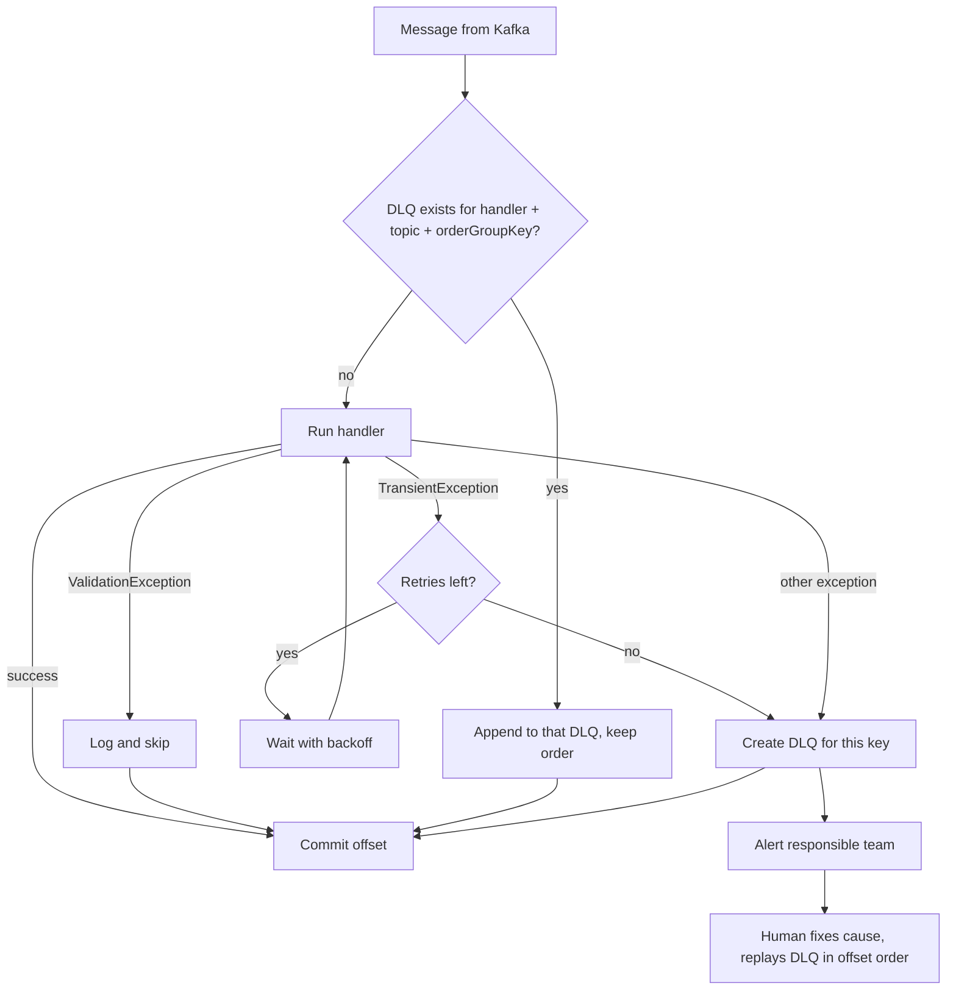

# 07. Domain events, the Outbox pattern and Kafka

## Why this chapter matters

Almost every backend interview for a senior role has a "distributed systems" part. The questions sound
simple: "How do you publish an event after you save an order?" or "What happens if the consumer fails?"
The honest answers are not simple. They involve the dual-write problem, at-least-once delivery,
idempotency, ordering and dead letter queues. Interviewers use these questions to see if you have
operated a real event-driven system or only read about one.

At Smartcat this is daily work. Services such as Project Tasks (PTS), Work Orders (WOS) and the
monolith talk to each other mostly through events on Kafka. A wrong `Set` instead of `PushEach`, or a
handler that is not idempotent, gives you lost or duplicated business actions in production.

## What you will be able to do

- Explain why events decouple bounded contexts and when an event is the wrong tool.
- Explain the dual-write problem and show how the Outbox pattern solves it, including its limits.
- Write a Smartcat domain event, an entity that raises it, and a repository that stores it safely.
- Answer the Kafka questions interviews always ask: partitions, keys, ordering, consumer groups,
  offsets, rebalancing, retention and delivery semantics.
- Design idempotent handlers, a retry policy and a DLQ strategy, and explain how to monitor them.
- Evolve an event contract without breaking consumers, and design a saga with correct compensation.

---

## 1. Why events

### Concept

A **domain event** is a fact about something that already happened in the domain:
`ProjectTaskStatusChanged`, `IndividualAssignmentCreated`, `UserDeleted`. It is named in the past
tense. It is not a request ("please do X"). That is a **command**.

The difference matters:

| | Command | Event |
|---|---|---|
| Meaning | "Do this" | "This happened" |
| Number of receivers | Exactly one owner | Zero, one or many |
| Can be refused | Yes | No, it is already a fact |
| Coupling | Sender knows the receiver | Sender does not know who listens |
| Typical transport | HTTP call, a task in a queue | Kafka topic |

### Why

Events give you three kinds of decoupling:

1. **Logical decoupling between bounded contexts.** PTS publishes `ProjectTaskStatusChanged`. It does not
   know that notifications, billing and search all react to it. A new consumer needs no change in PTS.
   (Bounded contexts are covered in chapter 06, Architectural patterns at Smartcat.)
2. **Temporal decoupling.** The consumer can be down for ten minutes. The events wait in Kafka. With a
   synchronous HTTP call, the producer would fail or would need its own retry logic.
3. **Read models.** A service can keep its own copy of the data it needs, built from events. For example,
   PTS publishes `ProjectTaskSummaryChanged` so that consumers can show "overdue / unassigned / stalled"
   without querying PTS for every project in a list.

There are two styles of event payload:

- **Notification event**: only ids. "Task 42 changed". The consumer calls back to get the data. Small
  events, but more load on the producer and a race: the data may change again before the call.
- **Event-carried state transfer**: the event carries the data the consumers need. Bigger events, but
  consumers can build read models without calls back. Most Smartcat contract events are of this kind.

### C# example

```csharp
[MqEvent("Project.TaskSummaryChanged", nameof(OrderGroupKey))]
public class ProjectTaskSummaryChanged : EventWithIdempotencyKeyBase
{
    public ProjectTaskSummaryChanged(Guid projectId, Guid accountId, int openTaskCount, DateTime computedAt)
    {
        OrderGroupKey = projectId.ToString();
        ProjectId = projectId;
        AccountId = accountId;
        OpenTaskCount = openTaskCount;
        ComputedAt = computedAt;
    }

    public string OrderGroupKey { get; set; }
    public Guid ProjectId { get; set; }
    public Guid AccountId { get; set; }
    public int OpenTaskCount { get; set; }

    /// <summary>A consumer that already holds a newer summary ignores this one</summary>
    public DateTime ComputedAt { get; set; }
}
```

This is a shortened form of the real event in
`project-tasks-service/src/Contracts.Events/Projects/ProjectTaskSummaryChanged.cs`.

### When an event is the wrong tool

- The caller needs an answer now ("is this user allowed?"). Use a query (HTTP/gRPC).
- The action must happen exactly once and the caller must know it failed (charge a card). Use a command
  with an explicit result, or a task with a state machine (see chapter 08, Background task processing).
- You need a strong invariant across two services in one moment. Events give eventual consistency only.
  If you need the invariant, the two pieces of data probably belong in one bounded context.

**Common mistake:** naming a command as an event. `SendInvoiceEmailEvent` is a command in disguise. It has
exactly one expected receiver, and the producer depends on it. Name the fact (`InvoiceIssued`) and let the
email service decide what to do.

**Tip:** in an interview, say "events are facts in the past tense; commands are requests with one owner".
It is a short sentence that shows you know the difference.

---

## 2. The dual-write problem

### Concept

You must change your database and also tell the world about the change. These are two different
systems: MongoDB and Kafka. There is no shared transaction between them.

```csharp
// BAD: dual write
public async Task CompleteTask(ProjectTask task)
{
    task.Complete();
    await _repository.Save(task);                            // 1. write to MongoDB
    await _producer.Publish(new ProjectTaskCompleted(task.Id)); // 2. write to Kafka
}
```

### Why it fails

Every order of the two writes has a failure window:

| Order | Crash point | Result |
|---|---|---|
| Save, then publish | After save, before publish (pod killed, Kafka down) | Data changed, event **lost** forever. Consumers never learn. |
| Publish, then save | After publish, before save (DB error, conflict) | Event published for a change that **never happened**. |
| Save, publish, retry on error | Publish timed out but actually succeeded | Event published **twice**. |

A pod restart during a deployment is enough to hit the first row. It is not a rare case. In a system
with thousands of writes per minute, it happens every day.

### Why not a distributed transaction

- Two-phase commit (2PC, a protocol where a coordinator asks every participant to "prepare" and then
  "commit") is not supported between MongoDB and Kafka.
- Kafka transactions exist, but they cover Kafka writes and consumer offsets only. They do not include
  your MongoDB write.
- 2PC also holds locks across systems and makes the slowest system decide your latency.

The industry answer is: **write the event into the same database, in the same atomic write as the state
change, and publish it later.** That is the Outbox pattern.

**Common mistake:** "I will wrap it in `try/catch` and publish again." A retry does not help when the
process is killed. The event lives only in memory, so it is gone.

**Tip:** when an interviewer asks "how do you publish an event after saving?", start your answer with
"this is the dual-write problem". Then explain the failure table. Then the outbox.

---

## 3. The Outbox pattern

### Concept

1. In the same atomic write that changes the entity, also store the event (the "outbox").
2. A separate **relay** (also called a pump or outbox processor) reads stored events, publishes them to
   Kafka, and then removes them from the outbox.



### Why it works

- The state change and the event are **one write** to one document, so they are atomic. Either both are
  saved or neither is. No lost events and no phantom events.
- The relay can crash at any point. The worst case is: it published to Kafka, then crashed before it
  removed the event. On restart it publishes the event again. So the outbox gives you
  **at-least-once** publishing, never "at-most-once".
- That is why every consumer must be idempotent (section 8). The outbox and idempotent consumers are one
  design. You cannot have one without the other.

### Variants you should know

| Variant | How it works | Trade-off |
|---|---|---|
| Polling outbox (Smartcat) | Relay polls the collection by an index | Simple, needs an index, small polling delay |
| Separate outbox collection | Event written to an `outbox` collection inside a DB transaction | Needs multi-document transactions |
| Change Data Capture (CDC) | Tool reads the DB log (Debezium, Mongo change streams) | No polling, but more infrastructure |
| Listen to yourself | Publish first, update state in your own consumer | State update becomes asynchronous for the writer too |

**Common mistake:** thinking that the outbox gives exactly-once delivery. It gives at-least-once
publishing. Exactly-once *effect* is something you build in the consumer, with idempotency.

**Tip:** say the full chain: "atomic write of state and event, relay with at-least-once, idempotent
consumer". This is the answer interviewers expect.

---

## 4. The outbox at Smartcat

At Smartcat: the outbox comes from the `Smartcat.DomainEvents` platform library. You do not write a
relay yourself. You follow four rules.

### Rule 1. The entity inherits `DomainEntity` and raises events with `AddEvents`

`DomainEntity` holds the list of new events. In MongoDB they live in the `mqEvents` array field of the
same document. In C# the property is `NewEvents`.

```csharp
[CollectionName("AssignmentTemplates")]
internal class AssignmentTemplate : DomainEntity
{
    public Guid Id { get; private set; }
    public Guid AccountId { get; private set; }
    public bool IsDeleted { get; private set; }

    public bool TryMarkDeleted()
    {
        if (IsDeleted)
            return false;

        IsDeleted = true;
        AddEvents(new AssignmentTemplateDeleted(Id, AccountId));
        return true;
    }
}
```

This is close to `project-tasks-service/src/AssignmentTemplates.Module/DAL/Schema/AssignmentTemplate.cs`.
Note the design: the entity raises the event in the same method that changes its state. You cannot
forget the event, and you cannot raise it without the state change.

### Rule 2. The repository appends events with `PushEach`, never `Set`

```csharp
// BAD: overwrites the array
var update = Builders<ProjectTask>.Update
    .Set(t => t.Status, task.Status)
    .Set(t => t.NewEvents, task.NewEvents);

// GOOD: appends atomically
var update = Builders<ProjectTask>.Update
    .Set(t => t.Status, task.Status)
    .PushEach(t => t.NewEvents, task.NewEvents);

await _collection.UpdateOneAsync(t => t.Id == task.Id, update, cancellationToken: ct);
```

Why `Set` loses events: two writers load the same document. Writer A adds event E1, writer B adds event
E2. Each writer's in-memory `NewEvents` contains only its own event. With `Set`, B's write replaces the
array, so E1 is gone, even if the relay has not published it yet. Also, if the relay published and
removed some events between your read and your write, `Set` can bring back already-published events.
`$push` with `$each` appends to whatever is in the database at the moment of the write, so both events
survive.

At Smartcat, PTS repositories add a second warning in code comments
(`project-tasks-service/src/ProjectTasks.Module/DAL/ProjectTaskRepository.cs`): push the entity's own
`NewEvents`, which are wrapped "stored events" that carry the **revision** the outbox orders by. If you
push a bare event object, the revision is missing and the relay cannot read it, so nothing is delivered.
No exception, no log. The event simply never leaves the database.

### Rule 3. The collection has the outbox index

```javascript
// partial index: holds only documents with pending events
{ "mqEvents.rev": 1 }
// partialFilterExpression: { "mqEvents.rev": { "$exists": true } }
```

The relay polls with `Filter.Exists("mqEvents.rev")`. Without the index, every poll is a full collection
scan, many times per second. Because the index is partial, it is almost empty at rest. It costs nearly
nothing. Naming: new indexes use `IDX_` (non-unique) or `UDX_` (unique) prefixes; keep old `IX_` names to
avoid a rebuild (see chapter 02, Code style, and chapter 09, MongoDB models, indexes and safe migrations).
A real example is the migration
`project-tasks-service/src/Migrations/Migration-2026-1/Before/CreateAssignmentTemplateOutboxIndex.cs`.

### Rule 4. The repository is registered as `IOutboxEventRepository`

The relay finds outboxes through DI:

```csharp
services.AddSingleton<IOutboxEventRepository, ProjectTaskRepository>();
services.AddSingleton<IOutboxEventRepository, AssignmentRepository>();
```

Each one has a unique `Name` and implements `GetEvents(limit)`. If you forget the registration, events
are stored but never published.

### Two generations of the outbox

At Smartcat you will see both:

| | Embedded outbox (`DomainEntity`) | Separate outbox (`OutboxEventRepositoryV2`) |
|---|---|---|
| Where the events live | `mqEvents` array inside the entity document | Separate outbox collection |
| Atomicity from | Single-document atomic update | Multi-document MongoDB transaction |
| Write pattern | `PushEach(x => x.NewEvents, ...)` | `WithTransaction(session => { insert/update; AddEvents(session, events); })` |
| Example | `ProjectTaskRepository`, `AssignmentTemplateRepository` | `ScopeRepository`, `ProjectTaskTagRepository` |

```csharp
public async Task Insert(Scope scope, CancellationToken ct = default)
{
    await _collection.WithTransaction(async session =>
    {
        await _collection.InsertOneAsync(session, scope, cancellationToken: ct);
        await AddEvents(session, scope.NewEvents);
    }, ct: ct);
}
```

The second form is useful when one domain operation changes many documents, or when the event does not
belong to one entity (for example a "deleted" event for a document you remove).

**Common mistakes (At Smartcat):**

- `Set` on `NewEvents` instead of `PushEach`.
- Entity does not inherit `DomainEntity`, so there is no `mqEvents` field.
- Missing `mqEvents.rev` partial index, so the relay scans the collection.
- Event pushed as a bare object, without the stored-event envelope.
- A loop of `UpdateOneAsync` calls for one business operation, with events on each. This breaks atomicity
  (review rule A22, multi-document mutation without atomicity). Use one update, `UpdateMany` with array
  filters, or a transaction.

**Tip:** in code review, search the diff for `.Set(` near `NewEvents`. It is the fastest high-value check
in an events MR.

---

## 5. `MqEventAttribute` and event contracts

### Concept

At Smartcat every Kafka event class has `[MqEvent(discriminator, orderGroupProperty)]`:

- `discriminator`: a unique, stable event type name, for example `"IndividualAssignment.Created"`. The
  consumer side routes by this string, not by the C# class name.
- `orderGroupProperty`: the name of the property whose value becomes the Kafka **message key**. Messages
  with the same key go to the same partition, so they are processed in order.
- `obsolete`: optional flag that marks the event as deprecated.

```csharp
[MqEvent("IndividualAssignment.Created", nameof(OrderGroupKey))]
public class IndividualAssignmentCreated : EventWithIdempotencyKeyBase
{
    public IndividualAssignmentCreated(Guid id, Guid projectTaskId, Guid accountId)
    {
        Id = id;
        OrderGroupKey = id.ToString();
        ProjectTaskId = projectTaskId;
        AccountId = accountId;
    }

    public string OrderGroupKey { get; set; }
    public Guid Id { get; set; }
    public Guid ProjectTaskId { get; set; }
    public Guid AccountId { get; set; }
}
```

`EventWithIdempotencyKeyBase` generates a unique event id. Idempotent handlers use it as the
deduplication key (section 8).

### Why

- Without the attribute there is no routing information and no ordering key. The event cannot be
  published correctly.
- The discriminator is part of the public contract. If you rename it, every consumer that routes on the
  old name silently stops receiving the event. PTS has a test that pins this
  (`project-tasks-service/src/Tests/Events/ProjectStatusChangedContractTests.cs`):

```csharp
[Test]
public void Should_route_on_the_unchanged_event_discriminator()
{
    // Arrange
    var type = typeof(ProjectStatusChanged);

    // Act
    var attribute = type.GetCustomAttribute<MqEventAttribute>();

    // Assert
    Assert.That(attribute, Is.Not.Null);
    Assert.That(attribute.Discriminator, Is.EqualTo("ProjectStatus.Changed"));
}
```

(Reading an attribute is a structure check, not reflection into private members, so it is fine in tests.)

**Common mistake:** choosing the order key by habit (`AccountId`) without thinking. A big account then
becomes a "hot" partition, and one slow event for that account blocks all its other events (see
section 10).

**Tip:** pick the order key as "the smallest entity whose events must be in order". For assignment
events it is the assignment id. For a project summary it is the project id.

---

## 6. Kafka basics that interviews test

You do not need to be a Kafka administrator. You need to explain these terms clearly and connect them to
your design choices.

### Vocabulary

| Term | What it is | Why you care |
|---|---|---|
| Topic | A named log of messages | One topic per event family, for example `user-events` |
| Partition | One ordered, append-only part of a topic | Order is guaranteed **only inside one partition** |
| Key | Value used to choose the partition (hash of key mod partitions) | Same key, same partition, so order per key |
| Offset | Position of a message in a partition | The consumer's "bookmark" |
| Consumer group | Set of consumers that share the work of a topic | Each partition goes to one consumer in the group |
| Commit | Saving the offset for the group | Decides what is re-delivered after a crash |
| Rebalance | Partitions move between consumers in a group | Happens on deploy, scale, crash, slow poll |
| Retention | How long Kafka keeps messages (time or size) | Defines how long a consumer can be down |
| Compaction | Kafka keeps only the latest message per key | Good for "latest state" topics |
| Replication factor | Number of copies of each partition on brokers | Survives broker loss |
| `acks=all` | Producer waits for all in-sync replicas | No loss when a broker fails |

### Parallelism

Inside one consumer group, **maximum parallelism equals the number of partitions**. With 12 partitions
and 20 pods, 8 pods are idle for that topic. With 12 partitions and 3 pods, each pod reads 4 partitions.
You cannot easily reduce the number of partitions later, and adding partitions changes which partition a
key maps to (so order for existing keys can break during the change). Choose the count with growth in mind.

### Delivery semantics

| Semantics | How you get it | Risk |
|---|---|---|
| At-most-once | Commit offset **before** processing | A crash loses the message |
| At-least-once | Commit offset **after** processing | A crash re-delivers, so duplicates |
| Exactly-once | Kafka transactions, Kafka-to-Kafka only | Does not cover your database or HTTP side effects |

At Smartcat, and in most real systems: at-least-once plus idempotent handlers. This gives an
exactly-once **effect**.

### Rebalancing and `max.poll.interval`

If a consumer does not poll within `max.poll.interval.ms`, Kafka thinks it is dead and gives its
partitions to another consumer. The slow consumer may still finish its work, and the new owner processes
the same messages again. This is one more source of duplicates. Long handlers must either be fast, or
move the long work into a background task (chapter 08) and only record the intent in the handler.

### Smartcat configuration

```json
{
  "kafka": {
    "producers": {
      "user-events": { "topic": "user-events", "partitions": 12, "replicationFactor": 3 }
    },
    "consumerSets": {
      "user-events-handler": {
        "topicTags": [ "user-events" ],
        "groupId": "my-service.user-events",
        "sessionTimeout": "0:0:10",
        "maxPollInterval": "0:5:0",
        "crashRecoveryInterval": "0:0:10",
        "partitionPauseInterval": "0:1:0",
        "enabled": true
      }
    }
  }
}
```

- `groupId` is per service and purpose. Two services with the same group id would **split** the
  messages instead of both receiving all of them. That is a classic bug.
- `topicTags` can list several topics for one handler. The handler then filters by event type, not by
  topic.

**Common mistake:** "Kafka guarantees order." Only per partition, and only if the producer uses the same
key and does not reorder on retries (the idempotent producer setting protects this).

**Tip:** when asked "how do you scale a consumer?", answer: "add pods up to the partition count; beyond
that, add partitions or make each message cheaper; check consumer lag".

---

## 7. Handlers at Smartcat

### Concept

At Smartcat a Kafka consumer is a **message handler** bound to a **ConsumerSet** in configuration.

```csharp
public class UserEmailChangedHandler : IMessageHandler
{
    public MessageHandlerId Id => new("user-events-handler"); // must equal the ConsumerSet key

    public bool CanHandle(Message message) => true;

    public async Task Handle(Message message, CancellationToken ct = default)
    {
        var envelope = InboxContainer.Parse(message.Payload);
        if (envelope.Type != "user-email-changed")
            return;

        var evt = JsonConvert.DeserializeObject<UserEmailChangedEvent>(envelope.Message);
        await _emailService.SendConfirmation(evt.NewEmail, ct);
    }
}
```

### The handler ID mismatch trap

The ConsumerSet key in JSON (`"user-events-handler"`) and `MessageHandlerId Id` must be the same string.
The binding happens at runtime. If they differ, the build is green and the service starts, and then you
get `message handler user-events-handler not found`, and no message is processed. Your consumer lag grows
until someone notices.

### Typed handlers and dispatchers

PTS uses a higher-level shape: a few dispatchers implement `IMessageHandler`, and business handlers
implement `IEventHandler<TEvent>`:

```csharp
internal class UserDeletedHandler : IEventHandler<UserDeleted>
{
    private readonly IAssignmentsEventHandlerService _service;

    public UserDeletedHandler(IAssignmentsEventHandlerService service) => _service = service;

    public Task Handle(UserDeleted eventValue, CancellationToken ct) =>
        _service.ProcessUserDeleted(eventValue, ct);

    public ResponsibleTeams ResponsibleTeams => ResponsibleTeams.AssignmentsExperience;
}
```

Registration lives in `project-tasks-service/src/ConsumerModule/Module.cs`. PTS code comments describe a
real trap: an `IEventHandler<>` that nobody registers, or an event type missing from a dispatcher's list
(`LocalDomainEventsDispatcher.GetHandledEventTypes`), is **neither a compile error nor a runtime error**.
The handler is simply never called and the read model goes stale. PTS fixed one case by deriving the
registrations from the handler's own interface list.

### Batch handlers

For high-volume events (segment progress, for example) a handler can take a batch:

```csharp
public class SegmentsProgressBatchHandler : IMessageBatchHandler
{
    public MessageHandlerId Id => new("segments-progress-batch");

    public async Task Handle(IList<Message> messages, CancellationToken ct)
    {
        var latestPerDocument = messages
            .Select(m => Parse(m))
            .GroupBy(e => e.DocumentId)
            .Select(g => g.MaxBy(e => e.Version)!);

        await _progressService.Apply(latestPerDocument, ct);
    }
}
```

Why: one database round trip for 500 messages instead of 500 round trips, and you can collapse many
updates of the same entity into one. The cost: one bad message can fail the whole batch, and
idempotency must work per item, not per batch.

**Common mistake:** doing heavy work (file processing, external API calls with long timeouts) inside the
handler. It exceeds the poll interval, causes rebalances and duplicates. Record the intent (create a
task) and return.

**Tip:** in review, open the config and the handler side by side and compare the IDs character by
character. It takes ten seconds.

---

## 8. Idempotent handlers

### Concept

A handler is **idempotent** when processing the same message twice has the same effect as processing it
once. With at-least-once delivery, duplicates are normal, not exceptional. They come from:

- the outbox relay crashing after publish but before cleanup;
- the consumer crashing after the side effect but before the offset commit;
- rebalances after a slow poll;
- manual replay from a DLQ.

### Techniques

| Technique | How | Good for |
|---|---|---|
| Natural idempotency | The operation is idempotent by nature: `$set status = Completed`, upsert by id | State updates |
| Deduplication store | Store (handlerName, eventId) with a unique index; skip if present | Side effects: emails, payments, task creation |
| Version / timestamp check | Ignore an event older than the state you hold | Read models, out-of-order events |
| Unique business key | Unique index on the thing you create; catch duplicate key | Creating entities or tasks |

### Smartcat: `SingleEventWithIdempotencyKeyProcessorBase`

```csharp
public class UserEmailChangedIdempotentHandler
    : SingleEventWithIdempotencyKeyProcessorBase<UserEmailChangedEvent>
{
    public UserEmailChangedIdempotentHandler(IMongoDatabase database)
        : base(database, "processedEvents.userEmailChanged", "user-email-changed-handler")
    {
    }

    protected override TimeSpan Ttl => TimeSpan.FromDays(7);

    protected override async Task HandleUnprocessed(
        IClientSessionHandle session,
        UserEmailChangedEvent evt,
        CancellationToken ct)
    {
        await _users.MarkEmailConfirmationSent(session, evt.UserId, ct);
    }
}
```

How it works:

1. Look up (handlerName, eventId) in the processed-events collection.
2. If found, skip.
3. If not found, in **one MongoDB transaction**: run `HandleUnprocessed` with the session, and insert the
   processed record.

Required indexes on the processed-events collection: unique `{ eventId: 1, handlerName: 1 }`
(`UDX_EventId_HandlerName`) and a TTL index on `{ expireTime: 1 }`. PTS wraps this in its own base class,
`project-tasks-service/src/ConsumerModule/EventWithIdempotencyHandler.cs`, with one shared
`ProcessedEvents` collection.

### The two subtle points interviewers love

1. **Use the session.** The guarantee holds only for writes made **through the session** passed to
   `HandleUnprocessed`. A write without the session, or an HTTP call, or an email, is outside the
   transaction. If the transaction aborts after an email was sent, the retry sends a second email. For
   external side effects, pass the event id as an idempotency key to the external system, or turn the
   side effect into a task that has its own unique key.
2. **TTL is a trade-off.** The dedup record expires (default one day). A duplicate that arrives after the
   TTL is processed again. Replays from a DLQ after a week-long incident can be older than the TTL. Pick
   the TTL based on the longest realistic replay window, and make the business operation naturally
   idempotent where you can.

### Version check for read models

`ProjectTaskSummaryChanged` carries `ComputedAt` and its contract says: "A consumer holding a newer
summary should ignore this one". That makes the consumer idempotent and safe against reordering:

```csharp
var filter = Builders<ProjectView>.Filter.Eq(v => v.Id, evt.ProjectId)
           & Builders<ProjectView>.Filter.Lt(v => v.ComputedAt, evt.ComputedAt);

var update = Builders<ProjectView>.Update
    .Set(v => v.OpenTaskCount, evt.OpenTaskCount)
    .Set(v => v.ComputedAt, evt.ComputedAt);

await _views.UpdateOneAsync(filter, update, cancellationToken: ct);
```

(A missing view needs an upsert; with an upsert and this filter, a stale event can hit a duplicate key on
`_id`, which you can catch and ignore. Keep that detail in mind if the interviewer asks.)

**Common mistake:** "Check if processed, then process" without a unique index or transaction. Two
consumers (during a rebalance) both see "not processed" and both run. A check-then-act without an atomic
guard is a race (review rule A28 discusses the same TOCTOU problem for unique writes).

**Tip:** say "duplicates are normal, so idempotency is a requirement, not an optimisation".

---

## 9. Errors, retries and the DLQ

### Three classes of errors

| Error | Example | What to do |
|---|---|---|
| Validation (permanent, the message is bad) | Unknown enum value, missing required field, entity that will never exist | Log and **skip**. Retrying will never help. |
| Transient (the world is temporarily bad) | Timeout, 503, Mongo primary election | **Retry** with backoff, then DLQ |
| Unknown / bug | `NullReferenceException` in your code | **DLQ** so that a human can look, fix and replay |

At Smartcat:

```csharp
if (!IsValid(evt))
    throw new ValidationException("Invalid payload");          // logged and skipped, no DLQ

if (!await _externalApi.IsAvailable(ct))
    throw new TransientException("External API unavailable"); // retried, then DLQ

// any other exception: DLQ
```

### The Smartcat DLQ

A dead letter queue (DLQ) is a place where messages that could not be processed wait for a human or a
replay.

The Smartcat DLQ is not one global queue. It is keyed by **(messageHandlerId, topicId, orderGroupKey)**:

- When a handler throws, a wrapper (`DeadLetterQueueMessageHandler`) catches it and creates a DLQ for that
  key.
- **Later messages with the same order group key are pushed into the same DLQ**, even if they would
  succeed.
- Messages with other keys continue to flow.

Why: ordering. If event 1 for assignment A fails and event 2 for assignment A succeeds, the consumer
state would be "event 2 applied without event 1". Keeping all later events of the same key behind the
failed one keeps per-key order. Only one key is blocked, not the whole partition.



### Storage and fields

```
messageQueues.dlq.v2            one DLQ task per (handler, topic, orderGroupKey)
messageQueues.dlq.v2.messages   failed and queued messages, with offsets
```

| Field | Meaning |
|---|---|
| `deadLetterQueueId.messageHandlerId` | Which handler failed |
| `deadLetterQueueId.topicId` | Which topic |
| `deadLetterQueueId.orderGroupKey` | The Kafka key that is blocked |
| `messageCount` | How many messages wait in this DLQ |
| `reason` | The first failure reason |
| `responsibleTeams` | Who gets the alert |
| `state` | DLQ task state; `2` means closed |

Unique index: `{ deadLetterQueueId.messageHandlerId: 1, deadLetterQueueId.topicId: 1,
deadLetterQueueId.orderGroupKey: 1 }`.

### Monitoring queries

```javascript
// open DLQs
db["messageQueues.dlq.v2"].find({ "state": { "$ne": 2 } })

// DLQs of one handler
db["messageQueues.dlq.v2"].find({ "deadLetterQueueId.messageHandlerId": "user-events-handler" })

// total waiting messages per handler
db["messageQueues.dlq.v2"].aggregate([
  { "$group": { "_id": "$deadLetterQueueId.messageHandlerId", "total": { "$sum": "$messageCount" } } }
])

// messages of one key, in replay order
db["messageQueues.dlq.v2.messages"].find({
  "deadLetterQueueId.messageHandlerId": "user-events-handler",
  "deadLetterQueueId.orderGroupKey": "12345"
}).sort({ "message.offset": 1 })
```

### Responsible-team alerting

A DLQ nobody looks at is a slow data loss. At Smartcat a handler declares its owner, and exceptions can
carry it:

```csharp
catch (Exception e)
{
    throw new EventHandlerException(new[] { ResponsibleTeams.Integration }, e);
}
```

PTS handlers override `ResponsibleTeams` (for example `ResponsibleTeams.WorkflowExperience`). The value
goes into the DLQ record, so the alert reaches the team that can fix the code, not a general channel.

**Common mistakes:**

- Throwing a generic exception for bad input. The DLQ fills with messages that can never succeed, and the
  key is blocked forever.
- Catching all exceptions and logging them "to keep the consumer alive". The message is lost silently.
- Treating every exception as transient and retrying forever. One poison message then blocks the key.
- Replaying a DLQ out of offset order.

**Tip:** in an interview, say "I classify errors: permanent ones are skipped and logged, transient ones are
retried with a budget, unknown ones go to a DLQ with an owner and an alert".

---

## 10. Ordering guarantees

### What you actually get

- Kafka: order per partition.
- Smartcat: the order key (`orderGroupProperty`) decides the partition, so you get **order per key**.
- The DLQ keeps order per key by queuing later messages of a failed key.
- The outbox relay publishes events of one document in revision order.

### What you do not get

- No order between different keys. `ProjectCreated` (key: project id) and `ProjectTaskCreated` (key: task
  id) can arrive in any order. A consumer that needs the project first must handle "parent not yet known":
  retry, create a placeholder, or store and re-apply.
- No order between different topics.
- No global order. If someone asks for it, the honest answer is "one partition", which means no
  parallelism.

### Choosing the key

| Key | Order scope | Risk |
|---|---|---|
| Entity id (assignment id) | Per entity | No order across entities of one project |
| Aggregate root id (project id) | Per project | A big project is a hot key |
| Account id | Per account | Hot partition for large accounts, one failure blocks a whole account in the DLQ |
| Random / none | None | Maximum parallelism, no order at all |

**Common mistake:** relying on timestamps from different producers to restore order. Clocks drift. Use a
version or revision number set by the single writer of that entity.

**Tip:** design consumers to tolerate reordering where possible (version checks, `ComputedAt`). Then the
key choice becomes a performance decision, not a correctness decision.

---

## 11. Event versioning and schema evolution

### Concept

An event contract is a public API. Old messages stay in Kafka (retention) and in DLQs. Consumers deploy at
different times from producers. So, at any moment, old and new shapes exist together.

### Safe and unsafe changes

| Change | Safe? | Why |
|---|---|---|
| Add an optional field | Yes | Old consumers ignore it; new consumers must handle `null` from old messages |
| Remove a field consumers read | No | Old consumers break |
| Rename a field | No | It is remove + add |
| Change a field type (int to string) | No | Deserialization fails, message goes to DLQ |
| Change enum values | Risky | Old consumers may not know the new value |
| Rename the discriminator | No | Routing silently stops |
| Change the order key | Risky | Order breaks during the switch |

### How to make a breaking change

1. Introduce a new event with a new discriminator (`Project.TaskSummaryChanged.V2`), or new optional
   fields.
2. Publish both, old and new, for a while.
3. Move consumers to the new event, one by one.
4. Mark the old event `obsolete` in `MqEvent`, then stop publishing it after all consumers moved and old
   messages have expired from retention and DLQs.

This is the "expand and contract" pattern. Migrations use the same idea (see chapter 09, MongoDB models,
indexes and safe migrations).

### Tolerant reader

Consumers should read only the fields they need, ignore unknown fields, and accept missing optional
fields. PTS pins this with contract tests that deserialize an **old-shape payload** and assert that the
old members read the same and the new members are `null`
(`project-tasks-service/src/Tests/Events/ProjectStatusChangedContractTests.cs`). The test comment says
why: the shared contracts package has no tests of its own, so a breaking change would otherwise reach
production.

**Common mistake:** making a new field required (non-nullable without default) in the consumer. All
messages published before the change now fail.

**Tip:** deploy order for additive changes: consumers that can read the new field first, then the producer
that writes it.

---

## 12. Sagas and compensation

### Concept

A **saga** is a long business process across several services, made of local transactions. Each step
commits on its own. If a later step fails, you run **compensating actions** for the earlier steps (a
refund, a cancel), because you cannot roll back a commit in another service.

| Style | How | Good | Bad |
|---|---|---|---|
| Choreography | Each service reacts to events and emits new ones | No central owner, loose coupling | The process is hard to see and debug |
| Orchestration | One coordinator (a task, a workflow engine) sends commands and tracks state | Process is explicit, easy to monitor | Coordinator becomes a central dependency |

At Smartcat, long processes are often orchestrated by a background task with a state machine (chapter 08)
or by the workflow engine service, while the steps communicate through events.

### Compensation must know why it runs

Review rule A7 (compensation logic without distinguishing user-cancel vs infra-failure) is a real lesson:

- **User cancel**: the user wants to stop. Compensate (release reserved suppliers, notify), and mark the
  run as cancelled. Do not retry.
- **Infrastructure failure**: a pod died or a lock was lost. The user still wants the result. Retry or
  resume. Do **not** compensate, or you undo work the user expects.

```csharp
// BAD: one path for two different reasons
catch (OperationCanceledException)
{
    await CompensateAll(run);
}

// GOOD: the reason is explicit
catch (OperationCanceledException) when (run.CancellationReason == CancellationReason.UserRequested)
{
    await CompensateAll(run);
    await MarkCancelled(run);
}
catch (WorkerLostException)
{
    await ScheduleResume(run);
}
```

### Idempotency of saga triggers

Review rule A34 (workflow trigger without idempotency key) is about the start of a saga: if a UI
confirmation starts a workflow, pass the confirmation id as an idempotency key. A double click or a client
retry must not start two workflows. The same idea applies to every saga step: each step must be safe to
run twice, because events that drive it are delivered at least once.

**Common mistake:** writing compensations that are not idempotent. A compensation can also be delivered
twice: "refund twice" is worse than "refund never".

**Tip:** for each step of a saga, prepare three answers: "what if it runs twice?", "what if it never
runs?", "what is the compensation and is it idempotent?".

---

## 13. Testing event-driven code

### What to test

| Layer | Test | Example |
|---|---|---|
| Entity | The state change raises the right event | `TryMarkDeleted` adds `AssignmentTemplateDeleted` once, and not on the second call |
| Repository | Events are appended with `PushEach`, concurrent writers keep both events | Ephemeral Mongo test with two updates |
| Handler | Business effect for a valid event | Assert state, not mock call counts |
| Handler | **Replay**: the same event twice gives one effect | Review rule T14 (replay-idempotency test) |
| Handler | Validation errors skip, transient errors retry, budget ends | Review rule T17 (test for retry budget) |
| Contract | Discriminator unchanged; old payload still reads | `ProjectStatusChangedContractTests` |

### Replay test

```csharp
[Test]
public async Task Should_create_one_assignment_when_same_event_is_handled_twice()
{
    // Arrange
    var evt = new TemplateApplied(Guid.NewGuid(), Guid.NewGuid());
    var handler = Get<TemplateAppliedHandler>();

    // Act
    await handler.Handle(evt);
    await handler.Handle(evt);

    // Assert
    var assignments = await _assignments.GetByProjectTask(evt.ProjectTaskId);
    Assert.That(assignments, Has.Count.EqualTo(1));
}
```

Why this test matters: a fix to a state update or queueing logic that has no replay test is a common
source of production duplicates. The test is cheap and it fails clearly.

### Retry budget test

```csharp
[Test]
public void Should_stop_retrying_when_retry_budget_is_exhausted()
{
    // Arrange
    var api = AddFake<IExternalApi>();
    A.CallTo(() => api.Send(A<Request>._)).Throws(new TimeoutException());
    var sender = Get<RetryingSender>(); // budget: 3 attempts

    // Act
    Func<Task> act = () => sender.Send(new Request());

    // Assert
    Assert.That(act, Throws.TypeOf<RetryBudgetExceededException>());
    A.CallTo(() => api.Send(A<Request>._)).MustHaveHappened(3, Times.Exactly);
}
```

**Common mistake:** a test that only asserts "the handler called the service once". It proves the wiring,
not the behaviour. Assert the resulting state (review rule T5).

**Tip:** if the code under review adds retry, ask "where is the test for N+1 failures?". If it changes
state handling for a message, ask "where is the replay test?".

---

## At Smartcat: quick map

| Topic | Where to look |
|---|---|
| Event contracts with `MqEvent` | `project-tasks-service/src/Contracts.Events/**` |
| Entity raising events | `project-tasks-service/src/AssignmentTemplates.Module/DAL/Schema/AssignmentTemplate.cs` |
| `PushEach` with stored-event envelope | `project-tasks-service/src/ProjectTasks.Module/DAL/ProjectTaskRepository.cs`, `ProjectSummaryRepository.cs` |
| Transactional outbox (V2) | `project-tasks-service/src/ProjectTasks.Module/DAL/ScopeRepository.cs` |
| Outbox index migration | `project-tasks-service/src/Migrations/Migration-2026-1/Before/CreateAssignmentTemplateOutboxIndex.cs` |
| Outbox registration | `project-tasks-service/src/ProjectTasks.Module/Module.cs` (`IOutboxEventRepository`) |
| Handler registration and dispatchers | `project-tasks-service/src/ConsumerModule/Module.cs`, `ConsumerModule/Dispatchers/*` |
| Idempotent handler base | `project-tasks-service/src/ConsumerModule/EventWithIdempotencyHandler.cs` |
| Batch handlers | `smartcat/Features/Cat/Core.Cat.Module/Progress/SegmentsEventsHandlers/*` |
| Contract tests | `project-tasks-service/src/Tests/Events/*ContractTests.cs` |

Review checklist for an events MR (from the Smartcat code review checklist):

- Events appended with `PushEach`, never `Set`.
- Event class has `[MqEvent]` and inherits `EventWithIdempotencyKeyBase` when handlers need dedup.
- Entity inherits `DomainEntity`; collection has the `mqEvents.rev` partial index.
- Handler ID equals the ConsumerSet key.
- Handler is idempotent, and there is a replay test.
- Error strategy is explicit: validation, transient, DLQ, responsible team.
- Batch handlers: check the number of idempotency keys per message and per batch.

Note: the review checklist shows some shapes in a shorter form (for example an `[MqEvent(typeof(...),
ConsumerSet = ...)]` handler attribute and `_outbox.PushEach(...)`). Real PTS code puts `[MqEvent]` on the
event class and binds handlers through DI and ConsumerSet config. Follow the shape of the repo you work in.

---

## Interview corner

### As the interviewee

**1. How do you publish an event reliably after saving data?**
A strong answer covers:
- Names the dual-write problem and the three failure cases (lost, phantom, duplicate).
- Explains the outbox: state and event in one atomic write, relay publishes later.
- Says the relay is at-least-once, so consumers must be idempotent.
- Mentions alternatives: CDC, transaction with a separate outbox collection.

**2. Why `PushEach` and not `Set` for the events array?**
A strong answer covers:
- `Set` overwrites the array with the in-memory copy, so a concurrent writer's events are lost.
- `$push/$each` appends atomically to the current database value.
- Mentions that `Set` can also resurrect events the relay already removed.

**3. What does Kafka guarantee about order?**
A strong answer covers:
- Order only inside one partition; key decides the partition.
- No order across keys, partitions or topics.
- Retries and rebalances can still cause duplicates, but not reordering within a partition with an
  idempotent producer.
- How to choose a key and what a hot key is.

**4. Explain consumer groups and offsets.**
A strong answer covers:
- Each partition is read by one consumer of the group; parallelism is limited by partition count.
- Offsets are committed per group and partition.
- Commit after processing gives at-least-once.
- Different services need different group ids.

**5. What is a rebalance and why should you care?**
A strong answer covers:
- Partitions move on deploy, scale, crash or a missed poll interval.
- Messages in flight can be processed twice.
- Long work in a handler causes rebalances; move it to a task.

**6. How do you make a handler idempotent?**
A strong answer covers:
- Natural idempotency, dedup store with a unique index, version checks, unique business keys.
- Dedup record written in the same transaction as the effect.
- External side effects are outside the transaction; use an idempotency key with the external system.
- TTL of the dedup records and the replay window.

**7. What is "exactly-once" in practice?**
A strong answer covers:
- Kafka exactly-once covers Kafka-to-Kafka with transactions only.
- Real systems use at-least-once plus idempotency to get an exactly-once effect.

**8. What is a DLQ and how is Smartcat's DLQ organised?**
A strong answer covers:
- A store for messages that failed, for analysis and replay.
- Smartcat keys it by handler, topic and order group key.
- Later messages of the same key are queued to keep order; other keys keep flowing.
- Monitoring, alerts to the responsible team, replay in offset order.

**9. Which errors should go to a DLQ?**
A strong answer covers:
- Validation errors: skip and log, never DLQ.
- Transient errors: retry with backoff and a budget, then DLQ.
- Unknown errors: DLQ with an alert.

**10. How do you change an event contract safely?**
A strong answer covers:
- Additive, optional fields; tolerant reader.
- Breaking change: new event or discriminator, dual publish, migrate consumers, then retire.
- Old messages live in retention and DLQs; contract tests with old payloads.

**11. Choreography or orchestration for a saga?**
A strong answer covers:
- Trade-offs: visibility vs coupling.
- Compensations, their idempotency, and the difference between user cancel and infrastructure failure.

**12. A consumer's lag grows. What do you check?**
A strong answer covers:
- Is the handler bound at all (handler ID mismatch, consumer disabled)?
- Errors and DLQ growth, a poison message.
- Slow handler, rebalances, poll interval, partition count vs pod count, hot key.

**13. Why not just call the other service over HTTP?**
A strong answer covers:
- Temporal coupling: the call fails when the other service is down.
- The producer would need to know all consumers.
- HTTP is right when you need an answer now; events are right for "this happened".

### As the interviewer

**What to ask:** start with "We save an order and need to notify billing. Walk me through it." Let the
candidate drive. Then add failures one by one: "the pod dies here", "Kafka is down for an hour", "the
billing handler throws", "the same message arrives twice", "billing deploys a new contract".

**Depth probes:**
- "Your relay crashed after publishing but before cleanup. What happens next?"
- "Why is your dedup record in the same transaction? What is *not* covered by it?"
- "Two writers update the same document at the same time. Show me the update you write."
- "Your order key is the account id. What happens for a customer with 10 million tasks?"
- "One message for key K fails. What happens to the next message for K? For key L?"
- "How long do you keep dedup records, and why that number?"
- "The user clicks Cancel while a worker pod dies. What does your compensation do in each case?"

**Green flags:**
- Names the dual-write problem without being prompted.
- Says "at-least-once" and "idempotent" together, naturally.
- Talks about the order key as a design choice with a cost.
- Classifies errors and talks about alerting and ownership, not only code.
- Mentions contract tests and old payloads.

**Red flags:**
- "Kafka guarantees exactly-once, so duplicates are not a problem."
- "I publish inside the same `try` block after `SaveChanges`."
- "Catch all exceptions and log them so the consumer does not stop."
- "Kafka keeps order" without "per partition".
- No idea how to find a stuck message in production.

**Scoring rubric:**

| Level | Signals |
|---|---|
| Junior | Knows topics and consumers. Publishes after save. Has not thought about duplicates. |
| Senior | Explains outbox, at-least-once, idempotent handlers, partitions and keys, a DLQ. Writes a correct `PushEach`. |
| Staff | Explains limits of each guarantee (TTL window, side effects outside the transaction, hot keys, rebalances), designs DLQ ownership and alerting, plans contract evolution and saga compensation by cancellation reason, and asks about operations: lag, replay, monitoring. |

---

## Exercises

1. **Find the bug.** A repository method updates a project task like this:
   `Builders<ProjectTask>.Update.Set(t => t.Status, s).Set(t => t.NewEvents, task.NewEvents)`.
   Describe a concrete sequence of two requests that loses an event.
2. **Design an outbox.** You work on a service without the Smartcat library, on PostgreSQL. Design the
   outbox table, the relay query, and how the relay avoids two instances publishing the same row at the
   same time.
3. **Idempotent email.** Write a handler for `InvoiceIssued` that sends exactly one email per invoice,
   even with duplicates and crashes. The email provider supports an idempotency key header.
4. **DLQ incident.** Monday morning, `messageQueues.dlq.v2` has 40 open DLQs for one handler, all with
   reason `Unknown enum value 'onHold'`. Explain what probably happened, what you fix, and how you replay.
5. **Order key.** Choose the order key for `ScopeStatusChanged`, `ProjectTaskStatusChanged` and
   `ProjectTaskSummaryChanged`. Explain the trade-off for each.
6. **Saga.** A "bulk assign suppliers" process invites suppliers in groups, waiting between groups. Design
   the cancel path for "user cancels the project" and for "worker pod is killed".

<details>
<summary>Answer notes</summary>

1. Request A and request B load the task with `NewEvents = []`. A changes status and adds E1. B changes the
   deadline and adds E2. A writes: `mqEvents = [E1]`. B writes: `mqEvents = [E2]`. E1 is gone before the
   relay saw it. With `PushEach` the result is `[E1, E2]`. Also mention that the B write may overwrite A's
   status change; optimistic concurrency (a change stamp) is a separate fix.
2. Table `outbox(id, aggregate_id, revision, type, payload, created_at, published_at null)`. Insert in the
   same transaction as the business row. Relay: `SELECT ... WHERE published_at IS NULL ORDER BY id LIMIT
   100 FOR UPDATE SKIP LOCKED`, publish, then update `published_at` or delete. `SKIP LOCKED` stops two
   relays from taking the same rows. Order per aggregate needs one relay per aggregate or ordering by
   revision within a key. It is still at-least-once.
3. Inherit the idempotent base. In `HandleUnprocessed` do not send the email directly; either call the
   provider with `Idempotency-Key: invoiceId` (so a retry after a crash is deduplicated by the provider),
   or create an "send email" task with a unique index on invoice id. The dedup record alone does not cover
   the external call.
4. A producer added a new enum value and deployed before the consumer. The consumer fails to deserialize,
   so each affected key goes to a DLQ. Fix: make the consumer tolerant (unknown value maps to a default or
   is handled), deploy, then replay each DLQ in offset order. Prevention: consumers first, contract tests,
   and treat unknown enum values as validation errors only when skipping is really safe.
5. `ScopeStatusChanged`: scope id or project task id, depending on whether consumers need order across
   scopes of one task. `ProjectTaskStatusChanged`: task id. `ProjectTaskSummaryChanged`: project id (PTS
   uses it). Wider keys give more order and more risk of hot keys and wider DLQ blocking.
6. Store a `CancellationIsRequested` flag set by the cancel request (PTS does this in
   `ApplyAssignmentTemplateTaskManager.RequestCancellation`). The task checks the flag before each group
   and completes without inviting more. On a pod kill the task's lease expires and another pod recaptures
   it and continues from `NextIteration`. No compensation on pod kill. On user cancel, release or cancel
   pending invitations, and make that compensation idempotent.

</details>

---

## Summary

- Events are facts in the past tense; commands are requests with one owner.
- Writing to the database and to Kafka separately is the dual-write problem: lost, phantom or duplicate
  events.
- The outbox stores the event in the same atomic write as the state; a relay publishes it at least once.
- At Smartcat: inherit `DomainEntity`, call `AddEvents`, append with `PushEach` (never `Set`), add the
  partial `mqEvents.rev` index, register `IOutboxEventRepository`.
- Every event class has `[MqEvent(discriminator, orderGroupProperty)]`; the discriminator is a public
  contract.
- Kafka orders messages per partition only; the key chooses the partition; parallelism is limited by
  partition count.
- Duplicates are normal. Handlers must be idempotent: dedup record in the same transaction, version
  checks, unique keys.
- Validation errors are skipped, transient errors retried with a budget, unknown errors go to a DLQ with
  an owner.
- The Smartcat DLQ is keyed by handler, topic and order key, and queues later messages of the key to keep
  order.
- Evolve contracts additively, test old payloads, and in sagas compensate on user cancel but resume on
  infrastructure failure.

Anki deck: anki/07-events-outbox-kafka.txt
