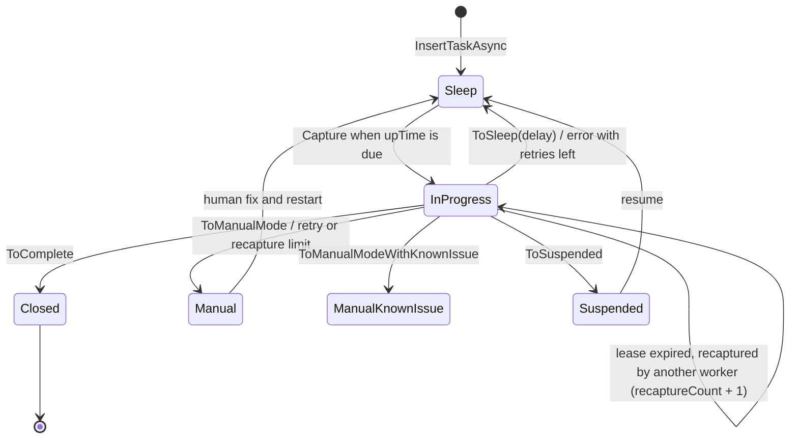
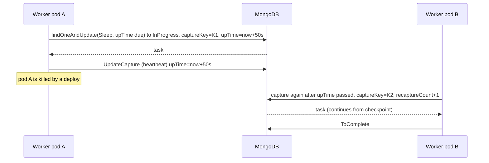

# 08. Background task processing: state machine, fairness, canary

## Why this chapter matters

"How do you run work in the background?" looks like an easy question. A junior answer is "use
`BackgroundService`" or "use Hangfire". A senior answer asks: what happens when the pod dies in the
middle, how do you retry, how do you stop one customer from starving the others, and how do you roll out a
new version of the processing safely? Interviewers ask these questions because background work is where
production systems lose data quietly.

At Smartcat most long or heavy work runs as **tasks stored in MongoDB**: document export, QA checks,
file disassembly, assignment templates, deadline notifications, sweeps and reconciliation. The
`Smartcat.TaskProcessing` library gives you a state machine, leases, retries, fair ordering and canary
routing. You must know its rules, because the mistakes compile fine and fail only under load.

## What you will be able to do

- Compare in-process background work, a database-backed task queue, Kafka, Hangfire, Quartz and cloud
  queues, and choose one with reasons.
- Draw the task state machine and explain every transition, including recapture after a crash.
- Choose between Ordinary, Singleton and Sticky tasks and implement each one.
- Explain capture and lease semantics, and why you never modify a task without capturing it.
- Configure retries, exponential backoff, fairness and canary routing, with the right indexes.
- Change a task model without breaking tasks that are already in the queue, and monitor tasks in
  production.

---

## 1. Why a task queue, and which one

### The problem

Some work does not fit into an HTTP request or a Kafka handler:

- it is long (export of a 2 GB project);
- it must survive a deploy or a pod crash;
- it must retry with a delay (the external API is down for an hour);
- it must run on a schedule (send deadline reminders every few minutes);
- it must be fair (one customer uploads 10,000 files; others must still get service).

### The options

| Option | Durable | Retries | Scheduling | Fairness | Visibility | Typical use |
|---|---|---|---|---|---|---|
| `BackgroundService` + `Channel<T>` in memory | No, lost on restart | You write them | You write it | You write it | Logs only | Cache warm-up, fire-and-forget metrics |
| Database-backed task queue (Smartcat `TaskProcessing`) | Yes | Built in | `UpTime` (run after) | Fairness hash | Query the collection | Business jobs, long processing |
| Kafka topic | Yes (retention) | DLQ, you design them | No delays | Per partition only | Lag metrics | Events between services (chapter 07) |
| Hangfire | Yes (SQL/Redis) | Built in, automatic | Cron, delayed jobs | Queues by name | Dashboard | General .NET background jobs |
| Quartz.NET | Optional (job store) | Misfire policies | Strong cron | No | Limited | Schedules, calendars |
| Azure Service Bus / AWS SQS | Yes | Delivery count, DLQ | Scheduled messages, visibility timeout | Sessions / message groups | Cloud console | Cross-service commands at cloud scale |

### Why Smartcat uses a Mongo-backed queue

- **Durability with no new infrastructure.** MongoDB is already the primary database. A task is a
  document; it survives restarts.
- **Atomic creation with business data.** A task can be inserted in the same Mongo transaction as the
  business change (`InsertTaskAsync(session, task)`). With an external queue you have the dual-write
  problem again (see chapter 07, Domain events, the Outbox pattern and Kafka).
- **The task is also state.** A task document can hold progress (`NextIteration`, `ProcessedCount`), so a
  long job continues where it stopped. A message in a queue is usually immutable.
- **Operations by query.** Support can find stuck tasks, tasks in manual mode, or tasks of one account
  with a Mongo query.
- **Platform features**: fairness, canary by account, telemetry, responsible teams.

The cost: polling load on MongoDB, the need for correct indexes, and throughput lower than a dedicated
broker.

### Why not just `BackgroundService`

```csharp
// BAD for business work: the queue lives in memory
public class ExportWorker : BackgroundService
{
    private readonly Channel<ExportRequest> _queue = Channel.CreateUnbounded<ExportRequest>();

    protected override async Task ExecuteAsync(CancellationToken stoppingToken)
    {
        await foreach (var request in _queue.Reader.ReadAllAsync(stoppingToken))
            await Export(request, stoppingToken);
    }
}
```

A deploy restarts the pod and every queued export is lost. With three pods, each pod has its own queue,
so no other pod can take over. There is no retry, no visibility and no fairness. `BackgroundService` is
still the right **host** for a polling loop; the problem is keeping the **queue** in memory.

**Common mistake:** "Kafka is a queue, so I put jobs on Kafka." Kafka has no per-message delay, no
per-message retry state, and a slow job blocks its partition. Kafka is for events; tasks are for work.

**Tip:** answer "which queue?" with the requirements first: durability, retries with delay, scheduling,
fairness, visibility, throughput. Then name the tool.

---

## 2. A task is a document: `BaseAsyncTask`

At Smartcat a task model inherits `BaseAsyncTask` (from `Smartcat.TaskProcessing.Persistence.Models`).

| Field | BSON name | Meaning |
|---|---|---|
| `Id` | `_id` | Task id |
| `State` | `state` | State machine value (section 3) |
| `UpTime` | `upTime` | When the task can be captured next; also the lease end while it is captured |
| `CaptureKey` | `captureKey` | Random key of the current capture (the "lease token") |
| `Created` | `created` | Insert time |
| `Reason` | `reason` | Human-readable reason of the last transition |
| `FairnessHash` | `fairnessHash` | Bytes used for fair ordering (section 7) |
| `TierKey` | not stored | Computed key for canary routing (section 8) |
| `IsCanary` | `isCanary` | Set at insert during a canary rollout |
| `RecaptureCount` | `recaptureCount` | How many times the lease expired without a transition |
| `RetriesCount` | `retriesCount` | How many times processing failed with an exception |
| `RequiresCompleteRestart` | `requiresCompleteRestart` | Restart from scratch, reset intermediate state |
| `CapturedAt`, `TotalCapturedTime`, `TotalCaptureCount` | telemetry | Time spent and number of captures |
| `ActivityTraceId` | `activityTraceId` | Links the task to the trace that created it |
| `ResponsibleTeams` | `responsibleTeams` | Owner for alerts |

A real model (`project-tasks-service/src/AssignmentTemplates.Module/TaskProcessing/ApplyAssignmentTemplate/ApplyAssignmentTemplateTask.cs`),
shortened:

```csharp
internal class ApplyAssignmentTemplateTask : BaseAsyncTask
{
    [BsonElement("accountId"), BsonRequired]
    public Guid AccountId { get; set; }

    [BsonElement("projectTaskId"), BsonRequired]
    public Guid ProjectTaskId { get; set; }

    [BsonElement("nextIteration"), BsonRequired]
    public int NextIteration { get; set; }

    [BsonElement("isFinished"), BsonIgnoreIfDefault]
    public bool IsFinished { get; set; }

    [BsonElement("cancellationIsRequested"), BsonIgnoreIfDefault]
    public bool CancellationIsRequested { get; set; }

    public override string TierKey => AccountId.ToString();
}
```

Note three ideas in this small class:

- `NextIteration` is a **checkpoint**. The task invites suppliers in groups and remembers which group is
  next. After a crash it continues, not restarts.
- `TierKey` is the account, so canary routing is per account (section 8).
- `CancellationIsRequested` is a flag that other code sets and the processor reads (section 4).

---

## 3. The state machine

| State | Value | Meaning |
|---|---|---|
| `Sleep` | 0 | Waiting. Can be captured when `upTime <= now` |
| `InProgress` | 1 | Captured by a worker. The lease ends at `upTime` |
| `Closed` | 2 | Finished. Terminal |
| `Manual` | 3 | Stopped, needs a human |
| `Suspended` | 4 | Paused on purpose; can be resumed to `Sleep` |
| `ManualKnownIssue` | 5 | Manual, but alerts are suppressed because the issue is known |



### Lifecycle methods

| Method | New state | Notes |
|---|---|---|
| `ToSleep(task, delay, reason)` | `Sleep` | Sets `upTime = now + delay`, resets `RecaptureCount`, clears the capture |
| `ToComplete(task, reason)` | `Closed` | Logs completion statistics |
| `ToManualMode(task, reason)` | `Manual` | Not captured again automatically; alerts |
| `ToManualModeWithKnownIssue(task, reason)` | `ManualKnownIssue` | Like manual, without alerts |
| `ToSuspended(task, reason)` | `Suspended` | Paused |
| `UpdateCapture(task, captureTime)` | stays `InProgress` | Extends the lease (heartbeat) |

### Rule: every path ends with an explicit transition

```csharp
protected override async Task ProcessTaskItemImpl(MyTask task, CancellationToken ct)
{
    var document = await _documents.Find(task.DocumentId, ct);
    if (document == null)
    {
        await TasksManager.ToComplete(task, "Document was deleted");
        return;
    }

    await _exporter.ExportNextBatch(task, ct);

    if (task.ProcessedCount >= task.TotalCount)
        await TasksManager.ToComplete(task, "Export finished");
    else
        await TasksManager.ToSleep(task, TimeSpan.FromSeconds(5), "Next batch");
}
```

If a path returns without a transition, the task stays `InProgress` until the lease expires. Then another
worker recaptures it, `RecaptureCount` grows, and after the limit the task fails, although nothing was
wrong. The Smartcat review checklist says this as "tasks always call `Completed`". Depending on the
library version and repository, the API is `ToComplete`/`ToSleep` on the manager (PTS) or result objects
such as `Completed.Now()`, `Completed.After(delay)` and `Rescheduled(reason)`. The rule is the same.

Every terminal reason must be a sentence a support engineer understands at 3 a.m. PTS reasons look like
`"Targeting rule not found."` or `"Cancellation requested: the project no longer takes suppliers."`.

**Common mistake:** throwing an exception for an expected business outcome ("document deleted"). It counts
as a failure, uses retries, and may end in `Manual` with an alert. Complete the task with a reason.

**Tip:** in review, read every `return` in a processor and ask "which transition happened before this?".

---

## 4. Capture and lease semantics

### Concept

Many pods poll the same collection. Only one may process a given task at a time. The library does this
with a **lease**, called a capture:

1. The worker runs one atomic `findOneAndUpdate`, conceptually:
   filter `state = Sleep and upTime <= now` (plus canary and fairness conditions),
   update `state = InProgress, captureKey = new Guid, upTime = now + captureTime`.
2. Only one worker can win that update for a given document. MongoDB makes a single-document update
   atomic.
3. The worker processes the task and ends with a transition. Transitions are written for the captured
   task (the library knows the capture key it took).
4. If the worker dies, nobody calls a transition. When `upTime` passes, the task can be captured again by
   another worker. That is a **recapture**, and `RecaptureCount` increases.



### Lease length and heartbeats

The capture time (`CaptureDelay` in processors) must be longer than one unit of work. For long loops,
extend the lease. PTS `DeadlineNotificationProcessor` does exactly this:

```csharp
protected override async Task DoProcessTaskItem(DeadlineNotificationTask taskItem)
{
    while (await _deadlineNotificationService.PostPendingDeadlineNotifications(_batchSize, Token))
    {
        await UpdateCaptureAsync(taskItem, CaptureDelay);
    }

    await SleepAsync(taskItem, _sleepTime, "No more pending tasks");
}

protected override TimeSpan CaptureDelay => TimeSpan.FromMinutes(1);
```

Too short a lease: a healthy worker loses the task while still working, and two workers run it at the
same time. Too long a lease: after a crash, the task waits a long time before another worker takes it.

### Recapture limit

`RecaptureCount` has a limit (6 in the platform). After that, `RecaptureCountLimitExceededException` is
raised and the task stops. Why: a task that kills its worker every time (out of memory on a huge file, a
stack overflow) would otherwise kill pods forever. `ToSleep` resets the counter, so a long job that makes
progress and sleeps between steps never hits it.

### Never modify a task without capturing it

```csharp
// BAD: read-modify-write without a lease
var task = await _manager.GetById(taskId);
task.ProcessedCount++;
await _manager.Update(task);
```

A worker may have captured the task between your read and your write. Your write overwrites its progress,
or its transition overwrites yours. It can also bring a `Closed` task back to life.

```csharp
// GOOD: change the task only while you hold the capture
var task = await _manager.Capture(TimeSpan.FromMinutes(5));
if (task != null)
{
    task.ProcessedCount++;
    await TasksManager.ToSleep(task, TimeSpan.FromMinutes(1), "Updated");
}
```

### How do outside actors talk to a task, then?

Through narrow updates of fields the processor only **reads**. PTS cancels assignment-template tasks like
this (`ApplyAssignmentTemplateTaskManager.RequestCancellation`):

```csharp
await _collection.UpdateManyAsync(
    filter.In(t => t.ProjectTaskId, projectTaskIds) & filter.In(t => t.State, _pendingStates),
    Builders<ApplyAssignmentTemplateTask>.Update.Set(t => t.CancellationIsRequested, true));
```

The processor checks the flag at the start and before each side effect, and completes the task itself.
The update touches one field only, so it does not fight the processor's writes (this is likely the reason
for the design; the processor does not write that field). The owner of the state transitions is still
the processor.

**Common mistake:** a "cancel" endpoint that sets `state = Closed` directly. If a worker holds the task,
its next `ToSleep` puts the task back to `Sleep`, and the cancel is lost.

**Tip:** say "capture is a lease with a token; only the lease holder changes state; others send signals
through fields the holder reads".

---

## 5. Task types: Ordinary, Singleton, Sticky

| Type | Instances | Fairness hash | Canary | Retry | Use for |
|---|---|---|---|---|---|
| Ordinary | Many | Yes | Yes (`TierKey`) | `RetriesCount` up to `MaxRetriesCount`; recapture limit | One task per unit of work: export, QA check, apply template |
| Singleton | One per `Name` | No (`BsonIgnore`) | No | `FailureCount` with exponential backoff | Scheduled jobs, sweeps, aggregations |
| Sticky | Many | Yes | Yes | Like Ordinary + stick marker | Long work with affinity to one worker |

### Ordinary

Model (see section 2), manager, processor and config:

```csharp
internal class ApplyAssignmentTemplateTaskManager : BaseAsyncTasksManager<ApplyAssignmentTemplateTask>
{
    public ApplyAssignmentTemplateTaskManager(
        [DefaultStorage] IMongoDatabase database,
        IOrdinaryAsyncTasksManagerContext context,
        ITaskCompletionStatisticsRepository completionStatistics)
        : base("AsyncTasks.ApplyAssignmentTemplates", database, context,
               ResponsibleTeams.AssignmentsExperience, completionStatistics)
    {
    }
}

internal class ApplyAssignmentTemplateTaskProcessor : OrdinaryTaskProcessorBase<ApplyAssignmentTemplateTask>
{
    protected override TimeSpan CaptureDelay { get; } = TimeSpan.FromSeconds(50);

    protected override async Task ProcessTaskItemImpl(ApplyAssignmentTemplateTask task, CancellationToken ct)
    {
        if (task.CancellationIsRequested)
        {
            await TasksManager.ToComplete(task, "Cancellation requested");
            return;
        }

        // invite the next group of suppliers, then sleep until the next group or complete
    }
}
```

```json
"ApplyAssignmentTemplateTaskProcessor": {
  "runDelay": "00:00:01",
  "maxTasks": 1,
  "maxRetriesCount": 3
}
```

- `runDelay`: how often the processor polls.
- `maxTasks`: how many tasks one instance processes in parallel.
- `maxRetriesCount`: how many unhandled exceptions before the task goes to manual mode.

Some repositories (the monolith) use an XML config shape with the same names
(`<MyFeatureTaskProcessor RunDelay="0:0:30" MaxTasks="10" MaxRetriesCount="3" />`).

### Singleton

One document per `Name` (unique index). Used for "one job for the whole system", for example
`DeadlineNotificationTask`, `ScopeProgressSweepTask` and `ProjectTaskSummarySweepTask` in PTS. They are
empty classes in PTS because they carry no data:

```csharp
internal class DeadlineNotificationTask : SingletonTask
{
}
```

A singleton with state:

```csharp
[CollectionName("AsyncTasks.DailyAggregation")]
public class DailyAggregationTask : SingletonTask
{
    [BsonElement("lastProcessedDate")]
    public DateTime? LastProcessedDate { get; set; }
}

public class DailyAggregationProcessor : SingletonTaskProcessorBase<DailyAggregationTask>
{
    protected override async Task ProcessTaskItemImpl(DailyAggregationTask task, CancellationToken ct)
    {
        var today = DateTime.UtcNow.Date;
        if (task.LastProcessedDate != today)
        {
            await Aggregate(today, ct);
            task.LastProcessedDate = today;
        }

        await ToSleep(task, TimeSpan.FromHours(24), "Waiting for next day");
    }
}
```

Note: the singleton is "one **task**", not "one **pod**". Capture gives mutual exclusion across pods, so
you do not need a separate distributed lock (chapter 04, Multithreading, concurrency and distributed
locks).

### Sticky

A sticky task prefers the worker that processed it before. It stores `StickMarker` (which worker) and
`StickTimeout` (until when the affinity holds).

```csharp
public class LongRunningExportTask : BaseAsyncTask, IStickyTask
{
    [BsonElement("stickMarker")]
    public string StickMarker { get; set; }

    [BsonElement("stickTimeout")]
    public DateTime StickTimeout { get; set; }
}

public class LongRunningExportTasksManager : BaseStickyTasksManager<LongRunningExportTask>
{
    protected override TimeSpan StickTimeout => TimeSpan.FromMinutes(30);
    public override bool CanStickTask => true;
}
```

Capture priority for a worker:

1. its own tasks (same `StickMarker`);
2. new tasks (no `StickMarker`);
3. tasks whose `StickTimeout` has passed (the owner is probably gone).

Why: the worker keeps something local that is expensive to rebuild, such as a downloaded source file or
a warm in-memory model. In the monolith, `DisassembleSourceFileTask` and
`ImportSourceFileToStringsTableTask` are sticky (`smartcat/Features/Cat/Core.Contract/DocumentProcessing/TaskEntities/`);
the likely reason is the file data on the worker. Stickiness is an **optimisation**, never a correctness
guarantee: after the timeout, another worker takes the task, so it must work without the local data.

### How to choose

- One task per unit of work, many in parallel: **Ordinary**. This is the default.
- Exactly one job for the system, often periodic: **Singleton**.
- Many tasks with expensive local state, where the same worker should continue: **Sticky**.

**Common mistake:** a singleton that processes everything for all accounts in one huge loop with no
checkpoint. One bad account fails the whole job, and backoff delays all other accounts. Use the singleton
as a **selector** that creates ordinary tasks per account (PTS has this split, for example
`BrokenAcceptedInvitationSelectorTask` and `CancelBrokenAcceptedInvitationTask`).

**Tip:** "Singleton for the schedule, Ordinary for the work" is a good short rule.

---

## 6. Retries, backoff and manual mode

### Two counters for Ordinary tasks

| Counter | Grows when | Limit | Then |
|---|---|---|---|
| `RetriesCount` | Processing throws an unhandled exception | `MaxRetriesCount` (config) | `Manual` |
| `RecaptureCount` | The lease expired without a transition | 6 (platform) | Exception, task stops |

`HandleError` (or `HandleProcessingException` in newer versions) lets you decide what an error means:

```csharp
protected override Task HandleError(MyFeatureTask task, string errorMessage)
{
    return TasksManager.ToSleep(task, TimeSpan.FromMinutes(1), $"Error: {errorMessage}");
}
```

### Singleton: exponential backoff

Singletons count consecutive failures in `FailureCount` and wait longer after each one:

```json
"DailyAggregationProcessor": {
  "runDelay": "0:1:0",
  "maxTasks": 1,
  "maxFailureCount": 10,
  "initialRecoveryTime": "0:0:30",
  "recoveryGrowthFactor": 2.0,
  "maxRecoveryTime": "1:0:0"
}
```

Delay after failure n is `min(initialRecoveryTime * growthFactor^n, maxRecoveryTime)`: 30 s, 60 s, 120 s,
240 s, ... capped at 1 hour. `maxFailureCount = -1` means retry forever.

Why exponential backoff: when a dependency is down, fixed fast retries create load exactly when the
dependency is weakest. Growing delays give it time to recover. In systems with many workers, add
**jitter** (a random part of the delay) so that all workers do not retry at the same moment.

### Classify errors

The same classes as for Kafka handlers (chapter 07):

| Error | Action |
|---|---|
| Expected business outcome (entity deleted, feature disabled) | `ToComplete` with a reason |
| Transient (timeout, 503, lock lost because of an infrastructure problem) | Retry with backoff |
| Permanent but known (bad customer file format) | `ToManualModeWithKnownIssue` or complete with reason |
| Unknown bug | Let it fail; retries; then `Manual` with an alert |
| State is corrupt, must start over | `TaskRequiresCompleteRestartException` / `RequiresCompleteRestart` |

Review rule A11 (distributed lock renewal without exception classification) is the same idea for locks:
"lock lost" (logical, stop) is different from "Mongo connection glitch" (retry).

`ManualKnownIssue` exists so that a known, accepted failure does not page anyone every night. Use it with
a ticket link in the reason, not to hide bugs.

**Common mistake:** retrying non-transient errors. A task that fails on a corrupt file will fail on every
retry. It uses worker time and delays other tasks, and it still ends in `Manual`.

**Tip:** review rule T17 (test for retry budget when a fix introduces retry): every new retry loop needs a
test that simulates N+1 failures and asserts that it stops.

---

## 7. Fairness hash

### Concept

Without fairness, workers capture tasks by `upTime`: first in, first out. One customer inserts 10,000
tasks at 10:00. Another customer inserts one task at 10:01. The second customer waits for all 10,000. This
is the **noisy neighbour** problem.

The fairness hash groups tasks so that capture goes round-robin over groups instead of strictly by time.

```csharp
public ExportDocumentAsyncTask(Guid accountId, ...)
{
    AccountId = accountId;
    SetCompoundFairnessHash(AccountId);
}
```

This is from `smartcat/Features/Cat/Core.Contract/DocumentExport/TaskEntities/ExportDocumentAsyncTask.cs`.
With a compound key:

```csharp
task.SetCompoundFairnessHash(new object[] { task.AccountId, task.DocumentId });
// fair between accounts first; inside one account, round-robin by document
```

### Turning it on

```csharp
public class MyFeatureTasksManager : BaseAsyncTasksManager<MyFeatureTask>
{
    protected override bool UseFairOrder => true; // requires the fairness index
}
```

Required index: `{ state: 1, fairnessHash: 1, upTime: 1 }` (`IDX_State_FairnessHash_UpTime`).

### Enabling fair order on an existing queue: two phases

The library docs say it directly: you must set the hash for all new tasks, and create the index in a
migration, **before** you enable fair ordering.

1. **Phase 1 (one release):** start setting `FairnessHash` on new tasks; add the index in a "before"
   migration; optionally backfill the hash for tasks already in the queue.
2. **Phase 2 (next release):** set `UseFairOrder = true`.

If you enable fair order first, capture queries run without the index, and tasks without a hash may be
ordered in unexpected ways.

### Never with Singleton

`SingletonTask.FairnessHash` is `BsonIgnore`. `SetCompoundFairnessHash()` on a singleton has no effect.
That makes sense: there is only one task, so there is nothing to be fair between.

**Common mistake:** choosing the user id as the fairness key for a process where one account has many
users. The account still floods the queue. Use the tenant boundary (account) as the first key.

**Tip:** the review question is "can one tenant overload this queue?". If yes, set a fairness hash.

---

## 8. Canary deployment by account

### Concept

A canary release runs the new version of the code on a small share of the work first. For tasks, that
means: some tasks are processed only by the new version (canary pods), the rest by the old version.

How it works at Smartcat:

1. During an active canary rollout, at **insert** time the manager computes the tier for the task from
   its `TierKey`, through an `ITaskTierDefiner`, and stores `isCanary = true` for the canary share.
2. Canary instances capture only tasks with `isCanary == true`.
3. Regular instances capture tasks with `isCanary != true`.

```csharp
public class MyTask : BaseAsyncTask
{
    [BsonElement("accountId")]
    public Guid AccountId { get; set; }

    public override string TierKey => AccountId.ToString(); // same account, same tier
}
```

The default `TierKey` is the task id. That spreads tasks randomly, so one customer can have half its
exports on the new code and half on the old. Overriding `TierKey` with the account id gives a consistent
experience per customer, and if the canary is broken, only a few customers see it, not everyone a little.

```csharp
public class MyTaskTierDefiner : ITaskTierDefiner
{
    private readonly ICanaryTierInfoService _tierInfo;

    public async Task<CanaryTier> Define(string tierKey)
    {
        var info = await _tierInfo.GetCurrentCanaryInfo();
        if (!info.IsActive)
            return CanaryTier.Standard;

        var bucket = StableBucket(tierKey); // 0..99
        return bucket < info.CanaryPercent ? CanaryTier.Canary : CanaryTier.Standard;
    }

    private static int StableBucket(string key)
    {
        var bytes = MD5.HashData(Encoding.UTF8.GetBytes(key));
        return (int)(BinaryPrimitives.ReadUInt32LittleEndian(bytes) % 100);
    }
}
```

### TierKey is not in the database

`TierKey` is `BsonIgnore`. It is computed in C#. Never write a Mongo query with `tierKey`; it matches
nothing. Query `isCanary` instead.

### The hash must be stable across processes

The skill reference shows `Math.Abs(tierKey.GetHashCode()) % 100`. Be careful: in .NET Core and later,
`string.GetHashCode()` is **randomized per process**. Two pods compute different values for the same
account. Each task is still consistent (the flag is computed once, at insert, and stored), but two tasks
of the same account inserted by two different pods can land in different tiers, so "same account, same
tier" is not guaranteed. Use a stable hash (MD5, SHA-256, XxHash) when you implement a tier definer.
This is exactly the kind of bug that review rule T18 (cross-pod test for hashing-relevant code) is for.
The library expects each service to provide its own `ITaskTierDefiner`, so check the implementation in
your repository.

**Common mistake:** adding a new field to a task, and reading it only on the new version. During the
canary, old pods process standard-tier tasks that were inserted by new pods (or the reverse). See
section 10 on compatibility.

**Tip:** query the canary distribution before you raise the percentage:
`db["AsyncTasks.X"].aggregate([{ $group: { _id: "$isCanary", count: { $sum: 1 } } }])`.

---

## 9. Required indexes

| Task type | Index | Name | Why |
|---|---|---|---|
| Ordinary, FIFO | `{ state: 1, upTime: 1 }` | `IDX_State_UpTime` | The capture query |
| Ordinary, fair | `{ state: 1, fairnessHash: 1, upTime: 1 }` | `IDX_State_FairnessHash_UpTime` | Fair capture |
| Ordinary with events | `{ hasNewEvents: -1 }`, sparse | `IDX_HasNewEvents_Sparse` | Outbox-like event tracking |
| Singleton | `{ name: 1 }`, unique | `UDX_Name` | One task per name |
| Singleton | `{ state: 1, upTime: 1 }` | `IDX_State_UpTime` | Capture |
| Sticky | `{ state: 1, stickMarker: 1, upTime: 1 }` | | Capture own tasks |
| Sticky | `{ state: 1, stickTimeout: 1, upTime: 1 }` | | Capture expired tasks |

Plus business indexes. PTS uses a **partial unique index** to make task creation idempotent:

```csharp
_collection.SafeCreateIndex(
    Builders<ApplyAssignmentTemplateTask>.IndexKeys.Ascending(t => t.ProjectTaskId),
    new CreateIndexOptions<ApplyAssignmentTemplateTask>
    {
        Unique = true,
        Name = "IX_ProjectTaskId",
        PartialFilterExpression = Builders<ApplyAssignmentTemplateTask>.Filter.Where(t => t.IsFinished == false)
    });
```

Only one unfinished task per project task can exist. A duplicate insert throws a duplicate-key error,
which `TryAddTask` catches and returns `false`. This is the right pattern instead of "check if exists,
then insert" (review rule A28, TOCTOU pre-check before unique-index write). The partial filter allows a
new task after the old one finished.

Where indexes live: `SafeCreateIndex` in the manager constructor creates them on fresh environments;
existing collections need a migration (`EnsureIndexAsync`). See chapter 09 (MongoDB models, indexes and
safe migrations).

**Common mistake:** a new task collection with `UseFairOrder = true` but only `IDX_State_UpTime`. Every
poll of every pod is a slow query, and with a large queue this loads the whole cluster.

---

## 10. Backward compatibility when task models change

Tasks live for minutes, days or weeks. During a deploy (and during a canary) old and new code read the
same documents. So a task model is a **persisted contract**, like an event (chapter 07).

| Change | Safe way |
|---|---|
| Add a field | `[BsonIgnoreIfDefault]` or nullable; code handles the default for old tasks |
| Rename a field | Add the new one, read both, write the new one; remove the old one later |
| Remove a field | Stop reading first; remove the property in a later release. Check whether the model ignores extra elements, or old documents fail to deserialize (likely handled by conventions, but verify) |
| Change meaning of a field | New field instead |
| New index | Two-phase: migration first (see chapter 09) |
| Enable fair order | Two-phase: hash + index first, then `UseFairOrder` |
| Change task type (Ordinary to Singleton) | New collection, migrate data, switch the processor |
| Change processing steps | New code must continue tasks that old code started (`NextIteration` written by old logic) |

The last row is the one people forget. If you change "invite in groups of 5" to "groups of 10", a task
that the old code left at `NextIteration = 3` must still be interpreted correctly.

**Common mistake:** a new required field that the new processor reads with `.Value`. The first old task
in the queue fails with `InvalidOperationException`, uses its retries and goes to `Manual`.

**Tip:** for each task model change, ask "what does the new code do with a task created yesterday by the
old code, and what does the old code do with a task created today by the new code?".

---

## 11. Idempotency of processors

### Why a processor runs more than once

The task queue is also **at-least-once**:

- the worker did the side effect and died before `ToComplete`; the lease expires and another worker
  repeats the step;
- the lease was too short and a second worker captured the task while the first was still running;
- a retry after an exception repeats the work before the failing line.

So each step of a processor must be safe to repeat.

### Techniques

- **Checkpoint after each step** (`NextIteration`, `LastProcessedDate`), then sleep. A repeat repeats only
  the last step.
- **Make the step itself idempotent**: set values, not increments; upsert by a natural key; external calls
  with an idempotency key.
- **Unique indexes** on what the step creates (for example one invitation per supplier per task).
- **Re-read state before acting.** PTS: "A retry of the first iteration sets the same value again, which
  changes nothing and publishes nothing" (`ApplyAssignmentTemplateTaskProcessor`, deadline step).

```csharp
// BAD: not repeatable
account.Credits += task.Amount;
await _accounts.Save(account);
await TasksManager.ToComplete(task, "Credited");

// GOOD: the credit is keyed by the task id
await _ledger.InsertIfAbsent(new LedgerEntry(task.Id, task.AccountId, task.Amount)); // unique on task id
await TasksManager.ToComplete(task, "Credited");
```

**Common mistake:** `processedCount++` on an in-memory copy, then a side effect, then `ToSleep`. A crash
between the side effect and `ToSleep` repeats the side effect, but the counter was never saved.

**Tip:** review rule T14 (replay-idempotency test): run the same task step twice in a test and assert one
effect.

---

## 12. Cross-pod state traps

A processor runs on many pods, and a task can move between pods at any time. Anything that is only in one
pod's memory is unreliable.

| Trap | Example | Fix | Rule |
|---|---|---|---|
| Per-pod cache in a cross-pod flow | `IMemoryCache` with "already processed" ids | Read the authoritative source, or a distributed cache | A18 (per-pod IMemoryCache in checkpoint-critical flow) |
| Object identity as a key | A lambda or `Func<>` used as a workflow node id | Stable string names | A3 (cross-pod state in object identity) |
| Unstable hashing | `string.GetHashCode()` for tiers or buckets | Stable hash (MD5, XxHash) | T18 (cross-pod test for hashing code) |
| Tenant not in the key | Background state found by `runId` only | Always include `(accountId, workspaceId)` | A4 (workspace crossing in background runs) |
| Static mutable fields | `static int _processed` as progress | Store progress in the task | |
| Local disk | Temp file written in step 1, read in step 2 | Store in S3/FMS, or use Sticky and handle timeout | |
| Lock renewal | Every exception treated as "lock lost" | Classify logical loss vs infra glitch | A11 |
| HTTP context snapshot | Feature flags copied into the task at creation | Store ids, re-resolve flags in the worker | A9 (snapshot of HttpContext state) |

```csharp
// BAD: different pods give different answers
private readonly IMemoryCache _seen;

if (_seen.TryGetValue(task.DocumentId, out _))
    return; // another pod has not seen it and processes it again
```

**Common mistake:** a test that passes on one machine and proves nothing about many pods. If the logic
depends on hashing or identity, test it with values created in different processes (T18).

**Tip:** ask "if this task moves to another pod right now, what is lost?" For a good design the answer is
"nothing, the task document has everything".

---

## 13. Monitoring

### Queries

```javascript
// stuck: InProgress long after the lease should have ended
db["AsyncTasks.MyFeature"].find({ "state": 1, "upTime": { "$lt": ISODate("2026-10-21T08:00:00Z") } })

// tasks that keep losing their lease (crashing workers, too short capture time)
db["AsyncTasks.MyFeature"].find({ "recaptureCount": { "$gte": 5 } })

// stopped tasks: Manual (3), Suspended (4), ManualKnownIssue (5)
db["AsyncTasks.MyFeature"].find({ "state": { "$in": [3, 4, 5] } })

// queue depth that is ready to run now
db["AsyncTasks.MyFeature"].countDocuments({ "state": 0, "upTime": { "$lte": new Date() } })

// canary distribution
db["AsyncTasks.MyFeature"].aggregate([{ "$group": { "_id": "$isCanary", "count": { "$sum": 1 } } }])

// which account floods the queue
db["AsyncTasks.MyFeature"].aggregate([
  { "$match": { "state": 0 } },
  { "$group": { "_id": "$accountId", "count": { "$sum": 1 } } },
  { "$sort": { "count": -1 } }, { "$limit": 10 }
])
```

### What to watch

- **Ready queue depth and age** (oldest `upTime` among ready tasks): are workers keeping up?
- **Manual count** by `responsibleTeams`: who needs to act?
- **Recapture rate**: crashing workers or wrong `CaptureDelay`.
- **Telemetry fields** `totalCapturedTime`, `totalCaptureCount`: which tasks are expensive.
- **`activityTraceId`**: open the trace of the request that created a strange task.

**Tip:** in an incident, read `reason` first. A good reason tells you the story without logs. That is why
reasons must be clear sentences.

---

## 14. Common mistakes (checklist)

- Modifying a task without capturing it.
- A processor path that returns without a transition.
- Throwing for expected business outcomes instead of `ToComplete` with a reason.
- Retrying permanent errors; no retry budget test.
- `SetCompoundFairnessHash` on a singleton (no effect).
- Enabling `UseFairOrder` before the index and the hashes exist.
- Querying `tierKey` in MongoDB (it is not stored).
- Using `string.GetHashCode()` for anything shared between pods.
- New task field read as required while old tasks are in the queue.
- Long loop without `UpdateCapture`; or a huge `CaptureDelay` that delays recovery.
- Per-pod caches, statics or local files as task state.
- "Check, then insert" instead of a unique index for "one task per entity".
- One singleton doing all the work for all accounts, without per-account tasks.

---

## 15. Testing tasks

| What | How |
|---|---|
| Each branch ends with the right transition | Unit test with a fake manager: assert `ToComplete`/`ToSleep` and the reason |
| Cancellation flag | Task with `CancellationIsRequested = true` completes without side effects |
| Repeat safety | Run the same step twice, assert one effect (T14) |
| Retry budget | Fail N+1 times, assert manual mode / give up (T17) |
| Old task shape | Insert a raw BSON document in the old shape into an ephemeral Mongo, run the new processor (T13, multi-era schema rollout) |
| Stable hashing | Tier/bucket computed in a separate process equals the local one (T18) |

```csharp
[Test]
public async Task Should_complete_without_inviting_when_cancellation_is_requested()
{
    // Arrange
    var task = new ApplyAssignmentTemplateTask { CancellationIsRequested = true };
    var manager = AddFake<IApplyAssignmentTemplateTaskManager>();
    var assignments = AddFake<IAssignmentsService>();
    var processor = Get<ApplyAssignmentTemplateTaskProcessor>();

    // Act
    await processor.Process(task, CancellationToken.None);

    // Assert
    A.CallTo(() => manager.ToComplete(task, A<string>.That.Contains("Cancellation"),
            null, null, null, null))
        .MustHaveHappenedOnceExactly();
    A.CallTo(assignments).MustNotHaveHappened();
}
```

(`Process` stands for whatever public entry point your processor base exposes. Do not call
`ProcessTaskItemImpl` through reflection: it is protected, and a test that reaches into non-public
members pins the implementation. Test through the public API, or extract the step logic into a service
you can test directly.)

---

## Industry comparison for interview answers

| Question | Smartcat TaskProcessing | Hangfire | Quartz.NET | Service Bus / SQS |
|---|---|---|---|---|
| Lease / visibility | Capture with `upTime` and capture key | Job fetch with invisibility timeout | Trigger state in job store | Peek-lock / visibility timeout |
| Retries | `MaxRetriesCount`, recapture limit, singleton backoff | Automatic retry attribute, exponential by default | Misfire instructions, manual | Max delivery count, then DLQ |
| Delayed run | `ToSleep(delay)` | `Schedule(..., delay)` | Triggers | Scheduled messages |
| Recurring | Singleton that sleeps | `RecurringJob.AddOrUpdate(cron)` | Cron triggers (strongest) | Not built in |
| Fairness | Fairness hash | Separate named queues | No | Sessions / FIFO message groups |
| Canary | Built in by `TierKey` | No | No | Separate queues/subscriptions |
| Progress state | In the task document | Job arguments are immutable; store state elsewhere | `JobDataMap` | Message immutable |
| Transactional enqueue with business data | Yes (same Mongo) | Yes with SQL storage in same DB | With JDBC store | No (dual write, needs outbox) |

A balanced interview answer: "For a .NET service with SQL Server, Hangfire is a good default. For strict
schedules and calendars, Quartz. For cross-service work at cloud scale, a managed queue with an outbox. At
Smartcat we use a Mongo-backed queue because Mongo is the primary store, which gives transactional
enqueue, task-as-state and built-in fairness and canary."

---

## At Smartcat: quick map

| Topic | Where to look |
|---|---|
| Ordinary task, manager with unique partial index, cancellation flag | `project-tasks-service/src/AssignmentTemplates.Module/TaskProcessing/ApplyAssignmentTemplate/*` |
| Singleton with lease extension | `project-tasks-service/src/ProjectTasks.Module/TaskProcessing/DeadlineNotificationProcessor.cs` |
| Singleton sweeps | `ProjectTasks.Module/TaskProcessing/ScopeProgressSweepProcessor.cs`, `ProjectTaskSummarySweepProcessor.cs` |
| Selector singleton + ordinary worker tasks | `ProjectTasks.Module/TaskProcessing/CancelBrokenAcceptedInvitations/*` |
| Processor config | `project-tasks-service/.configurations/common.json` (`runDelay`, `maxTasks`, `maxRetriesCount`) |
| Fairness hash | `smartcat/Features/Cat/Core.Contract/DocumentExport/TaskEntities/ExportDocumentAsyncTask.cs`, `QACheck/*` |
| Sticky tasks | `smartcat/Features/Cat/Core.Contract/DocumentProcessing/TaskEntities/DisassembleSourceFileTask.cs`, `Core.Cat.Module/DocumentProcessing/TaskManagers/ImportSourceFileToStringsTableTasksManager.cs` |
| Ordinary processors in the monolith | `smartcat/Features/Cat/DocumentProcessing.TaskModule/*` |

Review checklist (from the Smartcat code review checklist): every path completes or reschedules; correct
task type; fairness hash set if the task can overload a tenant; `TierKey` set for gradual rollout; retry
policy for transient errors; backward compatible model changes; indexes present.

---

## Interview corner

### As the interviewee

**1. How would you run a long export job in an ASP.NET Core service?**
A strong answer covers:
- Not in the request; not an in-memory queue only.
- A durable queue (DB-backed, Hangfire or a broker) with a lease, retries and a state.
- Checkpoints for progress, an explicit end state, and a way to see stuck jobs.

**2. What happens if the worker pod dies in the middle of a task?**
A strong answer covers:
- The lease (`upTime`) expires; another worker recaptures the task.
- `RecaptureCount` grows; there is a limit to stop poison tasks.
- The step may run twice, so it must be idempotent and checkpointed.

**3. Why must you never modify a task without capturing it?**
A strong answer covers:
- A worker may hold the task; read-modify-write races with it.
- Lost updates, or a closed task coming back to life.
- Outside actors set a flag the processor reads; the processor owns transitions.

**4. Ordinary vs Singleton vs Sticky?**
A strong answer covers:
- Ordinary: many, default, fairness and canary.
- Singleton: one per name, schedule or sweep, exponential backoff, no fairness.
- Sticky: affinity for local state, priority own/new/expired, never needed for correctness.

**5. What is the fairness hash and when do you need it?**
A strong answer covers:
- Noisy neighbour; round-robin over groups instead of FIFO.
- Tenant as the first key; compound keys.
- `UseFairOrder` needs the index; enable in two phases.

**6. How does canary deployment work for tasks?**
A strong answer covers:
- `IsCanary` computed at insert from `TierKey` by `ITaskTierDefiner`.
- Canary pods capture canary tasks only.
- Account as `TierKey` for per-customer consistency; `TierKey` is not stored.
- Stable hashing across pods.

**7. Explain exponential backoff. Why jitter?**
A strong answer covers:
- Delay grows by a factor, capped; formula.
- Protects a recovering dependency.
- Jitter spreads retries so workers do not retry at the same moment.

**8. How do you make sure only one task exists per entity?**
A strong answer covers:
- Unique (partial) index on the entity key, catch duplicate key.
- Not "check then insert" (TOCTOU).
- Partial filter to allow a new task after the old one finished.

**9. How do you change a task model safely?**
A strong answer covers:
- Old tasks are in the queue; old and new code run together.
- Optional fields, read both names, new collection for a type change.
- New code must continue tasks started by old code.

**10. What state must not live in a processor's memory?**
A strong answer covers:
- Progress, dedup sets, caches used for decisions, local files, statics.
- Unstable hash codes and object identities.

**11. Hangfire vs Quartz vs a cloud queue vs your own Mongo queue?**
A strong answer covers:
- Requirements first: durability, retries, scheduling, fairness, visibility, transactional enqueue.
- Strengths of each (see the comparison table).

**12. A queue is growing. How do you investigate?**
A strong answer covers:
- Ready depth and age; one account flooding (group by account); fairness on or off.
- Recapture rate and manual count; worker count and `maxTasks`; slow dependency.
- Missing index on the capture query.

### As the interviewer

**What to ask:** "Design the processing for 'export a project to a ZIP'. Projects can have 50,000
documents. The service runs on 6 pods and is deployed several times a day." Then add: "a pod dies in the
middle", "one customer starts 3,000 exports", "the storage API returns 503 for 20 minutes", "we want to
try a new ZIP library on 5% of customers".

**Depth probes:**
- "Where does the progress live? What happens to it on a pod kill?"
- "How long is your lease, and what if one batch takes longer than that?"
- "Your step uploaded the file and the pod died before you marked it done. What now?"
- "How does the canary decide that customer X is in the 5%? Is that decision the same on every pod?"
- "You change the batch size in the new version. What happens to tasks the old version started?"
- "Support wants to cancel one export. What exactly does the cancel endpoint write?"

**Green flags:**
- Talks about leases and recapture without being asked.
- Separates the scheduler (singleton) from the work (ordinary tasks).
- Thinks about tenant fairness and about canary consistency per customer.
- Makes steps idempotent with checkpoints and unique keys.
- Mentions monitoring: stuck tasks, manual tasks, reasons, owners.

**Red flags:**
- `Task.Run` or an in-memory `Channel` for business-critical work.
- "We use a distributed lock around the whole job" with no lease expiry thinking.
- A cancel that writes `state = Closed` directly.
- Retries without a limit or without error classification.
- `GetHashCode()` for routing across pods.

**Scoring rubric:**

| Level | Signals |
|---|---|
| Junior | `BackgroundService` or Hangfire by name; no failure thinking. |
| Senior | Durable queue, lease and retries, explicit state machine, idempotent steps, correct task type, indexes. |
| Staff | Adds fairness and canary design, model compatibility across versions, cross-pod traps (hashing, caches), poison-task limits, monitoring and ownership, and compares tools by requirements. |

---

## Exercises

1. **Find the bug.** An admin endpoint "retries" a manual task with:
   `var t = await _collection.Find(x => x.Id == id).FirstAsync(); t.State = TaskState.Sleep; t.RetriesCount = 0; await _collection.ReplaceOneAsync(x => x.Id == id, t);`.
   What can go wrong, and how should it work?
2. **Choose the type.** For each, pick Ordinary, Singleton or Sticky and explain: (a) nightly cleanup of
   expired invitations; (b) QA check per document; (c) import of a large source file that is downloaded
   to local disk and parsed in several steps.
3. **Fairness.** One account inserts 20,000 `ExportDocumentAsyncTask` items. Others complain. Describe
   how to turn on fair ordering on the live collection, release by release.
4. **Canary bug.** A colleague writes a tier definer with `Math.Abs(accountId.ToString().GetHashCode()) % 100`.
   Explain the bug and write a test that would catch it.
5. **Idempotent step.** A task sends a set of invitations per iteration and then calls
   `ToSleep`. Show how to make the iteration safe to repeat after a crash.
6. **Compatibility.** You add `[BsonElement("format")] public ExportFormat Format { get; set; }` to an
   existing task and the new processor switches on it. What happens to tasks already in the queue, and
   how do you fix it?

<details>
<summary>Answer notes</summary>

1. The task may be captured by a worker (it may even not be `Manual` any more by the time of the replace).
   `ReplaceOne` overwrites the whole document, including a worker's capture key and progress, and races
   with the worker's transition. Use the manager's API for the transition, filtered by the expected state
   (`state = Manual`), as one atomic update of only the needed fields. The library has a method to move
   suspended tasks back to `Sleep` with an optional condition; use the platform API, not a raw replace.
2. (a) Singleton that sleeps until the next night, or a singleton selector that creates ordinary tasks if
   the work is large. (b) Ordinary, with fairness by account (the monolith `QACheckDocumentAsyncTask`
   sets a fairness hash). (c) Sticky, because the local file is expensive to fetch again; the task must
   still work after `StickTimeout` on another worker (download again).
3. Release 1: set `SetCompoundFairnessHash(AccountId)` for new tasks; "before" migration creates
   `IDX_State_FairnessHash_UpTime`; optional backfill of the hash for queued tasks. Release 2: set
   `UseFairOrder = true`. Verify with the "which account floods the queue" query and capture latency.
4. `string.GetHashCode()` is randomized per process, so pods disagree on an account's tier. Tasks of one
   account inserted by different pods get different `IsCanary` values. Test: compute the bucket in a child
   process (`Process.Start` of a small helper, or a test that runs the definer in two processes) and assert
   equality; or assert the bucket equals a known constant for a fixed key, which fails with a randomized
   hash. Fix: MD5/XxHash of the UTF-8 bytes.
5. Before sending, read who is already invited for this task and skip them; rely on a unique index on
   (projectTask, supplier) and treat duplicate key as success; write `NextIteration + 1` and the sleep in
   one transition. Then a repeat sends only missing invitations.
6. Old documents have no `format`, so it deserializes as the enum default (0). If 0 is a real value, old
   tasks silently use it; if the processor throws on unknown values, they fail, retry and go to manual.
   Fix: make it nullable (`ExportFormat?`) with `BsonIgnoreIfNull`, treat `null` as the old behaviour, and
   remove the fallback only after the queue no longer has old tasks.

</details>

---

## Summary

- Business background work needs a durable queue with leases, retries and visible state; an in-memory
  queue loses work on every deploy.
- Smartcat uses a Mongo-backed queue: transactional enqueue, the task document holds progress, fairness
  and canary are built in.
- States: Sleep 0, InProgress 1, Closed 2, Manual 3, Suspended 4, ManualKnownIssue 5. Every processor path
  ends with an explicit transition and a clear reason.
- Capture is a lease (`captureKey`, `upTime`). Extend it for long work; after a crash, another worker
  recaptures; `RecaptureCount` stops poison tasks.
- Never modify a task without capturing it. Outside actors set a flag that the processor reads.
- Ordinary is the default; Singleton is one task per name with exponential backoff; Sticky adds worker
  affinity as an optimisation.
- Fairness hash prevents a noisy tenant from starving others; enable `UseFairOrder` only after the index
  and hashes exist. Never on singletons.
- Canary: `IsCanary` is set at insert from `TierKey` (not stored); use the account as `TierKey` and a
  stable hash.
- Tasks are at-least-once: checkpoint, make steps idempotent, use unique indexes instead of check-then-insert.
- A task model is a persisted contract: old and new code read the same documents during deploys and canaries.

Anki deck: anki/08-background-tasks.txt
