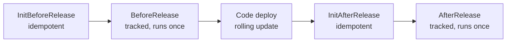

# 09. MongoDB models, indexes and safe migrations

## Why this chapter matters

Every Smartcat service stores its state in MongoDB, so most backend bugs that reach production touch
Mongo in some way: a lost update, a missing index, a document that grew too big, a migration that
ran in the wrong phase. Interviews test this in two ways. First, as general knowledge: "embed or
reference?", "how do you design a compound index?", "how do you avoid a race condition without
locks?". Second, as operations maturity: "how do you add a required field to a collection with 50
million documents, with zero downtime?". A strong answer to the second question is what separates
a senior from someone who has only used an ORM (object-relational mapper) on a small database.

## What you will be able to do

- Write a Mongo model the Smartcat way: `required` + `init`, `[BsonElement]`, correct Guid and enum
  representation.
- Choose between embedding and referencing, and avoid the 16 MB document limit.
- Replace read-modify-write with atomic updates, and add optimistic concurrency where you need it.
- Design compound, partial, unique and TTL indexes with the ESR rule, and name them correctly.
- Ship an index with the two-place pattern and a schema change with expand/contract migrations.
- Write a batched, throttled data migration with its own BSON model, and test it on an ephemeral
  Mongo.

---

## 1. The C# driver and BSON mapping

**Concept.** MongoDB stores BSON (binary JSON). The official C# driver maps your classes to BSON with
*class maps*, built from attributes (`[BsonElement]`, `[BsonId]`, ...) or code. You work with
`IMongoDatabase`, `IMongoCollection<T>`, and the typed builders `Builders<T>.Filter`, `.Update`,
`.Sort`, `.Projection`, `.IndexKeys`.

At Smartcat, a database is injected with an attribute that names the storage from config:

```csharp
public MyRepository([DefaultStorage] IMongoDatabase database)
{
    _collection = database.GetCollection<MyDocument>("MyFeature.Documents");
}
```

### The standard model pattern

At Smartcat (codestyle skill):

```csharp
public sealed class MyDocument
{
    [BsonId, BsonRequired]
    public required ObjectId Id { get; init; }

    [BsonElement("accountId"), BsonRequired]
    public required Guid AccountId { get; init; }

    [BsonElement("name"), BsonRequired]
    public required string Name { get; init; }

    [BsonElement("status"), BsonRepresentation(BsonType.String)]
    public required DocumentStatus Status { get; init; }

    [BsonElement("comment"), BsonIgnoreIfDefault]
    public string? Comment { get; init; }

    [BsonElement("createdAt"), BsonRequired]
    public required DateTime CreatedAt { get; init; }
}
```

| Element | Why |
|---|---|
| `required` + `init` | The compiler forces callers to set mandatory fields; the object is immutable after creation. |
| `[BsonElement("camelCase")]` | The database field name is explicit and stable. Renaming the C# property does not rename the field. |
| `[BsonRequired]` | Deserialization fails loudly if the field is missing, instead of a silent default. |
| `[BsonIgnoreIfDefault]` | Optional fields are not written when empty: smaller documents, and old documents without the field read fine. |
| `[BsonRepresentation(BsonType.String)]` on enums | Stored as `"Completed"`, not `2`. Reordering or inserting enum members cannot silently change meaning, and the data is readable in the shell. |
| Separate models | DB entity, API request and API response are different classes. A DB field rename must never change your public API. |

Many domain entities in older code use private setters and a constructor instead of `required` +
`init` (for example PTS `Scope`). Match the style of the file you edit; use the standard pattern for
new models. Field names are often kept in a nested `Fields` class of constants so that queries,
indexes and migrations use the same strings:

```csharp
// project-tasks-service/src/ProjectTasks.Module/DAL/Schema/Scope.cs (abbreviated)
[BsonKnownTypes(typeof(VolumeScope), typeof(DocumentScope))]
public abstract class Scope : DomainEntityV2Migrating, IConcurrentUpdatable<Guid>
{
    internal class Fields
    {
        public const string AccountId = "accountId";
        public const string ProjectTaskId = "projectTaskId";
        public const string ProgressVersion = "progressVersion";
        // ...
    }

    [BsonId]
    public Guid Id { get; protected set; }

    [BsonElement(Fields.AccountId), BsonRequired]
    public Guid AccountId { get; private set; }
}
```

`[BsonKnownTypes]` enables polymorphism: the driver writes a discriminator field `_t`, so one
collection can hold `VolumeScope` and `DocumentScope` documents. You can even index `_t`.

### Guid representation

**Concept.** BSON has several ways to store a UUID. The historical C# driver format is BinData
subtype 3 ("CSharpLegacy"); the standard format is subtype 4. The same Guid in the two formats has
different bytes, so a filter in one format does not match data in the other.

At Smartcat (monolith rules): C# `Guid`s are stored as **BinData subtype 3 (CSharpLegacy,
"CSUUID")**, registered globally. Consequences:

- In code, always filter through typed builders (`Builders<T>.Filter.Eq(d => d.AccountId, id)`), so
  the registered serializer is used. **Never hand-build a `BsonBinaryData`**; it silently matches
  nothing.
- In the shell or an MCP query tool, write `CSUUID('<guid>')`.
- Read a Guid out of a raw `BsonDocument` with the platform helper `.ToCSharpLegacyGuid()`.
- In tests on an ephemeral Mongo, **register the serializers** (`DefaultSerializers.Register()`), or
  typed-ID and Guid filters silently do not match.

Also note: monolith `DocumentId` is **not a Guid**. Legacy rows store an `int32`, modern rows an
`ObjectId`, with a custom serializer. Strongly-typed IDs (`FileId`, `UserId`, ...) each ship a
`*.CustomBsonSerializer.cs`.

**Common mistake.** Writing a migration with `new BsonBinaryData(guid.ToByteArray(), BsonBinarySubType.UuidStandard)`
as the filter. It runs, matches zero documents, and reports success.

**Tip.** When a query "should" match and returns nothing, check the Guid subtype first. It is the
most common cause.

---

## 2. Document design: embed or reference

**Concept.** Mongo has no joins in the relational sense (`$lookup` exists, but it is expensive and
not for the hot path). You design documents around **how you read and update them**.

| Embed (sub-document or array inside the parent) | Reference (separate collection, store the id) |
|---|---|
| Data is read together with the parent | Data is read alone, or by many parents |
| Bounded size (a handful of items) | Unbounded or fast-growing |
| Changes together with the parent (one atomic write) | Changes on its own schedule |
| Example: a task's deadline, languages, status | Example: a task's scopes (PTS stores `Scope` documents with `projectTaskId`) |

A single-document write is atomic in Mongo. So embedding is also a consistency tool: if two fields
must change together, keep them in one document and you need no transaction.

### The 16 MB limit and growing arrays

A BSON document cannot exceed **16 MB**. That sounds large, but an array that grows per user, per
run, or per event reaches it eventually. Long before 16 MB, a large document makes every read,
write and replication slower, and every array index on it larger.

```csharp
// BAD (review-architecture A29): one document per account, an array that grows forever
public sealed class AccountActivity
{
    [BsonId] public required Guid AccountId { get; init; }
    [BsonElement("entries")] public List<ActivityEntry> Entries { get; init; } = [];
}
// update: Builders<AccountActivity>.Update.Push(a => a.Entries, entry)

// GOOD: one document per entry, with an index on (accountId, createdAt)
public sealed class ActivityEntryDocument
{
    [BsonId] public required ObjectId Id { get; init; }
    [BsonElement("accountId")] public required Guid AccountId { get; init; }
    [BsonElement("createdAt")] public required DateTime CreatedAt { get; init; }
    [BsonElement("kind"), BsonRepresentation(BsonType.String)] public required ActivityKind Kind { get; init; }
}
```

If you need grouping, use the *bucket pattern*: one document per (account, day) with a capped array.

### The 16 MB trap in aggregations

At Smartcat (incident DEV-13826, monolith rules): never `$push` per-document objects into a `$group`
keyed by a low-cardinality field. The single grouped output document grows with the number of input
documents and crosses 16 MB (`BSONObj size ... is invalid`). Bound the accumulator by domain
cardinality, for example `$addToSet` of small tagged pairs over an `$unwind`ed stream.

**`AllowDiskUse` is not a fix for this.** It lets a blocking stage spill its 100 MB working set to
disk. It does not raise the 16 MB document limit.

**Tip.** For every array field, ask: "what is the maximum length, and who guarantees it?" If the
answer is "nobody", it is a separate collection.

---

## 3. Atomic updates vs read-modify-write

**Concept.** *Read-modify-write* means: load the document, change it in C#, write it back. Between
the read and the write another process can change the same document. The later write overwrites the
earlier one: a **lost update**.

```csharp
// BAD: read-modify-write, two concurrent progress events lose one increment
var scope = await _collection.Find(s => s.Id == id).SingleAsync(ct);
scope.Progress += increment;
await _collection.ReplaceOneAsync(s => s.Id == id, scope, cancellationToken: ct);
```

Mongo update operators run atomically on the server, on one document:

| Operator | Use |
|---|---|
| `$set` / `$unset` | Set or remove fields |
| `$inc` | Counters, progress, versions |
| `$push` + `$each` | Append many items to an array in one operation |
| `$addToSet` | Append only if not present (set semantics) |
| `$pull` | Remove matching items |
| `$min` / `$max` | Keep the smaller / larger value (for example "latest timestamp") |

```csharp
// GOOD: atomic increment on the server, returns the document after the update
// project-tasks-service/src/ProjectTasks.Module/DAL/ScopeRepository.cs (abbreviated)
public async Task<Scope> IncrementProgress(IClientSessionHandle session, Guid scopeId, int progressIncrement,
    bool markProgress, CancellationToken ct)
{
    var update = withProgressTracking(Builders<Scope>.Update.Inc(s => s.Progress, progressIncrement), markProgress);
    var options = new FindOneAndUpdateOptions<Scope> { ReturnDocument = ReturnDocument.After };

    return await _collection.FindOneAndUpdateAsync<Scope>(session, s => s.Id == scopeId, update, options, ct);
}
```

`FindOneAndUpdate` does the update and returns the document (before or after) in one atomic step.
Use it when you need the new state, instead of "update, then find".

### Outbox events: `PushEach`, never `Set`

At Smartcat, entities that emit domain events store them in the `mqEvents` array of the same
document (the outbox, see chapter 07). The repository must **append** them:

```csharp
// WRONG: Set overwrites the array; a concurrent writer's events are lost
.Set(u => u.NewEvents, user.NewEvents)

// CORRECT: PushEach appends atomically
.PushEach(u => u.NewEvents, user.NewEvents)
```

### Multi-document atomicity

An atomic operator covers one document. If one domain operation changes several documents, a loop of
`UpdateOneAsync` calls can stop halfway (review-architecture A22). Options:

1. Redesign so the invariant lives in one document (often the best answer).
2. `UpdateManyAsync` with a filter (and `ArrayFilters` for array elements) when the same change
   applies to many documents.
3. A transaction (`IClientSessionHandle`) when different documents must change together.

Transactions need a **replica set**. At Smartcat, write methods take an optional
`IClientSessionHandle session = null` and call the session overload when it is present. PTS writes
the entity and its events inside `_collection.WithTransaction(...)`.

**Common mistake.** Using a transaction to "fix" a design where a single document would do.
Transactions cost latency, hold locks, and abort under write conflicts; they are a tool, not a
default.

---

## 4. Optimistic concurrency with a version field

**Concept.** Sometimes the change is too complex for update operators: a domain method with rules
must run in C#. Then use *optimistic concurrency control* (OCC): read the document with its version,
apply the change, and write only if the version is still the same. If not, someone else won: re-read
and retry.

At Smartcat, PTS uses a `ChangeStamp` Guid as the version:

```csharp
// project-tasks-service/src/Common/Concurrency/MongoCollectionOccExtensions.cs (abbreviated)
public static async Task UpdateWithOcc<T, TId>(this IMongoCollection<T> collection, T entity,
    FilterDefinition<T> customFilter, UpdateDefinition<T> update,
    IClientSessionHandle session = null, CancellationToken ct = default)
    where T : class, IConcurrentUpdatable<TId>
{
    var filter = Builders<T>.Filter.Eq(a => a.Id, entity.Id)
               & Builders<T>.Filter.Eq(a => a.ChangeStamp, entity.ChangeStamp)
               & customFilter;

    update = update.Set(a => a.ChangeStamp, Guid.NewGuid());   // new version on every write
    var options = new FindOneAndUpdateOptions<T> { ReturnDocument = ReturnDocument.Before };

    var before = session == null
        ? await collection.FindOneAndUpdateAsync(filter, update, options, ct)
        : await collection.FindOneAndUpdateAsync(session, filter, update, options, ct);

    if (before == null)
        throw new ConcurrencyException($"Concurrent modification of entity, type: {entity.GetType().Name}, id: {entity.Id}");
}
```

A helper re-reads and re-applies the change on conflict:

```csharp
// project-tasks-service/src/ProjectTasks.Module/DAL/ScopeRepository.cs (abbreviated)
public async Task<Scope> UpdateScope(Scope scope, Action<Scope> modifier, CancellationToken ct = default)
{
    return await ConcurrencyHelper.RetryAsync(
        modifier,                                                      // the domain change
        () => _collection.Find(s => s.Id == scope.Id).SingleAsync(ct), // re-read on conflict
        async s =>
        {
            var updates = getCommonUpdates(s);
            await _collection.WithTransaction(async session =>
            {
                await _collection.UpdateWithOcc<Scope, Guid>(s, updates, session, ct: ct);
                await AddEvents(session, s.NewEvents);                 // outbox in the same transaction
            }, ct: ct);
        },
        scope);
}
```

**Why a Guid stamp and not a counter?** Both work. A counter (`$inc`) also tells you *how many*
changes happened, which helps when you compare "did anything change since I looked?". PTS uses a
counter for exactly that elsewhere: `ProgressVersion` is incremented on each progress write, and a
sweep clears a "dirty" flag only if the version is unchanged:

```csharp
// Compare the version rather than the timestamp: a write that became visible after the sweep's read
// would slip under a "<=" timestamp filter and lose its flag along with its event
new UpdateOneModel<Scope>(
    Builders<Scope>.Filter.Eq(s => s.Id, scope.ScopeId)
    & Builders<Scope>.Filter.Eq(s => s.ProgressVersion, scope.ProgressVersion),
    Builders<Scope>.Update.Unset(s => s.ProgressDirty));
```

This comment holds a general lesson: **timestamps are a poor concurrency token**. Clocks differ
between pods, and a timestamp is set before the transaction commits. Use a version.

**Null vs missing (review-architecture A10).** If you add a version field to an existing collection,
old documents do not have it. `Filter.Eq(x => x.Version, 0)` does not match a missing field. Either
backfill it in a migration, or filter with `Or(Eq(Version, current), Exists(Version, false))`.

**Common mistake.** Retrying forever. Always bound retries (`retryLimit`) and surface a clear error.
Endless retries under high contention turn a race into a CPU problem.

---

## 5. Reads at scale: N+1, unbounded scans, projections, pagination

### N+1 (review-architecture A20)

```csharp
// BAD: one round trip per id
foreach (var id in netRateIds)
    result.Add(await _collection.Find(r => r.Id == id).FirstOrDefaultAsync());

// GOOD: one query with $in, then zip results back
// smartcat/Features/Cat/Core.Cat.Module/NetRates/ClientNetRatesRepository.cs
public async Task<IReadOnlyCollection<ClientNetRate>> Get(IReadOnlyCollection<ObjectId> ids)
    => await _collection.Find(Builders<ClientNetRate>.Filter.In(r => r.Id, ids)).ToListAsync();
```

### Unbounded scans (review-architecture A21)

`Find(Filter.Empty).ToListAsync()`, `GetAll()` endpoints and in-memory `GroupBy` over a whole
collection work in development and fail in production when the collection is large. Paginate, or
push filtering and grouping into an aggregation pipeline that starts with an indexed `$match`.

### Pagination needs a total order

At Smartcat (PTS docs): list reads return pages in a stable **total order**: a sort key plus a
**unique tiebreaker** (usually `_id`). Without a tiebreaker, documents with the same sort value can
appear on two pages or on none. The sort index must exist in both the repository and a migration
(section 8). Do not reintroduce a fetch-all method; the legacy "all tasks in one response" method is
deprecated.

```csharp
var page = await _collection
    .Find(filter)
    .Sort(Builders<ProjectTask>.Sort.Descending(t => t.Deadline).Ascending(t => t.Id))
    .Limit(pageSize + 1)   // one extra tells you if there is a next page
    .ToListAsync(ct);
```

For deep pages, prefer *keyset pagination* ("give me items after (deadline, id) = (X, Y)") over
`Skip`: `Skip(100000)` still walks 100 000 index entries.

### Narrow projections

Do not load a full entity for two fields. Project to a small read model:

```csharp
var names = await _collection
    .Find(s => s.ProjectTaskId == taskId)
    .Project(s => new ScopeNameDto(s.Id, s.DocumentName))
    .ToListAsync(ct);
```

### Monolith specifics

- Repositories hold a **`CollectionWithDeletableFlag<T>`**: every read automatically adds
  `IsDeleted == false`. Do not add that filter again by hand. `AsMongoCollection()` returns the raw
  collection **without** the soft-delete filter; if you use it, re-apply the filter yourself.
- Read-only paths may read a **secondary** (`database.AsSecondary()`). Never read your own write from
  a secondary: replication lag returns stale data.
- Heavy aggregations live in a static query class (`internal static class XQuery` with a `Run`
  method), not inline in a 3 000-line repository. Build the leading `$match` from a typed, rendered
  filter so Guids keep their representation and the index is used.

---

## 6. Index design

**Concept.** An index is a sorted structure (a B-tree) over one or more fields. Without a suitable
index, Mongo scans the whole collection (`COLLSCAN`). With too many indexes, every write updates all
of them and memory fills with index pages. Index for your **queries**, not for your fields.

### Compound indexes and the ESR rule

A compound index `{ a: 1, b: 1, c: 1 }` serves queries on the *prefixes* `a`, `a,b`, `a,b,c`. Order
the fields by the **ESR rule**:

1. **E**quality fields first (`accountId = X`, `state = Sleep`),
2. then **S**ort fields (`ORDER BY upTime`),
3. then **R**ange fields (`createdAt > T`, `$in` on many values often behaves like a range for sort).

```csharp
// Query: tasks of one state, ordered by upTime, upTime <= now
// filter: { state: 0, upTime: { $lte: now } }   sort: { upTime: 1 }
// Index: equality (state) then sort/range (upTime) -> IDX_State_UpTime
Builders<MyTask>.IndexKeys.Ascending(x => x.State).Ascending(x => x.UpTime);
```

Why this order: equality narrows to one contiguous part of the B-tree; inside it, entries are already
sorted by the sort field, so no in-memory sort is needed; the range then cuts that sorted run. Put a
range before the sort and Mongo must sort in memory (`SORT` stage, limited memory).

A *covered query* reads only fields that are in the index, so Mongo never loads the documents. PTS
has explicitly "covered" indexes for statistics queries, with comments that name the query they
serve:

```csharp
// NOTE: covered index for GetScopesStatisticByStatus
_collection.SafeCreateIndex(
    Builders<Scope>.IndexKeys.Ascending(a => a.ProjectTaskId).Ascending(a => a.Status).Ascending(a => a.IsDeleted),
    new CreateIndexOptions<Scope>
    {
        Name = "IX_TaskId_Status_NonDeleted",
        PartialFilterExpression = Builders<Scope>.Filter.Where(s => s.IsDeleted == false),
    });
```

**Tip.** Always leave a comment that names the query an index serves. Unused indexes are expensive,
and without the comment nobody dares to drop them.

### Partial indexes

A partial index contains only documents that match a filter. It is small and cheap to maintain.

```csharp
// Outbox relay index: at rest the queue is empty, so the index holds nothing
await _collection.EnsureIndexAsync(
    Builders<BsonDocument>.IndexKeys.Ascending("mqEvents.rev"),
    new CreateIndexOptions<BsonDocument>
    {
        Name = "IX_events",
        Background = true,
        PartialFilterExpression = Builders<BsonDocument>.Filter.Exists("mqEvents.rev", true),
    });
```

A subtle PTS example: a partial index on a "dirty" flag `progressDirty: true` includes `_id` as a
second key. Why? "Every key in a partial index on a single true-valued flag is identical, which leaves
no order for the sweep to page through." The `_id` gives the sweep a stable order to page by.

**Query must match the partial filter.** Mongo uses a partial index only if your query filter
implies the index filter. A query without `isDeleted: false` cannot use an index that is partial on
`isDeleted: false`.

### Unique indexes and tenant scope

A unique index enforces uniqueness in the database, which no application check can do reliably under
concurrency.

- **Scope uniqueness by tenant** (review-architecture A27). A unique index on `name` alone means two
  customers cannot both have a rate called "Standard". Use `(accountId, name)`:

  ```csharp
  // smartcat/Features/Cat/Core.Cat.Module/NetRates/ClientNetRatesRepository.cs
  _collection.SafeCreateIndex(warmUpOperationInitializer,
      Builders<ClientNetRate>.IndexKeys.Ascending(r => r.AccountId).Ascending(r => r.Name),
      IndexOptions.SetName("IX_AccountId_Name").SetUnique(true));
  ```

- **Combine with soft delete through a partial filter.** PTS allows one *live* scope per
  (task, document): unique, partial on `isDeleted == false`, so deleted rows do not block new ones.

  ```csharp
  new CreateIndexOptions<Scope>
  {
      Name = "IX_TaskId_DocumentId_NonDeleted",
      Unique = true,
      PartialFilterExpression = Builders<Scope>.Filter.Where(s => s.IsDeleted == false),
  }
  ```

- **No TOCTOU pre-check** (review-architecture A28). TOCTOU = time of check to time of use.

  ```csharp
  // BAD: two requests both pass the check, then one insert fails anyway (or both succeed without an index)
  if (await _repository.ExistsAsync(accountId, name)) throw new DuplicateNameException(name);
  await _repository.InsertAsync(rate);

  // GOOD: rely on the unique index and map the error to a domain error
  try
  {
      await _collection.InsertOneAsync(rate, cancellationToken: ct);
  }
  catch (MongoWriteException ex) when (ex.WriteError.Category == ServerErrorCategory.DuplicateKey)
  {
      throw new DuplicateNameException(rate.Name);
  }
  ```

- **New unique index on a field that is being backfilled** (A26): add it with a partial filter that
  excludes `null` until the backfill finishes, and drop the filter in a later migration. Otherwise
  every not-yet-backfilled document collides on `null`.

### TTL indexes

A TTL (time to live) index deletes documents automatically after a time, based on a `DateTime`
field. A background thread runs about once a minute, so deletion is not instant.

```csharp
// smartcat/Features/Cat/Core.Contract/DocumentProcessing/FullAutotranslatedLogsRepository.cs
_collection.SafeCreateIndex(warmUpOperationInitializer,
    Builders<FullAutotranslatedLogEntry>.IndexKeys.Ascending(e => e.StartTime),
    new CreateIndexOptions<FullAutotranslatedLogEntry> { Name = "IX_TTL", ExpireAfter = TimeSpan.FromDays(30) });
```

review-architecture A38 and A39 apply: give the duration a name (a constant or config, not a magic
number), and document the cleanup contract at the field: who writes it, who relies on the cleanup,
the worst-case staleness, and what happens on a crash.

### Index naming

At Smartcat:

| Type | Prefix | Example |
|---|---|---|
| Unique | `UDX_` | `UDX_AccountId_Name` |
| Non-unique | `IDX_` | `IDX_State_UpTime` |

**Keep existing `IX_` names.** Many older indexes use `IX_`. Renaming an index means dropping and
rebuilding it: a long operation on a big collection, and for a unique index a window in which
uniqueness is not enforced. A name is cosmetic; a rebuild is not.

**Common mistake.** Adding an index "for safety" on every field you filter by. Each index costs
write latency, disk, and RAM. Use `explain()` on the real query and check for `IXSCAN` vs
`COLLSCAN`, and for in-memory `SORT`.

---

## 7. The two-place index pattern

**Concept.** At Smartcat, an index is declared in **two places**:

1. **A migration** with `EnsureIndexAsync`: creates the index on existing, populated databases
   (production, staging). Idempotent: if the index exists, it does nothing.
2. **The repository constructor** with `SafeCreateIndex`: creates the index on fresh, empty
   databases (local development, tests, a new environment). It **throws on a non-empty collection**
   ("Can't create index because collection is not empty. You should write proper migration
   script.").

```csharp
// 1. Migration (BeforeRelease) - existing environments
internal sealed class AddStateUpTimeIndex : BaseMigration
{
    private readonly IMongoCollection<BsonDocument> _collection;

    public AddStateUpTimeIndex([DefaultStorage] IMongoDatabase database, IServiceProvider serviceProvider)
        : base(serviceProvider)
        => _collection = database.GetCollection<BsonDocument>("AsyncTasks.MyFeature");

    public override async Task Run()
    {
        await _collection.EnsureIndexAsync(
            Builders<BsonDocument>.IndexKeys.Ascending("state").Ascending("upTime"),
            new CreateIndexOptions { Name = "IDX_State_UpTime", Background = true });
    }
}

// 2. Repository constructor - fresh environments
public MyTaskRepository([DefaultStorage] IMongoDatabase database, IWarmUpOperationInitializer warmUp)
{
    _collection = database.GetCollection<MyTask>("AsyncTasks.MyFeature");
    _collection.SafeCreateIndex(warmUp,
        Builders<MyTask>.IndexKeys.Ascending(x => x.State).Ascending(x => x.UpTime),
        IndexOptions.SetName("IDX_State_UpTime"));
}
```

| Declared only in... | What breaks |
|---|---|
| Repository | Production deploy: `SafeCreateIndex` throws on the populated collection |
| Migration | New environments and tests: they have no index (fresh setups do not run every old migration) |
| Both, different keys or names | Environments drift: prod and local have different indexes under one name |

**Why two places and not one smart method?** Building an index on a large, live collection is an
operation you want to *schedule*: in a migration phase, with replication care, before the code that
needs it. Creating it implicitly in a constructor at startup on production would block or overload
the primary at the worst moment (a deploy). The `SafeCreateIndex` throw is a guard that forces you
to write the migration.

In the monolith, `SafeCreateIndex` takes an `IWarmUpOperationInitializer`: index creation is part of
the warm-up phase at startup. Locally, set `warmUpOperationInitializer.delayEnabled` to `"false"` in
`override.dev.json` (from the monolith setup notes).

### Ownership rules: the review text and the canon

The migration skills, the monolith's platform rules and the PTS docs all say the same thing:
**every index lives in both places**, with the same keys and the same name. review-architecture A25
(MAJOR) flags an index in a migration with no `SafeCreateIndex` entry ("fresh-env breaker").

review-architecture A24 (MINOR) is worded as "warmup repo XOR migration, not both". Read literally,
it contradicts A25 and the canon. The safe reading: A24 is about **one logical definition**. Do not
create *different* versions of the same index in two places, and do not add a second, duplicate
definition in another migration. When you meet this tension in a review, follow the canon (both
places, identical definition) and say so in the reply.

**Tests (review-tests-backend T15, MINOR).** A new index should have a test for each path: the
fresh-environment path (the repository creates it on an empty collection) and the upgrade path (the
migration creates it on a populated one). Usually one ephemeral-Mongo integration test per path.

---

## 8. Migrations: Before/After release and two-phase deployment

### The lifecycle



| Phase | Use for | Example |
|---|---|---|
| `InitBeforeRelease` | Idempotent setup, can re-run | Create collections, seed data |
| `BeforeRelease` | Schema prep **before** the new code runs | Create indexes, add fields the new code needs |
| `InitAfterRelease` | Idempotent post-setup | Verify integrity |
| `AfterRelease` | Data changes **after** the old code is gone | Backfill, cleanup, drop old collections |

`Init*` phases are tracked with upsert (re-runnable). `Before`/`After` are tracked with insert (run
once).

**The key fact: during a rolling update, old and new code run at the same time against the same
database.** BeforeRelease runs while only old code is live, so its changes must be safe for old
code. AfterRelease runs when only new code is live, so it may remove what old code needed.

A real PTS example of the "After" reasoning:

```csharp
/// <summary>
/// Drops the collection of the finished one-shot migration ... its processor is removed, so nothing reads
/// the collection any more. Runs after the release, as a pod of the previous release would create the task
/// of the migration again
/// </summary>
internal sealed class DropSwitchDriveDocumentTasksToRocketTasks : BaseMigration
{
    public override async Task Run() => await _database.DropCollectionAsync(_collectionName);
}
```

If this ran *before* the release, an old pod still running would recreate the collection.

### Pack registration

Migrations are grouped in packs, one per period (`Migrations/Migration-YYYY-N/`), with `Before/` and
`After/` folders and a `Pack.cs`. An unregistered migration never runs:

```csharp
// project-tasks-service/src/Migrations/Migration-2026-1/Pack.cs
internal sealed class Pack : MigrationPack
{
    public Pack(IServiceProvider serviceProvider) : base(serviceProvider)
    {
        BeforeRelease.Add<CreateAssignmentTemplateOutboxIndex>();

        AfterRelease.Add<DropSwitchDriveDocumentTasksToRocketTasks>();
    }
}
```

Migrations can be scoped: `.Add<AddFairnessHashMigration>("fairness")` runs only with
`dotnet run before fairness`. The migrator CLI supports `before`, `after`, `all`, `List`. At
Smartcat, the monolith keeps migrations **centralized** in `smartcat/Migrations/` (not per feature)
and runs them through the `migrate` verb of the same binary; PTS runs
`dotnet run --project src/Service -- migrate all`. `Migration-Cleanup` in PTS **drops and resets** the
database: it is for a first local run only.

### Expand / contract (two-phase deployment)

**Concept.** To change a schema with zero downtime, split the change into steps that are each
compatible with the code before and after them:

1. **Expand**: add the new thing (field, index, collection) in a way old code tolerates.
2. **Migrate**: write both shapes, backfill old data.
3. **Switch**: read the new shape.
4. **Contract**: remove the old shape in a later release.

The fairness example from the migrations skill:

```csharp
// Release 1.2.0 - prepare
// BeforeRelease: create the index the new query needs
await _collection.EnsureIndexAsync(
    Builders<BsonDocument>.IndexKeys.Ascending("state").Ascending("fairnessHash").Ascending("upTime"),
    new CreateIndexOptions { Name = "IDX_State_FairnessHash_UpTime" });

// Code: start writing the field, do not use it yet
protected override bool UseFairOrder => false;
task.SetCompoundFairnessHash(new[] { task.AccountId });

// Release 1.3.0 - enable (every task now has the hash)
protected override bool UseFairOrder => true;
```

### The hidden trap: unknown fields break old pods

At Smartcat, many domain models do **not** ignore unknown BSON elements. A PTS comment explains the
consequence: "a rolling update runs the previous build against the same database, so a pod
predating these fields would fail to deserialize a scope a newer pod had stamped". So "just add a
field" is not always safe:

- Release N must be able to *read* the field (or ignore extra elements) **before** any release
  writes it.
- Or gate the first write behind something that happens after the rollout (PTS gates it per
  workspace with a feature: "the first write happens when a workspace is activated, which is
  necessarily after the rollout").

### Additive-only rules

At Smartcat (platform rules): Mongo changes are **additive only**:

- New fields are nullable or `[BsonIgnoreIfDefault]`; an optional field with a default needs no
  migration (old documents read as `default`).
- Never rename, retype, or repurpose a field in one step. A rename is expand/contract: add the new
  field, write both, backfill, switch reads, remove the old field later.
- Reads tolerate old-shape documents (review-tests-backend T13: test the read path against
  **unmigrated** raw BSON).

**Common mistake.** Putting a backfill in BeforeRelease "so the data is ready". Old code is still
running and still writing old-shape documents after your backfill finished. Backfill in AfterRelease,
when only new code writes, and make new code write the new shape from its first day.

---

## 9. Data migrations: batched, throttled, observable

**Concept.** A data migration touches many documents on a live database. It must not overload the
primary, must be restartable, and must show progress.

A good real example from the monolith:

```csharp
// smartcat/Migrations/Migration-2024-1/After/BackfillGlossaryTypeForDefaultGlossaries.cs
public class BackfillGlossaryTypeForDefaultGlossaries : BaseMigration
{
    private const string _collectionName = "LingvoPro.Glossaries";
    private readonly IMongoCollection<BsonDocument> _collection;

    public BackfillGlossaryTypeForDefaultGlossaries([DefaultStorage] IMongoDatabase database,
        IServiceProvider serviceProvider) : base(serviceProvider)
        => _collection = database.GetCollection<BsonDocument>(_collectionName);

    public override async Task Run()
    {
        var filter = Builders<BsonDocument>.Filter.Eq("isDefault", true)
                   & Builders<BsonDocument>.Filter.Not(Builders<BsonDocument>.Filter.Exists("glossaryType"));

        var count = await _collection.CountDocumentsAsync(filter);
        var progressReporter = new ProgressReporter(count, DateTime.UtcNow, _collectionName);

        var cursor = await _collection
            .Find(filter, new FindOptions { BatchSize = 100 })
            .Project(Builders<BsonDocument>.Projection.Include("_id"))
            .ToCursorAsync();

        while (await cursor.MoveNextAsync())
        {
            var ids = cursor.Current.Select(d => d["_id"]).ToArray();
            if (ids.Length == 0)
                continue;

            await _collection.UpdateManyAsync(
                Builders<BsonDocument>.Filter.In("_id", ids),
                Builders<BsonDocument>.Update.Set("glossaryType", 0));

            progressReporter.IncreaseProcessedCount(ids.Length);
            await Throtle();
        }
    }
}
```

What makes it good:

| Feature | Why |
|---|---|
| Filter selects only **unmigrated** documents (`Exists("glossaryType") == false`) | Re-running after a crash continues where it stopped: idempotent |
| `BatchSize = 100` cursor | Bounded memory; no `ToList()` of the whole collection |
| Projection to `_id` only | Small network transfer |
| One `UpdateManyAsync` per batch with `$in` | One round trip per 100 documents, not per document |
| `ProgressReporter` | Logs "processed X out of Y (Z%), ETA ...", so operators know it is alive |
| `await Throtle()` every batch | Gives the database room; the method name is spelled this way in the platform API |

**Common mistakes** (from the migrations skill): no `Throtle()` (database overload), no progress
reporting (operators cannot tell a slow migration from a stuck one), no `[BsonIgnoreExtraElements]`
on typed migration models (deserialization fails on fields you did not declare).

### Many indexes in one migration: the replication guard

Building indexes back to back on a replica set can push replicas to 100% CPU. Wrap consecutive
index builds in `MongoIndexReplicationGuard`:

```csharp
public override async Task Run()
{
    await using var guard = new MongoIndexReplicationGuard(replicaCount: 3);

    await _collection.EnsureIndexAsync(
        Builders<BsonDocument>.IndexKeys.Ascending("field1"), new CreateIndexOptions { Name = "IDX_Field1" });
    await _collection.EnsureIndexAsync(
        Builders<BsonDocument>.IndexKeys.Ascending("field2"), new CreateIndexOptions { Name = "IDX_Field2" });
}
```

Use `Background = true` for indexes on large collections. Drop with `Indexes.DropOneIfExistsAsync`
so a re-run does not throw.

### BSON models inside migrations: never reuse domain models

Use `BsonDocument`, or a **minimal private model** declared inside the migration, marked
`[BsonIgnoreExtraElements]`:

```csharp
[BsonIgnoreExtraElements]
private sealed class GlossaryRow
{
    [BsonId] public ObjectId Id { get; set; }
    [BsonElement("isDefault")] public bool IsDefault { get; set; }
    [BsonElement("glossaryType"), BsonIgnoreIfNull] public int? GlossaryType { get; set; }
}
```

Why never the domain model:

1. **A migration describes the data at one point in time.** The domain model keeps changing. When
   someone renames a property next year, an old migration that used the domain model now compiles to
   a *different* query, or breaks, the next time a fresh environment runs it.
2. **Domain models enforce today's rules.** Constructors, `[BsonRequired]` fields and invariants
   assume the new shape. The documents you migrate are, by definition, in the old shape, so
   deserialization fails or silently defaults.
3. **Coupling.** The migrations project would reference the feature's internals, which breaks the
   module boundary (chapter 06, rule 2).
4. **Extra elements.** Domain models often do not ignore unknown fields; a migration that reads full
   documents through them fails on any field the model does not know.

---

## 10. Testing Mongo code

**Concept.** Fakes are fine for business logic, but filters, updates, indexes and serializers can
only be tested against a real Mongo. Smartcat uses ephemeral databases, not shared ones.

At Smartcat:

- **Monolith:** `MongoTest` / `LegacyBaseTest` (`smartcat/Core/Tests.Common/`) start their own
  ephemeral **replica-set** `mongod`, without Docker. The first run downloads binaries (a quiet pause
  of minutes). The `[Category("DockerBasedTests")]` tag on many tests is a legacy name; they do not
  need Docker. Slow, high-volume Mongo tests are `[Explicit]`.
- **PTS:** integration tests (`[Category("Integration")]`, `BaseDockerMongoFixtureTest`) start a
  replica-set Mongo via Testcontainers. Set `SC_TESTS_MONGO_CONNSTR` to reuse one existing replica
  set (CI does this); `scripts/run-tests.ps1` provisions one shared Mongo for all fixtures.
- **Register serializers** in the fixture, or Guid and typed-ID filters silently match nothing.

```csharp
public sealed class ClientNetRatesRepositoryTests : MongoTest
{
    [Test]
    public async Task Should_reject_duplicate_name_when_same_account()
    {
        // Arrange
        var repository = new ClientNetRatesRepository(MongoDatabase, new ImmediateWarmUp());
        var accountId = Guid.NewGuid();
        await repository.Add(NewRate(accountId, "Standard"));

        // Act
        Func<Task> act = () => repository.Add(NewRate(accountId, "Standard"));

        // Assert
        Assert.That(act, Throws.InstanceOf<MongoWriteException>());
    }
}
```

(`ImmediateWarmUp` and `NewRate` stand for test helpers; use the ones in your test project.) The
test proves the unique index exists and is tenant-scoped, which no mock can prove. Chapter 10
(Unit and integration testing) covers the AAA structure and naming.

**What review-tests-backend asks for:**

| Rule | Severity | What to test |
|---|---|---|
| T2 | MAJOR | A schema change or new migration has an ephemeral-Mongo test: insert an **old-shape** document, read it with new code, update it and check the new field |
| T4 | MINOR | Filters on nullable fields cover **null, missing and zero** (insert raw BSON to emulate "missing") |
| T13 | MAJOR | A legacy-fallback read path is tested against **unmigrated** raw BSON |
| T14 | MAJOR | A state-update fix is tested by processing the same input twice (idempotency) |
| T15 | MINOR | A new index is tested on both the fresh-env path (repository) and the upgrade path (migration) |

```csharp
[Test]
public async Task Should_read_old_shape_document_when_glossary_type_missing()
{
    // Arrange: raw BSON in the OLD shape, exactly as production has it
    var raw = MongoDatabase.GetCollection<BsonDocument>("LingvoPro.Glossaries");
    await raw.InsertOneAsync(new BsonDocument { { "_id", ObjectId.GenerateNewId() }, { "isDefault", true } });

    // Act
    var glossaries = await _repository.GetDefaults();

    // Assert
    Assert.That(glossaries.Single().GlossaryType, Is.EqualTo(GlossaryType.Default));
}
```

**Tip.** Insert test data as raw `BsonDocument` when you test compatibility. If you insert through
the new model, you test the new shape twice and the old shape never.

---

## At Smartcat: quick reference

| Topic | Rule | Where |
|---|---|---|
| Model | `required` + `init`, `[BsonElement("camelCase")]`, enums as strings, separate DB/API models | codestyle skill |
| Guids | BinData subtype 3 (CSUUID); typed filters only | `smartcat/.claude/rules/mongo.md` |
| Soft delete | `CollectionWithDeletableFlag<T>`; `AsMongoCollection()` drops the filter | monolith repositories |
| Outbox | `PushEach` events; partial index on `mqEvents.rev` | chapter 07 |
| OCC | `ChangeStamp` + `UpdateWithOcc` + `ConcurrencyHelper.RetryAsync` | `project-tasks-service/src/Common/Concurrency/` |
| Index names | `IDX_` / `UDX_`; keep existing `IX_` | codestyle skill |
| Index placement | Migration (`EnsureIndexAsync`) **and** repository (`SafeCreateIndex`) | migrations skills |
| Phases | Index -> BeforeRelease; backfill/cleanup -> AfterRelease | migrations skills |
| Packs | `Migration-YYYY-N/Pack.cs`, `Before/`, `After/` | `smartcat/Migrations/`, `project-tasks-service/src/Migrations/` |
| Data migration | Cursor batches, `UpdateManyAsync`, `ProgressReporter`, `Throtle()`, private `[BsonIgnoreExtraElements]` models | migrations skills |
| Tests | Ephemeral replica-set Mongo; register serializers | `smartcat/Core/Tests.Common/MongoTest.cs` |

---

## Interview corner

### As the interviewee

**1. Embed or reference: how do you decide?**
A strong answer covers:
- Read and update patterns first; embed what is read and changed together and is bounded.
- Reference what grows without bound or is shared.
- Single-document atomicity as a design tool; the 16 MB limit.

**2. What is a lost update and how do you prevent it in Mongo?**
A strong answer covers:
- Read-modify-write race.
- Atomic operators (`$inc`, `$set`, `$push`), `findOneAndUpdate`.
- OCC with a version field when logic must run in the application; bounded retries.

**3. Explain the ESR rule with an example.**
A strong answer covers:
- Equality, then Sort, then Range.
- Why: contiguous B-tree range, no in-memory sort.
- Checking with `explain()`: `IXSCAN`, no `SORT` stage.

**4. When do you use a partial index?**
A strong answer covers:
- Sparse or state-based data (queue flags, non-deleted rows).
- Unique-among-live-rows with soft delete.
- The query must imply the partial filter to use it.

**5. Why must a unique index often include the tenant id?**
A strong answer covers:
- Uniqueness is a business rule *per tenant*.
- Global uniqueness leaks between customers and blocks legitimate data.
- Database enforcement beats application checks (TOCTOU).

**6. How do you add a required field to a 50-million-document collection with zero downtime?**
A strong answer covers:
- Expand/contract across releases; field optional first.
- Old pods must tolerate the field (rolling update).
- AfterRelease batched, throttled, idempotent backfill with progress.
- Switch reads, then make it required; tests on old-shape documents.

**7. What is the difference between BeforeRelease and AfterRelease migrations?**
A strong answer covers:
- Before: old code is live; schema prep like indexes; must be safe for old code.
- After: only new code is live; backfill, cleanup, drops.
- Init phases are idempotent and re-runnable.

**8. Why is an index declared in two places at Smartcat?**
A strong answer covers:
- Migration for populated databases, repository for fresh ones.
- `SafeCreateIndex` throws on non-empty collections by design.
- What breaks with only one; identical names and keys.

**9. Why should a migration not use the domain model?**
A strong answer covers:
- Migrations are frozen in time; domain models change.
- Old-shape data vs new invariants and required fields.
- Coupling to module internals; `[BsonIgnoreExtraElements]` minimal models or `BsonDocument`.

**10. A Guid filter returns nothing although the document exists. What do you check?**
A strong answer covers:
- Guid representation (subtype 3 vs 4).
- Hand-built `BsonBinaryData` vs typed builder.
- Serializer registration in tests.

**11. How do you paginate a large list correctly?**
A strong answer covers:
- Total order with a unique tiebreaker.
- Keyset pagination over deep `Skip`.
- An index that matches filter + sort.

**12. When do you use a Mongo transaction?**
A strong answer covers:
- Several documents must change together and the design cannot put them in one document.
- Replica set required; cost and abort behaviour.
- Outbox events in the same transaction as the state change.

### As the interviewer

**What to ask.** Give a small schema and a query ("tasks of an account, by state, newest deadline
first, 50 per page") and ask for the index. Then ask how they would ship that index to production
and how they would add a new field the query needs.

**Depth probes.**
- "Two pods handle the same Kafka event at once. Show me where your update can lose data."
- "Your backfill crashed at 60%. What happens when you run it again?"
- "Old and new code run together for 20 minutes during a deploy. Which of your changes is unsafe in
  that window?"
- "You need to rename a field used by three services. Walk me through the releases."
- "This aggregation fails with `BSONObj size is invalid`. Is `AllowDiskUse` the fix?"

**Green flags.**
- Thinks in terms of *query shapes* before indexes.
- Mentions the rolling-update window without being asked.
- Uses atomic operators by default and OCC when logic is needed.
- Makes migrations idempotent and observable.
- Tests compatibility with raw old-shape BSON.

**Red flags.**
- "Just add an index on every field."
- A backfill as one `UpdateMany` over the whole collection with no throttle, or `ToList()` of all
  documents.
- Read-modify-write without any concurrency control.
- Renaming a field in one release.
- `AllowDiskUse` as the answer to a 16 MB error.

**Scoring rubric.**

| Level | Signals |
|---|---|
| Junior | Knows CRUD and that indexes make queries faster. Uses the ORM-like "load, change, save". |
| Senior | Designs compound indexes with ESR; uses atomic updates and OCC; knows unique + tenant scope; writes batched idempotent migrations; knows Before vs After. |
| Staff | Reasons about the rolling-update window and multi-release expand/contract; plans index builds on live replica sets; designs for drift (versions, sweeps); makes compatibility testable (old-shape BSON tests); weighs index write cost against read gains with evidence. |

---

## Exercises

1. **Index design.** Query: `{ accountId: A, status: "Active", deadline: { $lt: T } }`, sorted by
   `createdAt` descending, 50 per page. Design the index, name it, and say where it goes.

2. **Find the bug.**

   ```csharp
   public async Task AddTag(Guid taskId, string tag)
   {
       var task = await _collection.Find(t => t.Id == taskId).SingleAsync();
       if (!task.Tags.Contains(tag))
           task.Tags.Add(tag);
       await _collection.ReplaceOneAsync(t => t.Id == taskId, task);
   }
   ```

3. **Migration plan.** You must rename `vendorId` to `supplierId` in a collection read by your
   service and written by two Kafka handlers. Write the release plan.

4. **Unique index during backfill.** You add `externalKey` (nullable) and want it unique per account
   after a backfill. What index do you create first, and what later?

5. **Review the migration.**

   ```csharp
   public override async Task Run()
   {
       var all = await _collection.Find(_ => true).ToListAsync();
       foreach (var doc in all)
           await _collection.UpdateOneAsync(d => d.Id == doc.Id,
               Builders<ProjectTask>.Update.Set(d => d.Priority, 1));
   }
   ```

6. **Test design.** Write the names and the Arrange step of two tests for a new index
   `IDX_AccountId_Status` (fresh path and upgrade path).

<details>
<summary>Answer notes</summary>

1. Equality fields first (`accountId`, `status`), then the sort (`createdAt` descending), then the
   range (`deadline`): `{ accountId: 1, status: 1, createdAt: -1, deadline: 1 }`. Add `_id` if you
   page by keyset with a tiebreaker. Name: `IDX_AccountId_Status_CreatedAt_Deadline`. Declare it in a
   BeforeRelease migration (`EnsureIndexAsync`, `Background = true`) **and** in the repository
   constructor (`SafeCreateIndex`), with a comment naming the query. If `deadline` is very selective,
   check with `explain()` whether `{ accountId, status, deadline }` plus an in-memory sort of a small
   result is cheaper; ESR is a default, not a law.

2. Read-modify-write race: two concurrent calls both read the old tag list and the second replace
   drops the first tag. `ReplaceOne` also overwrites every other field changed in between. Fix:
   `UpdateOneAsync(t => t.Id == taskId, Builders<ProjectTask>.Update.AddToSet(t => t.Tags, tag))`.
   If the entity emits events, use the repository's update path with `PushEach` for `mqEvents`.

3. Release 1: add `supplierId` (optional); code writes **both** fields, reads `supplierId ?? vendorId`;
   all models can read the new field (check unknown-element tolerance first). AfterRelease of
   release 1: batched, throttled backfill copying `vendorId` to `supplierId` where missing; add
   indexes on `supplierId` in BeforeRelease if queries need them. Release 2: read only `supplierId`,
   stop writing `vendorId`. Release 3: AfterRelease removes `vendorId` (and its index). Tests insert
   raw BSON with only `vendorId` and assert the fallback read. If other services read the field, the
   contract change goes through their releases too.

4. First: unique `(accountId, externalKey)` with a partial filter `externalKey` exists and is not
   null (A26), so unbackfilled documents do not collide. After the backfill: replace it with the final
   index (a new name avoids redefining an index under a name Mongo already holds), in a later
   migration, with `SafeCreateIndex` updated in the repository.

5. Problems: loads the whole collection into memory (`ToListAsync`), one round trip per document,
   no throttle, no progress, not idempotent (no filter on "not yet migrated"), uses the domain model
   `ProjectTask`. Fix: filter `Exists("priority", false)`, cursor with `BatchSize`, project `_id`,
   `UpdateManyAsync` with `$in` per batch, `ProgressReporter`, `await Throtle()`, `BsonDocument` or a
   private `[BsonIgnoreExtraElements]` model. Run it in AfterRelease.

6. `Should_create_IDX_AccountId_Status_when_repository_starts_on_empty_collection` (Arrange: fresh
   ephemeral database, construct the repository). `Should_create_IDX_AccountId_Status_when_migration_runs_on_populated_collection`
   (Arrange: insert raw BSON documents first, then run the migration). Both assert the index exists
   by listing indexes and checking name and keys.

</details>

---

## Summary

- Smartcat models: `required` + `init`, explicit `[BsonElement("camelCase")]`, `[BsonRequired]`,
  `[BsonIgnoreIfDefault]` for optional fields, enums as strings, separate DB and API models.
- Guids are BinData subtype 3 (CSUUID). Filter with typed builders; register serializers in tests.
- Embed what is bounded and changes together; reference what grows. Mind the 16 MB limit in documents
  **and** in `$group` results. `AllowDiskUse` does not fix it.
- Prefer atomic operators and `FindOneAndUpdate` over read-modify-write. Use OCC with a version field
  and bounded retries when logic must run in C#. Outbox events: `PushEach`, never `Set`.
- No N+1, no unbounded scans; paginate with a unique tiebreaker; project narrowly.
- Index for queries with the ESR rule; use partial, unique-with-tenant and TTL indexes on purpose.
  Name new indexes `IDX_` / `UDX_`; keep existing `IX_` names.
- Every index lives in **two places**: migration (`EnsureIndexAsync`) and repository
  (`SafeCreateIndex`), with the same name and keys.
- BeforeRelease = schema prep safe for old code; AfterRelease = backfill and cleanup when only new code
  runs. Change schemas with expand/contract; old pods may not tolerate unknown fields.
- Data migrations: cursor batches, `UpdateManyAsync`, `ProgressReporter`, `Throtle()`, idempotent
  filters, private `[BsonIgnoreExtraElements]` models, never domain models. Register them in `Pack.cs`.
- Test on an ephemeral replica-set Mongo with raw old-shape BSON (T2, T13, T15).

Anki deck: anki/09-mongodb-and-migrations.txt
