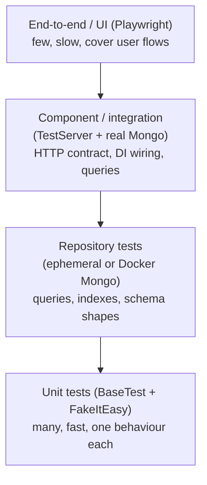
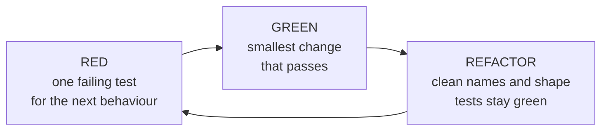

# 10. Unit and integration testing: NUnit, FakeItEasy, AAA

## Why this chapter matters

Almost every .NET interview has a testing block. Sometimes it is direct ("how do you test this
service?"), sometimes it is hidden inside a live-coding task ("now add a test for it"). The interviewer
learns a lot from it: do you know where a test belongs, what to fake and what to keep real, and how
to make time, randomness and concurrency deterministic. In real work, tests are what let you change a
ten-year-old monolith without fear. At Smartcat, tests are also a merge gate: a fix without a test that
fails without the fix usually does not pass review.

## What you will be able to do

- Choose the right level for a test (unit, Mongo, component, end-to-end) and explain the cost of each.
- Write NUnit tests with the constraint model, parameterized cases, a correct lifecycle and safe
  parallel execution.
- Use FakeItEasy for setup, returns, throws, argument matching, verification and argument capture,
  and know when not to use a fake at all.
- Make time, IDs, async code and concurrency deterministic in tests.
- Run exactly the tests you want from the CLI and avoid the silent "the filter was ignored" trap.
- Review a test MR against a clear checklist and explain each finding.

---

## 1. The test pyramid and what to test where

The pyramid is an old idea, but the reason behind it is still correct: **a test costs time to run and
time to understand when it fails**. Fast, focused tests should be the majority. Slow, wide tests should
be few and should check wiring that small tests cannot see.



| Level | What it proves | What it cannot prove | Typical cost |
|---|---|---|---|
| Unit | Business rules, branching, error handling of one class | That DI wiring, serialization or queries work | Milliseconds |
| Repository (Mongo) | Filters, projections, indexes, old-shape documents | HTTP contract, auth | Tens to hundreds of ms per test |
| Component (in-process host) | Endpoint routing, model binding, DI graph, middleware, real Mongo | Other real services, real Kafka broker | Seconds to boot the host, then fast |
| End-to-end | The user flow across services | Why it failed (the failure is far from the cause) | Minutes, flaky by nature |

**What to test where (rules of thumb):**

- A calculation, a state machine transition, a validation rule → unit test.
- A Mongo filter, especially with `null` / missing / `0` fields → repository test against a real Mongo.
  A fake repository proves nothing about the query.
- A new endpoint → component test that calls it over HTTP inside the test process.
- A bug fixed in production → a regression test at the **lowest level that can reproduce it**.

**Common mistake:** testing a Mongo query by faking `IMongoCollection<T>`. You then test that your code
calls the driver, not that the query returns the right documents. The driver API is huge and the fake
setup becomes a copy of the implementation.

**Tip:** when you are unsure about the level, ask "what would break if this test is wrong?" If the
answer is "the SQL/Mongo query", the test must touch a real database.

---

## 2. NUnit essentials

NUnit is the default test framework in Smartcat backend repos (monolith, PTS, WOS, FDA, Scol). Some
newer services (for example `smartcat-ai-agents`) use xUnit, so expect both in interviews.

### 2.1 Attributes and lifecycle

```csharp
[TestFixture]
public class InvoiceCalculatorTests
{
    private InvoiceCalculator _calculator = null!;

    [OneTimeSetUp]    // once, before all tests of the fixture
    public void StartExpensiveThings() { }

    [SetUp]           // before EACH test
    public void CreateCalculator() => _calculator = new InvoiceCalculator();

    [TearDown]        // after EACH test, also after a failed test
    public void Cleanup() { }

    [OneTimeTearDown] // once, after all tests of the fixture
    public void StopExpensiveThings() { }

    [Test]
    public void Should_return_zero_when_there_are_no_lines()
    {
        // Arrange
        var lines = Array.Empty<InvoiceLine>();

        // Act
        var total = _calculator.Total(lines);

        // Assert
        Assert.That(total, Is.EqualTo(0m));
    }
}
```

There is also `[SetUpFixture]` on a class outside any fixture: its `[OneTimeSetUp]` runs once for a
whole namespace (or the whole assembly when the class has no namespace).

**At Smartcat:** PTS has `src/Tests/GlobalSetup.cs`, a `[SetUpFixture]` that registers Mongo
conventions once and raises the minimum thread-pool size, because every component fixture boots a
full host and NUnit blocks a thread per async test.

**Important difference from xUnit:** NUnit creates **one instance of the fixture class for all its tests**
(by default). xUnit creates a new instance per test. In NUnit, a field you set in one test is still
there in the next test unless `[SetUp]` resets it. NUnit 3.13+ can switch this with
`[FixtureLifeCycle(LifeCycle.InstancePerTestCase)]`.

**Common mistake:** initializing a field in its declaration (`private readonly List<int> _items = new();`)
and mutating it in tests. With one shared instance, the second test sees the first test's data.

### 2.2 Parameterized tests: `TestCase` and `TestCaseSource`

```csharp
[TestCase(0, ExpectedResult = "Zero")]
[TestCase(1, ExpectedResult = "One")]
public string Should_return_word_when_given_number(int number) => _converter.ToWord(number);

[TestCase("", false)]
[TestCase(null, false)]
[TestCase("valid@email.com", true)]
public void Should_validate_email(string? email, bool expected)
{
    var result = _validator.IsValidEmail(email);

    Assert.That(result, Is.EqualTo(expected));
}
```

`TestCase` only accepts compile-time constants. For complex inputs (dictionaries, records, objects),
use `TestCaseSource` pointing to a **static** member:

```csharp
[TestCaseSource(nameof(StatusCases))]
public void Should_calculate_task_status(ScopeStatus[] scopes, ProjectTaskStatus expected)
{
    var status = _calculator.Calculate(scopes);

    Assert.That(status, Is.EqualTo(expected));
}

private static IEnumerable<TestCaseData> StatusCases()
{
    yield return new TestCaseData(new[] { ScopeStatus.Completed }, ProjectTaskStatus.Completed)
        .SetName("Should_complete_task_when_all_scopes_are_completed");
    yield return new TestCaseData(Array.Empty<ScopeStatus>(), ProjectTaskStatus.Created)
        .SetName("Should_keep_task_created_when_there_are_no_scopes");
}
```

**At Smartcat:** `project-tasks-service/src/Tests/Services/ProjectTaskStateCalculatorTests.cs` is a
good real example: one calculator, many `TestCaseSource` tables of assignments, invitations and scope
statistics, and a short body that calls `Calculate` and checks the state.

**Tip:** `SetName` (or `TestName = "..."` on `TestCase`) gives each row a readable name in the test
report. Without it you see `Should_calculate_task_status(System.Int32[],Created)`.

### 2.3 Categories, `Assume`, `Assert.Multiple`

```csharp
[Test, Category("Integration")]
public async Task Should_find_documents_by_account() { /* ... */ }
```

- `[Category("Integration")]` lets you exclude slow tests: `-- --filter "TestCategory!=Integration"`.
- `Assume.That(...)` marks the test **inconclusive** (not failed) when a precondition is false. Use it for
  preconditions in Arrange, not for results.
- `Assert.Multiple(() => { ... })` reports all failed asserts in the block, not only the first one.
  Useful when several fields describe one result.

### 2.4 Parallel execution

By default NUnit runs tests **sequentially**. You opt in:

```csharp
[TestFixture, Parallelizable(ParallelScope.Fixtures)] // this fixture can run next to other fixtures
public class TeamInvitationTests : BaseComponentTest { }

[TestFixture, Parallelizable(ParallelScope.All)]      // its tests can also run in parallel with each other
public class PureCalculatorTests { }
```

`[assembly: LevelOfParallelism(4)]` sets the number of worker threads.

The danger is shared state. `ParallelScope.All` together with the default "one fixture instance" means
two tests write the same fields at the same time. Use `ParallelScope.All` only for fixtures without
mutable fields, or together with `[FixtureLifeCycle(LifeCycle.InstancePerTestCase)]`.

**At Smartcat:** PTS component fixtures use `Parallelizable(ParallelScope.Fixtures)`: fixtures run in
parallel, tests inside one fixture run one after another against one booted host.

**Common mistake:** parallel fixtures that share one Mongo database name or one static cache. Each
parallel fixture needs its own database (or unique IDs per test).

---

## 3. Assertions: the constraint model only

NUnit has two assertion styles. The **classic** style (`Assert.AreEqual(expected, actual)`) and the
**constraint** style (`Assert.That(actual, Is.EqualTo(expected))`). NUnit 4 moved the classic style to
`ClassicAssert` in `NUnit.Framework.Legacy`.

**At Smartcat (PTS rule):** asserts use the constraint model only. Classic asserts (`Assert.AreEqual`,
`CollectionAssert.*`, `ClassicAssert.*`) are rejected by analyzers, and because of
`TreatWarningsAsErrors` they **fail the build**. Treat the constraint model as the default in every
Smartcat repo.

Why the constraint model is better:
- The order of arguments is always `actual` first; you cannot swap "expected" and "actual" by mistake.
- Constraints compose: `Is.Not.Null.And.Not.Empty`, `Has.Count.EqualTo(3)`.
- Failure messages are better, especially for collections.

| Classic (do not use) | Constraint model |
|---|---|
| `Assert.AreEqual(5, x)` | `Assert.That(x, Is.EqualTo(5))` |
| `Assert.IsTrue(ok)` | `Assert.That(ok, Is.True)` |
| `Assert.IsNull(r)` | `Assert.That(r, Is.Null)` |
| `CollectionAssert.AreEquivalent(a, b)` | `Assert.That(b, Is.EquivalentTo(a))` |
| `CollectionAssert.Contains(list, x)` | `Assert.That(list, Does.Contain(x))` |
| `StringAssert.StartsWith("Err", s)` | `Assert.That(s, Does.StartWith("Err"))` |
| `Assert.Greater(x, 0)` | `Assert.That(x, Is.GreaterThan(0))` |

More useful constraints:

```csharp
Assert.That(list, Is.Empty);
Assert.That(list, Has.Count.EqualTo(3));
Assert.That(list, Has.All.Matches<Item>(i => i.IsValid));
Assert.That(list, Is.Ordered.By(nameof(Item.CreatedAt)));
Assert.That(name, Is.EqualTo("TEST").IgnoreCase);
Assert.That(value, Is.InRange(1, 100));
Assert.That(when, Is.EqualTo(expected).Within(TimeSpan.FromSeconds(1)));
```

### 3.1 Exceptions and async

```csharp
// Sync
var ex = Assert.Throws<ArgumentException>(() => service.Process(null!));
Assert.That(ex!.ParamName, Is.EqualTo("input"));

// Async: the delegate is a Func<Task>
Func<Task> act = () => service.ProcessAsync(request, CancellationToken.None);
var error = Assert.ThrowsAsync<InvalidOperationException>(act);
Assert.That(error!.Message, Does.Contain("already completed"));
```

Facts that come up in interviews and reviews:

- `Throws<T>` / `ThrowsAsync<T>` match the **exact** type. A `TaskCanceledException` does not satisfy
  `ThrowsAsync<OperationCanceledException>`. Use `Assert.CatchAsync<T>` or
  `Assert.That(act, Throws.InstanceOf<T>())` when a subtype is fine.
- Never write `async void` tests. NUnit cannot observe the result; failures can be lost.
- `Assert.ThrowsAsync` blocks until the task finishes, so it returns the exception directly; you do
  not `await` it.

**At Smartcat (monolith review conventions, observed in review):**
- `AsyncTestDelegate` is obsolete in the monolith's NUnit version and CS0618 is an error. Declare
  `Func<Task> act = ...` and pass it to `Assert.ThrowsAsync<T>(act)`.
- The Act step is the awaited call. `Assert.DoesNotThrowAsync(() => sut.Run())` as the only check is a
  weak test; reviewers ask for a real observation (a saved state, a call that must not happen).

---

## 4. FakeItEasy

FakeItEasy is the mocking library in Smartcat backend repos. Everything starts with `A.Fake<T>()` and
`A.CallTo(...)`.

### 4.1 Create and configure

```csharp
var repository = A.Fake<IDocumentRepository>();

A.CallTo(() => repository.GetById(documentId)).Returns(document);           // exact argument
A.CallTo(() => repository.GetById(A<Guid>._)).Returns(document);            // any argument
A.CallTo(() => repository.GetById(A<Guid>._)).Returns((Document?)null);     // explicit null
A.CallTo(() => repository.GetNext()).ReturnsNextFromSequence(first, second);
A.CallTo(() => clock.UtcNow()).ReturnsLazily(() => current);                // computed per call
```

For async members, FakeItEasy has overloads that take the result value directly:

```csharp
// Task<Document> GetByIdAsync(Guid id, CancellationToken ct)
A.CallTo(() => repository.GetByIdAsync(id, A<CancellationToken>._)).Returns(document);
A.CallTo(() => repository.SaveAsync(A<Document>._, A<CancellationToken>._))
    .ThrowsAsync(new TimeoutException());
```

**What an unconfigured fake returns** (a classic interview question): FakeItEasy fakes are "loose".
An unconfigured call returns a **dummy** value: `0`/`false` for value types, `""` for `string`, an empty
completed `Task`, a `Task<T>` with a dummy `T`, and **another fake** for a fakeable interface type. It
does **not** return `null` for an interface. So "the repository returns nothing" must be configured
explicitly with `.Returns((Document?)null)`.

**Common mistake:** a test for the "not found" branch that forgets the explicit `null`. The fake returns a
dummy document, the code takes the happy path, and the test checks the wrong thing (or passes by luck).

Strict fakes fail on any unconfigured call:

```csharp
var api = A.Fake<IPaymentApi>(options => options.Strict());
```

Use them rarely. They make tests break on every harmless refactoring.

### 4.2 Throws

```csharp
A.CallTo(() => repository.Save(A<Entity>._))
    .Throws(new InvalidOperationException("Database error"));

A.CallTo(() => repository.GetById(A<Guid>.That.Matches(id => id == Guid.Empty)))
    .Throws<ArgumentException>();
```

### 4.3 Argument matching

```csharp
A<Entity>._                                        // any value (same as A<Entity>.Ignored)
A<Entity>.That.Matches(e => e.Name == "Test")      // condition
A<string>.That.StartsWith("SUPPORT-")              // built-in helpers
A<IEnumerable<Guid>>.That.IsSameSequenceAs(ids)    // sequence equality
```

### 4.4 Verification

```csharp
A.CallTo(() => repository.Save(A<Entity>._)).MustHaveHappenedOnceExactly();
A.CallTo(() => repository.Save(A<Entity>._)).MustHaveHappened(3, Times.Exactly);
A.CallTo(() => repository.Delete(A<Guid>._)).MustNotHaveHappened();

// Order between calls
A.CallTo(() => lockService.Take(id)).MustHaveHappened()
    .Then(A.CallTo(() => repository.Save(A<Entity>._)).MustHaveHappened());
```

### 4.5 Capturing arguments

```csharp
var saved = new List<Entity>();
A.CallTo(() => repository.Save(A<Entity>._))
    .Invokes((Entity e) => saved.Add(e))
    .Returns(Task.CompletedTask);

await service.ProcessAll();

Assert.That(saved, Has.Count.EqualTo(3));
Assert.That(saved, Has.All.Matches<Entity>(e => e.Status == EntityStatus.Processed));
```

Newer FakeItEasy versions (8+) also have `A.Captured<T>()` for the same purpose.

### 4.6 Verify state, not only calls

`review-tests-backend` rule **T5** flags tests that only check *how often* a fake was called. A
call-count assertion pins the implementation: a valid refactoring (batching two saves into one) breaks
the test while the behaviour is the same.

```csharp
// BAD: only says "Update was called twice"
A.CallTo(() => repo.Update(A<ProjectTask>._, A<Action<ProjectTask>>._, A<CancellationToken>._))
    .MustHaveHappened(2, Times.Exactly);

// BETTER: also checks the observable result
Assert.That(task1.DeadlineTime, Is.EqualTo(deadline));
Assert.That(task2.DeadlineTime, Is.EqualTo(deadline));
```

Call verification is correct when the call **is** the behaviour: "an event must be published",
"the external API must not be called when the feature flag is off".

---

## 5. `BaseTest` and the Smartcat test base classes

**At Smartcat:** tests inherit from base classes in the shared test utilities (for example
`Smartcat.TestUtils.Mocks` in PTS, `Smartcat.Tests.Common` in the monolith).

| Base class | Use case | Features |
|---|---|---|
| `BaseTest` | Unit tests with fakes | Small DI container, FakeItEasy helpers, no DB |
| `BaseEphemeralMongoTest` | Fast DB tests | In-process Mongo, no Docker |
| `BaseMongoTest` | Integration | Docker Mongo, persistent |
| `BaseKafkaTest` | Messaging | Docker Kafka |
| `BaseElasticsearchTest` | Search | Docker Elasticsearch |

`BaseTest` gives you a container per test:

```csharp
[TestFixture]
public class DocumentServiceTests : BaseTest
{
    private IDocumentRepository _repository = null!;

    [SetUp]
    public void Setup()
    {
        _repository = AddFake<IDocumentRepository>();
        AddSingleton<IDocumentService, DocumentService>();
    }

    [Test]
    public void Should_return_null_when_document_is_not_found()
    {
        // Arrange
        var id = Guid.NewGuid();
        A.CallTo(() => _repository.GetById(id)).Returns((Document?)null);
        var service = Get<IDocumentService>();

        // Act
        var result = service.TryGet(id);

        // Assert
        Assert.That(result, Is.Null);
    }
}
```

- `AddFake<T>()` registers a fake and returns it (optionally with a configuration lambda).
- `AddSingleton<TService, TImpl>()` registers a real implementation.
- `Get<T>()` resolves the class under test with its dependencies injected.

A real PTS example (`src/Tests/Managers/ProjectTaskDeadlineManagerTests.cs`) shows that `Get<T>()` for
an interface that was not registered returns a fake you can configure. This is likely an auto-fake
feature of the base class (inferred from the code; check the base class before relying on it):

```csharp
[SetUp]
public void SetUp()
{
    var provider = Get<IDateTimeProvider>();
    A.CallTo(() => provider.UtcNow()).Returns(_deadlineTime);
    AddSingleton<IDateTimeProvider>(provider);
}

[Test]
public async Task Should_update_deadline_for_all_tasks_from_request()
{
    // Arrange
    var projectTaskRepository = Get<IProjectTaskRepository>();
    var task1 = createProjectTask(_projectTaskId1, "TR-1");
    var task2 = createProjectTask(_projectTaskId2, "TR-2");
    var taskIds = new HashSet<Guid> { task1.Id, task2.Id };
    A.CallTo(() => projectTaskRepository.GetByCriteria(
            A<ProjectTaskSelectionCriteria>.That.Matches(c => taskIds.SetEquals(c.ProjectTaskIds))))
        .Returns(new[] { task1, task2 });
    var manager = Get<ProjectTaskDeadlineManager>();
    var request = createRequest(taskIds);

    // Act
    await manager.ChangeProjectTaskDeadlines(request, CancellationToken.None);

    // Assert
    Assert.That(task1.DeadlineTime, Is.EqualTo(_deadlineTime));
    Assert.That(task2.DeadlineTime, Is.EqualTo(_deadlineTime));
}
```

**Why a container in unit tests?** The class under test gets its constructor dependencies from DI.
When a new dependency is added, tests that do not care about it keep compiling and running, because
the container supplies a fake. With `new DocumentService(a, b, c)` in every test, one new constructor
parameter breaks fifty tests. The tradeoff: the wiring is less visible. For tiny pure classes,
`new Calculator()` is still the clearest choice.

---

## 6. Naming, AAA and one behaviour per test

### 6.1 Naming: `Should_<behaviour>_when_<condition>`

**At Smartcat:** the convention is `Should_do_something[_when_condition]`, underscores, lowercase
after `Should`.

```csharp
[Test] public void Should_return_empty_list_when_no_documents() { }
[Test] public void Should_throw_when_name_is_empty() { }
[Test] public void Should_increment_retry_count_when_processing_fails() { }
[Test] public void Should_not_call_handler_when_filter_rejects() { }
```

The name is the specification. When it fails in CI, the name alone should tell you which rule broke.
`Test1`, `ProcessTest`, or `Should_work` say nothing (rule **T7**).

Note: the generic `review-tests-backend` skill shows `MethodName_Scenario_ExpectedOutcome` as an
example. That example comes from an xUnit repo. In NUnit repos (monolith, PTS, WOS, FDA) follow the
`Should_..._when_...` convention. In an interview, the point is the same: **the name describes the
behaviour and the condition**, the exact format is a team choice.

### 6.2 Strict AAA

```csharp
[Test]
public async Task Should_process_document_when_input_is_valid()
{
    // Arrange
    var document = new Document { Id = Guid.NewGuid(), Name = "Test" };
    var repository = AddFake<IDocumentRepository>();
    A.CallTo(() => repository.GetById(document.Id)).Returns(document);
    var service = Get<DocumentService>();

    // Act
    var result = await service.Process(document.Id);

    // Assert
    Assert.That(result.IsSuccess, Is.True);
}
```

Rules:
- `// Arrange`, `// Act`, `// Assert` markers, with blank lines between the parts.
- **Bare markers.** In the monolith, `// Arrange: a fresh stage` is a review nit. Put the explanation
  into the test name.
- **One Act per test.** If you need two Acts, you have two behaviours, or you are testing a sequence
  (then name it as a sequence).
- **Preconditions go into Arrange** as `Assume.That`, not as `Assert.That` after Act. An assert after Act
  reads as if it were the result.
- When Act and Assert cannot be separated (an exception), `// Act & Assert` is acceptable. You will see
  it in PTS component tests for multi-step scenarios.

### 6.3 One behaviour per test

```csharp
// BAD: four behaviours; a failure in "Create" hides the other three
[Test]
public void Should_handle_all_crud_operations()
{
    var entity = service.Create(data);
    entity.Name = "Updated";
    service.Update(entity);
    service.Delete(entity.Id);
    Assert.That(service.GetById(entity.Id), Is.Null);
}

// GOOD
[Test] public void Should_create_entity_when_data_is_valid() { }
[Test] public void Should_update_entity_name() { }
[Test] public void Should_delete_entity_by_id() { }
```

"One behaviour" is not "one `Assert.That`". Several asserts that describe **one** result (status,
action point, flags of one state object) are fine; group them with `Assert.Multiple`.

### 6.4 No shared mutable state

```csharp
// BAD: static state leaks across tests and across parallel fixtures
private static Entity _sharedEntity = new Entity();

// GOOD: fresh state per test
[SetUp]
public void Setup() => _entity = new Entity();
```

Order dependence is the symptom: a test passes alone and fails in the full run (or the opposite).
NUnit's default order is alphabetical inside a fixture, but **never rely on it**.

---

## 7. Mock only at seams

**At Smartcat (PTS rule):** mock only at **seams**: external services, time, randomness, I/O. Never mock
the type under test or trivial value objects. Prefer real wiring where it is cheap (ephemeral Mongo
over a hand-written fake).

A **seam** is a place where you can replace behaviour without editing the code under test, usually
an injected interface at the boundary of your process.

| Fake it | Keep it real |
|---|---|
| HTTP clients to other services (`ISmartcatApiClient`, `IScolApiClient`) | The class under test |
| Time (`TimeProvider`, `IDateTimeProvider`) | Value objects, DTOs, records |
| Random numbers, ID generation (when the value matters) | Pure helpers and mappers |
| Message publishing (Kafka producer, outbox writer) at unit level | Mongo, in repository tests |
| Feature flags client | Interfaces added in the same MR, when the real class is cheap |

Rule **T6** (MAJOR): a test for class `X` that fakes an interface `IY` introduced **in the same MR**.
Both are new, so the fake only repeats what the author believes `IY` does. The real interaction is
never tested. Use the real `Y`, or add an integration test.

Other things not to fake:
- `ILogger` to assert on messages (rule **T10**, NIT). Log text is not a contract.
- `IMongoCollection<T>` (see section 1).
- `HttpClient` itself. If you must fake HTTP, fake an `HttpMessageHandler` or, better, the typed API
  client interface.

**Common mistake:** "mock everything so the test is a unit test". The result is a test that passes
while production fails, because every interesting interaction was replaced by the author's assumption.

---

## 8. MongoDB tests

### 8.1 Ephemeral vs Docker

```csharp
[TestFixture]
public class DocumentRepositoryTests : BaseEphemeralMongoTest
{
    private DocumentRepository _repository = null!;

    [SetUp]
    public void Setup() => _repository = new DocumentRepository(CreateDatabase()); // fresh DB per test

    [Test]
    public async Task Should_save_and_retrieve_document()
    {
        // Arrange
        var document = new Document { Id = Guid.NewGuid(), Name = "Test" };

        // Act
        await _repository.Save(document);

        // Assert
        var stored = await _repository.GetById(document.Id);
        Assert.That(stored?.Name, Is.EqualTo("Test"));
    }
}
```

| | `BaseEphemeralMongoTest` | `BaseMongoTest` / Docker fixtures |
|---|---|---|
| Needs Docker | No | Yes (or an existing Mongo via env var) |
| Speed | Fast | Slower startup |
| Features | Basic CRUD, queries | Real server: replica set, transactions, indexes |
| Use for | Repository logic | Transactions, index creation, migration tests |

**At Smartcat (PTS):**
- PTS uses transactions, so Mongo must be a **replica set**. A standalone `mongod` fails.
- Integration tests use `[Category("Integration")]` and `BaseDockerMongoFixtureTest`, which starts a
  replica-set Mongo with Testcontainers.
- If `SC_TESTS_MONGO_CONNSTR` is set, fixtures reuse that Mongo instead of starting a container. This is
  what CI does (Mongo runs as a GitLab service; the CI job has **no Docker daemon**).
- Locally, use `pwsh ./scripts/run-tests.ps1`: it starts **one** shared replica-set Mongo and points
  every fixture at it. Per-fixture containers race and produce random `ReplicaSet Disconnected` errors.
- Errors like `Connection refused` on 27017, `ReplicaSet Disconnected` timeouts, or an OOM-killed
  container (`Exited (137)`) are **infrastructure**, not code failures.

### 8.2 Schema changes and old documents

Rules **T2** and **T13** (MAJOR): a new field on a Mongo document, or a migration with a legacy fallback
in the read path, needs a test against **old-shape documents**. Insert raw BSON in the old shape, read
it with the new code:

```csharp
[Test]
public async Task Should_use_default_priority_when_document_has_no_priority_field()
{
    // Arrange
    var id = Guid.NewGuid();
    var raw = new BsonDocument { { "_id", new BsonBinaryData(id, GuidRepresentation.Standard) },
                                 { "Name", "legacy" } }; // no "Priority" field: written before the change
    await Database.GetCollection<BsonDocument>("Documents").InsertOneAsync(raw);

    // Act
    var document = await _repository.GetById(id);

    // Assert
    Assert.That(document!.Priority, Is.EqualTo(Priority.Normal));
}
```

Rule **T4** (MINOR, recurring): `null` vs **missing** vs `0` are three different states in Mongo.
`Filter.Eq(x => x.Count, 0)` does not match a document without the field. `Filter.Eq(field, null)`
matches both `null` and missing. Cover all three with a parameterized test; emulate "missing" by
inserting raw BSON.

Rule **T15** (MINOR): a new index needs a test for fresh environments (warm-up creates it) and for
existing environments (the migration creates it). See chapter 09 (MongoDB models, indexes and safe
migrations).

---

## 9. Integration tests with an in-process host

### 9.1 General .NET: `WebApplicationFactory`

`Microsoft.AspNetCore.Mvc.Testing` boots your real `Program` in memory with a `TestServer`. Requests
go through the real middleware, routing, model binding and DI, but no network port is opened.

```csharp
public class OrdersApiTests
{
    private WebApplicationFactory<Program> _factory = null!;
    private HttpClient _client = null!;

    [OneTimeSetUp]
    public void Start()
    {
        _factory = new WebApplicationFactory<Program>().WithWebHostBuilder(builder =>
        {
            builder.UseEnvironment("Testing");
            builder.ConfigureTestServices(services =>
            {
                services.RemoveAll<IPaymentApi>();
                services.AddSingleton(A.Fake<IPaymentApi>()); // fake only the external service
            });
        });
        _client = _factory.CreateClient();
    }

    [OneTimeTearDown]
    public void Stop()
    {
        _client.Dispose();
        _factory.Dispose();
    }

    [Test]
    public async Task Should_return_404_when_order_does_not_exist()
    {
        // Act
        var response = await _client.GetAsync($"/api/orders/{Guid.NewGuid()}");

        // Assert
        Assert.That(response.StatusCode, Is.EqualTo(HttpStatusCode.NotFound));
    }
}
```

With top-level statements, add `public partial class Program;` so the test project can reference the
type.

Why boot the host in `[OneTimeSetUp]` and not `[SetUp]`: booting takes seconds. Tests in the fixture
share the host and must use unique data (new IDs per test) so they do not see each other's documents.

### 9.2 At Smartcat: `BaseComponentTest` in PTS

PTS does the same thing with the platform hosting builder instead of `WebApplicationFactory`
(`src/Tests/Integration/Common/BaseComponentTest.cs`, simplified):

```csharp
public abstract class BaseComponentTest : BaseDockerMongoFixtureTest
{
    protected TestServerWrapper TestServer => _testServer!;

    [OneTimeSetUp]
    public void StartTestServer()
    {
        var options = new RunOptions { Roles = new[] { AppRole.Web, AppRole.Processing } };

        _testServer = StandardWebApplicationBuilderConfigurator.Create()
            .UseCommonConfigs()
            .ConfigureModules(logger, options)
            .Module<Smartcat.ProjectTasksService.Testing.WebModule.Module>()
            .UseRebinds(services =>
            {
                services.ReplaceAllWithSingleton<IMongoDatabase>(_ => MongoDatabase); // real Mongo
                services.AddSingleton(SetupSmartcatApi(A.Fake<ISmartcatApiClient>())); // external: fake
                services.AddSingleton(SetupScolConnection(A.Fake<IScolApiClient>()));
                services.AddSingleton(A.Fake<IFeatureFlagsClient>());
            })
            .BuildHost(logger, options)
            .RunTestServer();
    }

    [OneTimeTearDown]
    public void StopTestServer() => _testServer?.Dispose();
}
```

Notice the seam rule in action: the service's own code and Mongo are real; the monolith API, Scol and
feature flags are fakes. A derived fixture can override `SetupSmartcatApi` to configure answers.

A test then calls the service through its **published API client**, which also tests the contract:

```csharp
[OneTimeSetUp]
public void ResolveServices()
{
    _http = TestServer.CreateClient();
    _projectTasksApi = new ProjectTaskServiceConnection(_http).ProjectTasksApi;
}
```

Facts to remember about PTS component tests:
- They boot Web + Processing roles against the shared Mongo; **no Kafka broker is required**. Kafka
  consumers retry harmlessly; tests assert on HTTP and Mongo behaviour.
- Do not make them start their own Kafka container: CI has no Docker daemon.

Rule **T9** (MAJOR): a new endpoint without a matching integration test.

---

## 10. Testing time and IDs

Code that calls `DateTime.UtcNow` or `Guid.NewGuid()` directly is hard to test: the value changes
every run, and "expired after 24 hours" would need a real 24-hour wait. Rule **T8** (MINOR) flags it.

### 10.1 `TimeProvider` and `FakeTimeProvider` (.NET 8+)

```csharp
public sealed class LeaseService(TimeProvider time, TimeSpan lifetime)
{
    private DateTimeOffset _takenAt;

    public void Take() => _takenAt = time.GetUtcNow();
    public bool IsExpired => time.GetUtcNow() - _takenAt >= lifetime;
}
```

```csharp
using Microsoft.Extensions.Time.Testing; // package Microsoft.Extensions.TimeProvider.Testing

[Test]
public void Should_expire_lease_after_lifetime()
{
    // Arrange
    var time = new FakeTimeProvider(new DateTimeOffset(2026, 1, 1, 0, 0, 0, TimeSpan.Zero));
    var service = new LeaseService(time, TimeSpan.FromMinutes(5));
    service.Take();

    // Act
    time.Advance(TimeSpan.FromMinutes(5));

    // Assert
    Assert.That(service.IsExpired, Is.True);
}
```

`FakeTimeProvider` also drives timers created from it (`time.CreateTimer`, `PeriodicTimer` built on the
provider in .NET 8+) and timeouts like `Task.Delay(delay, time)` and `task.WaitAsync(timeout, time, ct)`.
`Advance` fires them synchronously, so a test of a "retry after 30 seconds" loop runs in milliseconds.

**At Smartcat:**
- The monolith uses `FakeTimeProvider` in lock and lease tests, for example
  `smartcat/Features/Cat/AbbyyLS.SmartCAT.BL.Tests/Projects/ProjectCompletionLockServiceTests.cs`:
  take a lease, `Advance` past its lifetime, check that the lease is lost.
- Monolith review convention: product code should use the `Task.WaitAsync(timeout, TimeProvider, ct)`
  overload so tests can `Advance` time instead of sleeping real seconds.
- PTS (older code) uses its own `IDateTimeProvider` with `UtcNow()`, faked with FakeItEasy.

### 10.2 IDs

For IDs, choose between two approaches:
- **Do not care about the value**: let the code generate it, then read it back from the result or
  capture it (`Invokes`). This is usually enough.
- **Care about the value** (sorting, deduplication keys, idempotency keys): inject an ID provider
  (`IGuidProvider`, or a `Func<Guid>`) and return fixed values.

**Common mistake:** asserting `UpdatedAt > DateTime.UtcNow.AddMinutes(-1)`. It works, but it is a
weak check and fails on a slow CI agent with a paused debugger. With a fake clock you can assert
`Is.EqualTo(fixedNow)`.

---

## 11. Async and concurrency, deterministically

### 11.1 Async tests

- Test methods return `Task`, never `async void`.
- Pass a real `CancellationToken` when cancellation matters; test that a cancelled token stops work.
- Never use `Thread.Sleep` or `Task.Delay(1000)` "to let the background work finish". It is slow and
  still flaky. Wait for a **signal**, with a timeout as a safety net only.

```csharp
// BAD: hope that 500 ms is enough
_ = worker.StartAsync();
await Task.Delay(500);
Assert.That(store.Items, Has.Count.EqualTo(1));

// GOOD: wait for the event you care about
var processed = new TaskCompletionSource(TaskCreationOptions.RunContinuationsAsynchronously);
A.CallTo(() => store.Save(A<Item>._)).Invokes(() => processed.TrySetResult());

_ = worker.StartAsync();
await processed.Task.WaitAsync(TimeSpan.FromSeconds(5)); // timeout only protects the CI run
A.CallTo(() => store.Save(A<Item>._)).MustHaveHappenedOnceExactly();
```

`RunContinuationsAsynchronously` matters: without it, the test continuation can run inline on the
worker's thread inside `TrySetResult`, which can cause surprising re-entrancy and deadlocks.

### 11.2 Concurrency: force the interleaving

Rule **T3** (MAJOR): new `lock` / `SemaphoreSlim` / `Monitor` code needs a test with **deliberate
contention**. Calling the method twice in sequence does not test a lock.

The trick is a **gate**: hold the first caller inside the critical section, start the second one, then
release the gate. Now the interleaving is deterministic, not a lucky race.

```csharp
[Test]
public async Task Should_run_only_one_import_at_a_time_when_called_concurrently()
{
    // Arrange
    var gate = new TaskCompletionSource(TaskCreationOptions.RunContinuationsAsynchronously);
    var running = 0;
    var maxRunning = 0;
    A.CallTo(() => _importer.ImportAsync(A<Guid>._, A<CancellationToken>._))
        .ReturnsLazily(async () =>
        {
            var now = Interlocked.Increment(ref running);
            InterlockedMax(ref maxRunning, now);
            await gate.Task;
            Interlocked.Decrement(ref running);
        });
    var service = Get<ImportService>();

    // Act
    var calls = Enumerable.Range(0, 10).Select(_ => service.RunAsync(Guid.NewGuid())).ToArray();
    await Task.Yield();
    gate.SetResult();
    await Task.WhenAll(calls);

    // Assert
    Assert.That(maxRunning, Is.EqualTo(1));
}
```

(`InterlockedMax` is a small compare-exchange loop helper in the test project.) For distributed locks
(two pods), the same idea applies with two service instances against one real Mongo; see chapter 04
(Multithreading, concurrency and distributed locks).

### 11.3 Idempotency, retries and hashing

- **T14 (MAJOR) replay test.** A fix in checkpoint, state-update or queue logic needs a test that
  processes the **same input twice** (same message ID / idempotency key) and checks for one side effect.
  Kafka delivers at least once; your handler will see duplicates. See chapter 07.
- **T17 (MAJOR) retry budget.** New retry code needs a test with N+1 induced failures that checks the
  loop **gives up**. Otherwise a bug becomes an infinite retry loop. Use `FakeTimeProvider` for the
  backoff delays.
- **T18 (MAJOR) cross-process hashing.** A custom `GetHashCode` used in persisted or cross-pod state
  needs a test that computes it in two processes. Reason: `string.GetHashCode()` is **randomized per
  process** in .NET Core. A value that matches inside one test run can differ on another pod. Use a
  stable hash (for example `XxHash64` or SHA-256 over UTF-8 bytes) for anything stored or shared.
- **T16 (MAJOR, AI agents)** — a new entry point that builds chat messages needs a test that injects a
  `System` role message and checks it is normalized to `User` before it reaches the model.
- **T12 (MAJOR)** — a permission or credential chain (User → Workspace → Organization) needs a test
  where the highest-scope record is **disabled** and a lower one is active.

---

## 12. Legacy code: characterization tests and red → green → refactor

### 12.1 Characterization first

A **characterization test** records what the code does **today**, without judging if it is right. You
write it before you change legacy code, so you have a green baseline.

**At Smartcat (PTS rule):** never edit production code that has no test covering the behaviour you are
about to change.

How to write one:
1. Call the code with a realistic input.
2. Write an assertion with a value you know is wrong (`Is.EqualTo("?")`).
3. Run it. The failure message shows the real value.
4. Put the real value into the assertion. Now the test is green and pins today's behaviour.
5. Change the code. If the characterization test breaks, decide: is this change intended (update the
   test in the same commit and explain it) or a regression (fix the code)?

### 12.2 Regression test for a production bug

Rule **T11** (MAJOR): a bug-fix commit without a test that **fails without the fix**. The check is
simple: revert the production change locally, run the test, it must be red.

### 12.3 TDD loop

From the `common-tdd` skill and the PTS rule:



- **RED must fail for the right reason**: an assertion mismatch, not a compile error or a typo. A test
  that errors is not a valid RED.
- **GREEN is minimal**: no behaviour the test does not demand.
- **Refactor only on green**, re-run after each step.
- Small steps: one behaviour per cycle.
- At the end, run the full relevant suite, not only the new tests.
- Record the RED → GREEN evidence (the failing assertion, then the pass) in the report or MR.
- **Opt-out is allowed and explicit**: config-only changes, renames, docs, generated files, version
  bumps. Say "no meaningful test: reason". Do not write a fake test to satisfy the process.

**Interviewer view:** "Do you always do TDD?" A strong answer is honest: TDD is the default for logic
with clear acceptance criteria and for bug fixes (write the failing regression test first). For
exploratory spikes, the candidate writes tests after the design settles, then checks that each test can
fail.

---

## 13. Never reflect into non-public members

**At Smartcat (rule T19 in the team's test review rules):** never write a test that reads or invokes
non-public members by name:

- `GetField` / `GetProperty` / `GetMethod` with `BindingFlags.NonPublic`, then `GetValue` /
  `SetValue` / `Invoke`;
- `Activator.CreateInstance` or `Assembly.GetType("...")` on an internal type by its string name;
- `[UnsafeAccessor]` doing the same.

```csharp
// BAD: pins a private field name; a rename breaks the test at runtime, not at compile time
var field = typeof(AllowListFilter).GetField("_allowed", BindingFlags.NonPublic | BindingFlags.Instance);
var allowed = (HashSet<string>)field!.GetValue(filter)!;
Assert.That(allowed, Does.Contain("pptx"));
```

Why it is wrong:
- It tests the implementation, not the contract.
- A rename breaks it at **runtime**. Find-usages and rename refactorings do not see the string.
- Needing it usually means the production code hides a dependency that the test cares about.

Fix, in this order:

1. **Assert the observable behaviour through the public API.** Test the effect of the allow-list, not
   the field that holds it.

   ```csharp
   Assert.That(filter.IsAllowed("deck.pptx"), Is.True);
   Assert.That(filter.IsAllowed("script.exe"), Is.False);
   ```

2. **Make the hidden piece explicit.** Extract it into its own type or an injected dependency that the
   test can construct or replace.
3. **Only then** widen visibility to `internal` and add `InternalsVisibleTo` for the test assembly.

Severity in review: **MINOR** by default; **MAJOR** when the test project already has
`InternalsVisibleTo` on the assembly under test, because option 3 was a one-word change. (PTS, for
example, already declares `InternalsVisibleTo` for its test project in several `.csproj` files.)

Allowed exceptions:
- Internals of a **third-party** package that has no public API for the scenario, kept in **one shared
  test helper** with a comment that names the missing API, not copied into every test file.
- **Architecture / convention tests** that only inspect structure: scan types, check inheritance,
  detect a forbidden override, read attributes. They do not read member values or invoke members.

```csharp
// Fine: structure only
[Test]
public void Should_seal_all_message_handlers()
{
    var handlers = typeof(Module).Assembly.GetTypes()
        .Where(t => t.IsClass && !t.IsAbstract && typeof(IMessageHandler).IsAssignableFrom(t));

    Assert.That(handlers, Has.All.Matches<Type>(t => t.IsSealed));
}
```

---

## 14. Running tests

### 14.1 Target the solution, not the project

Smartcat test projects import `$(SolutionDir)\.build\TestProject.props`. `$(SolutionDir)` is set for a
`.sln` build but not reliably for a bare `.csproj`. Targeting the project leaves it empty, the import
becomes `/.build/TestProject.props`, and the build fails with **`MSB4019: The imported project ... was
not found`**.

```bash
dotnet test ProjectTasksService.sln                                  # PTS
dotnet test src/Tests/Tests.csproj -p:SolutionDir=$(pwd)/            # escape hatch: trailing slash required
```

### 14.2 VSTest vs Microsoft.Testing.Platform (MTP)

Smartcat opts test projects into the **MTP** NUnit runner through the shared `.build/TestProject.props`
(`EnableNUnitRunner=true`, `OutputType=Exe`, `TestingPlatformDotnetTestSupport=true`). Because it is in
an imported props file, you do not see it in the `.csproj`. Check with:

```bash
rg -l "EnableNUnitRunner|TestingPlatformDotnetTestSupport" --glob "*.props" --glob "*.csproj"
```

### 14.3 The filter trap: `-- --filter`

Under the MTP bridge (the default `dotnet test` mode today), a top-level `--filter` is consumed by the
`dotnet test` driver and **silently ignored**. The whole suite runs.

```bash
# CORRECT
dotnet test ProjectTasksService.sln -- --filter "FullyQualifiedName~DeadlineManagerTests"

# WRONG: runs everything, no error
dotnet test ProjectTasksService.sln --filter "FullyQualifiedName~DeadlineManagerTests"
```

Filter syntax (NUnit adapter):
- `FullyQualifiedName~Part` (contains), `FullyQualifiedName=Ns.Fixture.Method` (exact), `Name~Part`.
- NUnit `[Category("X")]` is selected with **`TestCategory=X`**, not `Category=X`.
- Combine with `&` and `|`: `"TestCategory!=Integration&FullyQualifiedName~Scope"`.
- Discover names with `-- --list-tests`.

**Always check the executed count.** The failure is silent; a full-suite count means the filter was
ignored.

In native MTP mode (.NET 10 SDK, enabled in `global.json`) `dotnet test --filter` works without `--`.
Classic VSTest projects take a top-level `--filter`. Check the repo instead of guessing.

### 14.4 Repo-specific quirks

| Repo | Quirk | What to do |
|---|---|---|
| FDA (`filedisassembling`) | `dotnet test` silently discovers **zero tests** (NUnit + MTP combination) | `dotnet build src/Tests/Tests.csproj -c Debug`, then `dotnet vstest ".../Smartcat.FdaService.Tests.dll" --TestCaseFilter:"FullyQualifiedName~X"` |
| FDA module tests | Need `$(SolutionDir)` | Add `-p:SolutionDir=$(pwd)/` to restore, build and test |
| Monolith in a git worktree | A scoped build does not copy MTP runner DLLs into the shared bin; `dotnet test <proj>` fails with `MTP0001` | Run the full `pwsh ./buildBackend.ps1` once, then run the DLL directly: `dotnet buildResult/app/bin/X.Tests.dll --filter "FullyQualifiedName~Y"` |
| PTS integration | Needs a replica-set Mongo | `pwsh ./scripts/run-tests.ps1`, or set `SC_TESTS_MONGO_CONNSTR` |

### 14.5 Run cadence

1. While editing: a fast filtered run of one class.
2. After a larger change: everything except integration (`-- --filter "TestCategory!=Integration"`).
3. Before calling the task done: a full **unfiltered** run, including integration. A narrow filter can
   hide tests you broke elsewhere.

Use `--no-build` to re-run without rebuilding after a good build.

---

## 15. Reviewing tests: the checklist

The `review-tests-backend` skill is a pre-MR reviewer. Its job is not to check that tests pass (CI does
that) but to find **what is missing or weak**.

| Rule | Severity | What it flags |
|---|---|---|
| T1 | BLOCKER | New handler/strategy (or new type branch) without a test |
| T2 | MAJOR | Mongo schema change without an ephemeral/integration test |
| T3 | MAJOR | New lock/semaphore without a contention test |
| T4 | MINOR | Filter on `null` or `0` without tests for the other states (null / missing / zero) |
| T5 | MINOR | Only call counts asserted, no behaviour |
| T6 | MAJOR | Faking an interface introduced in the same MR |
| T7 | NIT | Name does not describe behaviour (`Test1`) |
| T8 | MINOR | `DateTime.UtcNow` / `Guid.NewGuid()` without injection; time asserted without a frozen clock |
| T9 | MAJOR | New endpoint without an integration test |
| T10 | NIT | Asserting on log messages |
| T11 | MAJOR | Bug fix without a test that fails without the fix |
| T12 | MAJOR | Permission chain without a "higher scope disabled, lower active" test |
| T13 | MAJOR | Legacy-fallback read path not tested against unmigrated documents |
| T14 | MAJOR | State-update fix without a replay (same input twice) test |
| T15 | MINOR | New index without warm-up and migration tests |
| T16 | MAJOR | Chat message pipeline without a `System`-role injection test |
| T17 | MAJOR | New retry loop without a "gives up after N" test |
| T18 | MAJOR | New hash used across pods without a cross-process test |

The skill also says: check the repo for a past-incidents file (for example
`.claude-review/past-incidents.md`) and treat its entries as repo-specific rules. That is how a
codebase carries its own bug history into reviews.

Output format, one line per finding:

```
[MAJOR] src/Module/Services/ScopeService.cs — fix to scope status update has no replay test. Rule T14.
```

---

## At Smartcat (summary)

- **Framework:** NUnit + FakeItEasy in the monolith, PTS, WOS, FDA and Scol. Some newer AI services use
  xUnit.
- **Base classes:** `BaseTest` (DI + fakes), `BaseEphemeralMongoTest`, `BaseMongoTest`,
  `BaseKafkaTest`, `BaseElasticsearchTest`; PTS adds `BaseDockerMongoFixtureTest` and
  `BaseComponentTest`.
- **Naming:** `Should_<behaviour>[_when_<condition>]`.
- **Structure:** bare `// Arrange`, `// Act`, `// Assert`; one Act; preconditions with `Assume.That`.
- **Asserts:** constraint model only; classic asserts fail the PTS build.
- **Discipline:** characterization first, red → green → refactor, mock only at seams, inject clock and
  ID providers.
- **Running:** target the `.sln`, use `-- --filter`, verify the count; FDA uses `dotnet vstest`.
- **Review:** T1–T18 from `review-tests-backend`, plus the "no reflection into non-public members" rule.
- **Real examples to read:**
  - `project-tasks-service/src/Tests/Services/ProjectTaskStateCalculatorTests.cs` (TestCaseSource)
  - `project-tasks-service/src/Tests/Managers/ProjectTaskDeadlineManagerTests.cs` (BaseTest + FakeItEasy)
  - `project-tasks-service/src/Tests/Integration/SplitScopeCompletionTests.cs` (component test)
  - `smartcat/Features/Cat/AbbyyLS.SmartCAT.BL.Tests/Projects/ProjectCompletionLockServiceTests.cs`
    (FakeTimeProvider + real Mongo)

---

## Interview corner

### As the interviewee

1. **What is the difference between a unit test and an integration test? Where do you draw the line?**
   A strong answer covers:
   - Unit: one class, external seams replaced, milliseconds, many of them.
   - Integration: real wiring (DI, HTTP pipeline, database) for a slice of the system.
   - The line is "what can break here": query logic needs a real DB, business rules do not.
   - Mentions cost of failure diagnosis, not only run time.

2. **What do you mock and what do you keep real?**
   - Mock seams: other services, time, randomness, I/O at the boundary.
   - Keep real: the class under test, value objects, cheap collaborators, the database in repository tests.
   - Danger of faking an interface designed in the same change (the fake copies your assumptions).

3. **How does NUnit's fixture lifecycle differ from xUnit's, and why does it matter?**
   - NUnit: one fixture instance for all tests (default); xUnit: a new instance per test.
   - Fields leak between NUnit tests unless reset in `[SetUp]`.
   - `FixtureLifeCycle(InstancePerTestCase)` exists; parallel `ParallelScope.All` needs care.

4. **When do you use `TestCaseSource` instead of `TestCase`?**
   - `TestCase` takes only constants; `TestCaseSource` takes objects, collections, records.
   - Source must be static; `TestCaseData.SetName` for readable names.
   - Avoid huge tables that hide which rule a row checks.

5. **What does an unconfigured FakeItEasy fake return?**
   - Dummy values: default for value types, `""` for strings, completed tasks, fakes for interfaces.
   - Not `null` for interfaces, so "not found" must be configured explicitly.
   - Strict fakes exist but make tests brittle.

6. **What is wrong with asserting only `MustHaveHappenedOnceExactly`?**
   - It pins how, not what; refactoring breaks it.
   - Assert the resulting state; use call verification when the call is the behaviour (publish an event,
     do not call an API).

7. **How do you test code that depends on the current time?**
   - Inject `TimeProvider` (or a clock interface); use `FakeTimeProvider` and `Advance`.
   - Timers and `Task.Delay`/`WaitAsync` overloads that take a `TimeProvider` are driven by `Advance`.
   - No `Thread.Sleep`, no "within one minute" asserts.

8. **How do you test that a lock really prevents concurrent execution?**
   - Deliberate contention: many concurrent calls with `Task.WhenAll`.
   - A gate (`TaskCompletionSource`) to hold the first caller inside the section.
   - Measure maximum concurrency with `Interlocked`; avoid sleeps.
   - For distributed locks: two instances against one real database.

9. **You need to change a 600-line legacy method without tests. How do you start?**
   - Characterization tests to pin current behaviour first.
   - Find or create a seam (extract a dependency, inject time).
   - Small refactor steps under green tests; then the behaviour change with a new failing test.

10. **How do you test an ASP.NET Core endpoint end to end inside the test process?**
    - `WebApplicationFactory<Program>` / `TestServer`, `ConfigureTestServices` to replace external
      clients.
    - Host per fixture, unique data per test.
    - Assert status codes and the response contract; real DB where cheap.

11. **A test needs a private field value. What do you do?**
    - Do not use reflection; assert via public behaviour.
    - If that is not possible, extract the hidden piece into an injectable type.
    - Last resort: `internal` + `InternalsVisibleTo`.
    - Structure-only architecture tests with reflection are fine.

12. **Your `dotnet test --filter X` ran all 3,000 tests. Why?**
    - MTP runner bridge: the top-level filter is ignored silently; use `-- --filter`.
    - Always check the executed count.
    - Mentions `TestCategory=` for NUnit categories.

13. **How do you test idempotency of a Kafka handler?**
    - Process the same message (same ID) twice, assert one side effect.
    - At-least-once delivery makes duplicates normal; see chapter 07.

14. **What does TDD give you, and when do you skip it?**
    - Catches misread requirements early; every test has been seen failing.
    - RED must fail for the right reason.
    - Skip for config, renames, docs, version bumps, and say so.

### As the interviewer

**What to ask:** give the candidate a small service with a repository, a clock and an external API
client, and ask: "Write the tests for this. Which ones first? What do you fake?"

**Depth probes:**
- "Your fake returns the entity for any ID. What branch is now not tested?"
- "This test passes alone and fails in the full run. What do you check first?" (shared state, order,
  parallel fixtures, static caches.)
- "How would you make this `retry after 30 seconds` test run in 10 ms?"
- "Show me how this test fails if I revert the fix."
- "Why does this Mongo test need old-shape documents?"
- "What would make you choose an integration test over ten unit tests here?"

**Green flags:**
- Chooses the test level from the risk, not from habit.
- Configures the negative paths explicitly (null, throws, cancelled token).
- Talks about determinism: injected time, gates instead of sleeps.
- Asserts behaviour and state; uses call verification only where the call is the contract.
- Checks that a regression test fails without the fix.

**Red flags:**
- "100% coverage" as the goal; tests without meaningful assertions.
- Mocks the class under test or the Mongo driver.
- `Thread.Sleep` in tests; `DateTime.Now` in product code with "the test is flaky sometimes".
- Uses reflection to read private fields as a normal practice.
- Cannot explain why a test is red in CI but green locally.

**Scoring rubric:**

| Signal | Junior | Senior | Staff |
|---|---|---|---|
| Test level choice | Unit tests for everything | Picks unit vs integration per risk | Designs the seams so each risk has a cheap test level |
| Fakes | Fakes everything, or nothing | Fakes at seams, keeps value objects real | Spots tests that copy assumptions (same-MR fakes), pushes for contract tests |
| Determinism | Sleeps and retries | Fake clock, TCS gates | Builds time/ID abstractions into the platform; removes flaky classes of tests |
| Legacy code | Rewrites first | Characterization tests first | Plans incremental seams and a test strategy for a whole module |
| Tooling | Runs tests in the IDE only | Knows filters, categories, CI cadence | Diagnoses runner, props and CI infra failures quickly |

---

## Exercises

1. **Find the bugs in this test.**

   ```csharp
   private readonly List<Order> _orders = new();

   [Test]
   public async Task Test_Process()
   {
       A.CallTo(() => _repo.Get(A<Guid>._)).Returns(new Order());
       var svc = Get<OrderService>();
       _orders.Add(await svc.Process(Guid.NewGuid()));
       Thread.Sleep(1000);
       Assert.AreEqual(1, _orders.Count);
       A.CallTo(() => _repo.Save(A<Order>._)).MustHaveHappenedOnceExactly();
   }
   ```

2. **Make it deterministic.** `CacheEntry.IsExpired` uses `DateTime.UtcNow`. Change the design and write
   a test for "expires exactly after 10 minutes".

3. **Characterize a legacy method.** You are given `string FormatInvoiceNumber(int year, int seq,
   bool proForma)` with no tests. Describe the characterization tests you write before you change the
   `proForma` formatting.

4. **Contention test.** Write a test showing that `ImportService.RunAsync` never runs two imports for the
   same project at the same time, without `Task.Delay`.

5. **Reflection fix.** A test reads `_allowedExtensions` with `GetField(..., BindingFlags.NonPublic)`.
   The test project already has `InternalsVisibleTo`. What severity do you give in review, and what fix
   do you propose first?

6. **Filter debugging.** `dotnet test src/Tests/Tests.csproj --filter "Category=Unit"` fails with
   `MSB4019`. After you fix that, it runs all tests. List every problem in the command.

<details>
<summary>Answer notes</summary>

1. Name `Test_Process` describes nothing (use `Should_save_order_when_processing_succeeds`). No AAA
   markers. `_orders` is a field initialized once: NUnit shares the fixture instance, so the list
   grows across tests. `Thread.Sleep` is useless and slow (the call was already awaited). Classic
   `Assert.AreEqual` fails the PTS build; use `Assert.That(..., Has.Count.EqualTo(1))`. The only real
   check is a call count; assert the order state (for example `Status == Processed`). The fake returns
   an order for any ID, so the "not found" branch is untested (add a separate test).

2. Inject `TimeProvider` into `CacheEntry` (or its factory). Test: `FakeTimeProvider` with a fixed
   start; create the entry; `Advance(TimeSpan.FromMinutes(10) - TimeSpan.FromTicks(1))` → not expired;
   `Advance(TimeSpan.FromTicks(1))` → expired. Two tests, one behaviour each, boundary on both sides.

3. Use `TestCase` rows that cover: normal year/seq, `seq` with padding boundaries (1, 9, 10, 999, 1000),
   `proForma` true and false, year boundaries. Start each with a wrong expected value, read the real
   value from the failure, paste it in. Commit the green tests first, then change the `proForma` branch
   with a new failing test for the new format, and update only the `proForma` rows on purpose.

4. Fake the importer with `ReturnsLazily` that increments a counter with `Interlocked`, records the
   maximum, and awaits a `TaskCompletionSource` gate. Start 10 calls for the same project ID, yield,
   release the gate, `await Task.WhenAll`, assert max is 1. Add a second test with different project
   IDs that asserts max is greater than 1 if the design allows parallel imports across projects.

5. MAJOR, because `InternalsVisibleTo` already exists (the fallback was a one-word change). But the
   first fix is still option 1: assert through the public API (`IsAllowed("x.pptx")` true,
   `IsAllowed("x.exe")` false). If the list must be visible, extract it into an injectable type.

6. Targeting the `.csproj` leaves `$(SolutionDir)` empty → `MSB4019`; target the `.sln` or pass
   `-p:SolutionDir=<root>/`. The top-level `--filter` is ignored under the MTP bridge → use
   `-- --filter`. `Category=Unit` is the wrong property; NUnit categories use `TestCategory=Unit`. And
   check the executed test count to confirm the filter worked.

</details>

---

## Summary

- Choose the test level by "what can break": logic → unit, queries → real Mongo, endpoints → in-process host.
- NUnit shares one fixture instance across tests by default; reset state in `[SetUp]`.
- Constraint model only (`Assert.That`); classic asserts fail the PTS build.
- FakeItEasy fakes are loose and return dummies, not `null`; configure negative paths explicitly.
- Assert behaviour and state; call verification only when the call is the contract.
- Mock only at seams; never the class under test, value objects, or interfaces from the same MR.
- Inject `TimeProvider` and ID providers; use `FakeTimeProvider.Advance` instead of sleeping.
- Make concurrency deterministic with gates (`TaskCompletionSource`) and `Task.WhenAll`.
- Characterization tests before changing legacy code; a regression test must fail without the fix.
- No reflection into non-public members: public API first, extract a dependency second,
  `InternalsVisibleTo` last.
- Run tests via the `.sln`, use `-- --filter`, verify the executed count; FDA needs `dotnet vstest`.

Anki deck: anki/10-testing.txt
