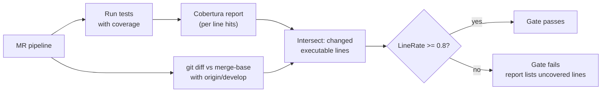

# 11. Diff coverage: testing what you changed

## Why this chapter matters

Coverage questions look simple in interviews ("what coverage do you aim for?"), but they test
judgment: does the candidate know what a coverage number can and cannot say, and can they use it
without turning it into a game? In real work at Smartcat, diff coverage is a **blocking merge gate**
on the monolith: an MR whose new or changed lines are less than 80% covered does not merge. Knowing how
the gate computes its number, how to read its report and how to fix it quickly saves hours on every
second MR.

## What you will be able to do

- Explain line, branch and diff coverage, and why a team gates on diff coverage instead of total coverage.
- Read the Smartcat Diff Coverage report and turn it into a short list of tests to write.
- Produce and read Cobertura coverage locally with coverlet or Microsoft code coverage.
- Avoid the `dotnet test` filter trap and the most common CI coverage failures.
- Explain why coverage is not quality and how mutation testing fills the gap.
- Talk about metrics in an interview without falling into Goodhart's law.

---

## 1. Line, branch and diff coverage

**Line coverage**: the share of executable lines that ran at least once during the tests.
**Branch coverage**: the share of decision outcomes (each side of an `if`, each `case`, each `&&`
short-circuit) that ran at least once. **Diff coverage**: line (or branch) coverage measured **only on
the lines changed by your MR**.

```csharp
public decimal Discount(Customer customer, decimal total)
{
    if (customer.IsVip && total > 1000) return total * 0.1m;   // line A
    return 0;                                                  // line B
}
```

One test with a VIP customer and `total = 2000`:

| Metric | Value | Why |
|---|---|---|
| Line coverage | 50% (A ran, B did not) | Only the `return total * 0.1m` path executed |
| Branch coverage | Low | `IsVip == false`, `total <= 1000` were never taken |

Add a second test with a non-VIP customer: line coverage becomes 100%. But the `total <= 1000` outcome
for a VIP is still never taken. **Branch coverage still shows the gap; line coverage does not.** This is
why "100% line coverage" can hide untested logic, especially on one-line conditions.

What counts as an "executable line": statements the compiler emits sequence points for. Braces,
comments, `using` directives, blank lines, and most auto-property declarations are usually not counted.
Exact rules depend on the tool.

| Kind | Question it answers | Weakness |
|---|---|---|
| Line | Did this line run? | Blind to untaken branches on the same line |
| Branch | Did each decision outcome run? | Noisy in async/iterator code (compiler-generated branches) |
| Method | Was this method called at all? | Very coarse |
| Diff | Did the lines I changed run? | Says nothing about old code or about assertion quality |

**Common mistake:** "the line is green, so the logic is tested". Green means *executed*. It does not
mean any assert checked the result.

---

## 2. Why gate on diff coverage

A large legacy system (the Smartcat monolith is many years old) will never reach a high **total**
coverage number. A total-coverage gate then has two bad outcomes:

- The threshold is low (say 35%), so it blocks nothing.
- The threshold is high, so every MR is blocked by code its author never touched.

Total coverage also moves for the wrong reasons: deleting a well-tested class **lowers** it; adding an
untested DTO in a huge codebase barely changes it.

**Diff coverage** asks a fair, local question: *did you test the code you wrote or changed?*

- **New code must be tested.** The gate applies to every changed executable line.
- **Legacy is not blocking.** Untested old code next to your change does not count against you.
- **It works like a ratchet.** Every MR adds tested code; over time the tested share grows in exactly
  the places that change most, which are also the places where bugs appear.



**Tradeoff:** diff coverage punishes small MRs more. A 5-line change with 1 untested line is at 80%;
with 2 untested lines it fails. In practice this is a feature: small changes are the easiest to test.

**Tip:** if a refactoring moves 300 old untested lines, they become "changed" lines and enter the gate.
Split mechanical moves from behaviour changes, or add characterization tests first (see chapter 10,
section 12).

---

## 3. How coverage is collected in .NET

### 3.1 Tools

| Tool | How you enable it | Output |
|---|---|---|
| coverlet.collector (VSTest data collector) | `dotnet test --collect:"XPlat Code Coverage"` | `TestResults/<guid>/coverage.cobertura.xml` |
| coverlet.msbuild | `dotnet test /p:CollectCoverage=true /p:CoverletOutputFormat=cobertura` | `coverage.cobertura.xml` |
| Microsoft.Testing.Extensions.CodeCoverage (MTP runner) | `dotnet test ... --coverage --coverage-output-format cobertura --coverage-output out.xml` | Cobertura or binary `.coverage` |
| ReportGenerator | `reportgenerator -reports:**/coverage.cobertura.xml -targetdir:coverage-html` | HTML report for humans |

The tools instrument (or profile) the compiled assemblies, run the tests, and record hits per
sequence point. Coverlet rewrites IL; Microsoft code coverage uses a profiler.

**At Smartcat:** test projects use the MTP NUnit runner (see chapter 10, section 14), so the MTP
coverage extension is the natural local choice. The `qa-mutation-analysis` skill collects a C# baseline
this way:

```bash
SC_TESTS_CI_MODE=true dotnet build path/to/Tests.csproj -c Debug
SC_TESTS_CI_MODE=true dotnet test path/to/Tests.csproj --no-build \
  --coverage --coverage-output-format cobertura --coverage-output .test-coverage/baseline.xml
```

### 3.2 Reading Cobertura XML

```xml
<coverage line-rate="0.62" branch-rate="0.48" lines-covered="310" lines-valid="500">
  <packages>
    <package name="Smartcat.ProjectTasksService.Module" line-rate="0.62" branch-rate="0.48">
      <classes>
        <class name="ScopeService" filename="src/ProjectTasks.Module/Services/ScopeService.cs"
               line-rate="0.75" branch-rate="0.5">
          <lines>
            <line number="41" hits="12" branch="false" />
            <line number="42" hits="3" branch="true" condition-coverage="50% (1/2)" />
            <line number="43" hits="0" branch="false" />
          </lines>
        </class>
      </classes>
    </package>
  </packages>
</coverage>
```

- `hits="0"` is an uncovered line.
- `condition-coverage="50% (1/2)"` is a line that ran but only one branch outcome was taken.
- `line-rate` and `branch-rate` are 0..1 fractions.

**Tip:** when a coverage gate surprises you, open the Cobertura file for that one class and look at
the exact line numbers. It is faster than guessing from the IDE colours.

### 3.3 GitLab integration (general)

GitLab can show coverage in the MR diff gutter if a job publishes a Cobertura report:

```yaml
test:
  script: dotnet test ... --collect:"XPlat Code Coverage"
  artifacts:
    reports:
      coverage_report:
        coverage_format: cobertura
        path: "**/coverage.cobertura.xml"
```

This shows **which lines** are covered while you review. It is not a gate by itself. The gate is a
separate job that compares a number with a threshold.

---

## 4. How a diff coverage number is computed

1. **Find the base.** Compute the merge-base of the MR source commit and the target branch
   (`origin/develop`). Comparing with the merge-base, not the current tip of develop, means other
   people's new commits on develop do not enter your diff.
2. **Collect changed lines.** From `git diff merge-base..source`, take the added or modified lines per
   file (deleted lines cannot be covered and do not count).
3. **Intersect with executable lines.** Keep only changed lines that the coverage report knows as
   executable. A changed comment or brace is not counted.
4. **Count.** `LineRate = covered changed lines / total changed executable lines`.
5. **Compare** with the threshold and list uncovered lines per file.

Consequences you should be able to explain:
- Files outside any test-covered assembly (no tests load them) show 0 hits for all lines.
- A changed line inside a method that no test calls is uncovered even if its file has 90% total
  coverage.
- Moving a block of code makes every moved line "changed".

---

## 5. At Smartcat: the diff coverage gate

**At Smartcat (monolith):**
- The blocking job is `Backend/Code Coverage [Diff Line Rate Check]`, stage `TestCoverageAnalysis`,
  run by an internal tool (`smartcat-diff-coverage`). It is **not** allowed to fail.
- Threshold: **`LineRate >= 0.8`** on the changed lines.
- The diff base is the merge-base with `origin/develop`.
- The result is posted on the MR as a **Diff Coverage Status** comment with a JSON body.

### 5.1 Reading the report

```json
{
  "CoveredLines": 8,
  "TotalLines": 16,
  "LineRate": 0.5,
  "UncoveredFiles": [
    {
      "FileName": "Features/Module/SettingsModel.cs",
      "CoveredLines": 0,
      "TotalLines": 1,
      "LineRate": 0,
      "UncoveredLines": "39"
    }
  ]
}
```

| Field | Meaning |
|---|---|
| `CoveredLines` / `TotalLines` | Changed executable lines that ran / all changed executable lines in the MR |
| `LineRate` | Their ratio; the gate needs `>= 0.8` |
| `UncoveredFiles[]` | Only files that have at least one uncovered changed line |
| `UncoveredLines` | The line numbers (in the MR's version of the file) to look at |

How to read it in practice:
- First, check `LineRate`. If it is `>= 0.8`, stop: nothing to do.
- Then sort `UncoveredFiles` by `TotalLines - CoveredLines`. The biggest gaps first.
- A file with `TotalLines: 1` and an uncovered line in a model is often a trivial property. A file with
  20 uncovered lines in a service is your real work.
- How far below the threshold you are tells you how many lines you need: with 8/16, you need at least
  13/16, so at least 5 more lines covered.

### 5.2 The workflow to fix a failing report

From the `backend-smartcat-backend-code-coverage` skill:

1. **Get the changes.** From the MR URL, take project and MR IID; fetch the MR metadata and the
   changed files and diffs. Without an MR and its CI report there is nothing to analyze.
2. **Analyze the report.** Find the Diff Coverage Status comment. If there is none, the pipeline has
   not run yet or the job is still pending.
3. **Map lines to code.** Read each uncovered file at the listed lines. Check if tests already exist
   for that class (`*Tests.cs`). Decide which lines are testable logic and which are trivial.
4. **Write tests** following chapter 10 (BaseTest, FakeItEasy, AAA, `Should_..._when_...`), then run
   them and confirm they pass.
5. **Push and re-check** the new report.

### 5.3 Prioritization

Not all uncovered lines are equal. Write tests in this order:

1. **Business logic**: conditionals, calculations, state transitions.
2. **Error handling**: catch blocks, validation, guard clauses.
3. **Integration points**: API calls, message handlers, repository methods.

Deprioritize:
- DTOs and POCOs with only auto-properties.
- One-line pass-through methods (`return _inner.DoSomething();`).
- Generated code and configuration models.

**Why this order:** the gate counts lines equally, but bugs do not. One test of a state transition
usually covers several lines **and** protects real behaviour. A constructor test for a DTO covers a
line and protects nothing.

### 5.4 A worked example

The report says `Features/Cat/Projects/ProjectArchiver.cs`, `UncoveredLines: "58,61"`. The code:

```csharp
55  public async Task ArchiveAsync(Guid projectId, CancellationToken ct)
56  {
57      var project = await _repository.GetById(projectId, ct)
58          ?? throw new ProjectNotFoundException(projectId);
59
60      if (project.Status == ProjectStatus.Archived)
61          return;
62
63      project.Archive(_time.GetUtcNow());
64      await _repository.Save(project, ct);
65  }
```

Lines 63–64 are covered, so a happy-path test exists. Line 57 also ran (the repository call). The gaps are the "not found" path (58: the
`throw` part of the expression was never reached) and the "already archived" early return (61). Two
tests:

```csharp
[Test]
public void Should_throw_not_found_when_project_does_not_exist()
{
    // Arrange
    A.CallTo(() => _repository.GetById(A<Guid>._, A<CancellationToken>._)).Returns((Project?)null);
    var archiver = Get<ProjectArchiver>();

    // Act
    Func<Task> act = () => archiver.ArchiveAsync(Guid.NewGuid(), CancellationToken.None);

    // Assert
    Assert.ThrowsAsync<ProjectNotFoundException>(act);
}

[Test]
public async Task Should_not_save_when_project_is_already_archived()
{
    // Arrange
    var project = ProjectBuilder.Archived();
    A.CallTo(() => _repository.GetById(project.Id, A<CancellationToken>._)).Returns(project);
    var archiver = Get<ProjectArchiver>();

    // Act
    await archiver.ArchiveAsync(project.Id, CancellationToken.None);

    // Assert
    A.CallTo(() => _repository.Save(A<Project>._, A<CancellationToken>._)).MustNotHaveHappened();
}
```

Both tests protect real behaviour (no silent save of an archived project, a clear error for a missing
one). They were not written "for coverage"; the report only showed where they were missing.

---

## 6. The `dotnet test` filter trap

After writing the tests, you run only them. The trap: when the repo uses the NUnit MTP runner
(`EnableNUnitRunner=true`), a top-level `--filter` is consumed by `dotnet test` and silently ignored.

```bash
# CORRECT: the filter goes after -- so it reaches the NUnit runner
dotnet test <path/to/Tests.csproj> -- --filter "MyTestClass"

# WRONG: may run all tests; the filter is consumed by dotnet/VSTest instead of NUnit
dotnet test <path/to/Tests.csproj> --filter "MyTestClass"
```

Without the MTP runner (classic VSTest), the top-level form is correct:

```bash
dotnet test <path/to/Tests.csproj> --filter "MyTestClass"
```

Two more details from chapter 10 (section 14):
- In Smartcat repos, targeting a bare `.csproj` can fail with `MSB4019` because `$(SolutionDir)` is
  empty. Prefer the `.sln`, or pass `-p:SolutionDir=<repo-root>/`.
- **Check the executed count.** If it equals the whole suite, the filter was ignored.

**Note on sources:** the coverage skill shows a `.csproj` path in its example, while the test-execution
skill says to target the `.sln`. Both agree on the important part: `-- --filter` under MTP. Use the
`.sln` form when the csproj form fails with `MSB4019`.

---

## 7. Troubleshooting

| Problem | Likely cause | Fix |
|---|---|---|
| MR has no Diff Coverage comment | CI pipeline has not run yet, or the job is pending | Wait for CI, or run coverage locally |
| `LineRate` is 0 but all code is trivial | DTOs or models counted as uncovered | `[ExcludeFromCodeCoverage]` on pure data types, or a minimal test that uses them |
| Tests pass but coverage does not improve | Tests do not reach the exact uncovered lines | Re-check `UncoveredLines`; drive the exact branch (the `throw`, the early return) |
| Can't find the test project | Non-standard repo layout | Ask the owner, or search for `*Tests.csproj` referencing the assembly |
| Tests ran, but the report shows 0 for a whole file | No test project loads that assembly, or the test failed before reaching it | Check project references and that the tests really executed (count) |
| Gate crashes with `FindMergeBase ... object not found` | CI shallow clone (see section 8) | Retry the job |

**About `[ExcludeFromCodeCoverage]`:** it is a legitimate tool for generated code and pure data
holders. It is **not** a tool for hiding logic you did not want to test. A reviewer who sees it on a
class with `if` statements will ask why. Use it rarely and explain it in the MR.

---

## 8. CI flakes around the gate

### 8.1 Shallow-clone merge-base: "object not found"

**At Smartcat (observed on monolith MRs):** the diff coverage job sometimes fails **before measuring
anything**:

```
LibGit2Sharp.LibGit2SharpException: object not found - no match for id (<sha>)
   at ObjectDatabase.FindMergeBase(...)
```

What it means: the tool calls `FindMergeBase(origin/develop, source)`. CI checks out a **shallow
clone** (limited history). If the walk needs a commit that is not in the shallow history, LibGit2Sharp
cannot find it.

Why it is environmental, not your code:
- It happens even when the branch is 0 commits behind develop.
- The "missing" commit ID changes from run to run, and it exists in a full local clone.

What to do:
1. **Retry the failed job.** A retry can land on a runner whose clone has the needed history.
2. If the retry fails with the **same** missing ID, stop retrying that job and **start a fresh MR
   pipeline**.
3. **Do not** keep merging or rebasing develop "to refresh the merge-base". The pipeline takes a long
   time, develop moves on, and the error also happens at zero divergence. You lose the race.
4. If it keeps failing: ask DevOps to increase the fetch depth for that job, or let a human decide to
   waive that one gate. The clone depth is set in a shared CI template, not in the repo.

### 8.2 Other flakes

A coverage job usually needs the test job to pass first. A flaky unrelated test (for example a timing
test, or an email template test that fails once in a few thousand runs) blocks the gate too. Treat it
the usual way: confirm the failure is unrelated to your diff (different area, passes on retry, known
flaky), retry, and report it if it repeats.

**Tip:** read the job log before changing code. "The gate failed" can mean "your lines are
uncovered", "the tool crashed", or "an earlier job failed". Only the first one needs tests.

---

## 9. Coverage is not quality

Coverage measures **execution**, not **verification**. This test gives 100% line coverage of
`Discount` and checks nothing:

```csharp
[Test]
public void Should_calculate_discount()
{
    _calculator.Discount(vip, 2000);
    _calculator.Discount(regular, 10);
}
```

Ways tests reach coverage without quality:
- **Assertion-free tests**: the code runs, nothing is checked.
- **Weak assertions**: `Assert.That(result, Is.Not.Null)` on a calculated value.
- **Only call-count assertions** (rule T5 in chapter 10).
- **Asserting what the fake returns**: the test checks the setup, not the code.

### 9.1 Mutation testing

Mutation testing answers: *if I break the code, does a test fail?* A tool (Stryker.NET for C#,
StrykerJS for TypeScript) makes many small changes to the code, called **mutants**: `>` becomes `>=`,
`&&` becomes `||`, a `return x` becomes `return default`, a statement is removed. Then it runs the
tests for each mutant.

- **Killed**: a test failed. Good.
- **Survived**: all tests still passed. The tests do not verify that behaviour.
- **NoCoverage**: no test even runs that code.
- Timeout, CompileError, Ignored: excluded from the score.

```
mutation score = killed / (killed + survived + no_coverage) × 100
```

For `Discount`, the mutant `total > 1000` → `total >= 1000` survives unless a test uses exactly
`total = 1000`. That is a real missing boundary test, which no coverage number shows.

**At Smartcat:** the QA skills (`qa-mutation-analysis`, `qa-cpa-mutation-score`) use this rule for
**coverage theater**:

```
line coverage >= 80%  AND  mutation score < 60%   →   theater flag
```

High coverage with a low mutation score means the tests run the code but do not check it.

Practical rules from those skills:
- **Never run Stryker on the whole repo.** It is slow (every mutant reruns tests). Run it per file with
  `--mutate` on a sample.
- Sample across coverage buckets: some high-coverage files (to detect theater), some medium (most
  actionable), a few low (to see the floor).
- A practical target in those skills is around 70% mutation score, not 100%. Some mutants are
  equivalent (they do not change behaviour) and can never be killed.

### 9.2 Risk-weighted coverage

The critical-path analysis skills (`qa-cpa-coverage-analysis`) do not ask "what is the coverage
percentage?". They classify components by impact (for example *Fatal* or *Corrupt* when a failure
loses or corrupts customer data) and only then check if the **key code paths and branches** of those
components are tested: **RED** (no tests), **YELLOW** (some paths), **GREEN** (all public methods and key
branches). They also cross-reference bug tickets with untested paths. This is the mature view:
coverage is a tool to find **untested risk**, not a score.

---

## 10. Designing code so it is coverable

Hard-to-cover lines are usually a design signal. If a line can only run when the real clock passes
midnight, or when a real HTTP call times out, no unit test can reach it cheaply. The fix is a **seam**:
a place where the test can control the behaviour.

```csharp
// HARD TO COVER: hidden time, hidden HTTP, catch block unreachable in tests
public class ReportSender
{
    public async Task SendAsync(Report report)
    {
        if (DateTime.UtcNow.Hour < 6) return;                 // depends on when CI runs
        using var http = new HttpClient();                    // real network
        try { await http.PostAsJsonAsync("https://reports/api", report); }
        catch (HttpRequestException) { report.MarkFailed(); } // only on real network errors
    }
}

// COVERABLE: time and the external API are injected
public class ReportSender(TimeProvider time, IReportsApi api)
{
    public async Task SendAsync(Report report, CancellationToken ct)
    {
        if (time.GetUtcNow().Hour < 6) return;
        try { await api.Send(report, ct); }
        catch (HttpRequestException) { report.MarkFailed(); }
    }
}
```

Now each line has a cheap test: `FakeTimeProvider` at 05:00 and at 07:00, and a FakeItEasy
`.Throws(new HttpRequestException())` for the catch block.

Other design habits that make coverage come naturally:
- **Small methods with one decision each.** Fewer combinations per test.
- **Pure functions for calculations.** Input in, value out, no setup.
- **No error handling for impossible scenarios.** Defensive code for cases that cannot happen creates
  lines no test can reach. Fail fast with a clear exception at the boundary instead.
- **Keep wiring thin.** Startup and DI registration are covered by one component test; logic belongs in
  classes that unit tests can create.

See chapter 10 (section 7, "Mock only at seams") for what to fake at those seams.

---

## 11. Talking about metrics: Goodhart's law

**Goodhart's law**: *when a measure becomes a target, it stops being a good measure.* People optimize
the number, not the thing the number was supposed to show.

Coverage is a textbook case:
- A team with a "90% coverage" target writes assertion-free tests and constructor tests for DTOs.
- A team that sees coverage as a **signal** asks "which risky paths are not tested?" and writes fewer,
  better tests.

How a strong candidate talks about it:
- **Coverage is a floor detector, not a quality score.** Low coverage tells you something is
  untested. High coverage does not tell you the tests are good.
- **Gate the change, not the codebase.** Diff coverage keeps new code tested without blocking on legacy.
- **Pair it with a quality signal.** Mutation score on samples, review rules (does the regression test
  fail without the fix?), escaped-defect trends.
- **Never use it to rank people.** It immediately becomes a target and gets gamed.
- **Choose the threshold from cost.** 80% on changed lines leaves room for trivial lines and
  generated code; 100% would push people to `[ExcludeFromCodeCoverage]` or to silly tests.

**Interviewer view:** "What coverage percentage should we have?" has no single right number. A strong
answer moves the question from *how much* to *what*: which risks, which code paths, which changes.

---

## At Smartcat (summary)

- The monolith's backend MR pipeline has a **blocking** diff coverage gate:
  `Backend/Code Coverage [Diff Line Rate Check]`, threshold `LineRate >= 0.8` on changed lines, base =
  merge-base with `origin/develop`.
- The result is a **Diff Coverage Status** JSON comment on the MR: `CoveredLines`, `TotalLines`,
  `LineRate`, `UncoveredFiles[]` with `UncoveredLines`.
- Fixing workflow (skill `backend-smartcat-backend-code-coverage`): get MR changes → read the report →
  read uncovered lines → write tests with the chapter 10 conventions → run them → push.
- Prioritize business logic, then error handling, then integration points; deprioritize DTOs,
  pass-throughs, generated code.
- Run new tests with `-- --filter` under the MTP runner; check the executed count.
- `FindMergeBase ... object not found` = shallow-clone flake: retry the job; if the same ID repeats,
  start a fresh MR pipeline; do not keep rebasing.
- QA skills add mutation testing (Stryker, per-file `--mutate`) and a coverage-theater flag (line ≥ 80%
  and mutation < 60%).

---

## Interview corner

### As the interviewee

1. **What is the difference between line and branch coverage? Give an example where they differ.**
   A strong answer covers:
   - Line = executed lines; branch = decision outcomes taken.
   - `if (a && b) return x;` on one line: one test makes the line green, but outcomes stay untested.
   - Branch coverage is noisier in async/iterator code.

2. **What is diff coverage and why would a team gate on it instead of total coverage?**
   - Coverage of changed lines only.
   - Fair to the author, does not block on legacy, works as a ratchet in the code that changes most.
   - Total coverage moves for wrong reasons (deleting tested code lowers it).

3. **How is the diff coverage number computed?**
   - Merge-base with the target branch, changed lines from the diff, intersected with executable lines
     in the coverage report, `covered / total`.
   - Deleted lines and non-executable lines do not count.

4. **Your MR fails the diff coverage gate at 0.62. What do you do?**
   - Read the report, list uncovered lines per file, sort by size.
   - Map lines to code; separate logic from trivial lines.
   - Write tests for logic and error paths first; run with the right filter; push.
   - Check the job log first, in case the tool crashed instead.

5. **Tests pass and you added new tests, but the coverage number did not change. Why?**
   - The tests do not reach the exact lines (another branch, an earlier return, the `throw` part of an
     expression).
   - The test project does not load that assembly, or the filter ran different tests.

6. **Is 100% coverage a good goal?**
   - No; Goodhart's law; tests without assertions; equivalent mutants; cost grows sharply near 100%.
   - Use coverage to find untested risk; pair with mutation testing and review.

7. **What is mutation testing, and what does a surviving mutant tell you?**
   - Small code changes (operators, conditions, removed statements); tests should fail.
   - Survived = tests run the code but do not check that behaviour; often a missing boundary assert.
   - Score = killed / (killed + survived + no coverage).

8. **How do you collect coverage locally for a .NET project?**
   - coverlet (`--collect:"XPlat Code Coverage"`) or MTP code coverage (`--coverage
     --coverage-output-format cobertura`).
   - Read Cobertura XML or render with ReportGenerator.

9. **When is `[ExcludeFromCodeCoverage]` acceptable?**
   - Generated code and pure data holders.
   - Not to hide logic; explain it in the MR.

10. **The coverage job fails with `FindMergeBase ... object not found`. What is it and what do you do?**
    - Shallow clone in CI lacks a commit the merge-base walk needs; environmental.
    - Retry; if the same ID repeats, a fresh pipeline; do not keep rebasing; escalate the fetch depth.

11. **How do you design code so it is easy to cover?**
    - Inject time, HTTP clients and other external effects (seams).
    - Small methods, pure calculations, no defensive code for impossible states.

12. **How do you talk to a manager who wants "90% coverage by Q3"?**
    - Agree on the real goal (fewer escaped bugs, safe changes).
    - Propose diff coverage on new code plus risk-based testing of critical paths.
    - Offer quality signals (mutation score samples, regression tests per incident).

### As the interviewer

**What to ask:** show a short method and one test that "covers" it 100% with a weak assertion. Ask:
"Is this method tested?"

**Depth probes:**
- "Which mutant would survive here?"
- "Why compare with the merge-base and not with the tip of develop?"
- "A refactoring MR moves 400 untested lines and fails the gate. What do you do?"
- "How would you choose the threshold for a diff coverage gate?"
- "What else would you measure next to coverage, and how would you stop people gaming it?"

**Green flags:**
- Separates *executed* from *verified* without being prompted.
- Knows branch coverage and gives a concrete one-line example.
- Fixes a coverage gap with tests that protect behaviour, not tests that touch lines.
- Reads the CI log before writing tests; recognizes infrastructure failures.
- Mentions Goodhart's law or the same idea in their own words.

**Red flags:**
- "We had 95% coverage, so the code was well tested."
- Proposes `[ExcludeFromCodeCoverage]` or deleting tests to pass a gate.
- Writes assertion-free tests "just for the gate".
- Keeps rebasing to fix a CI tool crash.

**Scoring rubric:**

| Signal | Junior | Senior | Staff |
|---|---|---|---|
| Definitions | Knows line coverage | Line vs branch vs diff, with examples | Explains instrumentation, merge-base, executable lines |
| Using the gate | Writes any test that turns lines green | Prioritizes logic and error paths | Shapes the code and the gate (threshold, exclusions) so it measures the right thing |
| Quality | Trusts the number | Knows assertion-free tests and mutation testing | Combines coverage, mutation samples and risk maps into a test strategy |
| CI issues | Re-pushes until green | Reads logs, retries flakes | Finds the root cause (shallow clone) and gets it fixed for everyone |
| Metrics talk | "More is better" | Mentions Goodhart's law | Moves the conversation from a percentage to risk and change safety |

---

## Exercises

1. **Read a report.** The Diff Coverage comment shows `CoveredLines: 21, TotalLines: 30, LineRate: 0.7`
   with two files: `ScopeService.cs` (7 uncovered of 12) and `ScopeDto.cs` (2 uncovered of 2). What is
   the minimum number of lines you must cover, and where do you start?

2. **Branch vs line.** Write a method where one test gives 100% line coverage but 50% branch coverage.
   Then write the second test.

3. **Kill the mutant.** For `bool IsOverdue(DateTimeOffset deadline) => _time.GetUtcNow() > deadline;`,
   which mutant survives if your only tests use "one day before" and "one day after"? Write the test
   that kills it.

4. **Make it coverable.** A class calls `File.ReadAllText("/etc/app/limits.json")` inside a method that
   also contains the limit logic. Redesign it so every line can be covered by unit tests.

5. **CI triage.** The gate failed twice with `object not found - no match for id (e4c1...)`, the same
   ID both times. Your colleague wants to rebase on develop again. What do you do instead, and why?

6. **Metric debate.** Write three sentences you would say in a design review against a "95% total
   coverage" target for the monolith, and propose an alternative.

<details>
<summary>Answer notes</summary>

1. The gate needs `>= 0.8 × 30 = 24` covered lines, so at least **3 more**. Start with `ScopeService.cs`
   (logic, 7 uncovered lines); tests for its branches will likely cover 3+ lines and protect behaviour.
   The DTO lines are trivial; cover them only if they appear naturally in a service test, or exclude a
   pure data type with an explanation.

2. Example: `public int Clamp(int x) { if (x > 100) x = 100; return x; }` written with the `if` and its
   statement on one line. A test with `x = 150` executes every line; the "not greater than 100" outcome
   is never taken. Second test: `x = 50`, assert 50.

3. The mutant `>` → `>=` survives: both tests give the same result for `>` and `>=`. Kill it with a test
   where `GetUtcNow()` equals `deadline` exactly (use `FakeTimeProvider` set to the deadline) and assert
   `IsOverdue` is `false`.

4. Inject the source of the limits: an `ILimitsSource` (or `IOptions<LimitsSettings>` bound from config)
   that the logic class receives. The logic becomes a pure method over a `Limits` object; the file
   reading lives in a thin adapter covered by one integration test (or by the configuration system).
   Unit tests pass `Limits` directly.

5. The error is the shallow-clone merge-base flake, not a coverage problem. Same ID twice means retrying
   the job is not helping: start a **fresh MR pipeline**. Rebasing does not help: it fails also at zero
   divergence, and develop moves while the long pipeline runs. If it continues, ask DevOps to raise the
   fetch depth for that job, or let a human decide to waive this one gate.

6. Example: "A total target punishes every MR for legacy code its author never touched, and it moves
   for wrong reasons, for example when we delete tested code. Teams under a total target write tests
   that run code without checking it, so the number goes up and the safety does not. I propose we keep
   the 80% diff coverage gate on changed lines, add mutation-testing samples on our critical-path
   components, and require a failing-first regression test for every production bug."

</details>

---

## Summary

- Line coverage = executed lines; branch coverage = taken decision outcomes; diff coverage = coverage of
  the lines you changed.
- Gate on diff coverage: new code must be tested, legacy does not block, the tested share grows where
  code changes.
- The number = covered changed executable lines / all changed executable lines, against the merge-base.
- At Smartcat the monolith gate needs `LineRate >= 0.8` and posts a JSON report with uncovered lines per file.
- Fix order: business logic, then error handling, then integration points; DTOs and pass-throughs last.
- Under the MTP runner use `-- --filter`, and check the executed test count.
- `FindMergeBase ... object not found` is a shallow-clone flake: retry the job, then a fresh pipeline;
  do not keep rebasing.
- Coverage shows execution, not verification; mutation testing shows if tests really check behaviour.
- Hard-to-cover code is a design signal: add seams for time, I/O and external services.
- Goodhart's law: a coverage target gets gamed; use coverage as a signal to find untested risk.

Anki deck: anki/11-diff-coverage.txt
