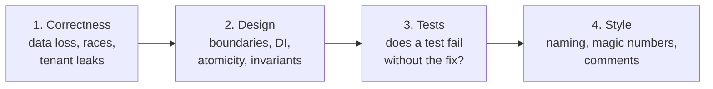

# 12. Code review from both sides of the MR

## Why this chapter matters

Many .NET interviews now have a "code review exercise": you get a diff or a class, and 20–30
minutes to review it aloud. It tests more than knowledge. It tests priorities (do you find the
data-loss bug before the naming issue?), communication (can you say what is wrong without
sounding hostile?) and judgment (is this a blocker or a nit?). In real work, review is where most
knowledge moves between engineers. Reviewers protect production; authors learn the codebase. Both
sides have skills, and both sides can be practiced.

## What you will be able to do

- Review a .NET diff in a fixed order: correctness, then design, then tests, then style.
- Assign BLOCKER / MAJOR / MINOR / NIT and defend the level with a failure scenario.
- Apply the Smartcat backend checklist (style, tests, tasks, events, migrations) and the
  architecture rules (A-series) by theme.
- Write short, clear review comments that explain why and propose a fix.
- Receive review well: verify each point against the code, answer with evidence, keep MRs small.
- Run and pass a code review interview exercise.

---

## 1. What a good review looks for, in order

Reviewers have limited attention. Spend it where the risk is. The order:



| Step | Questions | Example findings |
|---|---|---|
| 1. Correctness | Does it do what the ticket says? What happens on retry, on concurrency, on missing data, on another tenant? | lost events, task never completes, `Single()` on duplicates, missing `accountId` filter |
| 2. Design | Is it in the right layer? Lifetimes correct? One atomic operation? Invariant inside the aggregate? | singleton with scoped dependency, N+1, multi-doc update without atomicity |
| 3. Tests | Is the new behavior tested? Does a test fail when the fix is reverted? Are edge cases (null, missing, zero) covered? | new handler without test, bug fix without regression test |
| 4. Style | Does it follow repo conventions? | camelCase private method, magic number, stale TODO |

**Why this order?** Style findings are cheap to find and cheap to fix. If you start with style,
you fill your attention and the comment thread with 20 nits, and the one data-loss bug hides
between them. The author also fixes the easy nits first and feels "done".

Tip: before reading the diff, read the ticket and the MR description. You cannot judge
correctness without knowing the intent. The Smartcat review bot does the same: it extracts the
`SUPPORT-12345`-style ID from the title and loads the ticket first.

Second tip: **do not review the diff in isolation.** Open the full file and the callers. A diff
shows what changed. It does not show the caller that now gets `null`, or the second
implementation of the interface that was not updated.

Common mistake: "LGTM" after reading only the green lines. Removed lines matter too. A removed
`if` or a removed `await` is often the bug.

---

## 2. Severity levels and how to calibrate them

### 2.1 The four levels

| Level | Meaning | Merge? | Typical examples |
|---|---|---|---|
| **BLOCKER** | will break production, lose data, leak data, or break the contract | no | DI lifetime mixing (A1), pre-release NuGet (D11), MR claims a change the diff lacks (D27), new handler without any test (T1), workflow trigger without idempotency key (A34) |
| **MAJOR** | real bug or design risk under realistic conditions | not without a fix or an agreed follow-up | N+1 on a hot path (A20), multi-doc update without atomicity (A22), exception as success (D8), dead code (D2), missing regression test (T11) |
| **MINOR** | quality issue; costs maintenance, not correctness | author decides; usually fixed | magic numbers (D1), raw `IConfiguration` (D5), naming drift (D17) |
| **NIT** | taste or polish | optional | tab indentation (D12), `Async` suffix (D15), `Where().Any()` (D9) |

The general Smartcat review bot uses a three-level report: **Critical** (must fix), **Warning**
(should fix), **Suggestion**. It maps roughly to BLOCKER+MAJOR / MINOR / NIT. Status logic: any
Critical means "NEEDS CHANGES"; only warnings and suggestions mean "APPROVED with notes".

### 2.2 Calibration: three questions

For every finding, answer:

1. **What is the failure scenario?** Say it in one sentence: "When two pods process the same
   event, the counter is incremented twice." If you cannot say it, the finding is probably a NIT.
2. **How likely is it?** Every request, under load only, on a rare data shape, never in practice?
3. **How bad and how reversible?** Lost data and cross-tenant leaks are not reversible. A slow
   page is. A wrong log message is trivial.

| Impact \ Likelihood | Every request | Under load / retries | Rare data shape |
|---|---|---|---|
| Data loss, leak, security | BLOCKER | BLOCKER | MAJOR or BLOCKER |
| Wrong result, stuck task | BLOCKER | MAJOR | MAJOR |
| Performance | MAJOR | MAJOR | MINOR |
| Readability | MINOR | MINOR | NIT |

**Rules for calibration:**

- **Do not inflate.** If everything is a BLOCKER, nothing is. Authors learn to ignore you.
- **Do not deflate to be nice.** A cross-tenant query is a BLOCKER even if the MR is for a
  "small fix".
- **Context changes the level.** Rule D1 (magic number) is MINOR. A38 (magic TTL for a
  distributed lock) is also MINOR, but if the TTL is shorter than the operation, it is a correctness
  bug and becomes MAJOR. Severity follows the consequence, not the rule number.
- **Existing patterns lower the level.** If the whole module does it the same way, a deviation in
  this MR is at most MINOR, and fixing the module is a separate ticket.
- **Some rules escalate.** Example from the team's test rules: a test that reads private members
  by reflection is MINOR by default, but MAJOR when the test project already has
  `InternalsVisibleTo`, because the clean fix was a one-word change.

### 2.3 Say the level in the comment

```text
MAJOR: this loop awaits one Mongo read per scope. On a project with 5k documents that is 5k
round trips. Load all scopes with one FindByIds and zip them back.

NIT (optional): Where(...).Any() can be Any(...).
```

Why: the author needs to know what blocks the merge. "Optional" on NITs removes stress and saves
a review round.

---

## 3. The Smartcat backend checklist

This is the checklist from the team's backend review skill. Use it as a final pass after the
correctness reading.

### 3.1 Style (details in chapter 02 (Code style and naming))

- Private methods `camelCase` (monolith, PTS); private fields `_camelCase`.
- Meaningful lambda names when the parameter is used.
- Mongo models: `required` + `init`, explicit `[BsonElement("camelCase")]`, enums as strings.
- Separate DB entity, API request, API response.
- New indexes `IDX_` / `UDX_`; keep existing `IX_` names.
- No magic numbers; `#nullable enable` in new monolith files; no dot at end of comments; local
  functions only when they simplify a lot.

### 3.2 Unit tests (details in chapter 10 (Unit and integration testing))

- Name: `Should_do_something_when_condition` (`Should_throw_when_name_is_empty`).
- AAA: `// Arrange`, `// Act`, `// Assert` with blank lines; one Act; no shared mutable state.
- Base classes: `BaseTest` (mocks, no DB), `BaseEphemeralMongoTest` (fast in-memory DB),
  `BaseMongoTest` (Docker integration).
- Prefer asserting state over call counts (T5). Do not mock the class under test's new
  collaborators introduced in the same MR (T6). Inject time and Guid sources (T8).
- No reflection into non-public members (`GetField(..., BindingFlags.NonPublic)`,
  `[UnsafeAccessor]`). Test through the public API, or extract the hidden dependency.

### 3.3 Task processing (details in chapter 08 (Background task processing))

```text
Sleep -> InProgress -> Closed / Manual
            ^
     RecaptureTimeout
```

| Check | Why it matters |
|---|---|
| Every path ends with `Completed.Now()` / `Completed.After(delay)` | otherwise the task hangs forever (a Critical finding) |
| Retries use `Rescheduled(reason)` / `TaskRetryPolicy` | transient errors must not close the task |
| Manual state through an exception | a human must look; do not silently loop |
| `OrdinaryTask` / `SingletonTask` (with `SingletonLock`) / `StickyTask` (consistent `StickyKey`) | wrong type = duplicates or no progress |
| `FairnessHash` set when one tenant can flood the queue | otherwise one big customer starves everyone else |
| `TierKey` for gradual (canary) rollout | lets a risky change reach some tenants first |
| Long operations: batching, timeout protection, state persisted | a crash mid-way must resume, not restart from zero |
| Partial failures stored in task state | never "complete" silently with half the work done |

### 3.4 Domain events and Kafka (details in chapter 07 (Domain events, the Outbox pattern and Kafka))

```csharp
// CRITICAL: append events, never overwrite them
await _outbox.PushEach(projectId, events);
```

| Check | Why |
|---|---|
| `PushEach`, never `Set` for outbox events | `Set` overwrites events that are not yet published: lost messages |
| Batch limits on idempotency keys per message | one huge message can exceed limits |
| `EventWithIdempotencyKeyBase` for idempotent handlers | Kafka delivers at least once; duplicates are normal |
| `[MqEvent(typeof(X), ConsumerSet = "my-handler")]` matches the handler purpose | consumer sets define offsets; a copy-pasted name shares offsets with another handler |
| DLQ strategy for failures | a poison message must not block the partition forever |

### 3.5 Migrations (details in chapter 09 (MongoDB models, indexes and safe migrations))

| Phase | What belongs there |
|---|---|
| **Before release** | add nullable fields, new indexes, new collections |
| **After release** | remove deprecated fields, drop old indexes, cleanup |

- Index creation: `SafeCreateIndex` in a repository (throws if the collection is not empty, so it is
  for new collections), `EnsureIndexAsync` in migrations (idempotent).
- Two-phase deployment for breaking changes: phase 1 adds the nullable field and dual read/write;
  phase 2 migrates data, requires the field, removes the old one.
- Backward compatible (old code works with new schema) **and** forward compatible (new code works
  with old data). During a rolling deploy both versions run at the same time.

### 3.6 General checks from real MR history

The backend reviewer's rule table is mined from real MRs. The high-value ones:

| Check | Level | Why |
|---|---|---|
| `Single()` on a collection that can have duplicates | Critical | throws in production on the first duplicate |
| Auth must consider all roles, including freelancers/external users | Critical | unauthorized access |
| Tenant/account id in every Mongo filter | Critical | cross-tenant leak **and** a full scan without the index |
| Upsert without `DuplicateKeyException` handling | Critical | two concurrent upserts race; one fails |
| Release a preliminary version before adding new fields | Warning | rollback to old code must still read new documents |
| Business logic in controllers | Warning | hard to test and reuse |
| Cache key includes all request parameters | Warning | stale or wrong data for other parameters |
| Cache operations wrapped with fallback | Warning | a cache failure must not fail the request |
| Caught exceptions logged with context | Warning | silent swallow = invisible incident |
| Batch reads, DB projections, `HashSet` lookups | Warning/Suggestion | performance at scale |
| PATCH/PUT for updates; keep old endpoints until deprecated | Warning | contract hygiene and backward compatibility |
| Remove TODOs before merge | Warning | debt never paid |

---

## 4. Architecture rules by theme (A-series)

The A-series (A1–A39) comes from the review skill for the AI agents service, but most rules apply to
every Smartcat .NET service. Learn them by theme, not by number.

### 4.1 DI lifetimes and composition

| Rule | Pattern | Level |
|---|---|---|
| A1 | same interface registered with two lifetimes; singleton with a scoped dependency; `IHttpContextAccessor` in a singleton used by background workers | BLOCKER |
| A2 | behavior depends on the implicit order of `services.AddX()` or `IHostedService.StartAsync` | MAJOR |
| A6 | `AddHttpClient<TClient>` with config inline in the consumer instead of an `AddXClient()` extension in the client library | MAJOR |
| A16 | `IServiceProvider` injected into a non-factory class (service locator) | MAJOR |
| A17 | a new hand-written `*Client` where a generated SDK exists | MAJOR |
| A19 | registry depends on policy and policy on registry (cycle) | MAJOR |

```csharp
// BAD (A1): captive dependency. The scoped DbContext-like object lives forever
services.AddScoped<IUnitOfWork, MongoUnitOfWork>();
services.AddSingleton<IReportService, ReportService>(); // ReportService(IUnitOfWork uow)

// GOOD: match lifetimes, or create a scope per operation
public sealed class ReportService(IServiceScopeFactory scopeFactory) : IReportService
{
	public async Task Build(Guid reportId, CancellationToken ct)
	{
		await using var scope = scopeFactory.CreateAsyncScope();
		var uow = scope.ServiceProvider.GetRequiredService<IUnitOfWork>();
		// ...
	}
}
```

Why BLOCKER: it compiles, it passes unit tests, and it fails under load (shared state between
requests, disposed objects). `ValidateScopes` in Development catches some cases; background
workers often escape it. See chapter 05 (ASP.NET Core).

A2 question to ask in review: **"What guarantees this order?"** If the answer is "the line order in
`Module.cs`", it will break the day someone sorts the lines.

### 4.2 Cross-pod state and background runs

Smartcat services run several pods. Anything stored in one pod's memory is invisible to the others
and lost on restart.

| Rule | Pattern | Level |
|---|---|---|
| A3 | lambdas, `Func<>` instances or anonymous types used as identity (node IDs, keys) | MAJOR |
| A18 | per-pod `IMemoryCache` in checkpointed or cross-pod flows | MAJOR |
| A23 | singleton repository with hidden per-request state (`AsyncLocal`, `HttpContext` in a field) | MAJOR |
| A4 | background handlers keyed only by `runId`, without `(workspaceId, conversationId)` | MAJOR |
| A9 | `HttpContext` state (feature flags, culture) snapshotted into a background run record | MAJOR |
| A7 | one handler for both "user cancelled" and "worker lost" | MAJOR |
| A11 | lock renewer treats every exception as "lock lost" | MAJOR |

Why A9 matters: the run may execute hours later, on another pod. The flag may have changed.
Store identity (`accountId`, `workspaceId`) and re-resolve flags in the background context.

Why A11 matters: a network glitch during renewal is not the same as another pod taking the lock.
Treating both the same either kills healthy runs (too strict) or lets two pods work at once.
Classify: logical lock-lost = stop; infrastructure error = retry with backoff. See chapter 04
(Multithreading, concurrency and distributed locks).

### 4.3 MongoDB: atomicity, N+1, scans, 16 MB, indexes

| Rule | Pattern | Level |
|---|---|---|
| A20 | `foreach (...) await repo.Get(id)` on a hot path (N+1) | MAJOR |
| A21 | `Find(Filter.Empty)` without paging; unbounded `GetAll()`; in-memory `GroupBy` | MAJOR |
| A22 | several `UpdateOne`/`DeleteOne` calls that together form one atomic intent | MAJOR |
| A29 | one document that grows without limit (`$push` to a per-tenant array) toward 16 MB | MAJOR |
| A10 | new field filtered with `Eq` without handling "missing" in old documents | MINOR |
| A24 | the same index created in warmup `SafeCreateIndex` and in a migration without a clear owner | MINOR |
| A25 | a new index only in a migration, with no `SafeCreateIndex` entry: fresh environments miss it | MAJOR |
| A26 | new unique index on a nullable field that is backfilled later, without a partial filter | MINOR |
| A27 | unique index on `Name`/`Key`/`Slug` without the tenant co-key | MINOR |
| A28 | `if (await Exists(x)) throw; await Insert(x);` (TOCTOU) on a path with a unique index | MINOR |

```csharp
// BAD (A20): N+1
foreach (var task in tasks)
{
	var scope = await _scopes.Get(task.ScopeId, ct);
	result.Add(Map(task, scope));
}

// GOOD: one query, zip in memory
var scopeIds = tasks.Select(task => task.ScopeId).Distinct().ToArray();
var scopes = (await _scopes.GetByIds(scopeIds, ct)).ToDictionary(scope => scope.Id);
var result = tasks.Select(task => Map(task, scopes[task.ScopeId])).ToList();
```

```csharp
// BAD (A28): check-then-insert race; two requests both pass the check
if (await _templates.ExistsByName(accountId, name, ct))
	throw new DuplicateTemplateException(name);
await _templates.Insert(template, ct);

// GOOD: let the unique index (UDX_AccountId_Name) decide, map the error
try
{
	await _templates.Insert(template, ct);
}
catch (MongoWriteException ex) when (ex.WriteError.Category == ServerErrorCategory.DuplicateKey)
{
	throw new DuplicateTemplateException(name);
}
```

Why A22: if the process dies between update 3 and update 4, the data is half-changed and no code
knows how to repair it. Use `UpdateManyAsync` with array filters, a single-document design, or a
transaction (`IClientSessionHandle`) when the intent spans documents.

Why A29: MongoDB has a hard 16 MB document limit. Long before the limit, big documents are slow to
read, write and replicate. Per-entry rows scale; one growing document does not.

A10 / T4 detail: "null", "missing" and "zero" are three states in MongoDB. `Filter.Eq(x =>
x.Version, 0)` does not match documents where `version` does not exist. Use
`Or(Eq(Version, current), Exists(false))` or backfill.

### 4.4 Invariants, domain design and service shape

| Rule | Pattern | Level |
|---|---|---|
| A31 | invariant checked only by callers (`if (x.Status == Active)` in 2+ places) | MAJOR |
| A5 | partial class files > 50 lines each; class with > 5 public + > 10 private methods | MINOR |
| A13 / A15 | a tool/endpoint method with I/O inline or > 60 lines of orchestration | MAJOR |
| A14 | the same "build payload, call, parse" in 3+ classes | MAJOR |
| A12 | a stream adapter (SSE proxy) that also does side effects | MAJOR |
| A8 | status as empty classes instead of an enum | MINOR |

```csharp
// BAD (A31): every caller must remember the rule
if (scope.Status == ScopeStatus.Active)
	scope.Complete(now);

// GOOD: the aggregate protects itself
public void Complete(DateTime now)
{
	if (Status != ScopeStatus.Active)
		throw new InvariantViolationException($"Scope {Id} is {Status}, cannot complete");
	Status = ScopeStatus.Completed;
	CompletedAt = now;
}
```

Why: the third caller, written a year later, will forget the check. An invariant that lives in
the object cannot be forgotten.

### 4.5 Idempotency and replay

| Rule | Pattern | Level |
|---|---|---|
| A34 | a workflow started from a UI confirmation without an idempotency key | BLOCKER |
| A35 | a re-entry or rejection path that does not carry the prior decision | MAJOR |
| T14 | a fix to state-update or queueing logic without a "process the same input twice" test | MAJOR |
| T17 | a new retry loop without a test that it gives up after N attempts | MAJOR |

Why A34 is a BLOCKER: users double-click; browsers retry; gateways retry. Without a key derived
from the confirmation ID, one click can start two workflows that both send emails or spend money.

### 4.6 Failure handling and circuit breakers

| Rule | Pattern | Level |
|---|---|---|
| A30 | a circuit breaker that counts all exceptions, including user-input errors | MAJOR |
| A7 | cancellation reason not distinguished | MAJOR |
| A39 | a TTL field without a written contract (writer, cleaner, staleness, crash) | MAJOR |
| A38 | TTL/lease durations as inline numbers | MINOR |

```csharp
// BAD (A30): one bad file from one customer opens the breaker for everyone
catch (Exception)
{
	if (++_consecutiveFailures > _threshold)
		_breaker.Open();
	throw;
}

// GOOD: only infrastructure failures count
catch (Exception ex) when (isInfrastructureFailure(ex))
{
	if (++_consecutiveFailures > _threshold)
		_breaker.Open();
	throw;
}
```

The comment on the rule calls this "DoS-self": a single user can deny service to all users by
uploading broken input repeatedly.

### 4.7 AI-agent-specific rules (know they exist)

A32/A33 (normalize system/developer roles in loaded chat history, in one extension method), A36
(make "null" explicit in LLM payloads instead of omitting it), A37 (tool names as constants). They
matter for the AI services; in an interview for a general .NET role, knowing the principle
("centralize one normalization step", "make absence explicit") is enough.

---

## 5. How to write review comments

### 5.1 The shape

A good comment has three parts and fits in **1–2 lines**:

1. **Level** (BLOCKER / MAJOR / MINOR / NIT).
2. **What and why**: the failure scenario, not the rule name only.
3. **Proposed fix**: concrete, ideally code.

```text
BAD:  This is wrong.
BAD:  Why did you do it like this??
BAD:  Rule A22.
GOOD: MAJOR: if the pod dies after the 2nd UpdateOne, the stages stay half-moved.
      One UpdateMany with an array filter keeps it atomic.
```

### 5.2 Language rules (written for a team of non-native English readers)

At Smartcat most engineers read English as a second language. Comments must be easy to read for
them:

- Short sentences, one idea each, active voice.
- No idioms, phrasal verbs or slang: "this fails", not "this blows up"; "remove", not "get rid of".
- Plain words: "use", not "leverage"; "check", not "sanity-check".
- Keep technical terms (N+1, idempotent, DI). Explain any other term once.
- Respect the line width of the repo (120 in the monolith) for code comments in the diff.

### 5.3 Tone

- **Talk about the code, not the person.** "This loop issues one query per item", not "you
  wrote an N+1".
- **Ask when you are not sure.** "Can `scopes` contain the same id twice? If yes, `Single()` throws."
  A question is not weaker; it is honest.
- **Say what is good.** The review bot report has a "Positive observations" section for a reason:
  it tells the author which patterns to keep.
- **One comment per issue.** If the same issue appears 12 times, comment once: "Same in 11 other
  places in this file."

### 5.4 What not to comment

From the team's review agent rules:

- Do not nitpick formatting that the linter handles.
- Do not review commented-out code; ask to delete it.
- Do not suggest unrelated refactoring in this MR. Open a ticket.
- Do not post unverified examples. Re-check that your "current" and "should be" are actually
  different, and that hardcoded strings you quote exist in the source.

### 5.5 Code comments added in the MR

Code comments in the diff follow the same idea: 1–2 lines, the *why*, not the mechanics. Production
logic has no inline comments unless one is truly needed (see chapter 02). Longer reasoning goes to
the MR description.

---

## 6. How to receive review

### 6.1 Verify each point against the code

A reviewer can be wrong. You can be wrong. Feelings decide neither. For each comment:

1. **Read the code again** at the commented line, and the callers.
2. **Reproduce if you can**: write the test the reviewer implies. If it fails, the point is valid.
3. **Decide**: agree and fix, agree and defer (with a ticket), or disagree with evidence.
4. **Reply with the result**, short: "Fixed in a1b2c3d: added the `accountId` filter and a test."
   or "Checked: `scopes` comes from a unique index `UDX_TaskId`, so duplicates are impossible.
   Keeping `Single()`."

A useful habit: make a small table for yourself before answering.

| # | Point | Valid? | Evidence | Action |
|---|---|---|---|---|
| 1 | N+1 in `BuildReport` | yes | 1 query per scope, seen in test log | batch read |
| 2 | rename `Get` to `GetAsync` | no | repo convention: no suffix (0 of 230 methods) | reply with evidence |
| 3 | missing test for retry limit | yes | none found | add test (T17) |

### 6.2 Do not argue by feeling

- "I think it is fine" is not an answer. "It is fine because X, and here is the test" is.
- If you disagree on taste, follow the repo convention and move on. Taste debates belong in a team
  meeting, once, not in every MR.
- Do not resolve the reviewer's thread yourself. Reply and let the author of the thread resolve it.
  This keeps the reviewer in control of "is my concern addressed?".

### 6.3 Make your MR easy to review

| Habit | Why |
|---|---|
| **Small and focused**: one ticket per MR (D25) | small MRs get real review; big ones get "LGTM" |
| **Rebased on the target** (D28) | stale bases show fake removals and waste review time |
| **Honest title and description** (D27) | "bump X to Y" must be in the diff |
| **No dead code** (D2) | reviewers must not guess what is alive |
| **Self-review first** | read your own diff in the GitLab UI before you assign anyone |
| **CI green before review** | reviewers should not do the compiler's job |

### 6.4 A good MR description

```markdown
## Problem
Scopes stay "In progress" after the last document is completed (SUPPORT-12345).

## Root cause
The completion handler reads the scope before the last progress event is applied.

## Fix
Re-read the scope inside the handler and complete it in one conditional UpdateOne.

## How it was verified
- New test Should_complete_scope_when_last_document_completes (fails without the fix).
- Local repro on the PTS stack: red before, green after.

## Risk and rollout
No schema change. Safe to roll back. Automation contract: none.
```

Why: the reviewer starts with the intent and the evidence. The description is also the
permanent record of *why* the code changed. Inline comments are not the place for that.

---

## 7. Code review exercise interviews

### 7.1 How to pass one (as the candidate)

1. **Ask for context first** (1 minute): what does this code do, what is the load, is it a hot path,
   single or multi-tenant, how many pods?
2. **Read once fully, without commenting.** Build a picture.
3. **Say your order aloud**: "First correctness, then design, then tests, then style."
4. **Report the top risks first**, each with a failure scenario and a fix.
5. **Label severity.** Show calibration: "This one I would block. This one is a NIT."
6. **Mention what is missing**: tests, logging, idempotency, a migration.
7. **Mention what is good.** It shows balance.
8. **Watch the time.** At the end, summarize: "Two blockers, one major, three nits. I would request
   changes."

Common mistake: starting with "I would rename this variable". The interviewer hears "this person
does not see risk".

### 7.2 How to run one (as the interviewer)

- **Prepare a snippet with planted issues** of different levels: one data-loss or race, one design
  issue, one missing test, two or three style issues. Plant one "false alarm" (code that looks
  wrong but is fine) to test judgment.
- **Keep it realistic**: 40–80 lines, real-looking domain names, compiles.
- **Do not lead.** Ask "what else?" before giving hints. Hints cost points but keep the
  interview moving.
- **Probe calibration**: "Would you block the merge for this?"
- **Probe communication**: "Write the comment you would post for the top issue."

### 7.3 Scoring rubric

| Level | Signals |
|---|---|
| Junior | finds style issues and obvious null risks; no order; vague comments |
| Senior | finds the race/data-loss issue; orders by severity; concrete fixes; asks about tests |
| Staff | also asks about deploy shape (pods, retries, rolling deploy), proposes tests that prove the fix, separates "fix now" from "follow-up ticket", writes a comment a junior can act on |

---

## 8. Practice: three review exercises

Try each one yourself before you open the answer.

### Exercise A: the completion handler

```csharp
[MqEvent(typeof(DocumentCompletedEvent), ConsumerSet = "document-events")]
public class DocumentCompletedHandler : AsyncTaskMqEventHandler<DocumentCompletedEvent>
{
	private readonly IScopeRepository _scopes;
	private readonly IProjectOutbox _outbox;

	public DocumentCompletedHandler(IScopeRepository scopes, IProjectOutbox outbox)
	{
		_scopes = scopes;
		_outbox = outbox;
	}

	protected override async Task Handle(DocumentCompletedEvent e)
	{
		var all = await _scopes.GetByProject(e.ProjectId);
		var scope = all.Single(_ => _.DocumentId == e.DocumentId);

		scope.CompletedCount++;
		if (scope.CompletedCount == scope.TotalCount)
		{
			scope.Status = ScopeStatus.Completed;
			await _outbox.Set(e.ProjectId, new[] { new ScopeCompletedEvent(scope.Id) });
		}

		await _scopes.Save(scope);
	}
}
```

<details>
<summary>Findings</summary>

1. **BLOCKER: not idempotent.** Kafka delivers at least once. A redelivered event increments
   `CompletedCount` twice, and the scope completes early. Fix: store processed idempotency keys
   (`EventWithIdempotencyKeyBase`) or make the update conditional (`$addToSet` of the document id,
   then compare the set size).
2. **BLOCKER: `_outbox.Set` instead of `PushEach`.** `Set` overwrites events that are not yet
   published. Fix: `await _outbox.PushEach(e.ProjectId, events);`.
3. **MAJOR: lost update race (read-modify-write).** Two handlers for two documents of the same
   project read the same scope, both increment, one write wins. Fix: an atomic `$inc` with a
   filter, or optimistic concurrency (version field + `ConcurrencyHelper`).
4. **MAJOR: event and state are not written atomically.** The outbox push happens before `Save`.
   If `Save` fails, the event says "completed" while the scope is not. Order and atomicity must come
   from the outbox pattern (same document / same transaction). See chapter 07.
5. **MAJOR: loads all scopes of the project to find one** (A21-like unbounded read). Fix:
   `GetByDocument(e.ProjectId, e.DocumentId)` with an index.
6. **MAJOR: `Single()`** on a collection where duplicates may exist (several target languages per
   document?). Ask the author. If duplicates are possible, it throws in production.
7. **MAJOR: invariant outside the aggregate** (A31): status change by setter. Fix:
   `scope.RegisterCompletion(documentId)` that checks and completes.
8. **MINOR: `ConsumerSet = "document-events"`** is generic; it should name the handler purpose,
   e.g. `"scope-completion"`. A shared consumer set name shares offsets with other handlers.
9. **NIT: lambda `_ => _.DocumentId`** uses the discarded name. Use `scope => ...`.
10. **Missing tests** (T1, T14): a test for the completion path and a replay test (the same event
    twice gives one completion).

</details>

### Exercise B: the export service

```csharp
public class ExportService : IExportService
{
	private readonly IConfiguration _configuration;
	private readonly IMemoryCache _cache;
	private readonly IProjectRepository _projects;
	private readonly IDocumentRepository _documents;

	public ExportService(IConfiguration configuration, IMemoryCache cache,
		IProjectRepository projects, IDocumentRepository documents)
	{
		_configuration = configuration;
		_cache = cache;
		_projects = projects;
		_documents = documents;
	}

	public async Task<ExportResult> Export(Guid projectId)
	{
		if (_cache.TryGetValue(projectId, out ExportResult cached))
			return cached;

		var project = await _projects.Get(projectId);
		var result = new ExportResult();
		foreach (var documentId in project.DocumentIds)
		{
			var document = await _documents.Get(documentId);
			if (document.Status == DocumentStatus.Completed)
				result.Files.Add(document.Name);
		}

		_cache.Set(projectId, result, TimeSpan.FromMinutes(int.Parse(_configuration["Export:CacheMinutes"])));
		return result;
	}
}
```

Context: the service runs on 4 pods; `Export` is called from an endpoint that takes `projectId`
from the route.

<details>
<summary>Findings</summary>

1. **BLOCKER (security): no tenant/account check.** `projectId` comes from the route. Any user who
   knows a project id gets its export. Fix: take `accountId` from the authenticated context and
   filter by `(accountId, projectId)`. Also a Critical in the backend checklist ("missing tenant
   filter").
2. **MAJOR: cache key is incomplete.** The key is `projectId` only. If the result depends on the
   user's permissions or on parameters, users see each other's data (and with point 1 it becomes
   a leak). The cache key must include every input (backend checklist "cache-key").
3. **MAJOR: N+1** (A20): one `Get` per document. Fix: `GetByIds(project.DocumentIds)` with a
   projection of `Name` and `Status`, or a filter `status == Completed` in the query.
4. **MAJOR: per-pod `IMemoryCache`** (A18-like). With 4 pods, a user sees different results
   depending on the pod, and invalidation after a document change is impossible. Decide: no cache,
   or `IDistributedCache` with an explicit invalidation story.
5. **MAJOR: mutable cached object.** `ExportResult.Files` is a mutable list returned to callers
   and kept in the cache (D6). A caller that changes it changes the cache. Return an immutable
   result.
6. **MINOR: raw `IConfiguration` parsed per call** (D5). `int.Parse` throws on a missing key at
   runtime. Fix: `ExportOptions` with `CacheDuration` as `TimeSpan`, validated on start.
7. **MINOR: cache operations not protected** (backend checklist "cache-fallback"): a cache failure
   should not fail the export.
8. **NIT: no `CancellationToken`.** A long export cannot be cancelled when the client disconnects.
9. **Missing tests**: export filters non-completed documents; export of another account's project
   is rejected.

</details>

### Exercise C: the migration MR

MR title: "SUPPORT-23456: add `deadlineSource` to tasks, bump MongoDB.Driver to 3.2".

```csharp
// Migration-2026-3/Before/AddDeadlineSource.cs
public sealed class AddDeadlineSource : IMigration
{
	public async Task Run(IMongoDatabase database)
	{
		var tasks = database.GetCollection<BsonDocument>("ProjectTasks");
		await tasks.Indexes.CreateOneAsync(new CreateIndexModel<BsonDocument>(
			Builders<BsonDocument>.IndexKeys.Ascending("AccountId").Ascending("DeadlineSource"),
			new CreateIndexOptions { Name = "IX_AccountId_DeadlineSource" }));

		var all = await tasks.Find(FilterDefinition<BsonDocument>.Empty).ToListAsync();
		foreach (var task in all)
		{
			await tasks.UpdateOneAsync(
				Builders<BsonDocument>.Filter.Eq("_id", task["_id"]),
				Builders<BsonDocument>.Update.Set("deadlineSource", "Project"));
		}
	}
}

// Model change in the same MR
[BsonElement("deadlineSource"), BsonRequired]
public required DeadlineSource DeadlineSource { get; init; }
```

The diff does not touch `Directory.Packages.props`.

<details>
<summary>Findings</summary>

1. **BLOCKER (D27): the title claims "bump MongoDB.Driver to 3.2" but the diff has no package
   change.** Fix the diff or the title.
2. **BLOCKER: index field names in PascalCase** (`"AccountId"`, `"DeadlineSource"`) while the model
   stores camelCase (`accountId`, `deadlineSource`). The index is valid and never used.
3. **BLOCKER: new field is `required` + `[BsonRequired]` in the same release as the migration.**
   During the rolling deploy, and on rollback, documents without the field fail to deserialize.
   Two-phase: phase 1 nullable field + fallback read (`?? DeadlineSource.Project`); phase 2 after
   backfill, make it required.
4. **MAJOR: full collection load into memory** (A21): `Find(Empty).ToListAsync()` on a large
   collection. Fix: one `UpdateManyAsync(Filter.Exists("deadlineSource", false), Set(...))`, or a
   batched cursor.
5. **MAJOR: one `UpdateOne` per document** (A22/A20 shape): millions of round trips. Same fix.
6. **MINOR: new index named `IX_`**; new indexes use `IDX_`: `IDX_AccountId_DeadlineSource`.
7. **MAJOR (A25): index only in the migration.** Rule A25 calls this a "fresh-env breaker": a new
   environment gets its indexes from the repository warmup (`SafeCreateIndex`), so declare the
   index there too. The before-release migration creates it on existing (non-empty) collections
   first, and the warmup then finds it already present. Note the tension with A24 ("one owner"):
   the skills disagree on wording, so follow the convention of the repo and ask the team
   (likely: migration for existing environments + warmup declaration for new ones).
8. **MINOR: migration uses `CreateOneAsync` instead of the idempotent `EnsureIndexAsync`.** A re-run
   should be safe.
9. **Check**: the enum is stored as a string? The migration writes `"Project"`; the model needs
   `[BsonRepresentation(BsonType.String)]`, or reads fail.
10. **Missing tests** (T2, T13): an ephemeral-Mongo test that inserts an old-shape document (no
    `deadlineSource`) and reads it with the new code.

</details>

---

## At Smartcat

- **The review pipeline.** The team's code review agent classifies files (backend, frontend,
  migration, Playwright, security), runs specialist reviewers in parallel, merges findings by
  `file:line`, and reports Critical / Warnings / Suggestions / Positive. Security review always
  runs. Posting the review to GitLab requires explicit approval from the operator.
- **Rule series.** D (style, D1–D28), A (architecture, A1–A39), T (tests, T1–T18), S (security,
  chapter 13), plus repo-specific `past-incidents` files that extend the rules with real bug
  history. When a finding matches a past incident, cite it.
- **Rule format.** `[MAJOR] path/File.cs:42 — what. Rule A20.` One line per finding.
- **Branch and MR hygiene.** Branch names `dynamic-<TICKET>-<description>`, max 39 characters,
  no slashes (the `dynamic-` prefix triggers CI and a dynamic environment). One ticket per MR.
- **Team habits.** Verify each review point against the code before answering; reply, do not
  resolve other people's threads; comments short and ESL-friendly.

---

## Interview corner

### As the interviewee

**1. In what order do you review a diff?**
A strong answer covers:
- Ticket and description first, to know the intent.
- Correctness (data loss, races, tenants), then design, then tests, then style.
- Reads full files and callers, not only the green lines.

**2. How do you decide between BLOCKER and MAJOR?**
- Failure scenario, likelihood, impact, reversibility.
- Data loss, leaks and broken contracts are blockers even when rare.
- Existing patterns and context can raise or lower the level.

**3. What is a captive dependency and why is it dangerous?**
- A singleton holding a scoped (or transient with state) dependency.
- Compiles, passes tests, fails under load or in background workers.
- Fix: align lifetimes or `IServiceScopeFactory` per operation.

**4. Why is `foreach (...) await repo.Get(id)` a review finding?**
- N+1 round trips; latency grows with data size.
- One batched query and an in-memory join.

**5. Why is check-then-insert wrong when a unique index exists?**
- Race between two requests (TOCTOU). The index is the real guard.
- Catch `DuplicateKey` and map to a domain error.

**6. What makes a Kafka handler safe?**
- Idempotent (at-least-once delivery), atomic state + event (outbox), DLQ for poison messages,
  correct consumer set.

**7. How do you write a review comment for a non-native English speaker?**
- Level, scenario, fix; 1–2 lines; short sentences; no idioms; code example.

**8. A reviewer says your code has a race. You think it does not. What do you do?**
- Re-read with their scenario; try to write a test that shows the race.
- Reply with evidence either way. No "I think it is fine".

**9. What makes an MR easy to review?**
- One ticket, small, rebased, honest description, CI green, self-reviewed, tests that fail without
  the fix.

**10. Why must state changes live inside the aggregate?**
- Callers forget checks; the invariant must hold for every path, including future ones.

**11. What is the 16 MB problem?**
- Hard document limit in MongoDB; unbounded arrays grow toward it and slow down long before.
- Per-entry documents instead.

**12. A circuit breaker opened for all customers because one customer uploaded broken files. Why?**
- It counted user-input errors as failures. Only infrastructure failures must count.

### As the interviewer

**What to ask.** Use one of the exercises above or your own. Give 5 minutes of reading, 15 of
discussion, 5 for "write the top comment".

**Depth probes.**
- "This handler runs on 6 pods. What changes in your analysis?"
- "The fix needs a schema change. How does the deploy work if old and new code run together?"
- "Which of your findings would you accept as a follow-up ticket instead of a fix now?"
- "Write the test that proves your race finding."
- Plant a false alarm: `Single()` on a query that uses a unique index. Does the candidate ask
  before flagging?

**Green flags.**
- Reads the ticket/context before the code; asks about pods, retries, tenants.
- Top findings are correctness; every finding has a scenario and a fix.
- Clear calibration; says "this is a NIT, optional".
- Writes a short, respectful comment with code.
- Mentions what is good.

**Red flags.**
- Starts with formatting; never mentions concurrency or tenants in a multi-tenant system.
- Every finding is "critical".
- Hostile or personal tone ("who wrote this?").
- Cannot change their mind when shown evidence, or changes it without evidence.

**Scoring rubric.**

| Level | Signals |
|---|---|
| Junior | style and null checks; no severity; comments like "fix this" |
| Senior | finds race/idempotency/tenant issues; correct severities; fixes and missing tests |
| Staff | adds deploy and rollback analysis, proposes verification (test, repro), splits now vs follow-up, improves the team process (checklist, rule, analyzer) instead of repeating the same comment |

---

## Exercises

1. Do the three review exercises in section 8 with a timer (20 minutes each). Compare with the
   answer notes. Count how many BLOCKERs you found in the first 5 minutes.
2. Take a merged MR from your team. Write the MR description it should have had, using the template
   in section 6.4.
3. Rewrite these comments in the recommended shape (level, scenario, fix, 1–2 lines):
   - "This is not thread safe."
   - "Why not use a dictionary here???"
   - "We never do it like this."
4. You receive five review points. Two are wrong. Build the verification table from section 6.1
   for: (a) "use `GetAsync` naming" in PTS, (b) "N+1 in the loop", (c) "missing tenant filter" on a
   query that already filters by `accountId` inside the repository, (d) "add a retry-limit test",
   (e) "`Single()` can throw" on a query keyed by a unique index.
5. Design an interview snippet (50 lines) with one BLOCKER, one MAJOR, one missing test, two NITs
   and one false alarm. Write the scoring notes.

<details>
<summary>Answer notes</summary>

**1.** Target: both BLOCKERs of exercise A (idempotency, `Set`) and the tenant check of exercise B
in the first 5 minutes. If you started with the lambda name, practice the order.

**2.** Check that the description has Problem, Root cause, Fix, Verification (a test that fails
without the fix) and Risk/rollout. "Fixed bug" is not a description.

**3.** Examples:
- "MAJOR: two requests can run `addItem` at the same time and both change `_items`. Use a local
  list or a `ConcurrentDictionary`."
- "MINOR: `Contains` on a list inside the loop is O(n²) for 10k items. A `HashSet<Guid>` makes it
  O(n)."
- "MINOR: other repositories in this module use `IOptions<T>` for this. Can we follow the same
  pattern here? See `ScopeRepository`."

**4.** (a) Not valid in PTS: the repo convention is no suffix (evidence: zero suffixed public
`Task` methods); reply with evidence. (b) Valid if the loop awaits a call per item; fix. (c) Not
valid: show the repository code that adds the filter; maybe suggest a test that proves it. (d)
Valid if a retry loop was added (T17); add the test. (e) Not valid if the unique index guarantees
one match; reply with the index name. Keep the tone neutral in all replies.

**5.** A good snippet: an event handler with a read-modify-write counter (BLOCKER, non-idempotent),
a loop with an awaited read (MAJOR), no test for the completion branch, a magic number and a
camelCase/PascalCase drift (NITs), and `Single()` on a unique-index query (false alarm). Scoring
notes should list the expected order and the hints you allow.

</details>

---

## Summary

- Review order: intent, correctness, design, tests, style. Read the full file and callers.
- Severity follows the failure scenario, likelihood and reversibility, not the rule number.
- Never inflate or deflate: data loss, leaks and broken contracts are BLOCKERs.
- Smartcat checklist: `Completed` on every task path, `PushEach` not `Set`, idempotent handlers,
  before/after release migrations, `IDX_`/`UDX_` indexes, tenant id in every filter.
- Architecture themes: DI lifetimes, cross-pod state, Mongo atomicity/N+1/16 MB, invariants in the
  aggregate, idempotency, failure classification.
- Comments: level, scenario, fix; 1–2 lines; plain English; about the code, not the person.
- Receiving review: verify each point against code, answer with evidence, do not resolve others'
  threads.
- Small, rebased, honest MRs with a real description get real reviews.
- In an interview exercise: ask for context, say your order, top risks first, calibrate aloud.

Anki deck: anki/12-code-review.txt
