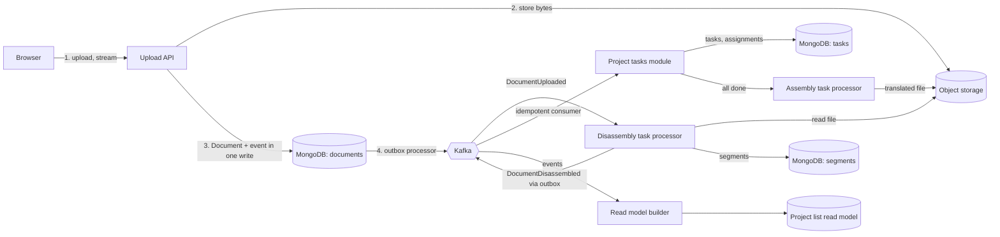

# 14. The interview playbook: run it and pass it

## Why this chapter matters

Chapters 01 to 13 give you the knowledge. This chapter is about using it under time pressure, with
a stranger watching. Many strong engineers fail interviews not because they do not know the
material, but because they answer the wrong question, stay silent while they think, or never say
the tradeoff out loud. Interviewers fail too: they ask trivia, decide in the first five minutes, and
write feedback nobody can act on. This chapter gives both sides a method.

## What you will be able to do

- Answer technical questions in a clear structure: clarify, answer, go deeper, state the tradeoff.
- Run a live-coding round in C# with a checklist that prevents the common mistakes.
- Walk through a system design in the Smartcat style: modules, events, outbox, background tasks,
  indexes, and the monolith-vs-service decision.
- Review a buggy C# snippet and rank the findings by severity.
- Answer behavioural questions with STAR.
- As an interviewer: plan a structured interview, pick questions from a bank, score with a rubric,
  control bias and write feedback that a hiring committee can use.

---

## Part 1. For the interviewee

### How to answer a technical question

Use the same five steps for almost every question.

1. **Clarify.** Repeat the question in your words. Ask about scope: "Do you mean `IAsyncDisposable`
   in general, or in ASP.NET Core request scope?" It takes ten seconds and avoids a five-minute
   answer to the wrong question.
2. **Answer first.** Give the short answer in one or two sentences. "`throw;` keeps the stack trace,
   `throw ex;` resets it."
3. **Explain the why.** One level deeper: the mechanism. "Because `throw ex` throws the object again
   from the current frame, the runtime records a new stack trace."
4. **Show it.** A tiny example or a real story. "We lost the original stack of a Mongo timeout this
   way; the log pointed to our wrapper, not to the driver."
5. **State the tradeoff or the limit.** "If I need to rethrow on another thread, I use
   `ExceptionDispatchInfo`."

Then **stop**. Let the interviewer choose where to go deeper. A long monologue hides the signal.

**Think aloud.** Silence looks like being stuck. Say what you are checking: "I am thinking about
whether this lambda captures the loop variable... yes, it is a `for` loop, so it does." The
interviewer scores your reasoning, not only the final answer.

**When you do not know.** Say it, then reason from what you know: "I have not used
`FrozenDictionary` in production. I expect it trades slow creation for fast reads, because it can
analyze the keys once. I would check the docs and benchmark it." This is a strong answer. Inventing
details is a weak one, and interviewers notice.

**Level up your answer.** The same question can get a Mid, Senior or Staff answer:

| Question: "How do you make a Kafka consumer safe?" | |
|---|---|
| Mid | "Catch exceptions and retry." |
| Senior | "Delivery is at-least-once, so the handler must be idempotent: store processed event ids with a unique index, in the same transaction as the side effect. Poison messages go to a DLQ." |
| Staff | Senior answer, plus: "ordering per key via the partition key; separate validation errors (skip) from transient ones (retry); alerts routed to the owning team; and a replay runbook. At Smartcat that is `SingleEventWithIdempotencyKeyProcessorBase` and `EventHandlerException(responsibleTeams, e)`." |

### Behavioural questions: STAR

Behavioural rounds ask about the past: "Tell me about a time you disagreed with a design." Use
**STAR**:

- **S**ituation: the context in one or two sentences.
- **T**ask: what you were responsible for.
- **A**ction: what *you* did (say "I", not "we"), with the reasoning.
- **R**esult: the outcome with a number if possible, and what you learned.

Example (a 90-second answer):

> **Situation:** Our document import sometimes left projects stuck "in progress". Customers opened
> support tickets every week.
> **Task:** I owned the import module and had to find the cause.
> **Action:** I compared stuck and healthy projects in the database and found that the progress
> event was written with `Set` instead of `PushEach`, so concurrent updates overwrote each other's
> events. I wrote a test that ran two updates in parallel and showed the lost event, fixed the
> repository, and wrote a migration that re-emitted the missing events for old projects.
> **Result:** The stuck-project tickets stopped. I also added the rule to our review checklist, and
> the reviewer bot now flags `Set` on the events field.

Prepare 6 to 8 stories that cover: a production incident, a disagreement, a mistake you made, a
mentoring case, a time you pushed back on scope, a cross-team change, a decision with incomplete
data, and a time you improved a process. One story can answer several questions.

**Common mistake:** a story where the result is "and then the team did it". The interviewer wants
*your* actions and *your* judgment.

### Live-coding checklist (C#)

Before you type:

- [ ] Restate the problem and the signature. Ask about input size, nulls, empty input, duplicates,
      ordering, and whether the input can be changed.
- [ ] Write two or three examples, including one edge case. Agree on the expected output.
- [ ] Say the simple solution and its complexity first. Then improve if needed.

While you type:

- [ ] Choose names that say the intent (`segmentsByDocument`, not `d`).
- [ ] Guard clauses first: `ArgumentNullException.ThrowIfNull(input)`; return early on empty input.
- [ ] Pick the collection on purpose and say why (`Dictionary` for lookups, `HashSet` for
      "seen", `PriorityQueue` for top-k).
- [ ] Use `async` all the way if I/O is involved; pass `CancellationToken`; no `.Result`.
- [ ] Avoid LINQ multiple enumeration; materialize once.
- [ ] Keep methods small; extract a helper when a loop body grows.

After you type:

- [ ] Walk through your examples line by line, out loud.
- [ ] Check edge cases: empty, one item, all equal, very large, null.
- [ ] State time and space complexity.
- [ ] Say how you would test it: name two or three test cases in `Should_..._when_...` form.
- [ ] Mention what you would change for production (logging, limits, concurrency).

**Worked example.** "Given translated segments, return the `k` most frequent target words, ignoring
case."

```csharp
public static IReadOnlyList<string> TopWords(IEnumerable<string> segments, int count)
{
	ArgumentNullException.ThrowIfNull(segments);
	ArgumentOutOfRangeException.ThrowIfNegative(count);
	if (count == 0)
		return Array.Empty<string>();

	var frequencies = new Dictionary<string, int>(StringComparer.OrdinalIgnoreCase);
	foreach (var segment in segments)
	{
		foreach (var word in segment.Split(' ', StringSplitOptions.RemoveEmptyEntries))
			frequencies[word] = frequencies.GetValueOrDefault(word) + 1;
	}

	var topWords = new PriorityQueue<string, int>();   // min-heap of size count
	foreach (var (word, frequency) in frequencies)
	{
		topWords.Enqueue(word, frequency);
		if (topWords.Count > count)
			topWords.Dequeue();                          // drop the least frequent
	}

	var result = new List<string>(topWords.Count);
	while (topWords.TryDequeue(out var topWord, out _))
		result.Add(topWord);

	result.Reverse();                                    // most frequent first
	return result;
}
```

What to say: "Counting is O(n) over all words. The heap keeps only `k` items, so selecting is
O(m log k) for `m` distinct words, and memory is O(m) for the dictionary. A full sort would be
O(m log m). Ties are in no defined order; if the order of ties matters, I would add the word as a
second key. Tests: empty input, `count` larger than distinct words, words that differ only in
case."

Note that `Split(' ')` is naive for real text (punctuation, other scripts). Say so. On a
translation platform, real tokenization is language-dependent. Saying this shows judgment.

---

### System design walkthrough: a file translation pipeline

**The prompt:** "Design the backend for this flow: a customer uploads a document (DOCX, XLSX, PPTX,
and so on), the system extracts translatable text, creates translation tasks for linguists, and
later builds the translated file."

This is close to how Smartcat works (upload, file disassembling, project tasks, assembling). Use
this structure. Spend about 5 minutes on step 1, 10 on step 2 and 3, 20 on deep dives, and 5 on
tradeoffs.

#### Step 1. Clarify requirements

Functional:
- Upload a file to a project; one project can have many files and many target languages.
- Extract segments (translatable units) from the file; show progress to the user.
- Create a translation task per document and target language; linguists are assigned.
- When all tasks are done, build ("assemble") the translated file for download.

Non-functional (ask, then write down your assumptions):
- File size: up to a few hundred MB. Most files are small; a few are huge.
- Multi-tenant: thousands of customer accounts (workspaces). One large customer must not slow down
  others.
- Latency: upload response in seconds; extraction can take minutes; the user sees status.
- Reliability: no lost files, no duplicated tasks, no project "stuck in progress".
- Formats change often; parsers are CPU and memory heavy and sometimes crash on bad files.

#### Step 2. High-level design



Say the flow in words: "The upload API streams the file to object storage and writes a `Document`
in state `Uploaded` together with a `DocumentUploaded` event in one Mongo write (outbox). The outbox
processor publishes the event to Kafka. A background task disassembles the file, stores segments,
and emits `DocumentDisassembled`. The project-tasks module consumes it idempotently and creates
tasks. A read-model builder keeps a denormalized project list for the UI."

#### Step 3. Modular monolith or microservices?

Do not start with "microservices". Start with the criteria and decide per component.

| Criterion | Keep in the modular monolith | Extract to a service |
|---|---|---|
| Scaling profile | same as the rest (request/response, light CPU) | very different (CPU/memory-heavy parsing) |
| Failure isolation | failures are ordinary exceptions | a crash or memory spike must not kill the web pods |
| Team ownership | shared or one team inside the monolith | one team owns it end to end |
| Release cadence | same as the monolith | needs its own fast releases (new formats) |
| Data | joins with other modules are frequent | owns its data; others need only events |
| Cost | in-process call, one transaction | network, contract versioning, eventual consistency |

A reasonable decision here:
- **Disassembly/assembly**: a separate service. Parsers are heavy, crash on bad input, and need
  their own scaling. (At Smartcat this is the File Disassembling service, `filedisassembling/`,
  with task processors such as `src/TaskModule/DisassembleDocumentTaskProcessor.cs` and
  `AssembleDocumentTaskProcessor.cs`.)
- **Project tasks**: can start as a module in the monolith with an honest boundary (own collections,
  published contract, events), and be extracted later. At Smartcat it was extracted:
  `project-tasks-service/` with its own `Contracts.Events` and `ConsumerModule`.
- **Upload API and documents**: stay in the monolith close to projects.

Say the key point: "A module with honest boundaries is cheap to extract later. A module that reads
other modules' collections is not." This is the Smartcat bounded-context rule (see chapter 06,
Architectural patterns at Smartcat).

#### Step 4. Deep dives

**Upload.** Stream the request body to object storage; do not buffer the whole file in memory (LOH
and out-of-memory risk, rule S22). Enforce a size limit at the server (Kestrel
`MaxRequestBodySize`) and check the type by content, not only by extension. Authorize: the user
must have access to the project, and the account id comes from the authenticated user, never from
the request body (rules S2 and S20). For very large files, use pre-signed upload URLs so bytes do
not pass through the API pods at all. See chapter 05 (ASP.NET Core) and chapter 13 (Secure .NET
code).

**Atomic state + event: the outbox.** The danger is a *dual write*: you save the document, then
publish to Kafka, and the process dies in between. The event is lost and the document is stuck. The
outbox pattern writes the event into the same Mongo document as the state change; a separate
processor publishes it later and marks it done.

```csharp
public sealed class Document : DomainEntity
{
	public void MarkUploaded(FileReference file)
	{
		File = file;
		State = DocumentState.Uploaded;
		AddEvents(new DocumentUploadedEvent { DocumentId = Id, AccountId = AccountId });
	}
	// ...
}

// Repository: state and events in one atomic update. PushEach, never Set.
var update = Builders<Document>.Update
	.Set(document => document.State, document.State)
	.Set(document => document.File, document.File)
	.PushEach(document => document.NewEvents, document.NewEvents);
```

At Smartcat: entities inherit `DomainEntity`, call `AddEvents`, events are stored in `mqEvents`,
and the repository must use `PushEach` (`Set` loses concurrent events). The event class carries
`[MqEvent("document-uploaded", nameof(DocumentId))]`: the second argument is the order group, which
becomes the Kafka partition key, so events of one document are processed in order. See chapter 07.

**Background processing.** Disassembly is a background task, not work done inside the HTTP request.

- One *ordinary* task per document. A worker *captures* it (an atomic state change from `Sleep` to
  `InProgress` with a capture key), processes, then calls `ToComplete` or `ToSleep` with a retry
  delay. Never change a task without capturing it.
- *Fairness*: set the fairness hash by `(accountId, documentId)`. Then a customer who uploads 5,000
  files does not block a customer who uploads one; workers round-robin across accounts.
- *Canary*: `TierKey => AccountId.ToString()` so a new parser version runs first for a small
  percentage of accounts, with the same account always in the same tier.
- *Poison files*: after the retry limit, the task goes to `Manual` state with a reason, and an
  alert fires. The rest of the queue keeps moving.

See chapter 08 (Background task processing).

**Idempotent consumers.** Kafka gives at-least-once delivery. The project-tasks consumer can see
`DocumentDisassembled` twice (rebalance, retry, replay). Without idempotency it creates duplicate
tasks.

```csharp
public sealed class DocumentDisassembledHandler
	: SingleEventWithIdempotencyKeyProcessorBase<DocumentDisassembledEvent>
{
	public DocumentDisassembledHandler(IMongoDatabase database, IProjectTaskService projectTasks)
		: base(database, "processedEvents.documentDisassembled", "document-disassembled-handler")
	{
		_projectTasks = projectTasks;
	}

	protected override Task HandleUnprocessed(
		IClientSessionHandle session,
		DocumentDisassembledEvent disassembled,
		CancellationToken cancellationToken)
	{
		return _projectTasks.CreateTasksAsync(session, disassembled.DocumentId, cancellationToken);
	}

	private readonly IProjectTaskService _projectTasks;
}
```

The base class checks `(handlerName, eventId)` in a processed-events collection and runs the
handler plus the insert of the processed record in one transaction. A second line of defence is a
unique index on the business key (for example `UDX_DocumentId_TargetLanguage` on tasks). Also: the
handler id must equal the `consumerSets` key in config, or the handler is silently not found.

**Read model.** The project list page shows name, progress, deadline and assignee counts. Joining
three modules on every request breaks the boundary rule and is slow. Instead, a consumer builds a
denormalized `ProjectListItem` collection from events. It is eventually consistent (a few seconds
behind), which is fine for a list. For the page the user just changed, read from the owning module.

**Data model and indexes.**

| Collection | Key fields | Indexes |
|---|---|---|
| `documents` | `_id`, `accountId`, `projectId`, `state`, `mqEvents` | `IDX_AccountId_ProjectId`; partial `IDX_MqEvents_Rev` on `mqEvents.rev` (outbox polling) |
| `segments` | `documentId`, `number`, `sourceText`, `targetText` | `UDX_DocumentId_Number` |
| `AsyncTasks.Disassemble` | `state`, `upTime`, `fairnessHash`, `documentId` | `IDX_State_FairnessHash_UpTime` |
| `processedEvents.*` | `eventId`, `handlerName`, `expireTime` | `UDX_EventId_HandlerName`; TTL on `expireTime` |
| `projectTasks` | `projectId`, `documentId`, `targetLanguage`, `status` | `UDX_DocumentId_TargetLanguage`; `IDX_ProjectId_Status` |

Why segments are a separate collection: a large file has hundreds of thousands of segments. An
array inside the document grows without limit and hits the 16 MB document size limit. Every unique
index includes the tenant or parent key (rule A27). New indexes are created in a "before release"
migration *and* in the repository constructor for fresh environments. See chapter 09 (MongoDB models,
indexes and safe migrations).

**Failure modes to mention.**

| Failure | Effect | Protection |
|---|---|---|
| Process dies between save and publish | lost event, stuck document | outbox |
| Event delivered twice | duplicate tasks | idempotent handler + unique index |
| Parser crashes on a bad file | task retries forever | retry limit, then `Manual` + alert |
| One customer floods the queue | others wait | fairness hash |
| New parser has a bug | all customers affected | canary by account |
| Handler throws for one document | other documents blocked? | DLQ per order group; others continue |
| Consumer lag grows | progress looks frozen | metrics on lag and task age, autoscaling |

**Observability.** Trace id from the upload request carried into the task (`activityTraceId`) and
into events. Metrics: queue depth and oldest task age per state, consumer lag, DLQ size, parse time
per format. Logs with document id and account id, without file content or personal data.

#### Step 5. Tradeoffs and next steps

Close with what you would revisit: "Eventual consistency on the project list is a product decision;
I would confirm it with the PM. If files of 1 GB are common, I would move to pre-signed uploads and
chunked parsing. If one format dominates the CPU cost, it could get its own worker pool."

**Common mistakes in this round:**
- Drawing boxes before asking about scale and tenancy.
- "We use Kafka" without saying what happens on a duplicate or a crash.
- Microservices for everything, with no reason per service.
- No indexes, or indexes that do not match the queries.
- Forgetting security: who may upload to this project?

---

### Code-review exercise

Many interviews include "review this code". You get 10 to 15 minutes. The method:

1. Read it once fully, without commenting, to understand the intent.
2. Then go through it by category: **correctness → security → concurrency/async → resource use →
   design → tests → style**.
3. Rank by severity and lead with the most important. A list of 20 style comments before the one
   security hole is a weak review.
4. For each finding: the problem, the consequence, the fix. One sentence each.

Severity scale (the same one Smartcat review rules use):

| Severity | Meaning |
|---|---|
| BLOCKER | security hole, data loss or corruption, crash; must fix before merge |
| MAJOR | real bug under load or in an edge case, or a design that is expensive to change later |
| MINOR | maintainability, small performance issue, missing test for a non-critical path |
| NIT | style, naming |

**The snippet.** An export endpoint. Assume DI registration is
`services.AddSingleton<ExportService>()` and `services.AddScoped<IDocumentRepository, DocumentRepository>()`.

```csharp
[ApiController]
[Route("api/exports")]
public sealed class ExportController : ControllerBase
{
	private readonly ExportService _exportService;

	public ExportController(ExportService exportService) => _exportService = exportService;

	[HttpPost]
	public IActionResult Start([FromBody] StartExportRequest request)
	{
		var path = _exportService.StartAsync(request.AccountId, request.DocumentIds, request.FileName).Result;
		return Ok(new { path });
	}
}

public sealed class ExportService
{
	private static readonly Dictionary<Guid, int> _progress = new();
	private readonly IDocumentRepository _documents;

	public ExportService(IDocumentRepository documents) => _documents = documents;

	public async Task<string> StartAsync(Guid accountId, List<Guid> documentIds, string fileName)
	{
		var path = Path.Combine("/data/exports", fileName);
		var texts = new List<string>();
		foreach (var documentId in documentIds)
		{
			var document = await _documents.GetByIdAsync(documentId);
			texts.Add(document.Text);
		}

		_progress[accountId] = 0;
		File.WriteAllText(path, string.Join("\n", texts));
		notifyAsync(accountId);
		return path;
	}

	public int GetProgress(Guid accountId) => _progress[accountId];

	private async void notifyAsync(Guid accountId)
	{
		try
		{
			using var client = new HttpClient();
			await client.PostAsync($"https://notifications.example/accounts/{accountId}", null);
			_progress[accountId] = 100;
		}
		catch { }
	}
}

[TestFixture]
public class ExportServiceTests
{
	[Test]
	public void ExportTest()
	{
		var repository = A.Fake<IDocumentRepository>();
		var service = new ExportService(repository);
		service.StartAsync(Guid.NewGuid(), new List<Guid> { Guid.NewGuid() }, "out.txt");
		Thread.Sleep(1000);
		var progress = (Dictionary<Guid, int>)typeof(ExportService)
			.GetField("_progress", BindingFlags.NonPublic | BindingFlags.Static)!.GetValue(null)!;
		Assert.That(progress.Count > 0);
	}
}
```

Try it yourself before you open the answer. Aim for at least 12 findings and get the top 5 in the
right order.

<details>
<summary>Findings, by severity</summary>

**BLOCKER**

1. **No authorization on a write endpoint.** No `[Authorize]` on the action or the controller
   (rule S20). Anyone can start exports.
2. **Tenant id from the request body, no ownership check.** `request.AccountId` and
   `request.DocumentIds` come from the client. A user can export another customer's documents
   (rules S2, S14). Take the account from the authenticated user; load documents filtered by
   account; reject ids that do not belong to it.
3. **Path traversal.** `Path.Combine("/data/exports", fileName)` with `fileName = "../../etc/x"`
   or an absolute path (`Path.Combine` then ignores the first part) writes anywhere (rule S9).
   Generate the file name on the server; never use client input in a path.
4. **Captive dependency.** A singleton `ExportService` holds a scoped `IDocumentRepository`
   (rule A1). The repository (and its connection or unit of work) lives forever and is shared by
   all requests and threads. In Development, ASP.NET Core scope validation throws when it builds or resolves the service; in
   Production the check is off and it silently runs. Make the service scoped, or inject `IServiceScopeFactory` in a
   true background component.

**MAJOR**

5. **Sync over async: `.Result` in the controller.** Blocks a thread-pool thread for the whole
   export; under load this causes thread-pool starvation. Make the action `async Task<IActionResult>`
   and `await`. (Chapter 03, Async and await.)
6. **`async void`.** An exception that escapes it crashes the process (there is no `Task` to observe
   it). Callers cannot await it, so the work is "fire and forget" and is lost on pod restart. Use a
   background task or an outbox event for the notification (chapters 07 and 08).
7. **Static `Dictionary` mutated from many threads.** `Dictionary` is not thread-safe; concurrent
   writes can corrupt it (including infinite loops in old runtimes). Also, it is per pod: with three
   pods, `GetProgress` returns a different answer on each pod. Store progress in the database (an
   export task document).
8. **`catch { }` swallows everything.** The notification fails silently; progress never reaches 100
   and nobody knows. Log, and let a retrying background mechanism handle it.
9. **`new HttpClient()` per call.** Socket exhaustion under load (`TIME_WAIT`), no DNS refresh
   policy, no timeouts or resilience. Use `IHttpClientFactory` with a typed client.
10. **N+1 reads.** One awaited database call per document id (rule A20). Load all with one
    `FindByIdsAsync(ids)` query filtered by account.
11. **Unbounded work and memory in the request.** No limit on `DocumentIds`; all texts are held in
    memory and joined into one big string (LOH), then written with synchronous `File.WriteAllText`.
    A request with 10,000 ids is a denial of service. Limit the input, stream the output, and move
    the export to a background task; return `202 Accepted` with an export id.
12. **`GetProgress` throws `KeyNotFoundException`** for an unknown account. Use `TryGetValue` and
    return 404 from the API.
13. **Null document.** `GetByIdAsync` can return null for a missing id; `document.Text` then throws
    `NullReferenceException`. With NRT enabled, the signature should say `Document?` and the code
    must handle it.

**MINOR**

14. **No `CancellationToken`.** The export keeps running after the client disconnects. Accept and
    pass a token.
15. **Returns an internal server path** to the client: information disclosure, and useless to the
    client. Return an export id and a download endpoint.
16. **Anonymous object in `Ok(new { path })`**: no typed response contract, so no generated client
    type. Use a response DTO.
17. **Magic values**: the `/data/exports` root and the notification URL belong in typed options
    (`IOptions<ExportOptions>`, rule D5).

**Tests**

18. **The test does not await** `StartAsync` and uses `Thread.Sleep(1000)`: slow and flaky. Make it
    `async Task` and `await`.
19. **Reflection into a private static field** pins the implementation: a rename breaks the test at
    run time, not at compile time. Assert observable behaviour through the public API
    (`GetProgress`), or extract the progress store into an injected dependency.
20. **Static state leaks between tests**: `_progress` is shared by every test in the process.
21. **Weak assertion**: `Assert.That(progress.Count > 0)` gives a useless failure message. Use the
    constraint model, for example `Assert.That(progress, Has.Count.EqualTo(1))`.
22. **Naming and structure**: `ExportTest` says nothing; use `Should_..._when_...` and Arrange / Act
    / Assert blocks. The fake returns a default `Document` (FakeItEasy creates a dummy), so the test
    does not control its data; configure the fake with `A.CallTo(...).Returns(...)`.
23. **Real file system and real HTTP** in a unit test. Put both behind seams (an `IExportStorage`,
    a typed client) and fake them.

**What a strong candidate says first:** "Three security issues and one DI bug must block this:
missing auth, tenant id from the body, path traversal, and a singleton holding a scoped repository.
Then the async problems: `.Result`, `async void`, and in-memory progress that is wrong with more
than one pod. The real fix is a design change: make export a background task with its state in the
database."

</details>

---

## Part 2. For the interviewer

### A structured interview plan

A *structured* interview means every candidate for the same role gets the same core questions, in
the same order, scored against the same rubric. It is the most reliable way to compare candidates
and to reduce bias. Leave room for follow-ups, but do not change the core.

**Typical loop for a Senior / Staff .NET backend role:**

| Round | Length | Goal | Chapters |
|---|---|---|---|
| Screening | 30–45 min | fundamentals, communication, motivation | 01, 03, 05 |
| Live coding | 60 min | correct, tested, readable C# | 01, 03, 10 |
| Technical deep dive | 60 min | depth in async, concurrency, data, testing | 03, 04, 07, 08, 09, 10 |
| System design | 60 min | architecture, tradeoffs, reliability | 06, 07, 08, 09 |
| Code review | 45 min | judgment, severity, security | 12, 13, 10 |
| Behavioural | 45 min | ownership, collaboration, influence | this chapter |

**One 60-minute technical round:**

| Minutes | What happens |
|---|---|
| 0–5 | Introductions. Explain the format: "I will ask a few questions; I may interrupt to go deeper; it is fine to think aloud." |
| 5–15 | Warm-up question from the candidate's own experience: "Tell me about a system you know well." |
| 15–45 | Two or three core questions from the bank, each with depth probes. |
| 45–55 | One scenario: a bug, an incident, or a design change. |
| 55–60 | Candidate's questions. |
| right after | Write notes and scores **before** you talk to other interviewers. |

**Tip:** announce the time plan. Candidates who know they have 30 minutes for a design pace
themselves better, and you get more signal.

### Question bank by chapter

Each question has a target answer in the chapter it references. Pick 2–3 per round. Use the
probes to find the candidate's real depth.

**Chapter 01 — C# and the .NET runtime**
- "Where does a struct field of a class live? A local used after `await`?" *Probe:* boxing; escape
  analysis.
- "Write `Equals` and `GetHashCode` for a case-insensitive key." *Probe:* what if the key changes
  while in a `HashSet`?
- "This repository returns `IEnumerable<T>`; the caller adds `.Where`. What runs where?"
- "When does a class need a finalizer?" *Probe:* `SafeHandle`; GC cost.

**Chapter 02 — Code style and naming**
- "How do you keep naming consistent across 40 modules and 11 teams?" *Probe:* analyzers vs review;
  `.editorconfig`; when the rule is wrong.
- "Why do Smartcat Mongo models use `required` + `init` but DTOs use public setters?"

**Chapter 03 — Async and await**
- "What does `.Result` do in an ASP.NET Core controller under load?" *Probe:* thread-pool
  starvation; why no deadlock in ASP.NET Core but deadlock in old ASP.NET.
- "When is `ValueTask` better than `Task`, and what is the rule for consuming it?"
- "How do you run 100 independent HTTP calls with at most 10 at a time?" *Probe:* `Parallel.ForEachAsync`,
  `SemaphoreSlim`, cancellation.

**Chapter 04 — Multithreading and distributed locks**
- "Two pods process the same document at the same time. How do you prevent it?" *Probe:* atomic
  capture in Mongo vs distributed lock; lock renewal and loss.
- "Is `ConcurrentDictionary.GetOrAdd` with a factory guaranteed to call the factory once?"
- "What does `AsyncLocal<T>` flow, and what is the trap with mutable values in it?"

**Chapter 05 — ASP.NET Core**
- "Explain DI lifetimes and the captive dependency problem." *Probe:* how to detect it at startup.
- "In which order do authentication, authorization and routing middleware run, and why does it
  matter?"
- "How do you bind and validate configuration?" *Probe:* `IOptions` vs `IOptionsSnapshot` vs
  `IOptionsMonitor`; `ValidateOnStart`.

**Chapter 06 — Architecture at Smartcat**
- "When would you extract a module from the monolith into a service?" *Probe:* what makes
  extraction cheap; what it costs.
- "Module A needs data owned by module B on its read path. What are the options?" *Probe:* contract
  call vs consuming events into a local read model.

**Chapter 07 — Events, outbox, Kafka**
- "Why not save to Mongo and then publish to Kafka?" *Probe:* the dual-write window; ordering.
- "How do you make a handler idempotent?" *Probe:* transaction scope; TTL of processed records;
  unique business key.
- "Why `PushEach` and not `Set` for the events field?"

**Chapter 08 — Background tasks**
- "What does *capture* mean for a task, and why can you not change a task without it?"
- "One customer uploads 10,000 files. How do you keep other customers fast?" *Probe:* fairness
  hash.
- "How do you roll out a risky processor change?" *Probe:* canary by `TierKey`.

**Chapter 09 — MongoDB and migrations**
- "How do you add a unique index to a big production collection safely?" *Probe:* before/after
  release; duplicates; index in two places.
- "Why can a `$group` with `$push` fail in production and never in tests?" *Probe:* 16 MB limit;
  `AllowDiskUse` is not the fix.
- "How do you rename a field without downtime?"

**Chapter 10 — Testing**
- "What makes a unit test valuable, and what makes it a maintenance cost?" *Probe:* testing
  behaviour vs implementation; mocks of the code under test.
- "How do you test code that uses `DateTime.UtcNow`?" *Probe:* `TimeProvider`.
- "How do you test that a handler is idempotent?"

**Chapter 11 — Diff coverage**
- "Why measure coverage of the diff instead of total coverage?" *Probe:* what coverage does not
  tell you; mutation testing.
- "Diff coverage is 40%. The author says the lines are trivial. What do you do?"

**Chapter 12 — Code review**
- "Show me how you would review this snippet." (use the exercise above) *Probe:* order of findings.
- "A senior colleague keeps approving MRs without comments. What do you do?"
- "How do you write a review comment for a non-native English speaker?"

**Chapter 13 — Security**
- "How do you prevent one tenant from reading another tenant's data?" *Probe:* where the check
  lives; tests for it.
- "What is wrong with taking `userId` from the request body?"
- "How do you store and rotate secrets for a service?"

### Depth probes that work for any topic

- "What happens if this runs on three pods at the same time?"
- "What happens if the process dies right here?"
- "How would you know in production that this is broken?"
- "What would you test first?"
- "What is the simplest version that would work? What does the complex version buy you?"
- "Have you seen this fail in real life? What happened?"
- "If you had to explain this to a new team member, what would you draw?"

A Senior candidate answers these for the code in front of them. A Staff candidate often answers
them *before* you ask, and extends them to teams and processes ("we added this to the review
checklist", "we made the platform enforce it").

### Scoring rubric

Score each dimension 1–4 with written evidence. Do not average away a red flag: one BLOCKER-level
gap (for example, no idea about tenant isolation for a role that owns APIs) can decide the result.

| Dimension | Junior (1) | Mid (2) | Senior (3) | Staff (4) |
|---|---|---|---|---|
| C# and runtime | uses the language | knows the common traps | explains the mechanism and the edge cases | sets team rules and tooling to prevent the traps |
| Async and concurrency | uses `async`/`await` | avoids `.Result`, passes tokens | reasons about thread pool, races, idempotency | designs for multi-pod correctness by default |
| Design and architecture | builds what is specified | splits into classes and layers | chooses boundaries, events, tasks with tradeoffs | decides monolith vs service with criteria; plans migration paths |
| Data and storage | CRUD | uses indexes | models for queries, safe migrations, 16 MB, tenancy | defines data ownership across teams; capacity planning |
| Testing | writes tests when asked | unit tests with mocks | tests behaviour, edge cases, idempotency, races | test strategy for a system; makes the right thing easy |
| Code review and quality | fixes what reviewers say | finds bugs in others' code | ranks findings, explains why, teaches | raises the bar for a team; turns repeat findings into rules |
| Security | knows the words | validates input | tenant isolation, authz on every write, secrets | threat models features; designs secure defaults |
| Communication | answers when asked | clear answers | clarifies, structures, states tradeoffs | adapts to the audience; aligns people with different views |
| Ownership and impact | own tasks | own features | own a component in production, incidents included | own outcomes across teams; finds problems nobody assigned |

**How to tell Senior from Staff in practice:**
- *Scope of the example.* Senior: "I fixed the handler." Staff: "I fixed the handler, found the same
  pattern in six other handlers, and made the base class prevent it."
- *Tradeoffs.* Senior names them. Staff names them, picks one, and says what signal would make
  them change the decision.
- *Ambiguity.* Senior asks good clarifying questions. Staff also says which unknowns matter most and
  proposes how to reduce them cheaply.
- *People.* Staff stories include influence without authority: other teams, product managers,
  disagreement resolved with data.

### Calibration and bias

**Calibration** means interviewers give the same score for the same performance. Practices:

- Use the same core questions for a role, and a shared rubric with written anchors (like the table
  above).
- Shadow and reverse-shadow: a new interviewer first observes, then leads while an experienced one
  observes. Compare scores afterwards.
- Hold debriefs where each interviewer reads their evidence *before* hearing others' opinions.
- Review past decisions: did the people we hired at "Senior" perform at Senior level?

**Common biases and what to do about them:**

| Bias | What it looks like | Countermeasure |
|---|---|---|
| First impression (halo / horns) | a strong or weak first answer colors the whole interview | score each question separately, right after it |
| Similarity | "they think like me", same school, same previous company | score evidence against the rubric, not "fit" |
| Confidence bias | a confident wrong answer beats a careful right one | check facts; reward "I am not sure, here is how I would find out" |
| Language and accent | weaker English read as weaker engineering | ask for clarification; judge the content; avoid idioms in your own questions |
| Anchoring in debrief | the first person who speaks sets the result | written feedback submitted before the debrief |
| Trivia bias | rewarding memorized API names | ask about mechanisms and tradeoffs, allow docs lookup in coding |
| Contrast effect | a candidate looks weak after a very strong one | compare to the rubric, not to the previous candidate |

For a team where many people work in their second language: speak in short sentences, avoid idioms,
and rephrase a question if the candidate looks unsure. A misunderstood question is noise, not signal.

### How to write feedback

Good feedback is **evidence, then interpretation, then a decision**, and somebody who was not in
the room can follow it.

Template:

```text
Role / level: Senior Backend (.NET)
Round: System design (file translation pipeline)
Recommendation: Hire at Senior / Strong hire / No hire / Not enough signal

Summary (2-3 sentences):
Clear structure, asked about tenancy and file sizes first. Strong on outbox and idempotency.
Weak on data modeling: put all segments in one array until prompted.

Evidence by dimension:
- Design (3): split disassembly into its own service and gave two reasons (CPU profile, crash
  isolation). Kept project tasks in the monolith with a clear boundary.
- Data (2): no indexes until asked; after the 16 MB hint, moved segments to their own collection
  with a unique (documentId, number) index.
- Reliability (3): explained the dual-write problem without a prompt; idempotent consumer with a
  processed-events collection in one transaction.
- Communication (3): thought aloud, checked assumptions, managed time.

Concerns / open questions:
- Did not mention authorization of the upload. Worth checking in the security round.
```

Rules:
- Write **what the candidate said or did**, not adjectives. "Explained the dual-write problem
  without a prompt" is evidence; "smart" is not.
- Separate what you observed from what you guess.
- Write it within the same day, before the debrief.
- Never mention protected characteristics (age, family, origin, accent) or guesses about them.
- If you did not get signal on a dimension, say "no signal". Do not guess.

**Interviewer view:** the worst feedback is "good culture fit, solid engineer, hire". It cannot be
checked, compared, or defended.

---

## At Smartcat

- **System design maps to real services.** Upload and documents live in the monolith (`smartcat/`),
  file parsing is the File Disassembling service (`filedisassembling/`, task processors in
  `src/TaskModule/`), project tasks are `project-tasks-service/` with published events in
  `src/Contracts.Events/`. A design answer that uses these patterns (outbox, idempotent consumers,
  ordinary tasks with fairness, additive contracts) is speaking the team's language.
- **Bounded contexts are mandatory.** `smartcat/.claude/rules/bounded-contexts.md`: one module per
  change, a module owns its model, cross-module communication only through contracts or events,
  no dependency cycles. A candidate who proposes "just read their collection" in the design round
  shows a red flag for this codebase.
- **Review severity matches the tools.** The review rules in the AI Toolkit
  (`review-architecture`, `review-security`, `review-dotnet-style`, `review-tests-backend`) use
  BLOCKER / MAJOR / MINOR / NIT. The code-review exercise above uses the same scale and real rule
  ids (A1, A20, S2, S9, S14, S20, D5), so the interview trains the same judgment the team uses in
  merge requests.
- **The team works across a language gap.** Many engineers are Russian-native and write in
  English. Interviewers should use plain, idiom-free English, and candidates should be scored on
  engineering content, not on fluency.

---

## Interview corner

### As the interviewee

**1. "Tell me about a system you know well."**
A strong answer covers:
- A one-minute overview: what it does, for whom, the main components.
- One hard problem in it and how it was solved; your own part in it.
- What you would change now, and why.

**2. "Design a file translation pipeline."**
A strong answer covers:
- Clarifying questions on size, tenancy, latency and reliability before drawing.
- Outbox for state + event, idempotent consumers, background tasks with fairness.
- A reasoned monolith-vs-service decision per component; indexes that match the queries.

**3. "How do you make sure an event is not lost?"**
A strong answer covers:
- The dual-write problem; outbox in the same atomic write as the state change.
- At-least-once delivery, so idempotent handlers.
- Monitoring: outbox backlog, consumer lag, DLQ.

**4. "Review this code." (any snippet)**
A strong answer covers:
- Reads first, then goes by category, then ranks by severity.
- Security and data-loss issues first, style last.
- Proposes the design fix, not only line fixes.

**5. "Tell me about a mistake you made."**
A strong answer covers:
- A real mistake with real impact, told with STAR.
- What you did to fix it and to prevent it next time (process, test, rule).
- No blaming others.

**6. "Tell me about a disagreement with a colleague."**
A strong answer covers:
- The disagreement was about the work, not the person.
- You used data or an experiment to decide.
- The relationship stayed good; you can say what you learned from the other side.

**7. "What would you do in your first 90 days here?"**
A strong answer covers:
- Learn the system and the people first: on-call, incidents, code reviews.
- Deliver a few small changes early to learn the release path.
- Find one problem that matters to the team and own it.

**8. "How do you decide between two designs?"**
A strong answer covers:
- Make the criteria explicit (cost of change, risk, team skills, time).
- Prefer the design that is easier to reverse when the data is unclear.
- Write the decision down (an ADR: architecture decision record) with what would change it.

**9. "You have 30 minutes left and the code does not work. What do you do?"**
A strong answer covers:
- Say it out loud; reduce scope to a working simpler version.
- Debug with a small example rather than random changes.
- Explain what is left and how you would finish.

**10. "Do you have questions for us?"**
A strong answer covers:
- Questions about how the team works: on-call, review process, how decisions are made.
- Questions about the problems the role will own.
- Not only questions about benefits.

### As the interviewer

**What to ask.** Use the question bank above. In each round, choose one question where the
candidate is strong (to find their ceiling) and one where they are weaker (to find the floor).

**Depth probes:** the generic set ("three pods", "process dies here", "how do you know it is broken
in production") works for every chapter.

**Green flags:**
- Asks clarifying questions before designing or coding.
- States assumptions and tradeoffs without being asked.
- Changes their mind when given new information, and says why.
- Uses "I" for their own actions in stories and gives credit to others.
- Knows the limits of their knowledge.

**Red flags:**
- Answers a different question than the one asked, twice.
- Cannot name a single tradeoff of their own design.
- Blames others in every story.
- Dismisses testing or security as "someone else's job".
- Pretends to know: invents API names or numbers.

**Scoring rubric (short form):**

| Level | Typical signal across rounds |
|---|---|
| Junior | needs guidance; correct on basics; little production experience |
| Mid | independent on features; knows common traps; limited design depth |
| Senior | owns components; explains mechanisms; ranks risks; mentors |
| Staff | owns outcomes across teams; designs for failure by default; changes how the team works |

---

## Exercises

1. **STAR practice.** Write two STAR stories (incident, disagreement) in under 200 words each.
   Read them aloud with a timer: each must fit in two minutes.
2. **Live coding.** Implement `IReadOnlyList<IReadOnlyList<string>> Batch(IEnumerable<string> items,
   int size)` that splits items into batches of at most `size`. Follow the checklist, including
   tests.
3. **Design.** Extend the translation pipeline: a customer re-uploads a new version of a file
   while translation is in progress. What changes?
4. **Code review.** Without opening the answer, list the top 5 findings of the code-review
   snippet in order of severity. Then compare.
5. **Interviewer practice.** Write a 60-minute interview plan for a Senior candidate with three
   questions from the bank, two probes each, and the rubric dimensions each question measures.
6. **Feedback.** Rewrite this feedback so it is useful: "Nice person, a bit slow, knows Kafka,
   probably fine for Senior."

<details>
<summary>Answer notes</summary>

1. Check: is the action yours ("I")? Is there a measurable result? Is there a lesson? Cut context
   to two sentences.
2. Guard clauses (`ThrowIfNull`, `size > 0`); one pass with a current `List<string>` of capacity
   `size`; add the last partial batch if not empty; return `IReadOnlyList`. Complexity O(n). Tests:
   empty input, exact multiple of `size`, remainder, `size = 1`, invalid `size`. Mention that .NET 6+
   has `Enumerable.Chunk`, and say whether you are allowed to use it.
3. Points to cover: a document version, so old segments and tasks are not overwritten in place;
   reuse existing translations by matching segments (translation memory); cancel or update tasks
   for the old version through an event (`DocumentVersionUploaded`), handled idempotently; the
   disassembly task for the new version uses the same fairness key; the UI shows which version is
   in work. Ask the product question: what happens to work already done on the old version?
4. Expected top 5: missing `[Authorize]`; tenant id from body / no ownership check; path traversal;
   singleton holding a scoped repository; `.Result` / `async void` / per-pod static progress (any of
   these as number 5 is acceptable if explained).
5. Check that each question maps to at least one rubric dimension, the timing adds up to 60
   minutes, and there are 5 minutes for the candidate's questions.
6. Example: "Recommendation: Hire at Mid; not enough signal for Senior. Evidence: explained
   consumer groups and partition ordering correctly; did not mention idempotency until asked about
   duplicates, then gave a correct design with a processed-events collection. Took 25 minutes for a
   15-minute coding task; the final code was correct and tested. Open question: design depth, to
   check in the system design round." Remove "nice person" (not evidence) and "a bit slow" (vague;
   replace with the observed timing).

</details>

---

## Summary

- Answer in five steps: clarify, answer first, explain the why, show an example, state the
  tradeoff. Then stop.
- Think aloud. Say "I do not know" and reason from what you know; never invent.
- Use STAR for behavioural answers, with "I" and a measurable result. Prepare 6–8 stories.
- In live coding: examples first, simple solution first, then walk through, complexity, tests.
- In system design: requirements, high-level flow, per-component monolith-vs-service decision,
  then outbox, idempotent consumers, background tasks with fairness, and indexes.
- In code review: security and data loss first, style last; propose the design fix.
- As an interviewer: same core questions, written rubric, notes before the debrief.
- Score evidence, not impressions; watch for halo, similarity, confidence and language bias.
- Good feedback is evidence, then interpretation, then a decision.

Anki deck: anki/14-interview-playbook.txt
